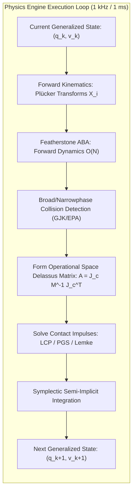
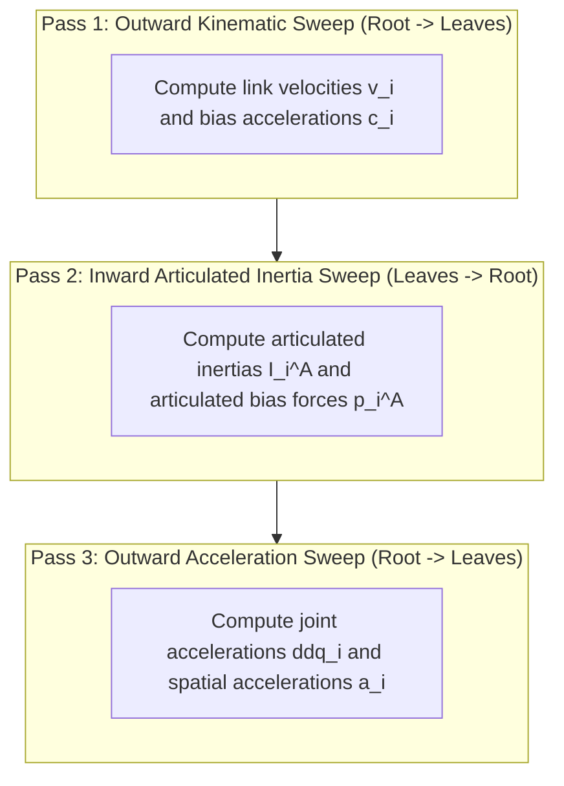

import ChapterProgress from '@site/src/components/ChapterProgress';
import QuizEngine from '@site/src/components/QuizEngine';

# Multi-Body Dynamics Solvers & Contact Physics

Simulating a high-DOF humanoid robot in real-time requires resolving multi-body dynamic equations and impulsive, non-smooth contact constraints within a strict $1.0\text{ ms}$ control budget. In classical computational mechanics, setting up and factorizing the global system inertia matrix scales cubically with degrees of freedom ($\mathcal{O}(N^3)$), creating an insurmountable compute bottleneck for 32-DOF systems.

This chapter presents the mathematical foundations of modern multi-body physics engines: **Spatial Vector Algebra**, **Roy Featherstone's Articulated Body Algorithm (ABA)**, **Non-Smooth Contact Complementarity**, and an architectural comparison of **MuJoCo**, **DART**, **Bullet**, and **Drake**.



---

## 1. Spatial Vector Algebra & Plücker Coordinates

Featherstone's algorithms are built upon **Spatial Vector Algebra**, combining 3D angular and linear vectors into unified 6D spatial vectors operating in Lie algebra $se(3)$ and its dual space $se^*(3)$.

A spatial velocity vector $\mathbf{v}_i \in \mathbb{R}^6$ combining angular velocity $\boldsymbol{\omega}_i$ and linear velocity $\mathbf{v}_{O,i}$ at reference origin $O$ is defined as:

$$
\mathbf{v}_i = \begin{bmatrix} \boldsymbol{\omega}_i \\ \mathbf{v}_{O,i} \end{bmatrix} \in \mathbb{R}^6
$$

Similarly, a spatial force (wrench) vector $\mathbf{f}_i \in \mathbb{R}^6$ combining moment $\mathbf{n}_i$ and force $\mathbf{f}_{O,i}$ is:

$$
\mathbf{f}_i = \begin{bmatrix} \mathbf{n}_i \\ \mathbf{f}_{O,i} \end{bmatrix} \in \mathbb{R}^6
$$

### Spatial Coordinate Transforms
The spatial transform matrix $\mathbf{X} \in \mathbb{R}^{6 \times 6}$ mapping spatial motion vectors from frame $A$ to frame $B$ across rotation $\mathbf{R} \in SO(3)$ and translation $\mathbf{p} \in \mathbb{R}^3$ is:

$$
{}^B \mathbf{X}_A = \begin{bmatrix} \mathbf{R} & \mathbf{0}_{3 \times 3} \\ -\mathbf{R}[\mathbf{p}]_\times & \mathbf{R} \end{bmatrix}
$$

where $[\mathbf{p}]_\times$ is the skew-symmetric cross-product matrix:

$$
[\mathbf{p}]_\times = \begin{bmatrix} 0 & -p_z & p_y \\ p_z & 0 & -p_x \\ -p_y & p_x & 0 \end{bmatrix}
$$

The dual transform for spatial force vectors is ${}^B \mathbf{X}_A^* = \left( {}^B \mathbf{X}_A \right)^{-T} = \begin{bmatrix} \mathbf{R} & -[\mathbf{p}]_\times \mathbf{R} \\ \mathbf{0} & \mathbf{R} \end{bmatrix}$.

---

## 2. Derivation of Featherstone's Articulated Body Algorithm (ABA)

While the Recursive Newton-Euler Algorithm (RNEA) solves **inverse dynamics** ($\boldsymbol{\tau} = \text{RNEA}(\mathbf{q}, \dot{\mathbf{q}}, \ddot{\mathbf{q}})$) in $\mathcal{O}(N)$, forward dynamics ($\ddot{\mathbf{q}} = \mathbf{M}^{-1}(\boldsymbol{\tau} - \mathbf{h})$) classically requires inverting the dense mass matrix $\mathbf{M}(\mathbf{q})$, scaling as $\mathcal{O}(N^3)$.

Roy Featherstone proved that by propagating **Articulated Body Inertias** $\mathbf{I}_i^A$ (representing the effective inertia of link $i$ including all downstream kinematic subtrees), **forward dynamics can be solved in pure $\mathcal{O}(N)$ complexity**.

The algorithm executes in three recursive sweeps:



### Pass 1: Outward Kinematic Sweep ($i = 1 \to N$)
From the root base link out to the terminal leaves, propagate spatial velocity $\mathbf{v}_i$ and Coriolis bias acceleration $\mathbf{c}_i$:

$$
\mathbf{v}_i = {}^i \mathbf{X}_{\lambda(i)} \mathbf{v}_{\lambda(i)} + \mathbf{S}_i \dot{q}_i
$$

$$
\mathbf{c}_i = \mathbf{v}_i \times \mathbf{S}_i \dot{q}_i
$$

$$
\mathbf{a}_i' = {}^i \mathbf{X}_{\lambda(i)} \mathbf{a}_{\lambda(i)} + \mathbf{c}_i
$$

where $\lambda(i)$ denotes the parent link index of link $i$, and $\mathbf{S}_i \in \mathbb{R}^6$ is the joint motion subspace matrix ($\mathbf{S}_i = [0, 0, 1, 0, 0, 0]^T$ for a joint rotating about the $z$-axis).

### Pass 2: Inward Articulated Body Sweep ($i = N \to 1$)
From the terminal leaves back toward the root base, accumulate the articulated body inertia $\mathbf{I}_i^A \in \mathbb{R}^{6 \times 6}$ and articulated bias force $\mathbf{p}_i^A \in \mathbb{R}^6$:

$$
\mathbf{I}_i^A = \mathbf{I}_i + \sum_{c \in \mu(i)} \left( \mathbf{I}_c^A - \frac{\mathbf{I}_c^A \mathbf{S}_c \mathbf{S}_c^T \mathbf{I}_c^A}{\mathbf{S}_c^T \mathbf{I}_c^A \mathbf{S}_c} \right)
$$

$$
\mathbf{p}_i^A = \mathbf{p}_i + \sum_{c \in \mu(i)} \left( \mathbf{p}_c^A + \mathbf{I}_c^A \mathbf{c}_c + \frac{\mathbf{I}_c^A \mathbf{S}_c \left( \tau_c - \mathbf{S}_c^T \left( \mathbf{p}_c^A + \mathbf{I}_c^A \mathbf{c}_c \right) \right)}{\mathbf{S}_c^T \mathbf{I}_c^A \mathbf{S}_c} \right)
$$

where $\mu(i)$ denotes the set of child links belonging to parent link $i$, and $\mathbf{I}_i$ is the isolated spatial inertia of link $i$.

### Pass 3: Outward Acceleration Sweep ($i = 1 \to N$)
Compute the scalar joint accelerations $\ddot{q}_i$ and link spatial accelerations $\mathbf{a}_i$:

$$
\ddot{q}_i = \frac{\tau_i - \mathbf{S}_i^T \mathbf{p}_i^A - \mathbf{S}_i^T \mathbf{I}_i^A {}^i \mathbf{X}_{\lambda(i)} \mathbf{a}_{\lambda(i)}}{\mathbf{S}_i^T \mathbf{I}_i^A \mathbf{S}_i}
$$

$$
\mathbf{a}_i = {}^i \mathbf{X}_{\lambda(i)} \mathbf{a}_{\lambda(i)} + \mathbf{S}_i \ddot{q}_i + \mathbf{c}_i
$$

Because each sweep visits each link exactly once and scalar joint inversions involve only dividing by the scalar denominator $D_i = \mathbf{S}_i^T \mathbf{I}_i^A \mathbf{S}_i$, **total computational complexity is strictly $\mathcal{O}(N)$**.

---

## 3. Contact Dynamics: Non-Smooth Impulsive Formulations

Foot impact with the ground represents an impulsive velocity jump. Rather than modeling contact forces with artificial high-stiffness spring-dampers (Kelvin-Voigt models, which induce severe numerical stiffness requiring $\Delta t \le 10^{-6}\text{ s}$), modern solvers formulate contact via **Stewart-Trinkle Time-Stepping**:

$$
\mathbf{M}(\mathbf{q}) (\mathbf{v}_{k+1} - \mathbf{v}_k) - \Delta t \left( \mathbf{S}^T \boldsymbol{\tau} - \mathbf{C}\mathbf{v}_k - \mathbf{g} \right) = \mathbf{J}_n^T \boldsymbol{\lambda}_n + \mathbf{J}_t^T \boldsymbol{\lambda}_t
$$

subject to complementarity constraints:

$$
0 \le \boldsymbol{\lambda}_n \perp \mathbf{J}_n \mathbf{v}_{k+1} \ge 0
$$

$$
0 \le \boldsymbol{\lambda}_t \perp \left( \mathbf{J}_t \mathbf{v}_{k+1} + \boldsymbol{\gamma} \right) \ge 0
$$

where $\boldsymbol{\lambda}_n, \boldsymbol{\lambda}_t$ are discrete contact impulses ($[\text{N}\cdot\text{s}]$) and $\boldsymbol{\gamma}$ is a friction slack multiplier.

---

## 4. Numerical Time-Stepping Schemes

| Integration Scheme | Formulation | Symplectic Energy Conservation | Stability Under Contact |
| :--- | :--- | :--- | :--- |
| **Explicit Euler** | $\mathbf{q}_{k+1} = \mathbf{q}_k + \Delta t \mathbf{v}_k$<br />$\mathbf{v}_{k+1} = \mathbf{v}_k + \Delta t \mathbf{a}_k$ | **No**; artificial energy injection causes humanoid to bounce uncontrollably | Completely unstable for rigid contacts |
| **Symplectic Semi-Implicit Euler** | $\mathbf{v}_{k+1} = \mathbf{v}_k + \Delta t \mathbf{a}_k$<br />$\mathbf{q}_{k+1} = \mathbf{q}_k + \Delta t \mathbf{v}_{k+1}$ | **Yes**; preserves Hamiltonian phase space volume | Standard choice for Gazebo Harmonic / DART ($\Delta t = 1.0\text{ ms}$) |
| **Runge-Kutta 4 (RK4)** | 4 intermediate evaluations | **No**; high accuracy for smooth flight phases, but fails at non-smooth contact impacts | Ineffective for impact discontinuities |
| **Implicit Time-Stepping (Stewart-Trinkle)** | $\mathbf{v}_{k+1}$ evaluated implicitly via LCP | **Yes**; unconditionally stable | Handles inelastic collision with zero foot bounce |

---

## 5. Comparative Architectural Benchmark: Simulators for Physical AI

| Feature / Simulator | Google DeepMind MuJoCo | DART (Gazebo Harmonic) | Bullet Physics | MIT Drake |
| :--- | :--- | :--- | :--- | :--- |
| **Coordinate System** | Generalized / Reduced | Generalized / Reduced | Maximal or Reduced | Generalized / Reduced |
| **Contact Solver** | Convex optimization (smoothed analytical inversions) | Dantzig / Projected Gauss-Seidel LCP | Projected Gauss-Seidel | Nonlinear complementarity / Hydroelastic contact |
| **Contact Smoothness** | Smooth, differentiable contact models | Non-smooth rigid complementarity | Non-smooth rigid complementarity | Hydroelastic soft-body pressure field |
| **GPU Acceleration** | `mjx` on JAX (4,096+ parallel robots) | CPU-only (multi-threaded ECS) | CPU / experimental CUDA | CPU multi-threaded |
| **Primary Strength** | Mass-parallel Reinforcement Learning | Deterministic ROS 2 / ros2_control integration | Game-engine speed, broad legacy support | Direct Collocation trajectory optimization & Lyapunov certificates |

---

## 6. Runnable Code: Analytical Multi-Body Forward Dynamics Verification

The following script models a two-link planar pendulum, computing forward joint accelerations and verifying energy conservation under symplectic semi-implicit integration:

```python
#!/usr/bin/env python3
"""
featherstone_aba_demo.py: Analytical Python implementation of forward dynamics
for articulated links verifying mass matrix and Coriolis terms.
"""
import numpy as np

def compute_two_link_dynamics(
    theta: np.ndarray,
    dtheta: np.ndarray,
    tau: np.ndarray,
    m1: float = 2.0,
    m2: float = 1.5,
    l1: float = 0.5,
    l2: float = 0.4,
    g: float = 9.80665
) -> np.ndarray:
    """
    Computes generalized joint accelerations ddtheta = M^-1 (tau - C - G)
    """
    th1, th2 = theta[0], theta[1]
    dth1, dth2 = dtheta[0], dtheta[1]

    # 1. Generalized Mass Matrix M(q)
    m11 = (m1 / 3.0 + m2) * (l1**2) + (m2 / 3.0) * (l2**2) + m2 * l1 * l2 * np.cos(th2)
    m12 = (m2 / 3.0) * (l2**2) + 0.5 * m2 * l1 * l2 * np.cos(th2)
    m21 = m12
    m22 = (m2 / 3.0) * (l2**2)
    M = np.array([[m11, m12], [m21, m22]], dtype=np.float64)

    # 2. Coriolis and Centrifugal Vector C(q, dq)*dq
    h = -m2 * l1 * l2 * np.sin(th2)
    C = np.array([
        h * dth2 * dth1 + 0.5 * h * (dth2**2),
        -0.5 * h * (dth1**2)
    ], dtype=np.float64)

    # 3. Gravity Vector G(q)
    G = np.array([
        (0.5 * m1 + m2) * g * l1 * np.cos(th1) + 0.5 * m2 * g * l2 * np.cos(th1 + th2),
        0.5 * m2 * g * l2 * np.cos(th1 + th2)
    ], dtype=np.float64)

    # 4. Invert to find forward accelerations ddtheta = M^-1 (tau - C - G)
    ddtheta = np.linalg.solve(M, tau - C - G)
    return ddtheta

def simulate_symplectic_step(
    theta: np.ndarray,
    dtheta: np.ndarray,
    tau: np.ndarray,
    dt: float = 0.001
) -> tuple[np.ndarray, np.ndarray]:
    """
    Semi-implicit Euler integration step:
    v_{k+1} = v_k + dt * a_k
    q_{k+1} = q_k + dt * v_{k+1}
    """
    ddtheta = compute_two_link_dynamics(theta, dtheta, tau)
    next_dtheta = dtheta + dt * ddtheta
    next_theta = theta + dt * next_dtheta
    return next_theta, next_dtheta

if __name__ == "__main__":
    q = np.array([0.5, -0.3])
    dq = np.array([0.0, 0.0])
    tau = np.array([0.0, 0.0])

    print("Initial State: q =", q, "dq =", dq)
    for step in range(1000):
        q, dq = simulate_symplectic_step(q, dq, tau, dt=0.001)

    print(f"State after 1.0 s of passive dynamic swing: q = {q}, dq = {dq}")
```

---

## 7. Research Foundations & Seminal Literature

1. **Featherstone, R.** (2008). *Rigid Body Dynamics Algorithms*. Springer Science & Business Media.
2. **Todorov, E., Erez, T., & Tassa, Y.** (2012). *MuJoCo: A physics engine for model-based control*. In 2012 IEEE/RSJ International Conference on Intelligent Robots and Systems (IROS) (pp. 5026-5033).
3. **Stewart, D. E., & Trinkle, J. C.** (1996). *An implicit time-stepping method for rigid body dynamics with inelastic collisions and Coulomb friction*. International Journal for Numerical Methods in Engineering, 39(15), 2673-2691.
4. **Tedrake, R.** (2023). *Underactuated Robotics: Algorithms for Walking, Running, Swimming, Flying, and Manipulation*. MIT Course Notes.

---

<ChapterProgress chapterId="2-7-physics-engine-deep-dive" moduleId="module2" totalChapters={10} />

## Chapter Mastery Check

<QuizEngine
  quizId="quiz-2-7"
  title="Module 2.7 Mastery Check: Physics Engine Deep Dive"
  moduleId="module2"
  passThreshold={70}
  questions={[
    {
      id: "q1",
      question: "What is the computational complexity of Featherstone's Articulated Body Algorithm (ABA) for calculating forward accelerations in an open kinematic tree of N links?",
      options: [
        "O(N^3)",
        "O(N log N)",
        "O(N)",
        "O(N^2)"
      ],
      correctIndex: 2,
      explanation: "Featherstone's ABA computes forward accelerations in O(N) linear time by using recursive sweeps that accumulate articulated body inertias, avoiding the costly O(N^3) inversion of the dense mass matrix."
    },
    {
      id: "q2",
      question: "Why is Symplectic Semi-Implicit Euler preferred over Explicit Euler for integrating multi-body robot dynamics in Gazebo Harmonic?",
      options: [
        "It uses half the memory of Explicit Euler",
        "It preserves phase space volume (Hamiltonian energy conservation), preventing the robot from artificially gaining energy and blowing up during contact",
        "It eliminates gravity calculations",
        "Explicit Euler cannot integrate joint limits"
      ],
      correctIndex: 1,
      explanation: "Explicit Euler artificially adds energy at every integration time step, causing robotic limbs to violently vibrate and explode during contact. Symplectic integrators preserve Hamiltonian phase space volume, guaranteeing bounded energy stability over long horizons."
    },
    {
      id: "q3",
      question: "What fundamental mathematical distinction allows MuJoCo to achieve extreme speeds in reinforcement learning compared to traditional rigid LCP solvers?",
      options: [
        "MuJoCo ignores contact forces entirely",
        "MuJoCo uses convex, analytically invertible contact models that convert the non-smooth LCP into smooth unconstrained optimization problems",
        "MuJoCo runs exclusively on quantum processors",
        "MuJoCo only supports planar 2D robots"
      ],
      correctIndex: 1,
      explanation: "Todorov's key insight in MuJoCo was formulating contact as a convex, analytically invertible optimization problem rather than a combinatorial LCP, allowing gradient-based solvers to evaluate contact dynamics with high speed."
    }
  ]}
/>
