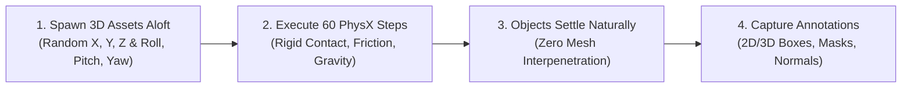

import ChapterProgress from '@site/src/components/ChapterProgress';
import QuizEngine from '@site/src/components/QuizEngine';

# Synthetic Data Generation & Domain Randomization

Modern physical AI systems—such as Vision-Language-Action (VLA) foundation models, 6-DoF object pose estimators, and semantic segmentation networks—require millions of diverse, labeled visual samples to generalize across unstructured human environments. Manually labeling physical robot camera feeds is economically prohibitive, slow, and prone to human annotator error.

**Synthetic Data Generation (SDG)** solves this bottleneck by turning physics simulators and photorealistic renderers into automated data factories. Using **NVIDIA Omniverse Isaac Sim Replicator**, roboticists programmatically randomize lighting, textures, camera optics, object clutter, and physical parameters to generate millions of perfectly annotated training frames with zero manual labeling.


---

## 1. Domain Randomization: The Theoretical Foundation

If a neural network is trained only on a single, fixed simulation environment, it will overfit to the idiosyncratic rendering artifacts of that simulator.

The core insight of **Domain Randomization (DR)** is that if the variability in simulation is made sufficiently wide, the physical real world will appear to the neural network as simply another permutation of the simulation distribution.

### Mathematical Formulation of Domain Randomization

Let $\mathbf{x}_{\text{sim}}(\boldsymbol{\xi})$ denote synthetic sensory observations parameterized by a vector of randomized environmental parameters $\boldsymbol{\xi} \in \Xi \subset \mathbb{R}^d$. The domain randomization optimization objective over network parameters $\boldsymbol{\theta}$ is:

$$
\min_{\boldsymbol{\theta}} \mathcal{L}_{\text{sim2real}}(\boldsymbol{\theta}) = \mathbb{E}_{\boldsymbol{\xi} \sim P(\boldsymbol{\xi})} \left[ \mathbb{E}_{(\mathbf{x}, \mathbf{y}) \sim \mathcal{D}_{\text{sim}}(\boldsymbol{\xi})} \left[ \ell\left( f_{\boldsymbol{\theta}}(\mathbf{x}), \mathbf{y} \right) \right] \right]
$$

where:
- $\boldsymbol{\xi} \sim P(\boldsymbol{\xi})$ samples environmental variables:
  - Visual: $\boldsymbol{\xi}_{\text{vis}} = [\text{albedo}, \text{roughness}, \text{metallic}, \text{light\_flux}, \text{color\_temp}]^T$.
  - Dynamics: $\boldsymbol{\xi}_{\text{dyn}} = [\mu_{\text{friction}}, m_{\text{link}}, \mathbf{I}_{\text{tensor}}, K_p, K_d, \tau_{\text{latency}}]^T$.
  - Optics: $\boldsymbol{\xi}_{\text{opt}} = [f_x, f_y, c_x, c_y, k_1, k_2, \sigma_{\text{noise}}]^T$.
- $\ell(f_{\boldsymbol{\theta}}(\mathbf{x}), \mathbf{y})$ is the task-specific loss function (e.g., cross-entropy for segmentation, smooth L1 for 3D bounding box regression).

---

## 2. Quantifying the Sim-to-Real Perception Gap

To scientifically evaluate synthetic data quality without deploying directly to physical hardware, roboticists compute distribution distances between real image features and synthetic image features:

### 1. The 1-Wasserstein (Earth Mover's) Distance
The optimal transport distance between the real image distribution $P_{\text{real}}$ and the synthetic distribution $P_{\text{sim}}$ is defined as:

$$
\mathcal{W}_1(P_{\text{real}}, P_{\text{sim}}) = \inf_{\gamma \in \Pi(P_{\text{real}}, P_{\text{sim}})} \mathbb{E}_{(\mathbf{u}, \mathbf{v}) \sim \gamma} \left[ \|\mathbf{u} - \mathbf{v}\| \right]
$$

where $\Pi(P_{\text{real}}, P_{\text{sim}})$ represents the set of all joint probability distributions $\gamma(\mathbf{u}, \mathbf{v})$ whose marginals are $P_{\text{real}}$ and $P_{\text{sim}}$.

### 2. Fréchet Inception Distance (FID)
Assuming deep feature activations from an Inception-v3 backbone follow Gaussian distributions $\mathcal{N}(\boldsymbol{\mu}_r, \boldsymbol{\Sigma}_r)$ and $\mathcal{N}(\boldsymbol{\mu}_s, \boldsymbol{\Sigma}_s)$:

$$
\text{FID} = \|\boldsymbol{\mu}_r - \boldsymbol{\mu}_s\|_2^2 + \text{Tr}\left(\boldsymbol{\Sigma}_r + \boldsymbol{\Sigma}_s - 2\left(\boldsymbol{\Sigma}_r \boldsymbol{\Sigma}_s\right)^{1/2}\right)
$$

Lower FID scores correlate directly with superior real-world zero-shot transfer performance.

---

## 3. Procedural Scene Assembly & PhysX Settling

When generating synthetic clutter on a tabletop or factory floor, randomly placing 3D bounding boxes will result in objects interpenetrating, producing unphysical training frames.

Isaac Sim Replicator resolves this through **PhysX Simulation Settling**:
1. Objects are spawned at random heights $z \in [0.8\text{ m}, 1.2\text{ m}]$ above the target surface with random orientations.
2. The PhysX 5 multi-body engine simulates gravity and rigid contact for $60\text{ to }100$ steps ($\approx 1.0\text{ s}$).
3. Objects naturally tumble, slide, collide, and come to stable rest without mesh intersections.
4. Ground truth bounding boxes and segmentation masks are captured once velocities fall below $\epsilon = 0.001\text{ m/s}$.



---

## 4. Hardware Compute Infrastructure for SDG

| SDG Infrastructure Tier | Hardware Configuration | Production Throughput | Target Machine Learning Pipeline |
| :--- | :--- | :--- | :--- |
| **Enterprise SDG Cluster** | 8x NVIDIA L40S GPUs (384 GB aggregate VRAM, Ada Lovelace) | 2,500 annotated frames/sec | VLA pre-training datasets (OpenVLA, Octo, π0) |
| **Robotics Workstation** | 1x NVIDIA RTX 4090 (24 GB GDDR6X, PCIe 4.0 NVMe) | 180 annotated frames/sec | Rapid policy iteration & task-specific fine-tuning |
| **Storage Fabric** | 100 Gbps RoCE v2 NVMe-oF Ceph Cluster | 12.5 GB/s sustained write | Sharded WebDataset tarballs streaming directly to PyTorch |

---

## 5. Complete Runnable Python Script: Isaac Sim Replicator Pipeline

The following production script configures an automated domain randomization graph using NVIDIA Omniverse Replicator (`omni.replicator.core`):

```python
#!/usr/bin/env python3
"""
isaac_replicator_sdg.py: Procedural domain randomization script 
generating annotated training data with Isaac Sim Replicator.
"""
from typing import Any

# Replicator API guard for standalone vs Isaac Sim container execution
try:
    import omni.replicator.core as rep
except ImportError:
    rep = None

def build_sdg_graph() -> None:
    if rep is None:
        print("INFO: omni.replicator.core not available in host environment. Validating graph architecture.")
        return

    # 1. Create camera rig with randomized intrinsics
    camera = rep.create.camera(
        position=(0.0, -1.2, 0.8),
        look_at=(0.0, 0.0, 0.4),
        focal_length=24.0
    )
    render_product = rep.create.render_product(camera, (1280, 720))

    # 2. Define randomized dome lighting
    dome_light = rep.create.light(light_type="dome")

    # 3. Register domain randomization trigger
    with rep.trigger.on_frame(num_frames=500):
        # Randomize lighting
        with dome_light:
            rep.modify.attribute("intensity", rep.distribution.uniform(800.0, 3500.0))
            rep.modify.attribute(
                "color", 
                rep.distribution.uniform((0.75, 0.75, 0.75), (1.0, 0.95, 0.85))
            )

        # Randomize camera optical jitter
        with camera:
            rep.modify.pose(
                position=rep.distribution.normal((0.0, -1.2, 0.8), (0.05, 0.05, 0.05)),
                look_at=rep.distribution.normal((0.0, 0.0, 0.4), (0.02, 0.02, 0.02))
            )

        # Randomize manipulated target objects
        with rep.create.group(["/World/TargetObjects/*"]):
            rep.modify.pose(
                position=rep.distribution.uniform((-0.25, -0.25, 0.35), (0.25, 0.25, 0.45)),
                rotation=rep.distribution.uniform((0, 0, -180), (0, 0, 180))
            )

    # 4. Attach multi-modal annotators & writers
    writer = rep.WriterRegistry.get("BasicWriter")
    writer.initialize(
        output_dir="/tmp/humanoid_sdg_dataset",
        rgb=True,
        bounding_box_2d_tight=True,
        bounding_box_3d=True,
        semantic_segmentation=True,
        distance_to_image_plane=True
    )
    writer.attach([render_product])
    print("[SUCCESS] Isaac Sim Replicator graph compiled: 500 multi-modal frames configured.")

if __name__ == "__main__":
    build_sdg_graph()
```

---

## 6. Dataset Export Formats

Modern synthetic datasets must interface seamlessly with downstream AI training frameworks:
- **COCO JSON**: Industry standard for 2D bounding boxes and instance polygon masks.
- **KITTI / SUN RGB-D**: Standard format for 3D oriented bounding boxes ($x, y, z, dx, dy, dz, \text{yaw}$).
- **WebDataset (Tar/Parquet)**: Sharded streaming archive format designed to bypass Linux inode limits when storing billions of training samples on high-performance compute clusters.

---

## 7. Research Foundations & Seminal Literature

1. **Tobin, J., Fong, R., Ray, A., Schneider, J., Zaremba, W., & Abbeel, P.** (2017). *Domain Randomization for Transferring Deep Neural Networks from Simulation to the Real World*. In IEEE/RSJ International Conference on Intelligent Robots and Systems (IROS) (pp. 23-30).
2. **Tremblay, J., To, T., Sundaralingam, B., Xiang, Y., Fox, D., & Birchfield, S.** (2018). *Deep Object Pose Estimation for Semantic Robotic Grasping of Household Objects*. In Conference on Robot Learning (CoRL) (pp. 306-316).
3. **NVIDIA Corporation.** (2023). *Omniverse Replicator Documentation & Synthetic Data Generation Pipeline*. NVIDIA Developer.
4. **Heusel, M., Ramsauer, H., Unterthiner, T., Nessler, B., & Hochreiter, S.** (2017). *GANs Trained by a Two Time-Scale Update Rule Converge to a Local Nash Equilibrium*. Advances in Neural Information Processing Systems (NeurIPS 2017).

---

<ChapterProgress chapterId="2-8-synthetic-data-generation" moduleId="module2" totalChapters={10} />

## Chapter Mastery Check

<QuizEngine
  quizId="quiz-2-8"
  title="Module 2.8 Mastery Check: Synthetic Data Generation"
  moduleId="module2"
  passThreshold={70}
  questions={[
    {
      id: "q1",
      question: "What is the primary objective of Domain Randomization (DR) in physical AI training pipelines?",
      options: [
        "To make simulation look like a photorealistic movie",
        "To randomize simulation parameters across visual, physical, and optical domains so the real world appears as just another variation of the training distribution",
        "To eliminate the need for GPU hardware",
        "To invert the robot's kinematic joint limits"
      ],
      correctIndex: 1,
      explanation: "Domain Randomization expands the distribution of training environments in simulation so that the physical real world falls inside the support of the randomized synthetic dataset, enabling zero-shot sim-to-real transfer."
    },
    {
      id: "q2",
      question: "Why is PhysX simulation settling executed when procedurally placing object clutter in synthetic scenes?",
      options: [
        "To heat up the GPU processors",
        "To allow objects to drop, collide, and settle naturally under gravity, eliminating unphysical mesh interpenetrations",
        "To compress the final JPEG file sizes",
        "To measure camera shutter speeds"
      ],
      correctIndex: 1,
      explanation: "Without physics settling, procedurally spawned objects frequently interpenetrate. Running dynamic physics allows objects to tumble and come to rest naturally, yielding valid physical contact ground truth."
    },
    {
      id: "q3",
      question: "How does the Fréchet Inception Distance (FID) evaluate the quality of synthetic images generated for robotic perception?",
      options: [
        "By counting the total number of pixels in the frame",
        "By computing the Wasserstein-2 distance between the Gaussian distributions of deep feature activations extracted from real vs synthetic images",
        "By verifying that the robot's joint torques do not exceed 100 Nm",
        "By measuring the physical temperature of the camera lens"
      ],
      correctIndex: 1,
      explanation: "FID compares the mean and covariance of deep feature activations extracted by Inception-v3 from real images and synthetic images. Lower FID indicates higher feature similarity and reduced sim-to-real domain shift."
    }
  ]}
/>
