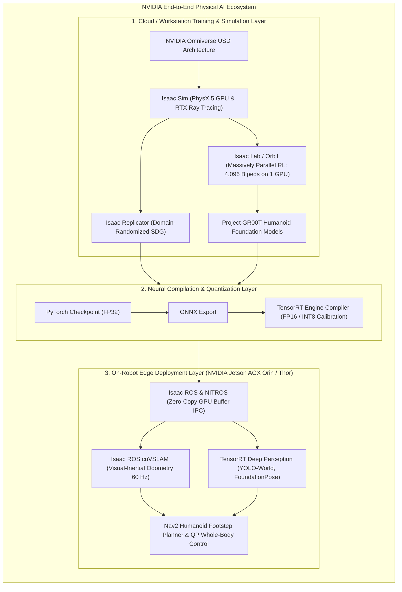

# The NVIDIA Isaac Ecosystem & Physical AI Architecture

Modern humanoid robotics demands computational capabilities orders of magnitude beyond classical robotics. Operating dozens of stereo cameras, extracting dense 3D visual-inertial odometry at 60 Hz, executing real-time object pose estimation, and deploying continuous vision-language-action policies in real time is fundamentally impossible on CPU architectures alone.

The **NVIDIA Isaac Platform** provides an end-to-end GPU-accelerated computing stack spanning cloud-scale simulation (**Isaac Sim / Isaac Lab**), synthetic data generation (**Replicator**), tensor optimization (**TensorRT**), and zero-copy edge ROS 2 perception (**Isaac ROS**).

---

## 1. The Core Pillars of the Isaac Architecture

The platform is partitioned into four synchronized subsystems:

### 1. NVIDIA Omniverse & Universal Scene Description (USD)
At the base of the simulation stack is Pixar's open-source **USD (Universal Scene Description)** format. Rather than rigid, flat XML formats like URDF, USD provides a hierarchical, composable scene graph supporting non-destructive layer overrides, physically-based materials (MDL), and skeletal animations. Multiple roboticists can collaborate in real time on the exact same virtual world environment.

### 2. Isaac Lab: Massively Parallel Reinforcement Learning
Building upon the seminal research in *Isaac Gym* (Rudin et al., 2022), **Isaac Lab** runs thousands of simulated humanoid instances simultaneously on a single desktop GPU. By keeping the physics step, contact calculations, sensor simulation, and PyTorch policy tensors entirely on GPU VRAM, it eliminates CPU-GPU synchronization bottlenecks, enabling humanoids to learn complex dynamic walking gaits in under 20 minutes of wall-clock time.

### 3. TensorRT: Hardware-Accelerated Deep Inference
Deploying deep neural networks onto an embedded robot computer (such as the 275 TOPS NVIDIA Jetson AGX Orin) requires extreme computational efficiency:
- **Layer & Tensor Fusion**: Merges Convolution, Bias, and ReLU activations into single GPU kernel calls.
- **Weight Precision Quantization**: Quantizes 32-bit floating-point weights to FP16 or INT8 with minimal accuracy degradation, yielding a **3x to 6x speedup** in perception inference.

### 4. Isaac ROS & NITROS
Traditional ROS 2 nodes serialize image matrices across CPU memory. **NITROS (NVIDIA Isaac Transport for ROS)** allows nodes to exchange raw CUDA memory pointers (`cudaStream_t`) directly across the ROS 2 graph without copying image pixels through the host CPU.

---

## 2. Global Industrial Adoption: Project GR00T

In 2024, NVIDIA unveiled **Project GR00T** (Generalist Robot 00 Technology), a multimodal foundation model engineered specifically for humanoid robotics. GR00T enables bipedal robots to:
- Ingest natural language instructions and past video demonstrations.
- Generate coordinated whole-body movements (dual-arm manipulation, torso posture adjustments, and bipedal footstep planning).
- Transfer policies seamlessly across commercial humanoid platforms including **Figure 02**, **Unitree H1/G1**, **Boston Dynamics Atlas**, and **Sanctuary Phoenix**.

---

## 3. Edge Compute Silicon: Jetson AGX Orin vs. Jetson Thor

To run the AI brain locally without relying on remote cloud connectivity, humanoids carry onboard AI supercomputers:

| Specification / Platform | Jetson Orin Nano | Jetson AGX Orin (64GB) | Jetson Thor (Next-Gen) |
| :--- | :--- | :--- | :--- |
| **AI Inference Performance** | 40 TOPS (INT8) | 275 TOPS (INT8) | **1,000+ TOPS (FP4/FP8)** |
| **GPU Architecture** | 1024-core Ampere | 2048-core Ampere + 64 Tensor Cores | Blackwell architecture + Transformer Engines |
| **CPU Complex** | 6-core Arm Cortex-A78AE | 12-core Arm Cortex-A78AE | 14-core Neoverse-V3AE CPU |
| **Memory Bandwidth** | 68 GB/s | 204.8 GB/s | **> 500 GB/s (LPDDR5X)** |
| **Humanoid Application** | Gripper / Hand compute | Real-time SLAM + YOLO-NAS + Nav2 | **Onboard 7B-14B VLA Model Execution** |

In the next chapter, we dive into simulation and data generation: **Isaac Sim for Humanoids and Synthetic Data Generation (SDG)**.
