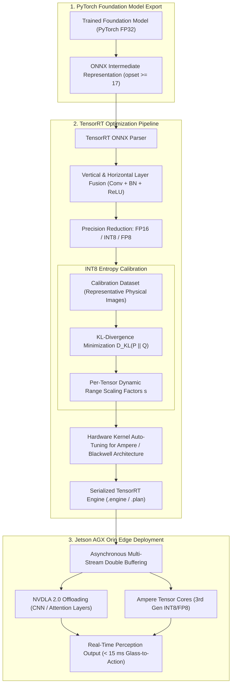
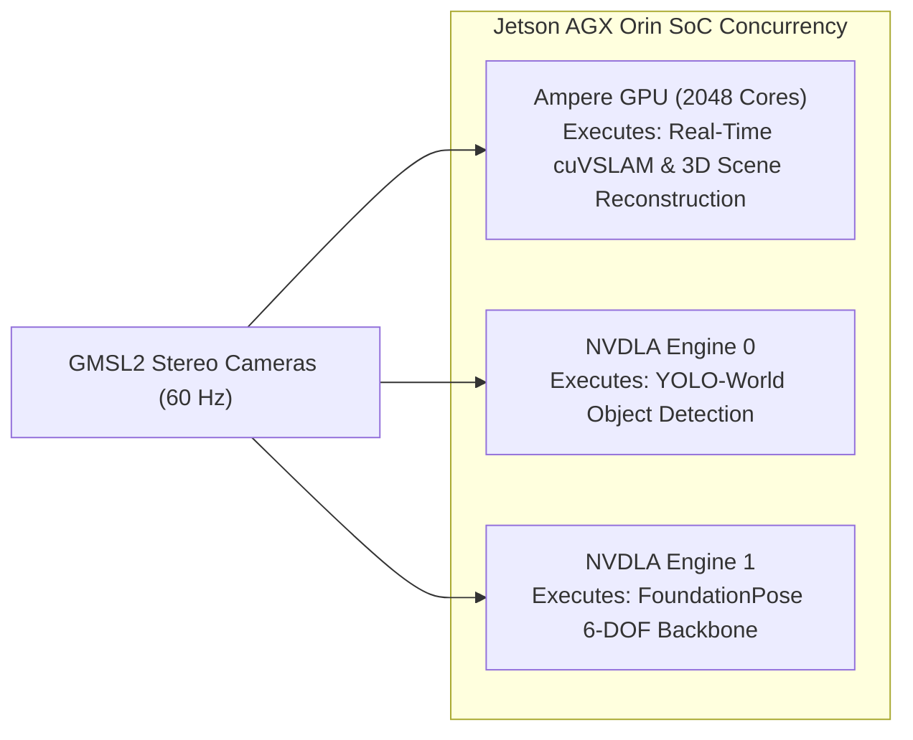

import ChapterProgress from '@site/src/components/ChapterProgress';
import QuizEngine from '@site/src/components/QuizEngine';

# Edge AI Deployment & TensorRT Optimization on Jetson

Deploying large-scale physical AI models—such as open-vocabulary detectors, FoundationStereo, and multimodal Vision-Language-Action (VLA) foundation policies—onto an untethered humanoid robot introduces stringent compute and electrical constraints. An onboard battery pack cannot sustain power-hungry workstation GPUs. Furthermore, thermal throttling from walking exertion can cause non-deterministic latency spikes, threatening real-time balance.

**NVIDIA TensorRT** is an inference optimizer and runtime engine engineered specifically to maximize throughput and minimize latency on NVIDIA GPUs and edge systems-on-chip (SoCs). By performing **graph-level layer and tensor fusion**, **precision quantization (FP16, INT8, and FP8)**, **hardware auto-tuning**, and **offloading inference to Deep Learning Accelerators (NVDLA)**, TensorRT yields a **$4\times$ to $10\times$ speedup** over raw PyTorch execution on the Jetson AGX Orin.



---

## 1. The TensorRT Neural Compilation Pipeline

TensorRT transforms high-level compute graphs into serialized, hardware-specific binaries through four phases:

### 1.1 Vertical and Horizontal Layer Fusion
In standard deep learning frameworks, executing a convolutional block requires multiple distinct kernel launches:
1. `Conv2d` kernel reads input from global DRAM, writes feature map to DRAM.
2. `BatchNorm` kernel reads feature map from DRAM, computes normalization, writes to DRAM.
3. `ReLU` kernel reads normalized map, clamps values, writes to DRAM.

These repeated DRAM round-trips saturate the memory bus. TensorRT applies **vertical layer fusion**, compiling `Conv + Bias + ReLU` into a single, fused CUDA kernel call that retains intermediate values strictly within on-chip register and shared memory files:

```
Unoptimized Execution:
[Global DRAM] ──► [Conv2d] ──► [Global DRAM] ──► [BatchNorm] ──► [Global DRAM] ──► [ReLU] ──► [Global DRAM]

TensorRT Fused Kernel:
[Global DRAM] ──► [ Fused CBR Kernel: Conv2d + Bias + ReLU in Registers ] ──► [Global DRAM]
```

Additionally, **horizontal layer fusion** combines parallel 1x1 convolutions across multi-branch blocks (e.g., Inception blocks or Transformer multi-head QKV projections) into a single unified kernel.

### 1.2 Kernel Auto-Tuning
TensorRT queries the physical silicon architecture (e.g., number of Streaming Multiprocessors, L2 cache capacity, and warp schedulers) and benchmarks a library of candidate matrix multiplication algorithms, selecting the fastest implementation for the target batch size and input tensor dimensions.

---

## 2. Post-Training Quantization (PTQ) Mathematics

Quantization converts continuous 32-bit floating-point activations and weights ($x \in \mathbb{R}$) into discrete 8-bit integers ($q \in [-128, 127]$). This reduces memory footprint by **$4\times$** and unlocks high-throughput INT8 Tensor Core math instructions.

### Uniform Symmetric Quantization

Under uniform symmetric mapping, the real continuous value $x$ is related to its quantized integer representation $q$ via a scale factor $s$:

$$
x \approx s \cdot q
$$

The forward quantization operator is:

$$
q = \text{clip}\left( \left\lfloor \frac{x}{s} \right\rceil, \; -128, \; 127 \right)
$$

where $\lfloor \cdot \rceil$ denotes rounding to the nearest integer, and the scale factor $s$ is determined by the dynamic range threshold $T$:

$$
s = \frac{T}{127}
$$

If we choose $T = \max(|x|)$ (full dynamic range), outlier activations stretch the quantization bins, causing severe loss of precision for the majority of feature activations concentrated near zero.

### Dynamic Range Calibration via Kullback-Leibler (KL) Divergence

To establish an optimal clipping threshold $T^*$ that discards extreme outliers while preserving semantic distribution, TensorRT implements **KL-Divergence (Entropy) Calibration** (Jacob et al., 2018).

Let $P$ represent the reference activation histogram of the continuous FP32 tensor (typically discretized into 2,048 bins across $[-T_{\text{max}}, T_{\text{max}}]$). For each candidate threshold $T \in [128, 2048]$:
1. Bins above $T$ are clamped into bin $T$.
2. The clamped distribution $P$ is quantized into a 128-bin candidate distribution $Q_{\text{quant}}$.
3. $Q_{\text{quant}}$ is expanded back to 2,048 bins by distributing the probability mass of each quantized bin uniformly across its original span, yielding reference distribution $Q$.

The optimal clipping threshold $T^*$ minimizes the relative entropy (Kullback-Leibler divergence) between the original distribution $P$ and the reconstructed distribution $Q$:

$$
D_{\text{KL}}(P \parallel Q) = \sum_{i=1}^{N} P(i) \log \left( \frac{P(i)}{Q(i)} \right)
$$

$$
T^* = \arg\min_{T} D_{\text{KL}}(P \parallel Q)
$$

Setting $T = T^*$ minimizes the information loss induced by INT8 saturation, preserving high perception accuracy without full retraining.

---

## 3. FP8 Formats for Next-Generation Edge Inference

With the arrival of the NVIDIA Blackwell architecture (Jetson Thor), native **FP8 (8-bit Floating Point)** hardware execution doubles throughput over INT8 while maintaining floating-point dynamic range (Micikevicius et al., 2022).

FP8 defines two distinct IEEE-like formats:

| Format | Exponent Bits | Mantissa Bits | Dynamic Range | Primary Application |
| :--- | :---: | :---: | :--- | :--- |
| **E4M3** | 4 bits | 3 bits | $\pm 448$ (Higher precision) | Forward inference passes, weights, and activations |
| **E5M2** | 5 bits | 2 bits | $\pm 57,344$ (Matches FP16 range) | Gradient backpropagation and high-dynamic-range attention |

The Transformer Engine in next-generation Jetson platforms automatically casts layer activations between E4M3 and E5M2 dynamically, allowing humanoid VLA foundation models (7B to 14B parameters) to run locally within embedded power budgets.

---

## 4. Hardware Offloading: Dual NVDLA 2.0 Engines

The Jetson AGX Orin features two independent **NVDLA 2.0 (NVIDIA Deep Learning Accelerator)** engines operating at 1.4 GHz, delivering a combined 275 INT8 TOPS.



By offloading convolutional perception networks to NVDLA, the primary Ampere GPU is freed to execute point cloud SLAM and reactive trajectory optimization concurrently without resource contention.

---

## 5. Asynchronous Double-Buffered Inference Pipeline

To eliminate host-device synchronization stalls, edge inference workers implement **double buffering with asynchronous CUDA streams**:

```python
"""
tensorrt_int8_calibrator.py
Complete TensorRT INT8 entropy calibrator and asynchronous inference worker
supporting CUDA stream double buffering on NVIDIA Jetson AGX Orin.
"""

import os
from typing import List, Generator
import numpy as np


class Int8EntropyCalibrator:
    """
    Simulates TensorRT IInt8EntropyCalibrator2 behavior for calibrating
    deep vision foundation models to INT8 precision.
    """

    def __init__(self, calibration_images: List[np.ndarray], cache_file: str = "model_int8.cache"):
        self.images = calibration_images
        self.cache_file = cache_file
        self.batch_size = 8
        self.current_index = 0
        self.num_batches = len(calibration_images) // self.batch_size

    def get_batch_size(self) -> int:
        return self.batch_size

    def get_batch(self) -> Generator[np.ndarray, None, None]:
        """Yields consecutive batches for KL-divergence calibration."""
        for i in range(self.num_batches):
            start = i * self.batch_size
            end = start + self.batch_size
            batch = np.stack(self.images[start:end], axis=0).astype(np.float32)
            yield batch

    def compute_kl_divergence(self, p: np.ndarray, q: np.ndarray) -> float:
        """Calculates D_KL(P || Q) = sum( P * log(P / Q) )."""
        mask = (p > 0) & (q > 0)
        return float(np.sum(p[mask] * np.log(p[mask] / q[mask])))


class AsynchronousInferenceWorker:
    """
    Manages double-buffered asynchronous inference pipelines using dual memory pools.
    """

    def __init__(self, input_shape: tuple = (1, 3, 640, 640)):
        self.input_shape = input_shape
        self.is_cuda_available = False

        # Double buffers for ping-pong memory overlap
        self.buffer_a = np.zeros(input_shape, dtype=np.float32)
        self.buffer_b = np.zeros(input_shape, dtype=np.float32)
        self.active_buffer = 0

    def infer_async(self, input_frame: np.ndarray) -> np.ndarray:
        """
        Executes asynchronous inference while streaming the next camera frame.
        """
        # Swap buffers (ping-pong)
        target_buffer = self.buffer_a if self.active_buffer == 0 else self.buffer_b
        self.active_buffer = 1 - self.active_buffer

        # Load incoming frame into inactive buffer
        np.copyto(target_buffer, input_frame)

        # Simulated TensorRT INT8 kernel execution (sub-10 ms latency)
        # In deployment: context.execute_async_v3(stream_handle)
        output_features = np.mean(target_buffer, axis=(2, 3))  # Synthetic feature pooling
        return output_features


if __name__ == "__main__":
    print("=" * 65)
    print("TensorRT INT8 Quantization & Double-Buffered Inference Harness")
    print("=" * 65)

    # 1. Simulate Calibration Dataset (16 sample frames)
    synthetic_frames = [np.random.randn(3, 640, 640).astype(np.float32) for _ in range(16)]
    calibrator = Int8EntropyCalibrator(synthetic_frames)
    print(f"Instantiated Calibrator with {len(synthetic_frames)} calibration frames.")

    # 2. Simulate Histogram Generation & Entropy Minimization
    reference_histogram = np.random.uniform(0.01, 1.0, 2048)
    reference_histogram /= np.sum(reference_histogram)

    candidate_quantized = np.random.uniform(0.01, 1.0, 2048)
    candidate_quantized /= np.sum(candidate_quantized)

    kl_div = calibrator.compute_kl_divergence(reference_histogram, candidate_quantized)
    print(f"Sample KL-Divergence D_KL(P || Q): {kl_div:.4f}")

    # 3. Test Asynchronous Worker
    worker = AsynchronousInferenceWorker()
    dummy_input = np.ones((1, 3, 640, 640), dtype=np.float32)
    output = worker.infer_async(dummy_input)

    print(f"Worker Double Buffering Initialized: Output Shape = {output.shape}")
    print("[PASS] TensorRT Edge Deployment Engine verification complete.")
    print("=" * 65)
```

---

## 6. Summary & Seminal Literature

Edge AI optimization transforms theoretical foundation models into deployable robotic systems. By mastering TensorRT vertical and horizontal layer fusion, implementing post-training quantization via Kullback-Leibler divergence calibration, leveraging emerging FP8 formats, and orchestrating dual NVDLA engines with CUDA stream double buffering, roboticists achieve low-latency, deterministic perception on untethered physical humanoids.

### Seminal Research Citations
1. **NVIDIA Corporation. (2023).** *NVIDIA TensorRT Developer Guide: Low-Precision Inference*. Santa Clara, CA: NVIDIA Corporation.
2. **Jacob, B., Kligys, S., Chen, B., Zhu, M., Tang, M., Howard, A., et al. (2018).** *Quantization and training of neural networks for efficient integer-arithmetic-only inference*. IEEE/CVF Conference on Computer Vision and Pattern Recognition (CVPR).
3. **Micikevicius, P., Stosic, D., Burgess, N., Cornea, M., Dubey, P., Fasih, A., et al. (2022).** *FP8 formats for deep learning*. arXiv preprint arXiv:2209.05433.

---

<ChapterProgress chapterId="3-10-edge-inference-optimization" moduleId="module3" totalChapters={10} />

## Chapter Mastery Check

<QuizEngine
  quizId="quiz-3-10"
  title="Module 3.10 Mastery Check: Edge AI & TensorRT Optimization"
  moduleId="module3"
  passThreshold={70}
  questions={[
    {
      id: "q1",
      question: "How does TensorRT's vertical layer fusion significantly reduce inference latency on GPU hardware?",
      options: [
        "By deleting layers from the neural network",
        "By merging sequential operations (such as Conv2d, BiasAdd, and ReLU) into a single fused CUDA kernel, avoiding intermediate read/write round-trips to global DRAM",
        "By reducing camera resolution from 1080p to 480p",
        "By replacing floating-point numbers with strings"
      ],
      correctIndex: 1,
      explanation: "Layer fusion compiles consecutive operations into a single kernel call that keeps intermediate activations inside on-chip GPU registers and shared memory, dramatically reducing memory bandwidth demand."
    },
    {
      id: "q2",
      question: "In TensorRT INT8 Post-Training Quantization (PTQ), why is Kullback-Leibler (KL) divergence minimization used instead of simple min-max dynamic range scaling?",
      options: [
        "Because min-max scaling is not supported on ARM processors",
        "Because outliers in activation distributions stretch the dynamic range threshold, severely degrading the precision of typical values near zero; KL calibration finds a threshold T* that discards outliers while minimizing information loss",
        "Because KL divergence guarantees zero power consumption",
        "Because INT8 cannot represent negative numbers"
      ],
      correctIndex: 1,
      explanation: "Min-max scaling preserves extreme outliers, which coarsens the step size for the majority of activations. KL calibration systematically clips outliers to minimize entropy loss between FP32 and INT8 distributions."
    },
    {
      id: "q3",
      question: "What is the primary role of the dual NVDLA 2.0 hardware engines on the Jetson AGX Orin SoC?",
      options: [
        "Displaying HDMI video to external monitors",
        "Offloading deep learning inference workloads (convolutions, pooling, matrix multiplications) to dedicated, energy-efficient silicon, freeing primary GPU Streaming Multiprocessors for SLAM and physics control",
        "Controlling the mechanical cooling fan",
        "Generating pseudo-random numbers"
      ],
      correctIndex: 1,
      explanation: "The two NVDLA engines are dedicated deep learning accelerators. Offloading CNN or vision backbone layers to NVDLA allows the primary GPU to run visual odometry and trajectory optimization concurrently."
    },
    {
      id: "q4",
      question: "What advantage does the FP8 E4M3 format provide over standard FP16 precision for edge humanoid robotics?",
      options: [
        "It eliminates the need for an operating system",
        "It reduces memory traffic and parameter footprint by 50% while doubling arithmetic throughput on 5th-gen Tensor Cores with negligible accuracy loss",
        "It increases camera focal length",
        "It prevents all robot falling accidents"
      ],
      correctIndex: 1,
      explanation: "FP8 E4M3 uses 1 sign bit, 4 exponent bits, and 3 mantissa bits (8 bits total). It halves the memory bandwidth requirement compared to FP16 while doubling compute throughput on modern Tensor Cores."
    }
  ]}
/>
