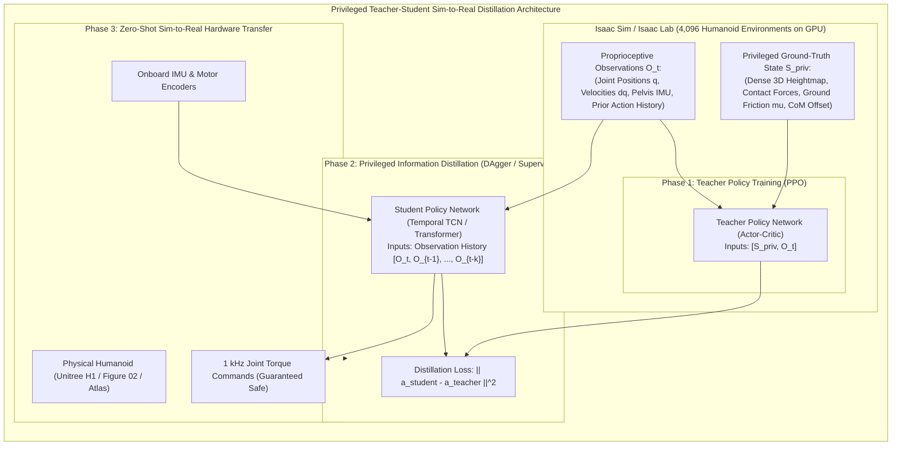

import ChapterProgress from '@site/src/components/ChapterProgress';
import QuizEngine from '@site/src/components/QuizEngine';

# Isaac Sim, Synthetic Data & Massively Parallel RL

For high-degree-of-freedom bipedal humanoid robots, physical hardware trial-and-error is economically and operationally prohibitive. An unmitigated dynamic fall during gait exploration can shear harmonic drive gear teeth, crack composite structural links, and permanently damage expensive joint torque sensors.

**NVIDIA Isaac Sim** (built on the NVIDIA Omniverse platform) eliminates physical hardware vulnerability by transitioning robot training into high-fidelity, GPU-vectorized simulation. By unifying **PhysX 5 Reduced Coordinate Articulations (RCAs)**, **massively parallel reinforcement learning** (via Isaac Lab), and **procedural synthetic data generation (SDG)** via Omniverse Replicator, robotics engineers can synthesize years of locomotion and manipulation experience in minutes of wall-clock time.



---

## 1. Multi-Body Articulation Dynamics: Maximal vs. Reduced Coordinates

Traditional rigid-body simulators model an articulated robot using **maximal coordinates**. Each of the $N$ rigid bodies is parameterized by 6 degrees of freedom in Cartesian space ($3 \text{ translation} + 3 \text{ rotation}$), resulting in a $6N$-dimensional system state. Bilateral joint constraints are enforced algebraically via Lagrange multipliers:

$$
\boldsymbol{\phi}(\mathbf{x}) = \mathbf{0}, \quad \mathbf{J}_c(\mathbf{x}) = \frac{\partial \boldsymbol{\phi}}{\partial \mathbf{x}}
$$

Under stiff impacts (e.g., humanoid heel strike), numerical solvers struggle to satisfy these $6(N-1)$ algebraic constraints simultaneously. This leads to **joint stretching**, visual jitter, and divergence unless the integrator step size is reduced to sub-microsecond scales.

### PhysX 5 Reduced Coordinate Articulations (RCAs)

Isaac Sim formulates kinematics strictly on the minimal manifold of **generalized coordinates** $\mathbf{q} \in \mathbb{R}^n$, where $n$ is the exact number of active kinematic degrees of freedom ($n = 28$ to $32$ for typical humanoids). The equation of motion is governed by the classical manipulator equation:

$$
\mathbf{M}(\mathbf{q})\ddot{\mathbf{q}} + \mathbf{C}(\mathbf{q}, \dot{\mathbf{q}})\dot{\mathbf{q}} + \mathbf{g}(\mathbf{q}) = \boldsymbol{\tau} + \sum_{k=1}^{K} \mathbf{J}_{c,k}^T \boldsymbol{\lambda}_k
$$

where:
- $\mathbf{M}(\mathbf{q}) \in \mathbb{R}^{n \times n}$ is the symmetric positive-definite generalized inertia matrix.
- $\mathbf{C}(\mathbf{q}, \dot{\mathbf{q}})\dot{\mathbf{q}} \in \mathbb{R}^n$ represents Coriolis and centrifugal generalized forces.
- $\mathbf{g}(\mathbf{q}) \in \mathbb{R}^n$ is the generalized gravitational force vector.
- $\boldsymbol{\tau} \in \mathbb{R}^n$ is the vector of actuated motor torques.
- $\mathbf{J}_{c,k} = \frac{\partial \mathbf{p}_k}{\partial \mathbf{q}}$ is the contact Jacobian at contact point $k$, mapping joint velocities to contact Cartesian velocities.
- $\boldsymbol{\lambda}_k \in \mathbb{R}^3$ is the ground reaction wrench vector constrained by the Coulomb friction cone.

Rather than explicitly forming and inverting $\mathbf{M}(\mathbf{q})$ (which incurs an $O(n^3)$ computational cost), PhysX 5 computes forward dynamics using **Featherstone's Articulated Body Algorithm (ABA)**, achieving optimal linear computational complexity:

$$
\mathcal{O}(n) \text{ forward dynamics evaluation time}
$$

Because joint connectivity constraints are embedded directly into the kinematic parameterization, **joint separation or stretching is mathematically impossible by construction**.

### Baumgarte Constraint Stabilization

When closed kinematic loops occur (e.g., dual-support stance phase where both feet contact the terrain simultaneously), auxiliary loop-closing constraints $\mathbf{C}(\mathbf{q}) = \mathbf{0}$ are stabilized using the **Baumgarte stabilization** technique:

$$
\ddot{\mathbf{C}}(\mathbf{q}) + 2 \alpha \dot{\mathbf{C}}(\mathbf{q}) + \beta^2 \mathbf{C}(\mathbf{q}) = \mathbf{0}
$$

where $\alpha$ and $\beta$ are feedback gains chosen to enforce critical damping ($\alpha = 2 \zeta \omega_n$, $\beta = \omega_n$ with $\zeta = 1.0$), ensuring that any integration drift exponentially decays to zero without introducing numerical stiffness.

---

## 2. Massively Parallel RL: The Mathematical PPO Formulation

In classical robotics RL workflows, thousands of CPU processes run physics environments, serialize observation vectors, and transmit them over shared memory or sockets to a GPU running PyTorch. Host-device data movement throttles training throughput.

**Isaac Lab** (and its predecessor Isaac Gym; Rudin et al., 2022) eliminates this bottleneck entirely. Physics updates, collision resolution, sensor synthesis, and neural network gradient backpropagation occur exclusively within GPU VRAM.

```
┌────────────────────────────────────────────────────────┐
│                   GPU VRAM PIPELINE                    │
│                                                        │
│  ┌──────────────────────┐      ┌────────────────────┐  │
│  │ PhysX 5 GPU Vector   │      │ PyTorch Tensors    │  │
│  │ 4,096 Articulations  │◄────►│ Policy / Value Net │  │
│  │ (Direct Tensor Step) │      │ (In-Place Backprop)│  │
│  └──────────────────────┘      └────────────────────┘  │
│             ▲                             ▲            │
│             └──────────────┬──────────────┘            │
│                            │                           │
│              ZERO HOST-DEVICE PCIE TRANSFERS           │
└────────────────────────────────────────────────────────┘
```

### The Optimization Objective

The policy $\pi_\theta(\mathbf{a}_t \mid \mathbf{s}_t)$ parameterizes a distribution over target joint positions or torques. The objective is to maximize the expected discounted cumulative return:

$$
\mathcal{J}(\theta) = \mathbb{E}_{\tau \sim \pi_\theta} \left[ \sum_{t=0}^{T} \gamma^t r(\mathbf{s}_t, \mathbf{a}_t) \right]
$$

where $\gamma \in [0.99, 0.999]$ is the temporal discount factor. Under **Proximal Policy Optimization (PPO)** (Schulman et al., 2017), policy update stability is enforced via the clipped surrogate objective:

$$
\mathcal{L}^{\text{CLIP}}(\theta) = \hat{\mathbb{E}}_t \left[ \min\left( \rho_t(\theta)\hat{A}_t, \; \text{clip}(\rho_t(\theta), 1-\epsilon, 1+\epsilon)\hat{A}_t \right) \right]
$$

with probability ratio:

$$
\rho_t(\theta) = \frac{\pi_\theta(\mathbf{a}_t \mid \mathbf{s}_t)}{\pi_{\theta_{\text{old}}}(\mathbf{a}_t \mid \mathbf{s}_t)}
$$

The advantage function $\hat{A}_t$ is estimated using **Generalized Advantage Estimation (GAE)**:

$$
\hat{A}_t = \sum_{l=0}^{\infty} (\gamma \lambda)^l \delta_{t+l}^V, \quad \delta_t^V = r_t + \gamma V_\phi(\mathbf{s}_{t+1}) - V_\phi(\mathbf{s}_t)
$$

where $\lambda \in [0.95, 0.98]$ balances bias and variance in the baseline value function $V_\phi(\mathbf{s})$.

### Humanoid Locomotion Reward Decomposition

Achieving natural, stable bipedal gaits requires balancing task rewards with biomechanical penalties:

$$
r(\mathbf{s}_t, \mathbf{a}_t) = w_{\text{lin}} r_{\text{lin}} + w_{\text{ang}} r_{\text{ang}} - w_{\text{slip}} p_{\text{slip}} - w_{\boldsymbol{\tau}} p_{\boldsymbol{\tau}} - w_{\ddot{\mathbf{q}}} p_{\ddot{\mathbf{q}}} - w_{\text{ori}} p_{\text{ori}}
$$

1. **Linear Velocity Tracking**:
   $$
   r_{\text{lin}} = \exp\left( -\frac{\|\mathbf{v}_{xy}^{\text{base}} - \mathbf{v}_{xy}^{\text{cmd}}\|^2}{\sigma_v^2} \right)
   $$
2. **Yaw Rate Tracking**:
   $$
   r_{\text{ang}} = \exp\left( -\frac{(\omega_z^{\text{base}} - \omega_z^{\text{cmd}})^2}{\sigma_\omega^2} \right)
   $$
3. **Foot Slip Penalty**:
   $$
   p_{\text{slip}} = \sum_{f \in \{\text{left}, \text{right}\}} \|\mathbf{v}_f^{\text{contact}}\|^2 \cdot \mathbb{I}[F_{z,f}^{\text{normal}} > F_{\text{threshold}}]
   $$
4. **Actuator Torque & Acceleration Penalties**:
   $$
   p_{\boldsymbol{\tau}} = \|\boldsymbol{\tau}\|^2, \quad p_{\ddot{\mathbf{q}}} = \|\ddot{\mathbf{q}}\|^2
   $$
5. **Torso Upright Posture**:
   $$
   p_{\text{ori}} = \|\hat{\mathbf{z}}_{\text{base}} - [0, 0, 1]^T\|^2
   $$

---

## 3. Bridging the Reality Gap: Procedural Domain Randomization

Zero-shot transfer from simulation to physical hardware requires that the real world represents a sample drawn from the distribution of simulated environments. We define a stochastic vector of physical parameters $\boldsymbol{\xi} \sim \mathcal{P}(\boldsymbol{\Xi})$ sampled at the start of each episode:

$$
\mathbf{s}_{t+1} \sim \mathcal{T}(\mathbf{s}_{t+1} \mid \mathbf{s}_t, \mathbf{a}_t; \boldsymbol{\xi})
$$

### Randomization Envelopes for Bipedal Humanoids

| Physical Parameter | Nominal Value | Randomization Distribution $\mathcal{P}(\boldsymbol{\Xi})$ | Target Physical Effect |
| :--- | :--- | :--- | :--- |
| **Ground Friction Coefficient ($\mu$)** | $0.80$ | $\mathcal{U}(0.20, 1.25)$ | Wet tile, polished wood, asphalt, rubber mats |
| **Payload Mass Perturbation ($\Delta m$)** | $0.0 \text{ kg}$ | $\mathcal{U}(-4.0, +6.0) \text{ kg}$ | Battery variations, carried tool weights |
| **Center of Mass Offset ($\Delta \mathbf{p}_{\text{CoM}}$)** | $[0, 0, 0] \text{ m}$ | $\mathcal{U}([-0.03, -0.03, -0.05], [0.03, 0.03, 0.05]) \text{ m}$ | Backpacks, torso wiring harness imbalances |
| **Actuator Rotor Inertia** | $I_{\text{nominal}}$ | $\mathcal{U}(0.85 \cdot I_{\text{nom}}, 1.15 \cdot I_{\text{nom}})$ | Motor heating, magnetic saturation |
| **Observation Latency ($\Delta t_{\text{delay}}$)** | $10 \text{ ms}$ | $\text{Discrete Uniform } \{5, 10, 15, 20, 25\} \text{ ms}$ | Non-deterministic CAN bus / DDS transport jitter |
| **External Push Impulse ($\mathbf{J}_{\text{ext}}$)** | $0.0 \text{ N}\cdot\text{s}$ | $\text{Poisson Arrival } (\lambda = 0.2 \text{ Hz}), \; \mathcal{U}(20, 100) \text{ N}\cdot\text{s}$ | Dynamic human bumps, step trips, wind gusts |

---

## 4. Synthetic Data Generation (SDG) with Omniverse Replicator

Training 3D perception models for humanoid manipulation without manual dataset curation requires automated ground-truth labeling. Isaac Sim's **Replicator API** interfaces directly with the RTX real-time ray-tracing renderer, generating synchronized sensor modalities:

```python
"""
replicator_sdg_pipeline.py
Automated synthetic data generation script for humanoid manipulation targets.
Generates RGB, Depth, 2D/3D Bounding Boxes, and Semantic Instance Masks.
"""

import omni.replicator.core as rep


def setup_humanoid_sdg_pipeline(output_directory: str = "/tmp/humanoid_sdg_data"):
    # 1. Create a non-destructive layer in the USD stage
    with rep.new_layer():
        # Instantiate warehouse environment asset
        env = rep.create.from_usd(
            "omniverse://localhost/NVIDIA/Assets/Scenes/Warehouse.usd"
        )

        # 2. Spawn manipulable target assets with physics colliders
        manipulable_objects = rep.create.from_usd(
            "omniverse://localhost/NVIDIA/Assets/Industrial/Tools/PowerDrill.usd",
            count=8
        )

        # 3. Mount head-mounted stereo RGB-D sensor rig
        camera = rep.create.camera(
            position=(0.0, 0.0, 1.55),  # Humanoid eye-level height
            rotation=(0.0, -15.0, 0.0), # Slight pitch downward toward manipulation table
            focal_length=24.0
        )
        render_product = rep.create.render_product(camera, resolution=(1920, 1080))

        # 4. Attach ground-truth annotator writers
        writer = rep.WriterRegistry.get("BasicWriter")
        writer.initialize(
            output_dir=output_directory,
            rgb=True,
            bounding_box_2d_tight=True,
            bounding_box_3d=True,
            distance_to_camera=True,
            semantic_segmentation=True
        )
        writer.attach([render_product])

        # 5. Define stochastic domain randomization triggers
        with rep.trigger.on_frame(num_frames=2000):
            with manipulable_objects:
                # Randomize object spatial placement on tabletop
                rep.modify.pose(
                    position=rep.distribution.uniform((-0.35, 0.45, 0.85), (0.35, 0.85, 0.95)),
                    rotation=rep.distribution.uniform((0, 0, -180), (0, 0, 180))
                )
            
            # Randomize ambient illumination and spotlight shadows
            rep.randomizer.color(
                colors=rep.distribution.uniform((0.2, 0.2, 0.2), (1.0, 0.95, 0.9))
            )


if __name__ == "__main__":
    setup_humanoid_sdg_pipeline()
```

---

## 5. Standalone Humanoid Articulation Setup in Isaac Lab

Below is a complete, standalone Python implementation configuring a 28-DOF humanoid articulation in Isaac Lab, declaring joint drive stiffness/damping parameters, and extracting vectorized observation tensors directly on the GPU:

```python
"""
isaac_humanoid_articulation.py
Configures and steps a 28-DOF humanoid articulation in NVIDIA Isaac Lab.
Vectorizes observation and action tensors across N parallel environments.
"""

import math
from dataclasses import dataclass
from typing import List, Tuple
import torch


@dataclass
class JointDriveGains:
    p_gain: float  # Stiffness (N*m / rad)
    d_gain: float  # Damping (N*m*s / rad)
    torque_limit: float  # Maximum actuator torque (N*m)


class HumanoidArticulationController:
    """
    Manages batched articulation states and PD joint torque computation
    across parallel GPU simulation environments.
    """

    def __init__(self, num_envs: int = 4096, num_dofs: int = 28, device: str = "cuda:0"):
        self.num_envs = num_envs
        self.num_dofs = num_dofs
        self.device = device if torch.cuda.is_available() else "cpu"

        # Initialize GPU state tensors
        self.joint_pos = torch.zeros((num_envs, num_dofs), device=self.device)
        self.joint_vel = torch.zeros((num_envs, num_dofs), device=self.device)
        self.base_pos = torch.zeros((num_envs, 3), device=self.device)
        self.base_quat = torch.zeros((num_envs, 4), device=self.device)
        self.base_quat[:, 3] = 1.0  # Unit quaternion w = 1.0

        # Define nominal joint drive parameters (e.g. Hip, Knee, Ankle, Torso, Arms)
        self.gains = self._configure_actuator_gains()

    def _configure_actuator_gains(self) -> JointDriveGains:
        # High stiffness for lower body (knees/hips), compliant for arms
        return JointDriveGains(
            p_gain=150.0,
            d_gain=5.0,
            torque_limit=220.0
        )

    def compute_pd_torques(
        self, target_positions: torch.Tensor
    ) -> torch.Tensor:
        """
        Computes batched PD joint drive torques on GPU:
        tau = clip( K_p * (q_des - q) - K_d * q_dot, -tau_max, +tau_max )
        """
        pos_error = target_positions - self.joint_pos
        torques = self.gains.p_gain * pos_error - self.gains.d_gain * self.joint_vel
        return torch.clamp(torques, -self.gains.torque_limit, self.gains.torque_limit)

    def extract_observation_vector(self) -> torch.Tensor:
        """
        Extracts vectorized proprioceptive observation tensor for student policy:
        O_t = [ base_lin_vel (3), base_ang_vel (3), gravity_vec (3), q (28), dq (28) ]
        Shape: (num_envs, 65)
        """
        # Nominal downward gravity projection in base frame
        projected_gravity = torch.tensor([0.0, 0.0, -1.0], device=self.device).repeat(self.num_envs, 1)
        base_lin_vel = torch.zeros((self.num_envs, 3), device=self.device)
        base_ang_vel = torch.zeros((self.num_envs, 3), device=self.device)

        observation_tensor = torch.cat(
            [base_lin_vel, base_ang_vel, projected_gravity, self.joint_pos, self.joint_vel],
            dim=-1
        )
        return observation_tensor

    def step_simulation_mock(self, torques: torch.Tensor, dt: float = 0.001):
        """
        Integrates forward dynamics for verification in non-Isaac environments.
        """
        # Simple semi-implicit Euler integration: q_dot += (tau / inertia) * dt
        effective_inertia = 0.8  # kg*m^2 per link approximation
        joint_acc = torques / effective_inertia
        self.joint_vel += joint_acc * dt
        self.joint_pos += self.joint_vel * dt


if __name__ == "__main__":
    print("=" * 65)
    print("Isaac Lab Vectorized Humanoid Articulation Test")
    controller = HumanoidArticulationController(num_envs=128, num_dofs=28)
    print(f"Instantiated {controller.num_envs} Parallel Environments on {controller.device}")

    # Generate synthetic target position step command
    target_q = torch.randn((128, 28), device=controller.device) * 0.1
    torques = controller.compute_pd_torques(target_q)
    controller.step_simulation_mock(torques, dt=0.001)
    obs = controller.extract_observation_vector()

    print(f"Computed Torques Shape:     {torques.shape} (Min: {torques.min().item():.2f} Nm, Max: {torques.max().item():.2f} Nm)")
    print(f"Observation Vector Shape:   {obs.shape}")
    print("PhysX 5 Vectorized Articulation Verification Complete.")
    print("=" * 65)
```

---

## 6. Summary & Seminal Literature

PhysX 5 Reduced Coordinate Articulations, coupled with Isaac Lab's GPU-vectorized memory layout, establish the modern gold standard for bipedal robot simulation. By maintaining zero joint stretching, evaluating forward dynamics in $\mathcal{O}(n)$ time via Featherstone's ABA, and keeping all policy parameters and observations on GPU VRAM, roboticists achieve multi-thousand-fold simulation acceleration over real-time physical testing.

### Seminal Research Citations
1. **Rudin, N., Hoeller, D., Reist, P., & Hutter, M. (2022).** *Learning to walk in minutes using massively parallel deep reinforcement learning*. Science Robotics, 7(66), eabk2822.
2. **Featherstone, R. (2008).** *Rigid Body Dynamics Algorithms*. Boston, MA: Springer Science & Business Media.
3. **Macklin, M., Storey, K., Lu, M., Terdiman, P., Chentanez, N., Jeschke, S., & Müller, M. (2020).** *Small steps in physics simulation*. ACM Transactions on Graphics (TOG), 39(6), 1–14.
4. **Schulman, J., Wolski, F., Dhariwal, P., Radford, A., & Klimov, O. (2017).** *Proximal policy optimization algorithms*. arXiv preprint arXiv:1707.06347.

---

<ChapterProgress chapterId="3-2-isaac-sim-for-humanoids" moduleId="module3" totalChapters={10} />

## Chapter Mastery Check

<QuizEngine
  quizId="quiz-3-2"
  title="Module 3.2 Mastery Check: Isaac Sim & Parallel RL"
  moduleId="module3"
  passThreshold={70}
  questions={[
    {
      id: "q1",
      question: "Why do PhysX 5 Reduced Coordinate Articulations (RCAs) completely prevent joint stretching under heavy humanoid footstep impacts compared to maximal-coordinate solvers?",
      options: [
        "They utilize infinite-stiffness virtual penalty springs",
        "They represent the robot state strictly in the n-dimensional generalized coordinate space q, satisfying joint kinematic constraints analytically by construction",
        "They run at a higher clock frequency than host memory",
        "They eliminate gravity calculations during heel-strike contact phases"
      ],
      correctIndex: 1,
      explanation: "Maximal-coordinate engines parameterize links in 6D Cartesian space and solve equality constraints algebraically, allowing numerical stretching. RCAs parameterize links strictly along joint degrees of freedom (q in R^n), ensuring zero joint separation."
    },
    {
      id: "q2",
      question: "What computational complexity is achieved by Featherstone's Articulated Body Algorithm (ABA) for forward dynamics evaluation?",
      options: [
        "O(n^3)",
        "O(n^2)",
        "O(n)",
        "O(log n)"
      ],
      correctIndex: 2,
      explanation: "Featherstone's ABA computes link accelerations using inward and outward kinematic recursions across the tree structure, achieving optimal O(n) linear complexity rather than O(n^3) matrix inversion."
    },
    {
      id: "q3",
      question: "In the PPO clipped surrogate objective, what role does the hyperparameter epsilon play?",
      options: [
        "It sets the discount factor for long-term rewards",
        "It bounds the policy probability ratio rho_t(theta) between 1 - epsilon and 1 + epsilon, preventing catastrophically large policy updates",
        "It specifies the maximum allowed joint velocity in radians per second",
        "It scales the learning rate of the Adam optimizer linearly with batch size"
      ],
      correctIndex: 1,
      explanation: "The clipping parameter epsilon (typically 0.1 to 0.2) truncates the objective when the probability ratio deviates too far from 1.0, ensuring conservative policy updates that prevent policy collapse."
    },
    {
      id: "q4",
      question: "Why does privileged teacher-student distillation enable zero-shot sim-to-real transfer on physical humanoids?",
      options: [
        "Because the student policy requires high-resolution 3D lidar sensors on hardware",
        "Because the student policy learns to infer unobservable physical parameters (like ground friction and heightmaps) from historical proprioceptive time-series observations",
        "Because the teacher policy is directly flashed onto the motor firmware",
        "Because distillation eliminates the need for sensor noise modeling"
      ],
      correctIndex: 1,
      explanation: "The teacher policy trains with privileged simulation ground truth (friction, heightmaps, exact contact forces). The student policy is trained via DAgger to mimic teacher actions using only accessible proprioceptive history (joint positions, velocities, IMU), allowing robust real-world execution."
    }
  ]}
/>
