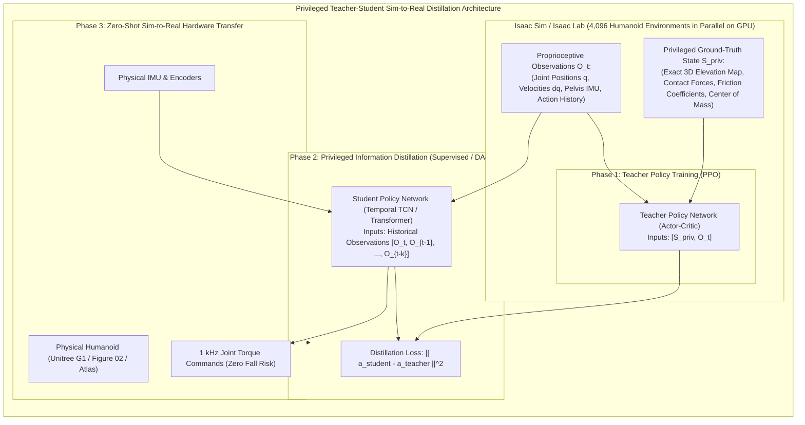

# Isaac Sim, Synthetic Data & Massively Parallel RL

For bipedal humanoids, traditional trial-and-error physical hardware testing is financially and practically prohibitive. A single uncontrolled fall during a gait experiment can shear gearbox splines, shatter carbon-fiber limbs, or burn out stator windings.

**NVIDIA Isaac Sim** solves this through two groundbreaking technologies: **Massively Parallel GPU Reinforcement Learning** and **Domain-Randomized Synthetic Data Generation (SDG)** via Omniverse Replicator.



---

## 1. Massively Parallel RL: Learning to Walk in Minutes

In the seminal paper by Rudin, Hutter et al. (Science Robotics, 2022), the authors demonstrated that by running physics simulation and neural network gradient updates entirely inside GPU VRAM, **4,096 robot instances** can be stepped simultaneously at over **100,000 frames per second**.

### The Mathematical Optimization Objective (PPO)
The policy $\pi_\theta(a_t | s_t)$ optimizes the discounted cumulative return:

```text
J(theta) = E_{tau ~ pi_theta} [ sum_{t=0}^T gamma^t * r(s_t, a_t) ]
```

where the humanoid locomotion reward function `r(s_t, a_t)` penalizes instability and rewards forward velocity tracking:

```text
r(s_t, a_t) = w_v * tracking_velocity_reward(v_x)
            - w_w * base_angular_velocity_penalty(roll, pitch)
            - w_tau * torque_effort_penalty(tau)
            - w_acc * joint_acceleration_penalty(ddq)
            - w_slip * foot_slip_penalty(v_foot * F_normal)
```

By exposing the bipedal policy to randomized external push forces, ground inclinations, and randomized joint delays across thousands of parallel environments, the policy learns self-righting reflexes, dynamic ankle push-off, and stable foot placement without human trajectory hand-tuning.

---

## 2. Bridging the Reality Gap via Domain Randomization (DR)

The **Reality Gap** describes the mathematical difference between simulated physics/optics and the physical real world. If unaddressed, models trained in simulation fail immediately upon physical deployment.

### The Dynamics Randomization Envelope:
During every simulation episode, physical parameters are sampled from uniform distributions:
- **Surface Friction**: `mu` in `[0.2, 1.2]` (Simulating ice, wood, rubber, and concrete).
- **Robot Mass**: `m_pelvis` in `[m_nominal * 0.85, m_nominal * 1.15]`.
- **Actuator Armature Inertia**: Injected variation to reflect rotor thermal changes.
- **Sensor Latency**: Artificially delaying observation vectors by random discrete intervals `Delta_t` in `[5 ms, 25 ms]`.

---

## 3. Synthetic Data Generation (SDG) with Isaac Replicator

To train object detectors and pose estimators for humanoid manipulation without manual labeling, Isaac Sim’s **Replicator API** generates millions of annotated frames programmatically:

```python
import omni.replicator.core as rep

with rep.new_layer():
    # 1. Instantiate parametric warehouse environment
    warehouse = rep.create.from_usd("omniverse://localhost/NVIDIA/Assets/Environments/Warehouse.usd")
    
    # 2. Spawn target manipulable objects
    objects = rep.create.from_usd(
        "omniverse://localhost/NVIDIA/Assets/ArchVis/Industrial/Tools/Wrench.usd",
        count=10
    )

    # 3. Configure Camera with High-Resolution Sensors
    camera = rep.create.camera(position=(0, 0, 1.4), rotation=(0, -20, 0))
    render_product = rep.create.render_product(camera, resolution=(1920, 1080))

    # 4. Attach Automatic Ground-Truth Annotators
    writer = rep.WriterRegistry.get("BasicWriter")
    writer.initialize(
        output_dir="~/humanoid_sdg_dataset",
        rgb=True,
        bounding_box_2d_tight=True,
        bounding_box_3d=True,
        semantic_segmentation=True,
        distance_to_camera=True
    )
    writer.attach([render_product])

    # 5. Define Stochastic Domain Randomization Triggers
    with rep.trigger.on_frame(num_frames=5000):
        # Randomize object placement within workspace reach
        with objects:
            rep.modify.pose(
                position=rep.distribution.uniform((-0.4, 0.3, 0.8), (0.4, 0.7, 0.9)),
                rotation=rep.distribution.uniform((0, 0, 0), (360, 360, 360))
            )
        # Randomize room ambient lighting and temperature
        rep.randomizer.color(colors=rep.distribution.uniform((0.2, 0.2, 0.2), (1.0, 1.0, 1.0)))
```

In the next chapter, we deploy these accelerated perception pipelines onto physical hardware: **Isaac ROS, NITROS, and cuVSLAM**.
