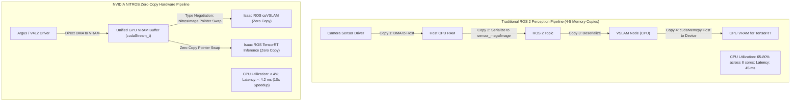

# Isaac ROS, NITROS & Hardware-Accelerated Perception

On a physical humanoid robot, perception is the gateway to intelligent action. However, high-resolution perception creates severe computational bottlenecks: processing two 1080p camera streams at 60 Hz requires moving **746 MB per second** across system memory. If images are copied into CPU RAM, formatted as standard ROS messages, and then copied back to the GPU for deep inference, the CPU cores become saturated, starving real-time locomotion control threads.

**NVIDIA Isaac ROS** solves this through **NITROS (NVIDIA Isaac Transport for ROS)**, implementing direct zero-copy GPU-to-GPU memory transfer alongside specialized acceleration libraries including **cuVSLAM** and **TensorRT**.



---

## 1. Type Adaptation & Negotiation in NITROS

Under the hood, NITROS leverages two advanced ROS 2 core mechanisms:
1. **Type Adaptation (REP-2007)**: Allows nodes to declare custom memory layouts (e.g., `nvidia::isaac_ros::nitros::NitrosImage`) that wrap underlying CUDA memory buffers without modifying standard ROS 2 interface definitions.
2. **Type Negotiation (REP-2009)**: Before establishing a publisher-subscriber connection, the nodes negotiate formats. If both nodes are running on the GPU, they agree on a raw `NitrosImage` pointer swap. If a subscriber is a standard CPU node (like `rviz2`), NITROS automatically triggers a fallback conversion to `sensor_msgs/msg/Image`.

---

## 2. Visual-Inertial Odometry for Bipedal Humanoids: cuVSLAM

Estimating the 6-DOF floating-base trajectory of a humanoid robot is far more demanding than estimating the path of a wheeled rover:
- **Heel-Strike Impact Shock**: Each footstep injects violent high-frequency acceleration spikes into the torso IMU.
- **Head & Torso Oscillation**: Natural human-like walking produces continuous roll, pitch, and yaw oscillations.
- **Visual Blur & Dynamic Occlusion**: Fast swinging arms and moving people create visual feature tracking dropouts.

### The cuVSLAM Architecture
**`isaac_ros_visual_slam`** implements a GPU-accelerated stereo Visual-Inertial Odometry (VIO) pipeline:
- **Optical Flow & Feature Tracking**: Tracks thousands of FAST/ORB features across stereo pairs at 60 Hz in CUDA.
- **Tightly-Coupled Factor Graph Optimization**: Optimizes joint camera projection errors and IMU pre-integration terms inside a sliding-window bundle adjustment formulation:

```text
min_{X} [ sum || r_imu(X_k, X_{k+1}) ||^2 + sum || r_reprojection(X_k, L_j) ||^2 ]
```

where `X_k` represents the robot state (position, velocity, orientation, IMU biases) at timestep `k`, and `L_j` represents 3D landmark locations.

---

## 3. Production Launch Configuration: `isaac_ros_visual_slam`

Below is an industrial Python launch script configuring `isaac_ros_visual_slam` with NITROS zero-copy image transport:

```python
import os
from launch import LaunchDescription
from launch_ros.actions import ComposableNodeContainer
from launch_ros.descriptions import ComposableNode

def generate_launch_description():
    # Load cuVSLAM as an in-process composable node to guarantee zero-copy shared VRAM
    visual_slam_node = ComposableNode(
        package='isaac_ros_visual_slam',
        plugin='nvidia::isaac_ros::visual_slam::VisualSlamNode',
        name='visual_slam_node',
        parameters=[{
            'enable_rectified_pose': True,
            'denoise_input_images': False,
            'enable_imu_fusion': True,              # Tightly-coupled IMU pre-integration
            'gyroscope_noise_density': 0.0002,      # IMU gyro parameters (rad/s/sqrt(Hz))
            'accelerometer_noise_density': 0.017,   # IMU accel parameters (m/s^2/sqrt(Hz))
            'base_frame': 'pelvis_link',
            'map_frame': 'map',
            'odom_frame': 'odom',
            'input_base_frame': 'pelvis_link',
            'enable_slam_visualization': False,
            'enable_landmarks_view': False,
            'rectified_images_are_stereo': True,
        }],
        remappings=[
            ('stereo_camera/left/image', '/humanoid/camera/left/image_rect'),
            ('stereo_camera/left/camera_info', '/humanoid/camera/left/camera_info'),
            ('stereo_camera/right/image', '/humanoid/camera/right/image_rect'),
            ('stereo_camera/right/camera_info', '/humanoid/camera/right/camera_info'),
            ('visual_slam/imu', '/humanoid/sensors/imu/pelvis/data_raw'),
        ]
    )

    container = ComposableNodeContainer(
        name='isaac_ros_container',
        namespace='',
        package='rclcpp_components',
        executable='component_container_mt',       # Multi-threaded container
        composable_node_descriptions=[visual_slam_node],
        output='screen'
    )

    return LaunchDescription([container])
```

In the next chapter, we connect this state estimate to humanoid path traversal: **Nav2 for Bipedal Movement, 3D Elevation Mapping, and Footstep Planning**.
