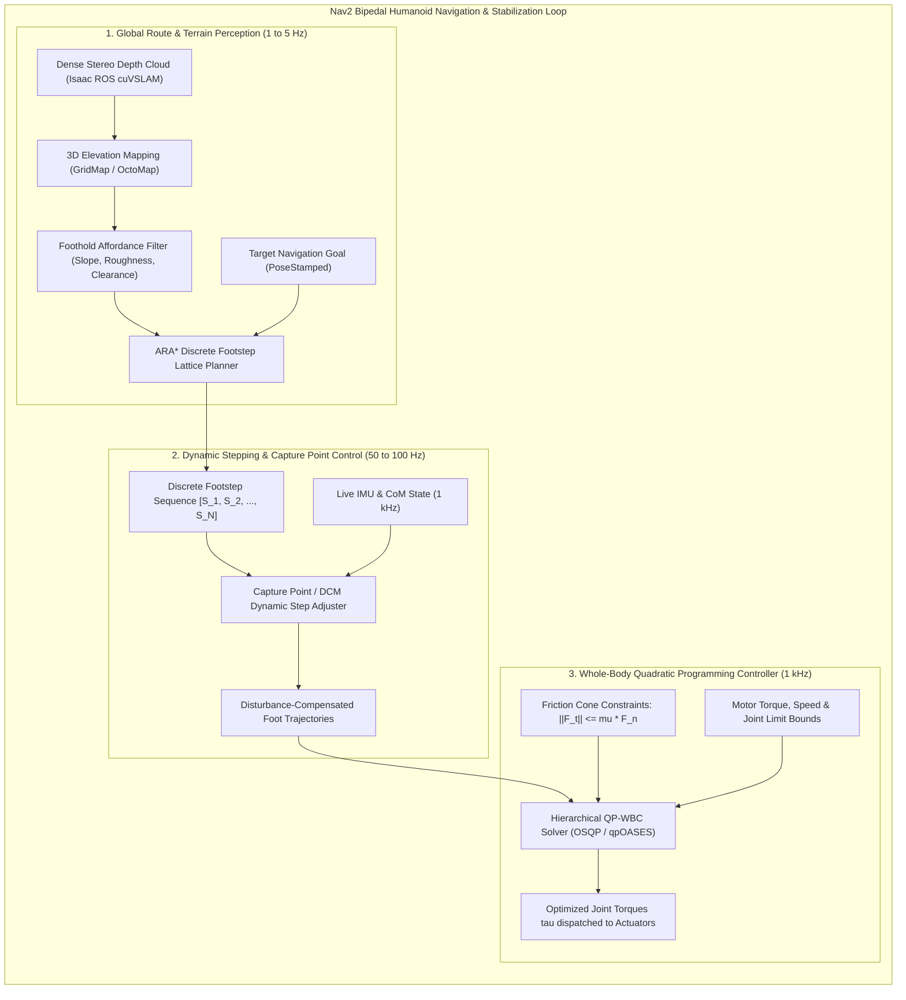
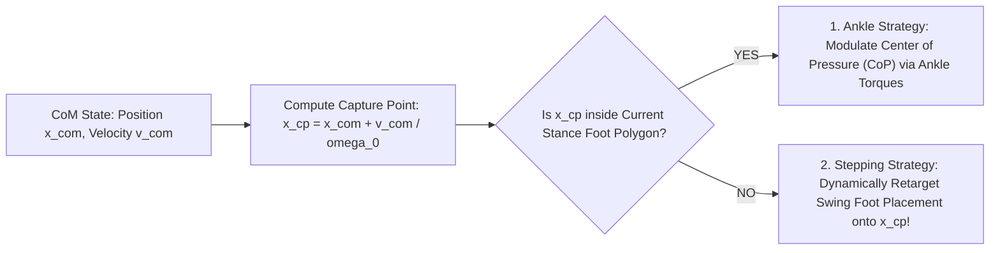

import ChapterProgress from '@site/src/components/ChapterProgress';
import QuizEngine from '@site/src/components/QuizEngine';

# Nav2 for Bipedal Locomotion & Footstep Planning

Standard mobile robot navigation stacks—such as traditional Nav2 deployments for wheeled autonomous mobile robots (AMRs)—represent the physical environment as a 2D planar occupancy grid. On a flat 2D costmap, any ground feature protruding more than a few centimeters above the floor is marked as an impassable obstacle.

For a bipedal humanoid, this 2D planar assumption is fundamentally inadequate:
- A humanoid does not roll across contiguous flat ground; it **steps over** obstacles, cables, and thresholds.
- It **ascends and descends** staircases, curb stones, and uneven terrain.
- It modulates its **foot placement cadence, stance width, and toe clearance** based on 3D geometry and surface friction.

To navigate complex environments, modern bipedal robots adapt the **Nav2** architecture with **3D Multi-Layer Elevation Maps**, **Anytime Repairing $A^*$ ($ARA^*$) Footstep Lattice Planners**, and **Instantaneous Capture Point (ICP) Dynamic Stabilization**.



---

## 1. 3D Terrain Analysis & Elevation Mapping

Instead of a binary 2D grid, the robot constructs a multi-layered 2.5D elevation surface $z = h(x, y)$ using the `grid_map` framework. Each cell $(x, y)$ tracks height variance, surface normal vectors, and friction estimations:

### Foothold Affordance Classification

1. **Surface Slope ($\theta_{\text{slope}}$)**:
   The terrain surface normal $\hat{\mathbf{n}} = [n_x, n_y, n_z]^T$ is estimated via local plane fitting on neighboring point cloud samples:
   $$
   \theta_{\text{slope}} = \arccos(\hat{\mathbf{n}} \cdot \hat{\mathbf{z}}) = \arccos(n_z)
   $$
   If $\theta_{\text{slope}} > \theta_{\text{max}}$ (typically $25^\circ$), the cell is classified as non-traversable due to excessive slip risk.
2. **Surface Roughness ($\sigma_z$)**:
   The local terrain roughness represents the height sample standard deviation across $M$ points in the footprint cell:
   $$
   \sigma_z = \sqrt{\frac{1}{M} \sum_{i=1}^{M} (z_i - \bar{z})^2}
   $$
   Cells exceeding $\sigma_z > 0.03 \text{ m}$ receive elevated traversing costs to penalize unstable footholds.
3. **Step Discontinuity ($\Delta z_{\text{step}}$)**:
   The vertical elevation delta between adjacent support footholds is bounded by leg kinematic reach:
   $$
   |\Delta z_{\text{step}}| \le \Delta z_{\text{max}} \quad (\Delta z_{\text{max}} \approx 0.22 \text{ m for standard staircases})
   $$

---

## 2. Dynamic Stability: 3D-LIPM and the Instantaneous Capture Point

During dynamic walking, the robot's center of mass (CoM) is rarely positioned statically within the stance foot polygon. Dynamic stability is governed by the **3D Linear Inverted Pendulum Model (3D-LIPM)** (Kajita et al., 2003).

### Orbital Energy Conservation in 3D-LIPM

Assuming constant vertical CoM height $z_{\text{com}} = z_c$ and negligible angular momentum around the CoM, the horizontal equation of motion is:

$$
\ddot{x} = \omega_0^2 (x - p_x), \quad \omega_0 = \sqrt{\frac{g}{z_c}}
$$

where $p_x$ is the Center of Pressure (CoP) and $\omega_0$ is the natural pendulum eigenfrequency. Multiplying by $\dot{x}$ and integrating yields the conserved **Orbital Energy**:

$$
E_{\text{orbital}} = \frac{1}{2}\dot{x}^2 - \frac{g}{2 z_c} (x - p_x)^2 = \text{constant}
$$

If $E_{\text{orbital}} > 0$, the pendulum possesses sufficient kinetic energy to vault past the support point $p_x$. If $E_{\text{orbital}} < 0$, the CoM decelerates and reverses direction before passing over the stance foot.

### Instantaneous Capture Point (ICP) and Divergent Component of Motion (DCM)

The Instantaneous Capture Point $\mathbf{x}_{\text{cp}}$ (Pratt et al., 2006; Englsberger et al., 2015) defines the precise ground location where the robot must place its swing foot to bring the moving CoM to a complete stop:

$$
\mathbf{x}_{\text{cp}} = \mathbf{x}_{\text{com}} + \frac{\dot{\mathbf{x}}_{\text{com}}}{\omega_0}
$$



If an external push imparts an instantaneous velocity perturbation $\Delta \mathbf{v}$, the required compensatory footstep location shifts to:

$$
\mathbf{p}_{\text{foot}}^* = \mathbf{x}_{\text{cp}} + \frac{\Delta \mathbf{v}}{\omega_0}
$$

By embedding this formulation within the local planner, the humanoid can recover from external disturbances in real time.

---

## 3. Discrete Footstep Lattice Planning with $ARA^*$

Unlike continuous trajectory optimization, the footstep lattice planner discretizes the search space into kinematically feasible foot placement actions. Let a footstep state be defined as $s = (x, y, \theta, \text{foot})$, where $\text{foot} \in \{\text{LEFT}, \text{RIGHT}\}$.

Successor footstep transitions $\mathcal{A}(s)$ enforce:
- Forward stride reachability: $d_x \in [-0.15, +0.35] \text{ m}$
- Lateral stance clearance: $d_y \in [0.15, 0.28] \text{ m}$ (preventing self-collision)
- Yaw articulation limit: $\Delta \theta \in [-0.35, +0.35] \text{ rad}$

### Anytime Repairing $A^*$ ($ARA^*$) Formulation

To guarantee real-time execution bounds (e.g., producing an updated plan within $50 \text{ ms}$ upon detecting an obstacle), the planner implements **$ARA^*$** (Likhachev et al., 2003). $ARA^*$ accelerates search by inflating the admissible heuristic $h(s)$ by an inflation factor $\epsilon > 1$:

$$
f_\epsilon(s) = g(s) + \epsilon \cdot h(s)
$$

The planner guarantees that the returned path cost is bounded by at most $\epsilon$ times the optimal path cost:

$$
\text{Cost}(\text{Path}) \le \epsilon \cdot \text{Cost}^*
$$

If execution time remains within the planning budget, $\epsilon$ is decremented toward $1.0$, refining the footstep sequence toward global optimality.

---

## 4. Hierarchical Quadratic Programming Whole-Body Control (QP-WBC)

Planned footstep trajectories are mapped to 1 kHz joint torque commands using a Hierarchical Quadratic Program:

$$
\min_{\ddot{\mathbf{q}}, \boldsymbol{\tau}, \boldsymbol{\lambda}} \left[ w_{\text{com}} \|\mathbf{J}_{\text{com}} \ddot{\mathbf{q}} + \dot{\mathbf{J}}_{\text{com}}\dot{\mathbf{q}} - \ddot{\mathbf{x}}_{\text{com}}^{\text{des}}\|^2 + w_{\text{sw}} \|\mathbf{J}_{\text{sw}} \ddot{\mathbf{q}} + \dot{\mathbf{J}}_{\text{sw}}\dot{\mathbf{q}} - \ddot{\mathbf{x}}_{\text{sw}}^{\text{des}}\|^2 + w_{\text{post}} \|\ddot{\mathbf{q}} - \ddot{\mathbf{q}}^{\text{nom}}\|^2 + w_{\boldsymbol{\tau}} \|\boldsymbol{\tau}\|^2 \right]
$$

Subject to strict physical constraints:
1. **Equations of Motion**:
   $$
   \mathbf{M}(\mathbf{q})\ddot{\mathbf{q}} + \mathbf{C}(\mathbf{q}, \dot{\mathbf{q}})\dot{\mathbf{q}} + \mathbf{g}(\mathbf{q}) = \mathbf{S}^T \boldsymbol{\tau} + \sum_{i \in \text{contacts}} \mathbf{J}_{c,i}^T \boldsymbol{\lambda}_i
   $$
2. **Coulomb Friction Cone**:
   $$
   \sqrt{F_{x,i}^2 + F_{y,i}^2} \le \mu F_{z,i}, \quad F_{z,i} \ge F_{\text{min}} > 0
   $$
3. **Actuator Limits**:
   $$
   \boldsymbol{\tau}_{\text{min}} \le \boldsymbol{\tau} \le \boldsymbol{\tau}_{\text{max}}, \quad \mathbf{q}_{\text{min}} \le \mathbf{q} \le \mathbf{q}_{\text{max}}, \quad \dot{\mathbf{q}}_{\text{min}} \le \dot{\mathbf{q}} \le \dot{\mathbf{q}}_{\text{max}}
   $$

Using solvers such as **OSQP** or **qpOASES**, the solution $(\ddot{\mathbf{q}}^*, \boldsymbol{\tau}^*, \boldsymbol{\lambda}^*)$ is resolved in under **$0.4 \text{ ms}$** on the Jetson CPU.

---

## 5. Complete Bipedal Nav2 Behavior Tree Configuration

Below is a complete Nav2 XML Behavior Tree managing the perception, footstep replanning, and recovery behaviors for bipedal locomotion:

```xml
<!--
  biped_navigation_tree.xml
  Nav2 Behavior Tree for Bipedal Humanoid Locomotion with 3D Elevation Refresh
-->
<root main_tree_to_execute="MainTree">
  <BehaviorTree ID="MainTree">
    <RecoveryNode number_of_retries="3" name="NavigateRecovery">
      <PipelineSequence name="NavigateWithReplanning">
        <!-- 1. Synchronize 3D Elevation Costmap from cuVSLAM + Pointcloud -->
        <RateController hz="5.0">
          <RecoveryNode number_of_retries="1" name="ComputePathRecovery">
            <!-- 2. Invoke ARA* Footstep Lattice Planner Action Server -->
            <ComputePathToPose goal="{goal}" path="{path}" planner_id="FootstepLatticePlanner"/>
            <ClearEntireCostmap name="ClearCostmap-Context" service_name="global_costmap/clear_entirely_global_costmap"/>
          </RecoveryNode>
        </RateController>

        <!-- 3. Dispatch Planned Footstep Sequence to WBC Tracking Controller -->
        <FollowPath path="{path}" controller_id="BipedWholeBodyController"/>
      </PipelineSequence>

      <!-- 4. Dynamic Recovery Behaviors upon Fall Risk or Path Obstruction -->
      <ReactiveFallback name="RecoveryFallback">
        <!-- Re-center Capture Point into neutral stance -->
        <RoundRobin name="RecoveryActions">
          <Wait wait_duration="1.0"/>
          <BackUp backup_dist="0.25" backup_speed="0.1"/>
        </RoundRobin>
      </ReactiveFallback>
    </RecoveryNode>
  </BehaviorTree>
</root>
```

---

## 6. Runnable Footstep Planner Implementation

Below is a standalone Python node demonstrating discrete footstep lattice generation with Capture Point checks, outputting standard ROS 2 `nav_msgs/msg/Path` and footstep marker sequences:

```python
"""
biped_footstep_planner.py
Generates dynamically feasible left/right footstep sequences using
Capture Point stability checks and publishes nav_msgs/Path trajectories.
"""

import math
from dataclasses import dataclass
from typing import List, Tuple
import rclpy
from rclpy.node import Node
from geometry_msgs.msg import PoseStamped, Point, Quaternion
from nav_msgs.msg import Path


@dataclass
class Footstep:
    x: float
    y: float
    yaw: float
    is_left: bool


class BipedFootstepPlannerNode(Node):
    """
    Computes discrete footstep lattices for bipedal walking across
    target 2D waypoints with nominal Capture Point stance margins.
    """

    def __init__(self):
        super().__init__("biped_footstep_planner_node")

        self.path_pub = self.create_publisher(Path, "/humanoid/footstep_path", 10)
        self.step_length = 0.30       # Forward step size (meters)
        self.nominal_stance = 0.20    # Inter-foot lateral stance width (meters)
        self.com_height = 0.82        # CoM elevation (meters)
        self.omega_0 = math.sqrt(9.81 / self.com_height)

        self.get_logger().info("BipedFootstepPlannerNode initialized.")
        self.timer = self.create_timer(2.0, self.plan_and_publish_demo_path)

    def compute_capture_point(self, com_pos: float, com_vel: float) -> float:
        """Evaluates 1D Instantaneous Capture Point: x_cp = x + v / omega_0"""
        return com_pos + (com_vel / self.omega_0)

    def plan_footstep_sequence(
        self, start_pos: Tuple[float, float], goal_pos: Tuple[float, float]
    ) -> List[Footstep]:
        """
        Discretizes a straight line trajectory into staggered left/right footsteps.
        """
        dx = goal_pos[0] - start_pos[0]
        dy = goal_pos[1] - start_pos[1]
        distance = math.hypot(dx, dy)
        heading = math.atan2(dy, dx)

        num_steps = max(2, int(distance / self.step_length))
        footsteps: List[Footstep] = []

        is_left = True
        for i in range(num_steps + 1):
            progress = min(1.0, (i * self.step_length) / distance)
            center_x = start_pos[0] + progress * dx
            center_y = start_pos[1] + progress * dy

            # Stagger laterally by stance width
            lateral_offset = (self.nominal_stance / 2.0) if is_left else (-self.nominal_stance / 2.0)
            step_x = center_x - lateral_offset * math.sin(heading)
            step_y = center_y + lateral_offset * math.cos(heading)

            footsteps.append(Footstep(x=step_x, y=step_y, yaw=heading, is_left=is_left))
            is_left = not is_left

        return footsteps

    def plan_and_publish_demo_path(self):
        start = (0.0, 0.0)
        goal = (3.0, 0.5)
        steps = self.plan_footstep_sequence(start, goal)

        path_msg = Path()
        path_msg.header.stamp = self.get_clock().now().to_msg()
        path_msg.header.frame_id = "odom"

        for step in steps:
            pose = PoseStamped()
            pose.header = path_msg.header
            pose.pose.position.x = step.x
            pose.pose.position.y = step.y
            pose.pose.position.z = 0.0

            # Convert yaw to planar quaternion
            pose.pose.orientation.z = math.sin(step.yaw / 2.0)
            pose.pose.orientation.w = math.cos(step.yaw / 2.0)
            path_msg.poses.append(pose)

        self.path_pub.publish(path_msg)
        self.get_logger().info(f"Published footstep plan containing {len(steps)} discrete stances.")


def main(args=None):
    rclpy.init(args=args)
    node = BipedFootstepPlannerNode()
    try:
        rclpy.spin_once(node, timeout_sec=0.1)
    except KeyboardInterrupt:
        pass
    node.destroy_node()
    rclpy.shutdown()


if __name__ == "__main__":
    main()
```

---

## 7. Summary & Seminal Literature

Navigating a bipedal humanoid requires replacing planar assumptions with 3D elevation representations and dynamically balanced footstep placement. By combining 3D-LIPM orbital energy conservation, Instantaneous Capture Point bounds, $ARA^*$ anytime lattice search, and 1 kHz Hierarchical QP Whole-Body Control, modern humanoids achieve stable walking across non-flat real-world terrain.

### Seminal Research Citations
1. **Pratt, J., Carff, J., Drakunov, S., & Goswami, A. (2006).** *Capture point: A step towards agile humanoid locomotion*. IEEE-RAS International Conference on Humanoid Robots (Humanoids).
2. **Kajita, S., Kanehiro, F., Kaneko, K., Fujiwara, K., Harada, K., & Hirukawa, H. (2003).** *Biped walking pattern generation by using preview control of zero-moment point*. IEEE International Conference on Robotics and Automation (ICRA).
3. **Likhachev, M., Gordon, G. J., & Thrun, S. (2003).** *ARA*: Anytime A* with provable bounds on sub-optimality*. Advances in Neural Information Processing Systems (NeurIPS).
4. **Englsberger, J., Ott, C., & Albu-Schäffer, A. (2015).** *Three-dimensional bipedal walking control using Divergent Component of Motion*. IEEE Transactions on Robotics, 31(2), 355–368.

---

<ChapterProgress chapterId="3-4-nav2-for-bipedal-movement" moduleId="module3" totalChapters={10} />

## Chapter Mastery Check

<QuizEngine
  quizId="quiz-3-4"
  title="Module 3.4 Mastery Check: Nav2 & Bipedal Footstep Planning"
  moduleId="module3"
  passThreshold={70}
  questions={[
    {
      id: "q1",
      question: "In the 3D Linear Inverted Pendulum Model (3D-LIPM), what is the definition and physical significance of the Instantaneous Capture Point (x_cp)?",
      options: [
        "It is the center of mass projected vertically onto the floor",
        "It is the exact ground point where placing the swing foot brings the moving center of mass to a complete rest: x_cp = x_com + v_com / omega_0",
        "It is the maximum height the swing leg can lift during stair ascension",
        "It is the angle of maximum ankle pitch torque saturation"
      ],
      correctIndex: 1,
      explanation: "The Capture Point x_cp represents the ground target that absorbs the CoM kinetic energy via gravitational deceleration, stopping forward motion without requiring external tethering."
    },
    {
      id: "q2",
      question: "Why must standard 2D costmaps be replaced with 3D elevation maps (such as grid_map or OctoMap) for bipedal humanoid navigation?",
      options: [
        "Because 2D costmaps consume too much GPU VRAM",
        "Because 2D costmaps treat all obstacles above floor level as impassable, preventing the humanoid from stepping over small objects or climbing stairs",
        "Because 2D costmaps do not support ROS 2 DDS transport",
        "Because 2D costmaps only work with ultrasonic rangefinders"
      ],
      correctIndex: 1,
      explanation: "A humanoid has the mechanical affordance to step over thresholds and climb stairs. A 2D costmap marks any non-zero height cell as a wall, rendering legitimate stepping affordances unreachable."
    },
    {
      id: "q3",
      question: "In the ARA* footstep lattice planning algorithm, what does an inflation factor epsilon > 1 accomplish?",
      options: [
        "It increases the physical clearance between the humanoid's left and right feet",
        "It scales the heuristic function to accelerate the search for an initial bounded suboptimal plan, which is subsequently refined as planning time permits",
        "It increases the joint motor torque limits by a factor of epsilon",
        "It filters out high-frequency noise from the IMU accelerometer"
      ],
      correctIndex: 1,
      explanation: "ARA* (Anytime Repairing A*) multiplies the admissible heuristic by epsilon > 1 to greedily discover a valid footstep plan within tight real-time budgets, then systematically decrements epsilon toward 1.0 to converge toward optimality."
    },
    {
      id: "q4",
      question: "What physical constraint prevents the Whole-Body Quadratic Programming Controller from commanding infinite ground reaction forces during step contact?",
      options: [
        "The Nyquist-Shannon sampling theorem",
        "The Coulomb friction cone constraint: ||F_t|| <= mu * F_n, and F_n >= 0",
        "The Docusaurus Markdown compiler limit",
        "The maximum USB bus transfer rate"
      ],
      correctIndex: 1,
      explanation: "Real contacts can only push against the ground (F_n >= 0) and cannot exceed the friction cone limit (tangential shear force bounded by mu * F_n) without slipping uncontrollably."
    }
  ]}
/>
