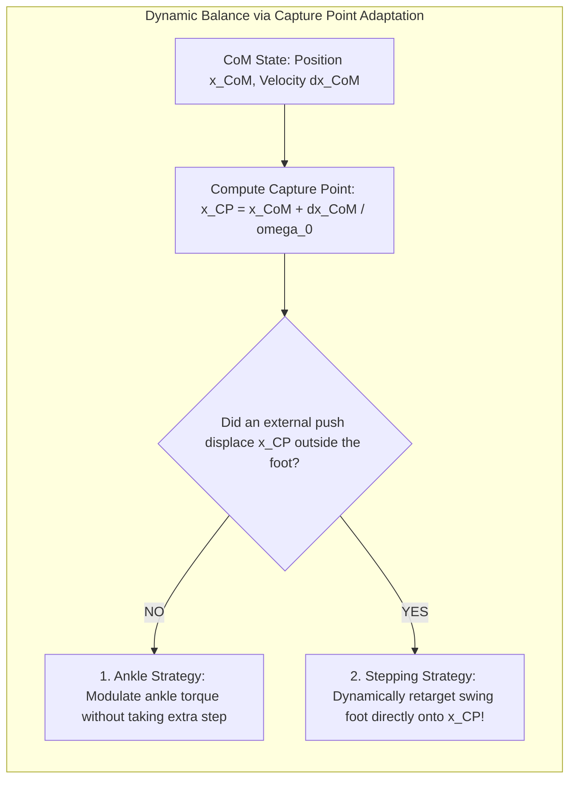
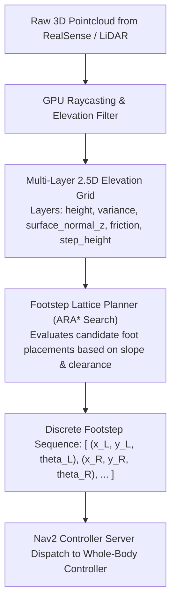

# Nav2 for Bipedal Locomotion & Footstep Planning

Standard mobile robot navigation stacks (e.g., standard Nav2 for wheeled AMRs) model the world as a 2D occupancy grid where any non-zero height obstacle represents an impassable collision. 

For a humanoid robot, this 2D paradigm is fundamentally broken. A humanoid does not roll across flat floors: it **steps over** ground cables, **climbs up** stairwells, **traverses** uneven stepping stones, and **adjusts its stance width** dynamically.

Modern bipedal navigation integrates **Nav2 3D Elevation Mapping**, **Discrete Footstep Lattice Planners**, and **Capture Point Dynamic Stabilization**.


---

## 1. Why 2D Costmaps Fail: The 3D Elevation Mapping Solution

A 15 cm step is considered an impassable obstacle by standard Nav2 costmaps. To enable humanoids to navigate real human environments, the terrain is represented as an **Elevation Map** $z = h(x, y)$ computed from GPU point clouds:

1. **Cell Slope Angle**:
   ```text
   theta = arccos( normal_z )
   ```
   If `theta > 25°`, the cell is classified as non-traversable.
2. **Cell Roughness (Height Variance)**:
   ```text
   sigma_z = sqrt( (1/M) * sum( (z_i - z_mean)^2 ) )
   ```
   Excessive roughness marks the foothold as slipping-prone.
3. **Step Height Difference**:
   Differences between consecutive footholds are bounded by maximum leg articulation reach:
   ```text
   Delta_z <= 0.22 meters (Maximum step climb threshold)
   ```

---

## 2. Dynamic Stability: The Capture Point (CP) & Divergent Component of Motion

During dynamic walking, the Center of Mass (CoM) is almost never statically supported inside the footprint polygon. Dynamic balance is governed by the **Linear Inverted Pendulum Model (LIPM)** and the **Capture Point** (Pratt et al., 2006).

### The Capture Point Mathematical Formulation
The Capture Point `x_CP` is the exact location on the ground where the humanoid must place its swing foot to bring the moving center of mass to a complete halt:

```text
x_CP = x_CoM + ( dx_CoM / omega_0 )
```

where:
- **`x_CoM`**: Horizontal position of the center of mass.
- **`dx_CoM`**: Horizontal velocity of the center of mass.
- **`omega_0`**: Natural pendulum frequency:

```text
omega_0 = sqrt( g / z_CoM )
```

(for typical humanoid center of mass height `z_CoM ≈ 0.85 m`, `omega_0 ≈ 3.4 rad/s`).



If an external disturbance pushes the robot, the local step generator dynamically shifts the upcoming swing foot touchdown target to intercept `x_CP`, absorbing the kinetic energy and preventing a fall.

---

## 3. Whole-Body Control: Hierarchical Quadratic Programming (QP-WBC)

Once footstep trajectories are planned, they are executed by a **Whole-Body Quadratic Programming Controller** running at 1 kHz:

```text
min_{ddq, tau, lambda} [ 
  w_com * || J_com * ddq + dJ_com * dq - dd_x_des_com ||^2 +
  w_swing * || J_swing * ddq + dJ_swing * dq - dd_x_des_swing ||^2 +
  w_posture * || ddq - ddq_nominal ||^2 +
  w_tau * || tau ||^2 
]
```

**Subject to strict physical constraints**:
1. Floating-base equations of motion:
   ```text
   M(q) * ddq + C(q, dq) * dq + g(q) = S^T * tau + sum( J_ci^T * lambda_i )
   ```
2. Coulomb friction cone constraints on ground reaction forces:
   ```text
   sqrt( F_x^2 + F_y^2 ) <= mu * F_z,   F_z >= 0
   ```
3. Hardware joint torque and speed limits:
   ```text
   tau_min <= tau <= tau_max,   q_min <= q <= q_max
   ```

Using modern real-time QP solvers such as **OSQP** or **qpOASES**, the solution `(ddq*, tau*, lambda*)` is found in under **0.5 milliseconds**, driving the physical joint motors directly.

---

## 4. 3D Elevation Mapping & Footstep Lattice Planning

Unlike wheeled robots that navigate 2D costmaps, humanoids step over obstacles, ascend stairs, and traverse broken terrain using **3D Elevation Mapping** (`grid_map` / `elevation_mapping` ROS 2 package):



1. **Surface Normal Verification**: Every candidate footstep is validated: the surface normal must satisfy `n_z >= cos(20 deg)` to prevent foot slip on steep grades.
2. **Step Height Discontinuity**: Curvature checks detect stair edges, ensuring the heel does not overhang stair nosing.

In the next chapter, we synthesize these tools into a comprehensive hands-on project: **Autonomous Humanoid Goal Navigation with cuVSLAM and Nav2**.
