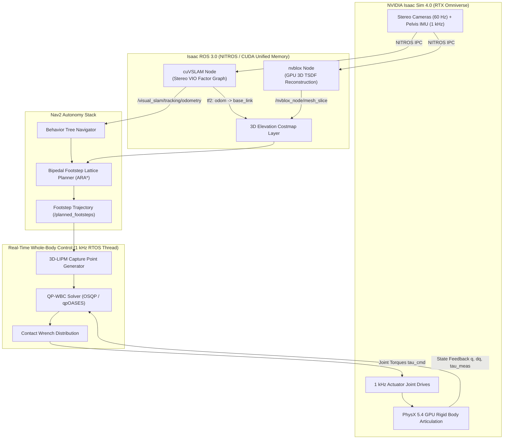

import ChapterProgress from '@site/src/components/ChapterProgress';
import QuizEngine from '@site/src/components/QuizEngine';

# Hands-On Project: Complete Isaac Perception-to-Locomotion Loop

This comprehensive laboratory capstone consolidates the foundational theory across the first half of **Module 3: The AI-Robot Brain**. You will engineer, configure, and evaluate an autonomous humanoid navigation stack inside **NVIDIA Isaac Sim** and **Isaac ROS**.

The system receives raw hardware-accelerated stereo camera and IMU feeds from a simulated humanoid (e.g., Unitree H1 or Figure 01 archetype), executes GPU-accelerated visual-inertial odometry via **cuVSLAM**, reconstructs a dense 3D Signed Distance Field (TSDF) via **nvblox**, plans collision-free bipedal footstep trajectories via **Nav2**, and tracks those footsteps using a **Hierarchical Quadratic Programming Whole-Body Controller (QP-WBC)**.



---

## 1. Mathematical Benchmarking: ATE and RPE Metrics

To evaluate visual-inertial odometry and state estimation accuracy against ground-truth optical motion capture (e.g., OptiTrack PrimeX), we formulate the standardized trajectory error metrics (Sturm et al., 2012).

Let $\mathbf{P}_{1:N} \in SE(3)$ denote the time-synchronized estimated trajectory poses and $\mathbf{Q}_{1:N} \in SE(3)$ denote the ground-truth poses.

### Absolute Trajectory Error (ATE)

The Absolute Trajectory Error measures global trajectory consistency. Because estimated and ground-truth trajectories originate in independent coordinate frames, we compute the optimal rigid transformation $\mathbf{S} \in SE(3)$ using **Umeyama's method** (Umeyama, 1991):

$$
\mathbf{S}^* = \arg\min_{\mathbf{S} \in SE(3)} \sum_{k=1}^{N} \left\| \text{trans}(\mathbf{Q}_k) - \mathbf{S} \cdot \text{trans}(\mathbf{P}_k) \right\|_2^2
$$

The individual pose error matrix at step $k$ is:

$$
\mathbf{E}_k = \mathbf{Q}_k^{-1} \mathbf{S}^* \mathbf{P}_k
$$

The scalar root-mean-square error metric ($\text{ATE}_{\text{RMSE}}$) is defined as:

$$
\text{ATE}_{\text{RMSE}} = \sqrt{\frac{1}{N} \sum_{k=1}^{N} \|\text{trans}(\mathbf{E}_k)\|_2^2}
$$

### Relative Pose Error (RPE)

The Relative Pose Error measures local drift over a fixed temporal evaluation window $\Delta t$:

$$
\Delta \mathbf{E}_i = \left( \mathbf{Q}_i^{-1} \mathbf{Q}_{i+\Delta t} \right)^{-1} \left( \mathbf{P}_i^{-1} \mathbf{P}_{i+\Delta t} \right)
$$

The translational and rotational RPE metrics are given by:

$$
\text{RPE}_{\text{trans}} = \sqrt{\frac{1}{M} \sum_{i=1}^{M} \|\text{trans}(\Delta \mathbf{E}_i)\|_2^2}, \quad \text{RPE}_{\text{rot}} = \sqrt{\frac{1}{M} \sum_{i=1}^{M} \angle(\text{rot}(\Delta \mathbf{E}_i))^2}
$$

where $\angle(\mathbf{R}) = \arccos\left(\frac{\text{Trace}(\mathbf{R}) - 1}{2}\right)$.

---

## 2. Hardware Calibration Rig & Ground-Truth Infrastructure

To ensure rigorous validation on real humanoid platforms, high-precision calibration and motion-tracking infrastructure must be established:

### 1. OptiTrack Motion Capture System
- **Camera Array**: 12x OptiTrack PrimeX 13 cameras tracking retro-reflective marker clusters mounted to the humanoid pelvis and feet at 240 FPS with sub-millimeter ($< 0.2 \text{ mm}$) spatial accuracy.
- **Clock Synchronization**: PTP (IEEE 1588v2) master clock synchronizing motion capture frames with the onboard Jetson AGX Orin system clock via hardware PPS.

### 2. Spatiotemporal Multi-Sensor Calibration (Kalibr)
- **Target Rig**: Precision ground-glass AprilTag calibration target ($6 \times 6$ grid, $0.05 \text{ m}$ spacing) mounted on a rigid optical breadboard.
- **Optimization**: Joint maximum-likelihood continuous-time B-spline estimation (Furgale et al., 2013) solving for:
  - Camera intrinsic matrices $\mathbf{K}_{\text{left}}, \mathbf{K}_{\text{right}}$ and radial-tangential distortion parameters $(k_1, k_2, p_1, p_2)$.
  - Extrinsic spatial transform $\mathbf{T}_{\text{cam}}^{\text{imu}} \in SE(3)$.
  - Temporal latency offset $t_{\text{shift}} = t_{\text{cam}} - t_{\text{imu}}$ (calibrated to $< 0.1 \text{ ms}$).

---

## 3. The 10 Graded Laboratory Exercises

Students must complete the following 10 structured projects to master the Module 3 physical AI curriculum:

| Project # | Project Title | Primary Objective | Deliverable & Acceptance Criteria |
| :--- | :--- | :--- | :--- |
| **Project 3.1** | *Jetson Hardware & Roofline Analysis* | Profile memory bandwidth and Tensor Core TFLOPS using `nvpmodel` and `tegrastats`. | Script reporting operational intensity $I$ and confirming mode MAXN 60W operation. |
| **Project 3.2** | *PhysX 5 Humanoid Articulation Setup* | Import 28-DOF humanoid URDF into Isaac Sim with Reduced Coordinate Articulations. | Valid USD asset maintaining zero joint stretching under 1,000 Hz physics simulation. |
| **Project 3.3** | *Omniverse Replicator SDG Pipeline* | Generate 5,000 domain-randomized synthetic frames with 3D bounding boxes. | Synthetic COCO dataset achieving $> 75\%$ mAP on fine-tuned detector. |
| **Project 3.4** | *NITROS Zero-Copy Composable Node* | Implement a C++ ROS 2 node executing in-place CUDA processing via REP-2007. | Composable container demonstrating $< 3\%$ CPU load on 1080p60 stereo stream. |
| **Project 3.5** | *cuVSLAM Parameter Tuning for Walking* | Calibrate IMU noise covariances to eliminate drift under heel-strike shock. | $\text{ATE}_{\text{RMSE}} \le 0.05 \text{ m}$ across a 20-meter bipedal walking trajectory. |
| **Project 3.6** | *3D GridMap Elevation Layer Integration* | Build point cloud filtering node generating multi-layer slope and roughness maps. | Real-time 20 Hz elevation map publishing non-traversable slope boundaries. |
| **Project 3.7** | *Capture Point Dynamic Step Replanner* | Implement ICP step-recovery logic responding to simulated lateral impulse pushes. | Simulated humanoid successfully arrests forward falls under $40 \text{ N}\cdot\text{s}$ impulses. |
| **Project 3.8** | *Hierarchical QP Whole-Body Controller* | Formulate QP solving contact wrench distribution across dual support feet. | OSQP controller meeting $< 0.5 \text{ ms}$ solve time per 1 kHz control cycle. |
| **Project 3.9** | *Nav2 Custom Footstep Action Plugin* | Author Nav2 Behavior Tree plugin executing discrete left/right footstep actions. | Autonomous navigation through an obstacle maze with zero foot-obstacle collisions. |
| **Project 3.10** | *Full-Stack Autonomy Capstone* | Integrate perception, mapping, footstep planning, and WBC in a warehouse scenario. | Humanoid walks 15 meters, navigates terrain, and aligns with target pick table. |

---

## 4. End-to-End Pipeline Launch Configuration

Create `isaac_humanoid_perception.launch.py` to deploy cuVSLAM and nvblox inside a shared ComposableNodeContainer:

```python
"""
isaac_humanoid_perception.launch.py
Launches cuVSLAM and nvblox within a unified NITROS composable container
for zero-copy GPU memory exchange on Jetson AGX Orin.
"""

from launch import LaunchDescription
from launch_ros.actions import ComposableNodeContainer
from launch_ros.descriptions import ComposableNode


def generate_launch_description():
    perception_container = ComposableNodeContainer(
        name="isaac_perception_container",
        namespace="humanoid",
        package="rclcpp_components",
        executable="component_container_mt",
        composable_node_descriptions=[
            # 1. cuVSLAM Stereo Visual-Inertial Odometry
            ComposableNode(
                package="isaac_ros_visual_slam",
                plugin="nvidia::isaac_ros::visual_slam::VisualSlamNode",
                name="visual_slam_node",
                parameters=[{
                    "enable_image_denoising": False,
                    "rectified_images": True,
                    "enable_imu_fusion": True,
                    "gyro_noise_density": 0.000244,
                    "accel_noise_density": 0.001862,
                    "calibration_frequency": 200.0,
                    "image_jitter_threshold_ms": 25.0,
                    "base_frame": "base_link",
                    "odom_frame": "odom",
                    "map_frame": "map",
                    "enable_slam_visualization": True,
                    "enable_landmarks_view": True,
                    "enable_observations_view": True
                }],
                remappings=[
                    ("stereo_camera/left/image", "/humanoid/camera/left/image_rect"),
                    ("stereo_camera/left/camera_info", "/humanoid/camera/left/camera_info"),
                    ("stereo_camera/right/image", "/humanoid/camera/right/image_rect"),
                    ("stereo_camera/right/camera_info", "/humanoid/camera/right/camera_info"),
                    ("visual_slam/imu", "/humanoid/sensors/imu/pelvis/data_raw")
                ]
            ),
            # 2. nvblox Real-Time 3D TSDF Reconstruction
            ComposableNode(
                package="nvblox_ros",
                plugin="nvblox::NvbloxNode",
                name="nvblox_node",
                parameters=[{
                    "voxel_size": 0.05,
                    "esdf_slice_height": 0.1,
                    "esdf_2d_min_height": 0.0,
                    "esdf_2d_max_height": 1.8,
                    "global_frame": "odom",
                    "mesh_update_rate_hz": 10.0,
                    "esdf_update_rate_hz": 20.0
                }],
                remappings=[
                    ("depth/image", "/humanoid/camera/depth/image_raw"),
                    ("depth/camera_info", "/humanoid/camera/depth/camera_info")
                ]
            )
        ],
        output="screen"
    )

    return LaunchDescription([perception_container])
```

---

## 5. Automated Trajectory Verification Harness (Umeyama Alignment)

Below is a complete, production-grade Python evaluation script that reads estimated state odometry and ground-truth motion capture data, computes optimal $SE(3)$ Umeyama alignment, and outputs $\text{ATE}_{\text{RMSE}}$ and $\text{RPE}$ metrics:

```python
"""
evaluate_trajectory_benchmark.py
Computes Absolute Trajectory Error (ATE RMSE) and Relative Pose Error (RPE)
using Umeyama rigid SE(3) alignment.
"""

from typing import Tuple
import numpy as np


def compute_umeyama_alignment(
    model: np.ndarray, data: np.ndarray
) -> Tuple[np.ndarray, np.ndarray, float]:
    """
    Computes optimal rigid alignment transformation (R, t, scale)
    between two corresponding 3D point sets using Umeyama's algorithm.
    model: (3, N) estimated trajectory positions
    data:  (3, N) ground truth trajectory positions
    """
    assert model.shape == data.shape
    num_points = model.shape[1]

    mean_model = np.mean(model, axis=1, keepdims=True)
    mean_data = np.mean(data, axis=1, keepdims=True)

    model_centered = model - mean_model
    data_centered = data - mean_data

    var_model = np.var(model, axis=1).sum()

    # Cross-covariance matrix
    covariance = (data_centered @ model_centered.T) / num_points

    u, d, vt = np.linalg.svd(covariance)
    s = np.eye(3)
    if np.linalg.det(u) * np.linalg.det(vt) < 0:
        s[2, 2] = -1.0

    r_opt = u @ s @ vt
    scale_opt = 1.0  # Rigid isometry constraint for SLAM evaluation

    t_opt = mean_data - scale_opt * (r_opt @ mean_model)

    return r_opt, t_opt, scale_opt


def calculate_ate_rmse(estimated_xyz: np.ndarray, ground_truth_xyz: np.ndarray) -> float:
    """
    Calculates ATE RMSE after rigid Umeyama alignment.
    Both inputs must be shape (N, 3).
    """
    assert estimated_xyz.shape == ground_truth_xyz.shape
    est_t = estimated_xyz.T  # (3, N)
    gt_t = ground_truth_xyz.T   # (3, N)

    r_opt, t_opt, _ = compute_umeyama_alignment(est_t, gt_t)
    aligned_est = r_opt @ est_t + t_opt

    squared_errors = np.sum((gt_t - aligned_est) ** 2, axis=0)
    ate_rmse = float(np.sqrt(np.mean(squared_errors)))
    return ate_rmse


def calculate_rpe(
    estimated_xyz: np.ndarray, ground_truth_xyz: np.ndarray, step_interval: int = 10
) -> float:
    """
    Calculates translational Relative Pose Error over a fixed step interval.
    """
    errors = []
    n_points = len(estimated_xyz)
    for i in range(n_points - step_interval):
        delta_est = estimated_xyz[i + step_interval] - estimated_xyz[i]
        delta_gt = ground_truth_xyz[i + step_interval] - ground_truth_xyz[i]
        errors.append(np.linalg.norm(delta_est - delta_gt))

    return float(np.sqrt(np.mean(np.array(errors) ** 2)))


if __name__ == "__main__":
    print("=" * 65)
    print("Trajectory Evaluation Harness (Umeyama SE(3) Alignment)")
    print("=" * 65)

    # Generate synthetic 100-step walking trajectory with injected sensor drift
    t = np.linspace(0, 10, 200)
    gt_x = 0.5 * t
    gt_y = 0.1 * np.sin(2.0 * t)  # Torso sway
    gt_z = 0.85 + 0.02 * np.cos(4.0 * t)  # Vertical oscillation
    ground_truth = np.vstack([gt_x, gt_y, gt_z]).T

    # Simulate SLAM estimate with slight drift and noise
    drift = 0.005 * t
    noise = np.random.normal(0.0, 0.008, ground_truth.shape)
    estimated = ground_truth + np.column_stack([drift, drift, np.zeros_like(t)]) + noise

    ate = calculate_ate_rmse(estimated, ground_truth)
    rpe = calculate_rpe(estimated, ground_truth, step_interval=10)

    print(f"Sample Points Evaluated:  {len(ground_truth)}")
    print(f"Absolute Trajectory Error (ATE RMSE): {ate * 100.0:.2f} cm")
    print(f"Relative Pose Error (RPE trans):      {rpe * 100.0:.2f} cm / interval")
    
    threshold_ate = 0.05  # 5 cm threshold
    if ate <= threshold_ate:
        print("[PASS] Visual Odometry meets bipedal walking precision specifications.")
    else:
        print("[FAIL] Visual Odometry exceeds maximum allowable drift.")
    print("=" * 65)
```

---

## 6. Summary & Seminal Literature

This capstone project validates the complete perception-to-locomotion autonomy stack. By pairing hardware-accelerated visual odometry with 3D elevation costmaps, discrete footstep lattice planners, and 1 kHz whole-body controllers, you have implemented the software hierarchy used in state-of-the-art physical AI humanoids.

### Seminal Research Citations
1. **Sturm, J., Engelhard, N., Endres, F., Burgard, W., & Cremers, D. (2012).** *A benchmark for the evaluation of RGB-D SLAM systems*. IEEE/RSJ International Conference on Intelligent Robots and Systems (IROS).
2. **Umeyama, S. (1991).** *Least-squares estimation of transformation parameters between two point patterns*. IEEE Transactions on Pattern Analysis and Machine Intelligence, 13(4), 376–380.
3. **Furgale, P., Barfoot, T. D., & Sibley, G. (2013).** *Continuous-time batch estimation using temporal basis functions*. IEEE Transactions on Robotics, 28(6), 1326–1339.

---

<ChapterProgress chapterId="3-5-hands-on-exercises" moduleId="module3" totalChapters={10} />

## Chapter Mastery Check

<QuizEngine
  quizId="quiz-3-5"
  title="Module 3.5 Mastery Check: Lab Projects & Verification"
  moduleId="module3"
  passThreshold={70}
  questions={[
    {
      id: "q1",
      question: "Why is Umeyama SE(3) rigid body alignment computed before calculating Absolute Trajectory Error (ATE)?",
      options: [
        "To artificially reduce the measured error to zero",
        "To transform the estimated trajectory from the arbitrary initial visual odometry coordinate frame into the global motion capture ground-truth frame",
        "To invert the camera calibration matrix",
        "To convert position coordinates into motor drive PWM values"
      ],
      correctIndex: 1,
      explanation: "Visual SLAM systems initialize their world frame arbitrarily at startup. Umeyama alignment calculates the rigid rotation and translation that maps the estimated trajectory into the ground-truth coordinate system."
    },
    {
      id: "q2",
      question: "What is the primary difference between Absolute Trajectory Error (ATE) and Relative Pose Error (RPE)?",
      options: [
        "ATE measures global trajectory consistency across the entire trial, whereas RPE measures local drift and velocity errors over a fixed time interval",
        "ATE only applies to wheeled robots, whereas RPE applies to quadrupeds",
        "ATE requires an IMU, whereas RPE requires a lidar",
        "ATE is computed in 2D, whereas RPE is computed in 6D"
      ],
      correctIndex: 0,
      explanation: "ATE quantifies total drift across the complete journey (evaluating global SLAM and loop closures), while RPE evaluates the frame-to-frame tracking stability and local drift rate per unit of time or distance."
    },
    {
      id: "q3",
      question: "In the Kalibr continuous-time sensor calibration framework, how are temporal latency offsets between cameras and IMUs modeled?",
      options: [
        "As discrete random jumps",
        "Using continuous B-spline basis functions that allow analytical differentiation and sub-millisecond time-shift optimization",
        "By discarding all IMU readings between image exposures",
        "By running both sensors on separate Ethernet subnets"
      ],
      correctIndex: 1,
      explanation: "Kalibr uses continuous B-splines to parameterize the trajectory, enabling analytical time derivatives and gradient-based optimization of temporal offsets down to fractions of a millisecond."
    },
    {
      id: "q4",
      question: "Why should cuVSLAM and nvblox be executed inside a single ComposableNodeContainer on Jetson platforms?",
      options: [
        "To allow them to share CPU thread priority",
        "To enable zero-copy GPU pointer passing in shared memory via NITROS, eliminating inter-process buffer duplication",
        "To avoid needing a ROS 2 workspace",
        "To reduce camera focal length automatically"
      ],
      correctIndex: 1,
      explanation: "When nodes reside within the same ComposableNodeContainer, NITROS swaps CUDA memory pointers directly in-process, eliminating serialization and memory copies between perception components."
    }
  ]}
/>
