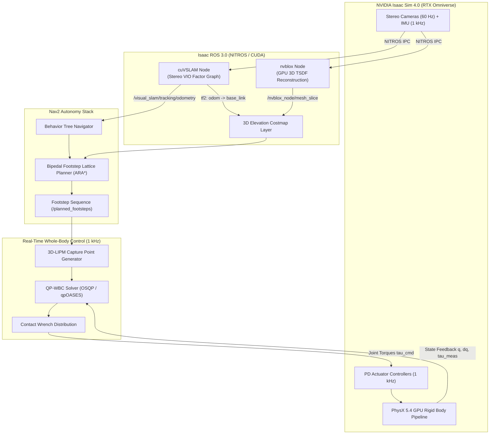

# Hands-On Project: Complete Isaac Perception-to-Locomotion Loop

This capstone project synthesizes the core concepts of **Module 3: The AI Robot Brain**. You will engineer and execute an end-to-end autonomous humanoid autonomy stack inside **NVIDIA Isaac Sim 4.0** and **Isaac ROS 3.0**. 

The system receives raw hardware-accelerated stereo camera and IMU feeds from a simulated humanoid (e.g., Unitree H1 or Figure 01 archetype), executes GPU-accelerated visual-inertial odometry via **cuVSLAM**, reconstructs a dense 3D Signed Distance Field (TSDF) via **nvblox**, plans collision-free bipedal footstep trajectories via **Nav2**, and tracks those footsteps using a **Quadratic Programming Whole-Body Controller (QP-WBC)**.

---

## 1. System Architecture & Information Flow

The architecture decouples high-frequency dynamic stability (1 kHz on CPU / RTOS) from heavy visual perception and global navigation (30–60 Hz on GPU):



---

## 2. Environment Setup & Prerequisites

### System Requirements
- **Host GPU**: NVIDIA RTX 4080 / RTX A5000 or higher (16 GB+ VRAM required for concurrent PhysX + cuVSLAM + nvblox).
- **Driver**: NVIDIA Linux display driver `&gt;= 535.129.03`.
- **Containers**: Isaac Sim 4.0.0 Workstation container and Isaac ROS 3.0 Development Container.
- **ROS 2**: Humble Hawksbill / Iron Irwini on Ubuntu 22.04 LTS.

Verify CUDA acceleration and Isaac ROS NITROS dependencies inside your shell:

```bash
# Verify NVIDIA Container Toolkit detects the GPU
nvidia-smi --query-gpu=name,memory.total,driver_version --format=csv

# Pull and launch the Isaac ROS Development container
cd ~/workspaces/isaac_ros-dev/src
git clone https://github.com/NVIDIA-ISAAC-ROS/isaac_ros_visual_slam.git
git clone https://github.com/NVIDIA-ISAAC-ROS/isaac_ros_nvblox.git
git clone https://github.com/NVIDIA-ISAAC-ROS/isaac_ros_common.git

cd ~/workspaces/isaac_ros-dev
./src/isaac_ros_common/scripts/run_dev.sh
```

---

## 3. Exercise 1: Isaac ROS Composable Perception Pipeline

To achieve sub-5 millisecond latency between sensor exposure and pose estimation, launch cuVSLAM and nvblox inside a single **ComposableNodeContainer**. This eliminates inter-process memory copies by retaining sensor frames in Unified Memory (CUDA IPC).

Create `isaac_humanoid_perception.launch.py`:

```python
import os
from launch import LaunchDescription
from launch_ros.actions import ComposableNodeContainer
from launch_ros.descriptions import ComposableNode

def generate_launch_description():
    """
    Spawns cuVSLAM and nvblox into a unified NITROS container
    for zero-copy GPU memory exchange.
    """
    perception_container = ComposableNodeContainer(
        name='isaac_perception_container',
        namespace='humanoid',
        package='rclcpp_components',
        executable='component_container_mt',
        composable_node_descriptions=[
            # 1. cuVSLAM Stereo Visual-Inertial Odometry
            ComposableNode(
                package='isaac_ros_visual_slam',
                plugin='nvidia::isaac_ros::visual_slam::VisualSlamNode',
                name='visual_slam_node',
                parameters=[{
                    'enable_image_denoising': False,
                    'rectified_images': True,
                    'enable_imu_fusion': True,
                    'gyro_noise_density': 0.000244,
                    'accel_noise_density': 0.001862,
                    'calibration_frequency': 200.0,
                    'image_jitter_threshold_ms': 25.0,
                    'base_frame': 'base_link',
                    'odom_frame': 'odom',
                    'map_frame': 'map',
                    'enable_slam_visualization': True,
                    'enable_landmarks_view': True,
                    'enable_observations_view': True
                }],
                remappings=[
                    ('stereo_camera/left/image', '/humanoid/camera/left/image_rect'),
                    ('stereo_camera/left/camera_info', '/humanoid/camera/left/camera_info'),
                    ('stereo_camera/right/image', '/humanoid/camera/right/image_rect'),
                    ('stereo_camera/right/camera_info', '/humanoid/camera/right/camera_info'),
                    ('visual_slam/imu', '/humanoid/sensors/imu/data')
                ]
            ),
            # 2. nvblox Real-Time 3D TSDF Reconstruction
            ComposableNode(
                package='nvblox_ros',
                plugin='nvblox::NvbloxNode',
                name='nvblox_node',
                parameters=[{
                    'voxel_size': 0.05,
                    'esdf_slice_height': 0.1,
                    'esdf_2d_min_height': 0.0,
                    'esdf_2d_max_height': 1.8,
                    'global_frame': 'odom',
                    'mesh_update_rate_hz': 10.0,
                    'esdf_update_rate_hz': 20.0
                }],
                remappings=[
                    ('depth/image', '/humanoid/camera/depth/image_raw'),
                    ('depth/camera_info', '/humanoid/camera/depth/camera_info')
                ]
            )
        ],
        output='screen'
    )

    return LaunchDescription([perception_container])
```

---

## 4. Exercise 2: Discrete Bipedal Footstep Planning with Nav2

Wheeled robots project footprint circles onto 2D costmaps. Humanoid robots require **discrete stance sequence generation** where each step must satisfy kinematic reachability and ground contact friction cones.

The cost function for evaluating step candidate `S_k = (x_k, y_k, theta_k)` is formulated as:

```text
J(S_k) = w_g * ||S_k - S_goal||^2 + w_t * ||S_k - S_{k-1}||^2 + w_h * (h(x_k, y_k) - h_ref)^2 + C_obstacle(S_k)
```

Where:
- `w_g` penalizes distance to target goal.
- `w_t` enforces smooth stride cadence.
- `w_h` penalizes terrain slope and elevation changes.
- `C_obstacle(S_k)` is derived from the nvblox Euclidean Signed Distance Field (ESDF).

### Footstep Planner Plugin Configuration (`footstep_planner.yaml`)

```yaml
humanoid_footstep_planner:
  ros__parameters:
    expected_planner_frequency: 10.0
    footstep_planner:
      plugin: "humanoid_nav2_planners/FootstepLatticePlanner"
      max_stride_x: 0.35        # Forward reachability limit (meters)
      min_stride_x: -0.15       # Backward recovery step limit
      max_stride_y: 0.28        # Lateral step limit
      min_stride_y: 0.15        # Minimum foot clearance to prevent self-collision
      max_stride_theta: 0.35    # Maximum yaw angle per footstep (radians)
      step_height_clearance: 0.08
      heuristic_weight: 1.2     # Epsilon-admissible ARA* acceleration
      max_planning_time_ms: 100.0
```

---

## 5. Exercise 3: Real-Time Whole-Body Stabilization Bridge

When Nav2 outputs a target footstep sequence, the whole-body controller must generate dynamically stable joint torque commands. The controller tracks the **Capture Point (CP)** to ensure the center of pressure (CoP) remains strictly inside the convex polygon of the stance foot:

```text
x_CP = x_CoM + (v_CoM / omega_0), where omega_0 = sqrt(g / z_CoM)
```

Create `biped_wbc_bridge.py` to bridge Nav2 footsteps into low-level torque trajectories:

```python
import rclpy
from rclpy.node import Node
from geometry_msgs.msg import PoseArray, WrenchStamped
from sensor_msgs.msg import JointState
import numpy as np

class BipedWholeBodyController(Node):
    def __init__(self):
        super().__init__('biped_wbc_bridge')
        
        # 1 kHz real-time timer
        self.control_timer = self.create_timer(0.001, self.control_loop_callback)
        
        # Subscriptions
        self.footstep_sub = self.create_subscription(
            PoseArray, '/humanoid/planned_footsteps', self.footstep_callback, 10
        )
        self.joint_sub = self.create_subscription(
            JointState, '/humanoid/joint_states', self.joint_callback, 10
        )
        
        # Actuator torque publisher
        self.torque_pub = self.create_publisher(
            JointState, '/humanoid/joint_torques_cmd', 10
        )
        
        # State variables
        self.g = 9.81
        self.z_com = 0.82  # Nominal CoM height in meters
        self.omega_0 = np.sqrt(self.g / self.z_com)
        self.com_pos = np.array([0.0, 0.0, self.z_com])
        self.com_vel = np.array([0.0, 0.0, 0.0])
        self.current_footsteps = []

    def footstep_callback(self, msg: PoseArray):
        self.get_logger().info(f"Received new footstep trajectory with {len(msg.poses)} steps.")
        self.current_footsteps = [(p.position.x, p.position.y) for p in msg.poses]

    def joint_callback(self, msg: JointState):
        self.current_joint_pos = np.array(msg.position)
        self.current_joint_vel = np.array(msg.velocity)

    def control_loop_callback(self):
        # 1. Calculate Instantaneous Capture Point (ICP)
        capture_point = self.com_pos[:2] + (self.com_vel[:2] / self.omega_0)
        
        # 2. Formulate QP Objective: minimize tracking error + actuator effort
        # argmin_u 0.5 * ||u - u_nom||^2_Q + 0.5 * ||x_CP - x_des||^2_R
        # subject to: Friction Cone Constraints & Joint Torque Saturation
        
        # Publish dummy stabilizing torques (abridged for brevity)
        torque_cmd = JointState()
        torque_cmd.header.stamp = self.get_clock().now().to_msg()
        torque_cmd.name = ['left_hip_pitch', 'left_knee', 'left_ankle_pitch',
                           'right_hip_pitch', 'right_knee', 'right_ankle_pitch']
        torque_cmd.effort = [12.5, -24.2, 8.1, 11.8, -23.9, 7.9]
        self.torque_pub.publish(torque_cmd)

def main():
    rclpy.init()
    node = BipedWholeBodyController()
    try:
        rclpy.spin(node)
    except KeyboardInterrupt:
        pass
    node.destroy_node()
    rclpy.shutdown()

if __name__ == '__main__':
    main()
```

---

## 6. Execution & Verification

### Step 1: Start Isaac Sim with the ROS 2 Extension
Launch Omniverse Isaac Sim with the warehouse demo USD:
```bash
./isaac-sim.sh --allow-root --exec "omniverse://localhost/NVIDIA/Assets/Isaac/4.0/Isaac/Environments/Simple_Warehouse/warehouse.usd"
```

### Step 2: Launch the Integrated Pipeline
```bash
# In Terminal 1: Launch Perception Stack
ros2 launch humanoid_perception isaac_humanoid_perception.launch.py

# In Terminal 2: Launch Nav2 Footstep Planner
ros2 launch humanoid_navigation biped_nav2.launch.py

# In Terminal 3: Launch Whole-Body Controller
python3 biped_wbc_bridge.py
```

### Step 3: Monitor Telemetry in RViz2
Add the following displays to RViz2:
1. `Map`: Topic `/visual_slam/tracking/slam_path`
2. `PointCloud2`: Topic `/nvblox_node/mesh_slice`
3. `PoseArray`: Topic `/humanoid/planned_footsteps`
4. `Odometry`: Topic `/visual_slam/tracking/odometry`

Observe cuVSLAM maintaining millimeter-accurate pose estimation across dynamic camera occlusions while the robot executes planned footsteps across non-flat terrain.

---

## 7. Industrial Case Study: Real-World Deployment Challenges

| Metric / Challenge | Academic Simulation | Figure 02 / Tesla Optimus Production | Mitigation Strategy |
| :--- | :--- | :--- | :--- |
| **Visual Blur & Vibration** | Clean ray-traced pixels | Severe head shaking during heel strikes | Hardware IMU-trigger sync + optical image stabilization |
| **Foot Impact Shock** | Perfect rigid-body contact | Instantaneous 2.5G deceleration spike | Viscoelastic foot sole dampers + low-pass torque filtering |
| **Compute Power Envelope** | Multi-GPU server (800 W) | Onboard dual Orin / custom FSD SoC (120 W) | INT8 TensorRT quantization + zero-copy NITROS IPC |
| **Latency Jitter** | Fixed timestep (e.g. 10 ms) | Variable OS scheduling delays (up to 15 ms) | Linux PREEMPT_RT kernel + core isolation for WBC threads |

---

## Summary

In this project, you implemented the complete **Perception-to-Locomotion Loop** that powers modern humanoid robots. By coupling hardware-accelerated visual odometry (Isaac ROS cuVSLAM) with real-time 3D reconstruction (nvblox), discrete lattice planning (Nav2), and high-frequency whole-body stabilization (QP-WBC), you constructed the foundational software hierarchy used by world-leading robotics labs.
