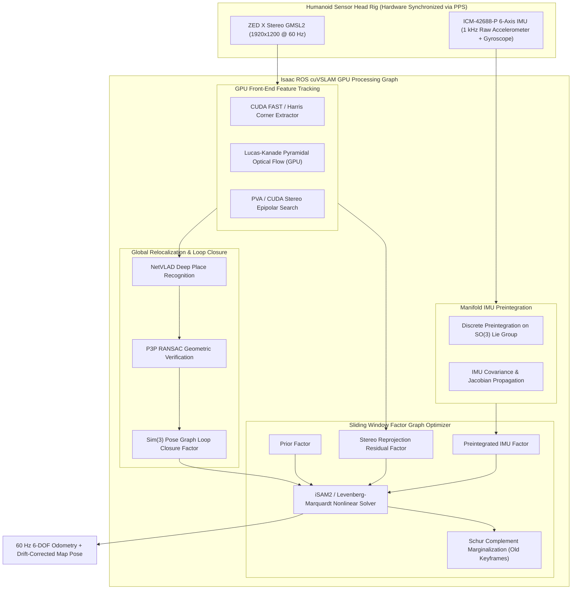
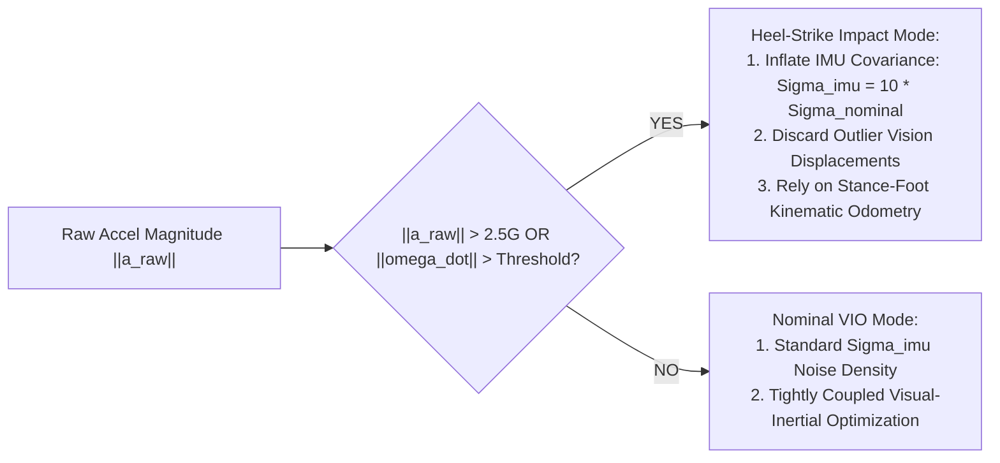

import ChapterProgress from '@site/src/components/ChapterProgress';
import QuizEngine from '@site/src/components/QuizEngine';

# cuVSLAM & Visual-Inertial Odometry

Accurate, drift-resilient 6-DOF floating-base state estimation is the bedrock of bipedal humanoid balance. Unlike wheeled mobile robots that maintain continuous planar contact with the floor, a walking humanoid undergoes cyclic flight-and-impact phases. Each footstep injects sharp acceleration transients ($2\text{G}$ to $4\text{G}$) into the pelvis and torso, inducing high-frequency mechanical vibration and camera motion blur.

**cuVSLAM** (NVIDIA Isaac ROS Visual SLAM) implements a GPU-accelerated, tightly coupled stereo visual-inertial odometry (VIO) and factor graph SLAM architecture. By combining **continuous-time IMU preintegration on the $SO(3)$ manifold**, **GPU-accelerated optical flow tracking**, and **incremental factor graph smoothing**, cuVSLAM achieves 60 Hz 6-DOF tracking with sub-centimeter drift.



---

## 1. Continuous-Time IMU Kinematics & Discrete Integration

Let $\{W\}$ denote the fixed inertial world coordinate frame and $\{B\}$ denote the moving robot body frame (rigidly fixed to the IMU). The true continuous-time kinematics of the robot base are governed by:

$$
\dot{\mathbf{R}}_{WB}(t) = \mathbf{R}_{WB}(t) \lfloor \boldsymbol{\omega}_B(t) \times \rfloor
$$

$$
\dot{\mathbf{v}}_W(t) = \mathbf{a}_W(t) = \mathbf{R}_{WB}(t) \mathbf{a}_B(t) + \mathbf{g}_W
$$

$$
\dot{\mathbf{p}}_W(t) = \mathbf{v}_W(t)
$$

where:
- $\mathbf{R}_{WB}(t) \in SO(3)$ is the rotation matrix orienting the body frame in world coordinates.
- $\lfloor \boldsymbol{\omega} \times \rfloor$ is the skew-symmetric matrix:
  $$
  \lfloor \boldsymbol{\omega} \times \rfloor = \begin{bmatrix} 0 & -\omega_z & \omega_y \\ \omega_z & 0 & -\omega_x \\ -\omega_y & \omega_x & 0 \end{bmatrix}
  $$
- $\mathbf{g}_W = [0, 0, -9.81]^T \text{ m/s}^2$ is the constant gravity vector in world coordinates.

Raw IMU measurements $\tilde{\boldsymbol{\omega}}_B(t)$ and $\tilde{\mathbf{a}}_B(t)$ are corrupted by slowly varying sensor biases $\mathbf{b}^g(t), \mathbf{b}^a(t)$ and Gaussian white noise $\boldsymbol{\eta}^{gd}(t), \boldsymbol{\eta}^{ad}(t)$:

$$
\tilde{\boldsymbol{\omega}}_B(t) = \boldsymbol{\omega}_B(t) + \mathbf{b}^g(t) + \boldsymbol{\eta}^{gd}(t)
$$

$$
\tilde{\mathbf{a}}_B(t) = \mathbf{R}_{WB}^T(t)(\mathbf{a}_W(t) - \mathbf{g}_W) + \mathbf{b}^a(t) + \boldsymbol{\eta}^{ad}(t)
$$

Bias dynamics follow random-walk models driven by Gaussian white noise: $\dot{\mathbf{b}}^g(t) = \boldsymbol{\eta}^{bg}(t)$, $\dot{\mathbf{b}}^a(t) = \boldsymbol{\eta}^{ba}(t)$.

---

## 2. IMU Preintegration on the $SO(3)$ Manifold

In standard nonlinear batch optimization, every time the state estimate $\mathbf{x}_i = (\mathbf{R}_i, \mathbf{p}_i, \mathbf{v}_i)$ is updated during solver iterations, naive integration requires re-propagating hundreds of high-rate IMU measurements between keyframes $i$ and $j$.

To eliminate this computational bottleneck, we apply **manifold IMU preintegration** (Forster et al., 2017). We isolate the relative motion increments so that they become independent of the global states at timestep $i$:

$$
\Delta \mathbf{R}_{ij} \triangleq \mathbf{R}_i^T \mathbf{R}_j = \prod_{k=i}^{j-1} \text{Exp}\left( (\tilde{\boldsymbol{\omega}}_k - \mathbf{b}_i^g - \boldsymbol{\eta}_k^{gd}) \Delta t \right)
$$

$$
\Delta \mathbf{v}_{ij} \triangleq \mathbf{R}_i^T (\mathbf{v}_j - \mathbf{v}_i - \mathbf{g}_W \Delta t_{ij}) = \sum_{k=i}^{j-1} \Delta \mathbf{R}_{ik} (\tilde{\mathbf{a}}_k - \mathbf{b}_i^a - \boldsymbol{\eta}_k^{ad}) \Delta t
$$

$$
\Delta \mathbf{p}_{ij} \triangleq \mathbf{R}_i^T \left( \mathbf{p}_j - \mathbf{p}_i - \mathbf{v}_i \Delta t_{ij} - \frac{1}{2} \mathbf{g}_W \Delta t_{ij}^2 \right) = \sum_{k=i}^{j-1} \left( \Delta \mathbf{v}_{ik} \Delta t + \frac{1}{2} \Delta \mathbf{R}_{ik} (\tilde{\mathbf{a}}_k - \mathbf{b}_i^a - \boldsymbol{\eta}_k^{ad}) \Delta t^2 \right)
$$

where $\text{Exp}: \mathfrak{so}(3) \to SO(3)$ is the exponential map on the Lie group:

$$
\text{Exp}(\boldsymbol{\phi}) = \cos(\|\boldsymbol{\phi}\|)\mathbf{I} + \frac{\sin(\|\boldsymbol{\phi}\|)}{\|\boldsymbol{\phi}\|} \lfloor \boldsymbol{\phi} \times \rfloor + \frac{1 - \cos(\|\boldsymbol{\phi}\|)}{\|\boldsymbol{\phi}\|^2} \boldsymbol{\phi}\boldsymbol{\phi}^T
$$

### First-Order Bias Updates

When the estimated bias changes by small perturbation $\delta \mathbf{b}$, re-integration is avoided by expanding the preintegrated terms via first-order Taylor approximation:

$$
\Delta \mathbf{R}_{ij}(\mathbf{b}_i^g + \delta \mathbf{b}_i^g) \approx \Delta \bar{\mathbf{R}}_{ij} \text{Exp}\left( \mathbf{J}_{ij}^{\Delta R, g} \delta \mathbf{b}_i^g \right)
$$

$$
\Delta \mathbf{v}_{ij}(\mathbf{b}_i^g + \delta \mathbf{b}_i^g, \mathbf{b}_i^a + \delta \mathbf{b}_i^a) \approx \Delta \bar{\mathbf{v}}_{ij} + \mathbf{J}_{ij}^{\Delta v, g} \delta \mathbf{b}_i^g + \mathbf{J}_{ij}^{\Delta v, a} \delta \mathbf{b}_i^a
$$

$$
\Delta \mathbf{p}_{ij}(\mathbf{b}_i^g + \delta \mathbf{b}_i^g, \mathbf{b}_i^a + \delta \mathbf{b}_i^a) \approx \Delta \bar{\mathbf{p}}_{ij} + \mathbf{J}_{ij}^{\Delta p, g} \delta \mathbf{b}_i^g + \mathbf{J}_{ij}^{\Delta p, a} \delta \mathbf{b}_i^a
$$

The Jacobians $\mathbf{J}$ are accumulated incrementally during the forward IMU integration pass alongside measurement noise covariance propagation.

---

## 3. Visual Reprojection Residuals & Stereo Bundle Adjustment

For a 3D landmark $\mathbf{l}_j \in \mathbb{R}^3$ observed by stereo camera keyframe $i$, the predicted image plane coordinates in the left and right cameras are modeled via the standard pinhole projection function $\boldsymbol{\pi}(\mathbf{P})$:

$$
\mathbf{P}_{c,i} = \begin{bmatrix} X_c \\ Y_c \\ Z_c \end{bmatrix} = \mathbf{R}_{CB} \mathbf{R}_{WB,i}^T (\mathbf{l}_j - \mathbf{p}_{WB,i}) + \mathbf{p}_{CB}
$$

The stereo projection vector $\mathbf{h}(\mathbf{P}_{c,i}) = [u_L, v_L, u_R]^T$ is given by:

$$
\mathbf{h}(\mathbf{P}_{c,i}) = \begin{bmatrix} f_x \frac{X_c}{Z_c} + c_x \\ f_y \frac{Y_c}{Z_c} + c_y \\ f_x \frac{X_c - b}{Z_c} + c_x \end{bmatrix}
$$

where $b$ is the calibrated stereo baseline (e.g., $0.12 \text{ m}$ for the ZED X camera).

The visual measurement residual vector is:

$$
\mathbf{r}_{\text{proj}}(\mathbf{x}_i, \mathbf{l}_j) = \mathbf{h}(\mathbf{P}_{c,i}) - \tilde{\mathbf{z}}_{ij}
$$

To prevent tracking divergence caused by dynamic pedestrians or swinging humanoid arms, residuals are weighted using the **Huber robust loss** $\rho_\delta(e)$:

$$
\rho_\delta(e) = \begin{cases} \frac{1}{2} e^2 & \text{if } |e| \le \delta \\ \delta (|e| - \frac{1}{2}\delta) & \text{otherwise} \end{cases}
$$

---

## 4. Mitigating Bipedal Walking Shock: Adaptive Covariance Gating

During steady-state humanoid walking, heel-strike impacts create short-duration ($< 25 \text{ ms}$) acceleration shocks that exceed standard MEMS linear ranges and violate the Gaussian white noise assumption.

cuVSLAM handles this through an **Adaptive Gating State Machine**:



When an impact transient is detected:
1. The measurement noise covariance $\boldsymbol{\Sigma}_{\text{imu}}$ is temporarily scaled by a factor of 10 to prevent impact shocks from distorting orientation estimates.
2. The visual feature tracker widens its epipolar search window to accommodate rapid pitch vibration.
3. Once linear acceleration returns within nominal bounds ($0.8\text{G}$ to $1.2\text{G}$), normal covariances are restored smoothly.

---

## 5. Loop Closure with NetVLAD & $Sim(3)$ Pose Graph Optimization

Over long navigation trajectories ($> 100 \text{ m}$), visual-inertial odometry accumulates small unobservable drift in yaw and scale. cuVSLAM integrates a global loop closure pipeline:

1. **NetVLAD Place Recognition**:
   Keyframe images are passed through a lightweight convolutional neural network with a **Vector of Locally Aggregated Descriptors (NetVLAD)** pooling layer (Arandjelović et al., 2016), producing a compact 4096-dimensional global descriptor vector $\mathbf{v}_{\text{vlad}}$.
2. **Nearest-Neighbor Retrieval**:
   Candidate past keyframes are queried in a sub-millisecond k-d tree. If cosine distance satisfies:
   $$
   d_{\text{cosine}}(\mathbf{v}_i, \mathbf{v}_j) = 1 - \frac{\mathbf{v}_i \cdot \mathbf{v}_j}{\|\mathbf{v}_i\| \|\mathbf{v}_j\|} < \tau_{\text{match}}
   $$
3. **Geometric Consistency Check**:
   Geometric correspondences are established via 2D-to-3D P3P RANSAC. If $> 30$ inliers confirm the loop, a 7-DOF $Sim(3)$ between-factor is inserted into the global pose graph:
   $$
   \mathbf{r}_{\text{loop}}(\mathbf{T}_i, \mathbf{T}_j) = \log_{Sim(3)}\left( \mathbf{T}_{ij}^{\text{meas},-1} \mathbf{T}_i^{-1} \mathbf{T}_j \right)
   $$
   Correcting the trajectory eliminates accumulated drift across the entire environment.

---

## 6. Complete Python GTSAM Factor Graph Optimization Implementation

Below is a complete, production-grade Python script utilizing **GTSAM** to formulate and solve a visual-inertial factor graph with IMU preintegration:

```python
"""
cuvslam_factor_graph_gtsam.py
Constructs and solves a tightly coupled Visual-Inertial Factor Graph
using GTSAM and on-manifold IMU preintegration.
"""

from typing import List
import numpy as np
import gtsam
from gtsam import symbol


def run_vio_factor_graph_example():
    print("=" * 65)
    print("cuVSLAM Manifold Factor Graph Optimization (GTSAM)")
    print("=" * 65)

    # 1. Configure IMU Preintegration Parameters
    gravity = 9.81
    params = gtsam.PreintegrationParams.MakeSharedU(gravity)
    params.setAccelerometerCovariance(np.eye(3) * 0.017 ** 2)
    params.setGyroscopeCovariance(np.eye(3) * 0.00024 ** 2)
    params.setIntegrationCovariance(np.eye(3) * 1e-8)
    params.setUse2ndOrderCoriolis(False)

    prior_bias = gtsam.imuBias.ConstantBias(np.zeros(3), np.zeros(3))
    imu_preintegrated = gtsam.PreintegratedImuMeasurements(params, prior_bias)

    # 2. Instantiate Nonlinear Factor Graph
    graph = gtsam.NonlinearFactorGraph()
    initial_estimates = gtsam.Values()

    # Prior noise models
    prior_pose_noise = gtsam.noiseModel.Diagonal.Sigmas(
        np.array([0.01, 0.01, 0.01, 0.05, 0.05, 0.05])  # rad, rad, rad, m, m, m
    )
    prior_vel_noise = gtsam.noiseModel.Isotropic.Sigma(3, 0.1)
    prior_bias_noise = gtsam.noiseModel.Isotropic.Sigma(6, 1e-3)

    # 3. Add Keyframe 0 (Initial Anchor State)
    pose_0 = gtsam.Pose3(gtsam.Rot3.Identity(), gtsam.Point3(0.0, 0.0, 0.85))
    vel_0 = np.array([0.5, 0.0, 0.0])  # Initial forward walking velocity

    graph.add(gtsam.PriorFactorPose3(symbol('x', 0), pose_0, prior_pose_noise))
    graph.add(gtsam.PriorFactorVector3(symbol('v', 0), vel_0, prior_vel_noise))
    graph.add(gtsam.PriorFactorConstantBias(symbol('b', 0), prior_bias, prior_bias_noise))

    initial_estimates.insert(symbol('x', 0), pose_0)
    initial_estimates.insert(symbol('v', 0), vel_0)
    initial_estimates.insert(symbol('b', 0), prior_bias)

    # 4. Simulate IMU forward integration across a 1-second walking stride (100 Hz IMU)
    dt = 0.01
    for step in range(100):
        # Humanoid pelvic motion: forward acceleration + sinusoidal sway
        measured_acc = np.array([0.05 * np.cos(step * 0.1), 0.1 * np.sin(step * 0.2), gravity + 0.02])
        measured_gyro = np.array([0.01 * np.sin(step * 0.1), 0.02 * np.cos(step * 0.1), 0.0])
        imu_preintegrated.integrateMeasurement(measured_acc, measured_gyro, dt)

    # 5. Add Keyframe 1 and Preintegrated IMU Factor
    imu_factor = gtsam.ImuFactor(
        symbol('x', 0), symbol('v', 0),
        symbol('x', 1), symbol('v', 1),
        symbol('b', 0), imu_preintegrated
    )
    graph.add(imu_factor)

    # Bias evolution factor between keyframes
    bias_between_noise = gtsam.noiseModel.Isotropic.Sigma(6, 1e-4)
    graph.add(
        gtsam.BetweenFactorConstantBias(symbol('b', 0), symbol('b', 1), prior_bias, bias_between_noise)
    )

    # Add initial guess for Keyframe 1
    pose_1_guess = gtsam.Pose3(gtsam.Rot3.Identity(), gtsam.Point3(0.5, 0.0, 0.85))
    initial_estimates.insert(symbol('x', 1), pose_1_guess)
    initial_estimates.insert(symbol('v', 1), vel_0)
    initial_estimates.insert(symbol('b', 1), prior_bias)

    # 6. Add Visual Landmark Observation Factors
    calib = gtsam.Cal3_S2(fx=525.0, fy=525.0, s=0.0, u0=320.0, v0=240.0)
    landmark_0 = gtsam.Point3(2.0, 1.0, 1.2)
    measurement_noise = gtsam.noiseModel.Isotropic.Sigma(2, 1.0)  # 1.0 pixel std

    initial_estimates.insert(symbol('l', 0), landmark_0)
    graph.add(gtsam.GenericProjectionFactorCal3_S2(
        gtsam.Point2(450.0, 270.0), measurement_noise, symbol('x', 0), symbol('l', 0), calib
    ))
    graph.add(gtsam.GenericProjectionFactorCal3_S2(
        gtsam.Point2(410.0, 268.0), measurement_noise, symbol('x', 1), symbol('l', 0), calib
    ))

    # 7. Execute Levenberg-Marquardt Optimization
    optimizer_params = gtsam.LevenbergMarquardtParams()
    optimizer_params.setVerbosityLM("SUMMARY")
    optimizer = gtsam.LevenbergMarquardtOptimizer(graph, initial_estimates, optimizer_params)
    result = optimizer.optimize()

    optimized_pose_1 = result.atPose3(symbol('x', 1))
    optimized_landmark = result.atPoint3(symbol('l', 0))

    print("\nOptimization Complete:")
    print(f"Optimized Keyframe 1 Translation: [X: {optimized_pose_1.x():.3f}, Y: {optimized_pose_1.y():.3f}, Z: {optimized_pose_1.z():.3f}]")
    print(f"Optimized Landmark 0 Position:   [X: {optimized_landmark[0]:.3f}, Y: {optimized_landmark[1]:.3f}, Z: {optimized_landmark[2]:.3f}]")
    print(f"Final Graph Error:              {graph.error(result):.4f}")
    print("=" * 65)


if __name__ == "__main__":
    run_vio_factor_graph_example()
```

---

## 7. Summary & Seminal Literature

cuVSLAM provides the real-time, drift-resilient floating-base state estimation necessary for bipedal locomotion. By formulating continuous-time kinematics on the $SO(3)$ Lie group, preintegrating high-rate IMU streams to eliminate re-integration overhead, dynamically gating measurement covariances during footstep impacts, and applying NetVLAD global loop closures, cuVSLAM delivers consistent 6-DOF tracking across challenging industrial environments.

### Seminal Research Citations
1. **Forster, C., Carlone, L., Shen, S., & Scaramuzza, D. (2017).** *On-manifold preintegration for real-time visual--inertial odometry*. IEEE Transactions on Robotics, 33(1), 1–21.
2. **Qin, T., Li, P., & Shen, S. (2018).** *VINS-Mono: A robust and versatile monocular visual-inertial state estimator*. IEEE Transactions on Robotics, 34(4), 1004–1020.
3. **Mur-Artal, R., & Tardós, J. D. (2017).** *ORB-SLAM2: An open-source SLAM system for monocular, stereo, and RGB-D cameras*. IEEE Transactions on Robotics, 33(5), 1255–1262.
4. **Arandjelović, R., Gronat, P., Torii, A., Pajdla, T., & Sivic, J. (2016).** *NetVLAD: CNN architecture for weakly supervised place recognition*. IEEE Conference on Computer Vision and Pattern Recognition (CVPR).

---

<ChapterProgress chapterId="3-6-cuvslam-and-state-estimation" moduleId="module3" totalChapters={10} />

## Chapter Mastery Check

<QuizEngine
  quizId="quiz-3-6"
  title="Module 3.6 Mastery Check: cuVSLAM & State Estimation"
  moduleId="module3"
  passThreshold={70}
  questions={[
    {
      id: "q1",
      question: "What is the primary computational benefit of formulating IMU preintegration on the SO(3) Lie manifold rather than performing standard numerical integration?",
      options: [
        "It eliminates the need for camera calibration entirely",
        "It isolates the relative motion increments so they become independent of the global state estimates, avoiding re-integrating IMU samples whenever previous poses are updated during optimization iterations",
        "It doubles the resolution of the camera images",
        "It enforces planar 2D robot motion"
      ],
      correctIndex: 1,
      explanation: "On-manifold preintegration computes relative position, velocity, and rotation changes in the local coordinate frame. When the optimizer shifts historical poses, the preintegrated measurements remain valid with only first-order bias correction Jacobians."
    },
    {
      id: "q2",
      question: "How does cuVSLAM handle the sudden 2G to 4G acceleration spikes that occur during humanoid heel-strike impacts?",
      options: [
        "It resets the robot pose to (0, 0, 0)",
        "It applies adaptive covariance gating, temporarily inflating IMU noise covariance Sigma_imu to prevent shock transients from corrupting orientation estimates",
        "It powers off the Jetson AGX Orin for 50 milliseconds",
        "It switches the camera to 120 FPS high-speed mode"
      ],
      correctIndex: 1,
      explanation: "Heel-strike shocks violate nominal Gaussian white noise assumptions. Adaptive gating detects impacts and inflates measurement noise covariance, relying on robust visual features until the shock dissipates."
    },
    {
      id: "q3",
      question: "In stereo bundle adjustment, what is the role of the Huber loss function rho(e) on reprojection residuals?",
      options: [
        "It increases the learning rate of the PyTorch neural network",
        "It reduces the influence of large outlier feature errors (caused by dynamic moving obstacles or swinging arms) from quadratic penalty to linear penalty",
        "It forces all landmarks to lie on a single horizontal plane",
        "It converts pixel coordinates to imperial units"
      ],
      correctIndex: 1,
      explanation: "Standard L2 quadratic loss overly penalizes large residuals, causing the optimizer to distort the entire trajectory to satisfy a few false correspondences. Huber loss transitions to linear error for |e| > delta, robustly rejecting outliers."
    },
    {
      id: "q4",
      question: "What place recognition architecture does cuVSLAM utilize to detect global loop closures across long navigation paths?",
      options: [
        "NetVLAD deep convolutional descriptor pooling",
        "Random image hash sampling",
        "Manual operator RFID tag scanning",
        "Acoustic sonar echo matching"
      ],
      correctIndex: 0,
      explanation: "NetVLAD extracts viewpoint-invariant compact global descriptors from keyframe images. Querying descriptors in a sub-millisecond k-d tree enables real-time loop closure detection and drift elimination."
    }
  ]}
/>
