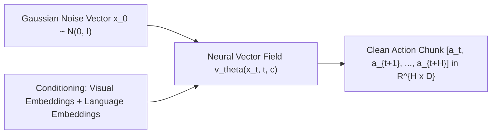
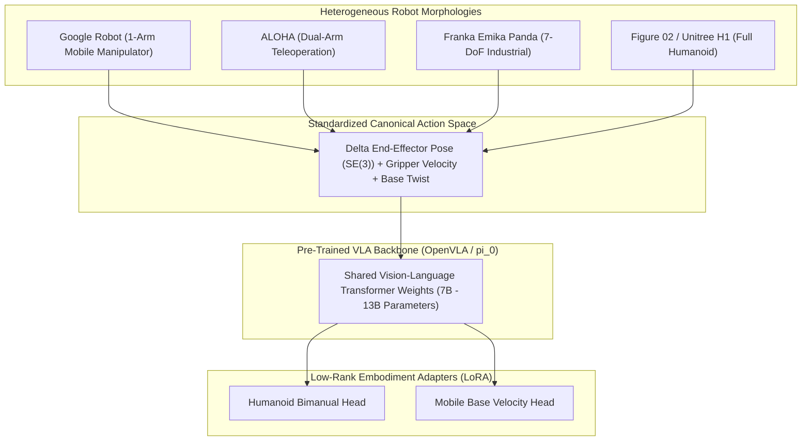

# Foundations of Vision-Language-Action (VLA) Systems

For decades, robotics operated under the classical **Sense-Plan-Act** paradigm: dedicated perception modules estimated object bounding boxes, task planners generated symbolic sequences (e.g., PDDL or Behavior Trees), and motion planners calculated inverse kinematics trajectories. While robust in structured factories, this brittle pipeline fails in open-world environments characterized by novel objects, varying lighting, and unstructured human instructions.

**Vision-Language-Action (VLA) systems** represent a paradigm shift: unifying multimodal perception (Vision), high-level semantic reasoning (Language), and closed-loop motor control (Action) into end-to-end or hierarchically grounded neural foundation models.

---

## 1. The Architectural Spectrum: Decoupled vs End-to-End

Modern robotic intelligence falls along a spectrum between **Modular Decoupled Systems** and **Unified End-to-End Foundation Policies**:

```mermaid
flowchart TD
    subgraph ModularPipeline ["1. Modular Decoupled VLA (e.g. SayCan, Code-as-Policies)"]
        RawInputs1["RGB-D Image + Spoken Audio"] --> ASR1["Speech Recognition (Whisper)"]
        RawInputs1 --> VLM1["Vision-Language Model (GPT-4V / Gemini)"]
        ASR1 --> LLMPlanner["LLM Semantic Planner<br/>(Symbolic Plan Generation)"]
        VLM1 --> Affordance["Affordance & Pose Estimator<br/>(FoundationPose / SAM)"]
        LLMPlanner --> TaskDispatch["ROS 2 Action Dispatcher"]
        Affordance --> TaskDispatch
        TaskDispatch --> TrajOpt["Trajectory Optimization (MoveIt 2 / OMPL)"]
        TrajOpt --> JointControl1["Low-Level Controller (1 kHz)"]
    end

    subgraph EndToEndVLA ["2. Unified Foundation Policy (e.g. OpenVLA, Octo, pi_0)"]
        RawInputs2["RGB-D Streams + Task Instruction Text"] --> VisionBackbone["Vision Transformer Backbone<br/>(DinoV2 / SigLIP)"]
        RawInputs2 --> TextTokenizer["Language Transformer<br/>(Llama 2 / Gemma)"]
        VisionBackbone --> CrossAttention["Cross-Attention Multimodal Core"]
        TextTokenizer --> CrossAttention
        CrossAttention --> ActionHead{"Action Generation Mechanism"}
        ActionHead -->|Autoregressive| DiscreteBins["Discretized Action Tokens (RT-2, OpenVLA)"]
        ActionHead -->|Flow Matching / Diffusion| ContinuousChunk["Continuous Action Chunking (pi_0, Octo)"]
        DiscreteBins --> JointControl2["Robot Execution (10-50 Hz)"]
        ContinuousChunk --> JointControl2
    end
```



### Comparative Analysis of Paradigms

| Feature | Modular Decoupled (LLM + Classical) | End-to-End VLA (OpenVLA / pi_0) |
| :--- | :--- | :--- |
| **Semantic Generalization** | Extremely High (Leverages trillion-token frontier LLMs) | Moderate to High (Limited by robotics training distribution) |
| **Physical Dexterity** | Low (Bound to pre-engineered motion primitives) | Exceptionally High (Discovers emergent reactive behaviors) |
| **Control Latency** | High (500 ms – 2000 ms per replan) | Low (20 ms – 100 ms inference loop) |
| **Explainability & Safety** | Transparent (Verifiable PDDL / ROS 2 Action states) | Black-box policy (Requires safety shielding / envelope clamping) |
| **Sample Efficiency** | Zero-shot task planning without robot fine-tuning | Requires tens of thousands of teleoperated robot trajectories |

---

## 2. Action Generation: Tokenization vs Continuous Flow Matching

Robotic control fundamentally differs from text generation. Text is discrete, sequential, and categorical, whereas robotic motor commands are **continuous, high-dimensional, and temporally correlated vectors**:

```text
a_t = [Delta x, Delta y, Delta z, Delta roll, Delta pitch, Delta yaw, gripper_state]^T in R^7
```

For dual-arm humanoid manipulation with dexterous hands (e.g., Figure 02 or Unitree G1), the action vector expands to:
```text
a_t in R^{14 + 2 * N_fingers}
```

Leading foundation models approach this challenge through two distinct mathematical formulations:

### Approach A: Discretized Action Bins (RT-1, RT-2, OpenVLA)

In models like **RT-2** and **OpenVLA (7B)**, continuous action dimensions are uniformly quantized into `K = 256` discrete bins between `[-1.0, 1.0]`:

```text
bin_i = floor( (a_i - a_min) / (a_max - a_min) * 256 )
```

These discrete bins are mapped directly to unused token IDs in the language tokenizer vocabulary. The model outputs actions as autoregressive text tokens:

```text
Prompt: "Task: Pick up the red apple. Context: [Image Tokens]"
Generation: "<action_bin_128> <action_bin_142> <action_bin_95> ... <action_bin_255>"
```

**Limitations**:
1. **Compounding Quantization Errors**: Fine manipulation tasks (such as threading a needle or peg-in-hole insertion) suffer from quantization jitter.
2. **Sequential Inference Bottleneck**: Generating 14 joint tokens autoregressively requires 14 forward passes per control step, capping control frequency at 3–5 Hz.

### Approach B: Continuous Flow Matching & Diffusion Policy (pi_0)

Pioneered by Physical Intelligence with **pi_0** (Physical Intelligence Foundation Policy) and Diffusion Policy (Chi et al.), this approach models the action trajectory as a continuous vector field using **Flow Matching**:



Instead of predicting a single discrete step, the network generates an entire **Action Chunk** of horizon `H` (e.g., `H = 50` steps at 50 Hz, corresponding to 1 second of continuous movement). 

The Flow Matching loss trains a neural vector field `v_theta` to transport random Gaussian noise `x_0` to the true demonstration distribution `x_1`:

```text
L_{FM}(theta) = E_{t ~ U[0, 1], x_0 ~ p_0, x_1 ~ p_1} [ || v_theta(x_t, t, c) - (x_1 - x_0) ||^2 ]
where x_t = (1 - t) * x_0 + t * x_1
```

During execution, an ordinary differential equation (ODE) solver integrates the learned vector field in just 4–8 denoising steps, enabling smooth, expressive, multi-modal actions at 50 Hz.

---

## 3. The Open X-Embodiment (OXE) Dataset & Cross-Embodiment Transfer

The primary obstacle to robot foundation models has historically been the **Embodiment Gap**: an ALOHA dual-arm robot shares neither kinematics, link lengths, actuator gearings, nor camera intrinsics with a Unitree H1 humanoid or a Boston Dynamics Atlas.

The **Open X-Embodiment (OXE)** collaboration (Google DeepMind, Stanford, Berkeley, CMU) aggregated:
- **1,000,000+ real-robot demonstrations**
- **22+ distinct robot embodiments**
- **500+ unique skills across industrial and domestic settings**



Through canonical action space normalization, pre-trained VLA models exhibit positive cross-embodiment transfer: policies trained on single-arm tabletop data significantly accelerate the learning of bimanual humanoid manipulation.

---

## 4. Real-Time Deployment Architecture for Humanoids

Humanoid robots cannot tolerate policy delays. If a humanoid pauses for 500 ms while an LLM generates tokens, dynamic balance is lost and the biped collapses.

Modern commercial platforms (Figure 01, Tesla Optimus) implement a **Tiered Hierarchical Autonomy Ring**:

```mermaid
flowchart TD
    subgraph CloudVLA ["Cognitive Layer (0.5 - 2 Hz, Off-Board Cloud / Edge Server)"]
        HighLLM["Vision-Language Planner (Gemini 1.5 Pro / GPT-4o)"]
        HighLLM -->|High-level Task Decomposition| TaskGraph["Semantic Task DAG"]
    end

    subgraph EdgeVLA ["Tactical Policy Layer (10 - 50 Hz, Dual NVIDIA Orin / Thor)"]
        TaskGraph --> LocalVLA["Fine-Tuned VLA Policy (OpenVLA / pi_0 / Octo)"]
        LocalCameras["Stereo Eye / Wrist Cameras"] --> LocalVLA
        LocalVLA -->|End-Effector Trajectories x_des(t)| CartesianController["Cartesian Impedance Controller"]
    end

    subgraph RealTimeKernel ["Dynamic Stability Layer (500 - 1000 Hz, PREEMPT_RT Linux)"]
        CartesianController --> QP_WBC["Quadratic Programming Whole-Body Controller"]
        IMU_FT["1 kHz IMU + 6-Axis Foot Load Cells"] --> QP_WBC
        QP_WBC -->|Torque Commands tau| BLDC_Actuators["FOC Joint Actuator Inverters"]
    end
```

### Safety Shielding & Kinematic Invariants
Because deep neural policies can hallucinate out-of-distribution actions, the output of the VLA policy passes through a deterministic **Safety Shield** before reaching the actuators:

1. **Self-Collision Barrier Functions**: Prevents the left arm from impacting the torso or right forearm.
2. **Workspace Envelopes**: Enforces hard Cartesian boundaries outside which joint torques are clamped to zero.
3. **Capture Point Interruption**: If the bipedal base suffers a destabilizing disturbance, the whole-body controller preempts arm manipulation to execute recovery stepping.

---

## 5. Architectural Comparison: Frontier Robot Foundation Models

| Model Architecture | Organization | Parameter Size | Action Generation Paradigm | Control Frequency | Primary Strength |
| :--- | :--- | :--- | :--- | :--- | :--- |
| **RT-2** | Google DeepMind | 55B (PaLM-E / PaLI-X) | Autoregressive token discretization (256 bins) | 3–5 Hz | Web-scale semantic knowledge |
| **OpenVLA** | Stanford / Berkeley | 7B (Llama-2 / Prismatic) | Autoregressive token discretization | 5–8 Hz | 100% open-source weights & fine-tuning |
| **Octo** | UC Berkeley / Stanford | 93M (Diffusion Transformer) | Score-based Denoising Diffusion (DDPM) | 10–20 Hz | Lightweight; multi-embodiment adapter |
| **pi_0 (π0)** | Physical Intelligence | ~3B (PaliGemma backbone) | Continuous Flow Matching (Conditional Flow) | **50 Hz** | High-precision dexterous manipulation |
| **Project GR00T** | NVIDIA | Dual-Tower Multimodal | Flow Matching + Dual-Arm Retargeting | 30–50 Hz | Native humanoid whole-body integration |

---

## Summary

Vision-Language-Action systems represent the convergence of multimodal AI and physical control. By understanding the progression from modular LLM planners (SayCan) to discretized tokenizers (OpenVLA) and continuous flow-matching policies (pi_0), engineers can architect humanoid control systems that balance open-world semantic comprehension with sub-millisecond physical stability.
