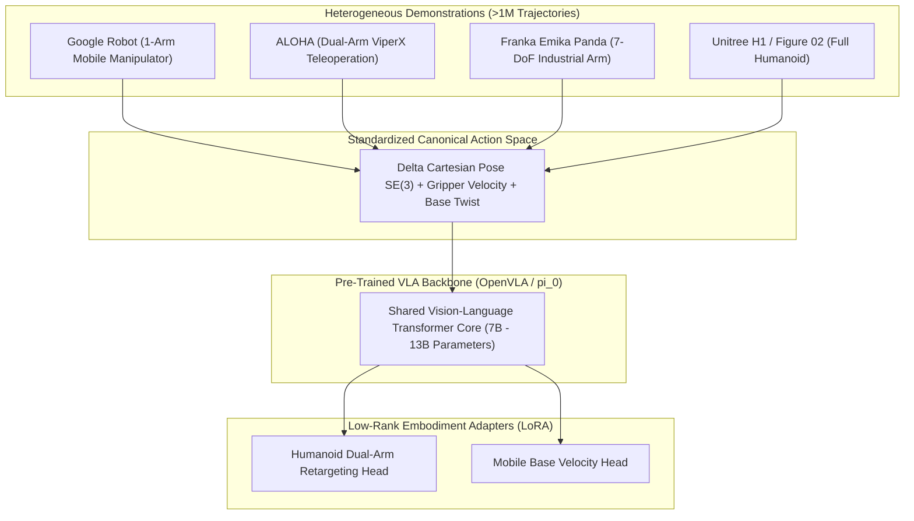

import ChapterProgress from '@site/src/components/ChapterProgress';
import QuizEngine from '@site/src/components/QuizEngine';

# Foundations of Vision-Language-Action (VLA) Systems

For decades, robotics operated under the classical **Sense-Plan-Act** paradigm: dedicated perception modules estimated object bounding boxes and geometric poses, symbolic task planners generated discrete action sequences (e.g., PDDL graphs or Behavior Trees), and numerical trajectory optimizers computed joint trajectories via inverse kinematics. While robust in structured industrial cells, this brittle sequential pipeline degrades rapidly in open-world environments characterized by novel objects, varying lighting conditions, non-rigid deformables, and ambiguous human instructions.

**Vision-Language-Action (VLA) systems** represent a fundamental paradigm shift: unifying multimodal sensory perception (Vision), high-level semantic reasoning (Language), and closed-loop motor control (Action) into end-to-end or hierarchically grounded neural foundation models.

---

## Learning Objectives

After completing this chapter, you will be able to:
- Formulate the joint autoregressive probability distribution over multimodal tokens and robot actions.
- Quantify the mathematical errors introduced by uniform discretization in continuous action spaces.
- Compare the mathematical formulation of autoregressive action tokenization with Continuous Flow Matching (CFM).
- Analyze cross-embodiment normalization across the Open X-Embodiment (OXE) dataset.
- Specify edge compute, thermal budgets, and functional safety shields for humanoid real-time deployment.

---

## 1. The Architectural Spectrum: Modular Decoupled vs. Unified End-to-End

Modern robotic intelligence falls along a spectrum between **Modular Decoupled Systems** and **Unified End-to-End Foundation Policies**:


### Comparative Analysis of Paradigms

| Feature Dimension | Modular Decoupled (LLM + Classical) | End-to-End VLA (OpenVLA / $\pi_0$) |
| :--- | :--- | :--- |
| **Semantic Generalization** | Extremely High (Leverages trillion-token frontier LLMs) | Moderate to High (Bound to robotics demonstration coverage) |
| **Physical Dexterity** | Constrained (Limited by hand-engineered motion primitives) | Exceptionally High (Learns emergent contact-rich motor strategies) |
| **End-to-End Latency** | High ($500 \text{ ms} - 2000 \text{ ms}$ per replan cycle) | Low ($20 \text{ ms} - 100 \text{ ms}$ closed-loop inference) |
| **Error Propagation** | Cascading: perception failures invalidate planning | Unified representation: sensory features adapt to motor intent |
| **Safety & Verification** | High (Verifiable PDDL preconditions / CBF guarantees) | Requires external safety shields and kinematic barrier filters |
| **Sample Efficiency** | Zero-shot planning without physical trajectory tuning | Requires $10^4 - 10^6$ teleoperated real-robot demonstrations |

---

## 2. Mathematical Formulation of VLA Policies

### Joint Autoregressive Formulation

In an autoregressive VLA foundation model (such as RT-2 or OpenVLA), the control policy is parameterized as a conditional probability distribution over tokenized robot actions $\mathbf{a}_t \in \mathbb{R}^D$ given an observation sequence of visual frames $\mathbf{I}_{1:t}$, a natural language task description $\mathbf{l} = (w_1, w_2, \dots, w_L)$, and historical action tokens $\mathbf{a}_{<t}$:

$$
\mathcal{L}_{VLA}(\theta) = -\sum_{t=1}^T \log P_\theta(\mathbf{a}_t \mid \mathbf{I}_{1:t}, \; \mathbf{l}, \; \mathbf{a}_{<t})
$$

When decomposed across individual action dimensions $d \in \{1, \dots, D\}$ (where $D$ typically represents 6-DoF end-effector delta pose plus gripper state: $[\Delta x, \Delta y, \Delta z, \Delta \text{roll}, \Delta \text{pitch}, \Delta \text{yaw}, \text{gripper}]^T$):

$$
P_\theta(\mathbf{a}_t \mid \mathbf{I}_{1:t}, \mathbf{l}, \mathbf{a}_{<t}) = \prod_{d=1}^D P_\theta(a_{t,d} \mid \mathbf{I}_{1:t}, \mathbf{l}, \mathbf{a}_{<t}, a_{t,<d})
$$

### Action Discretization & Quantization Error

Continuous physical commands $a \in [a^{min}, a^{max}]$ are mapped to discrete vocabulary tokens by partitioning the range into $K$ uniform bins (typically $K = 256$):

$$
\text{bin}(a) = \text{clip} \left( \left\lfloor \frac{a - a^{min}}{a^{max} - a^{min}} \cdot (K - 1) \right\rceil, \; 0, \; K - 1 \right)
$$

The deterministic de-quantization function reconstructing the continuous control command $\hat{a}$ from the predicted token index is:

$$
\hat{a} = a^{min} + \frac{\text{bin}(a)}{K - 1} (a^{max} - a^{min})
$$

The maximum deterministic quantization error per dimension is bounded by half the bin resolution:

$$
\Delta a_{max} = \frac{a^{max} - a^{min}}{2(K - 1)}
$$

For an end-effector translational workspace of $[-0.5 \text{ m}, +0.5 \text{ m}]$ ($1.0 \text{ m}$ total span) with $K = 256$ bins, the minimum positional resolution is:

$$
\Delta a_{trans} = \frac{1.0 \text{ m}}{2 \times 255} \approx 1.96 \text{ mm}
$$

While $1.96 \text{ mm}$ suffices for coarse pick-and-place, it introduces substantial contact limit cycles and chatter during high-precision contact insertion tasks (such as USB-C port insertion or optical alignment, which require sub-millimeter tolerances $\le 0.2 \text{ mm}$).

### Continuous Flow Matching Alternative

To overcome the discretization bottleneck and sequential autoregressive latency, modern foundation models such as $\pi_0$ parameterize actions via **Conditional Flow Matching (CFM)** on continuous manifolds. 

Let $\mathbf{x}_0 \sim p_0(\mathbf{x}_0) = \mathcal{N}(\mathbf{0}, \mathbf{I})$ represent a Gaussian noise sample, and $\mathbf{x}_1 = \mathbf{a} \sim q(\mathbf{a})$ denote the continuous ground-truth robot action trajectory chunk. A time-dependent probability path is constructed via linear interpolation:

$$
\mathbf{x}_t = (1 - t)\mathbf{x}_0 + t\mathbf{x}_1, \quad t \in [0, 1]
$$

The target vector field driving the probability mass along this path is:

$$
\mathbf{u}_t(\mathbf{x} \mid \mathbf{x}_1) = \frac{d\mathbf{x}_t}{dt} = \mathbf{x}_1 - \mathbf{x}_0
$$

The neural vector field $\mathbf{v}_\theta(\mathbf{x}_t, t, \mathbf{c})$ parameterized by multimodal conditioning vector $\mathbf{c} = f_{enc}(\mathbf{I}_{1:t}, \mathbf{l})$ is trained via the regression objective:

$$
\mathcal{L}_{FM}(\theta) = \mathbb{E}_{t \sim \mathcal{U}[0, 1], \; \mathbf{x}_0 \sim \mathcal{N}(\mathbf{0}, \mathbf{I}), \; \mathbf{x}_1 \sim q(\mathbf{a})} \left[ \left\| \mathbf{v}_\theta(\mathbf{x}_t, t, \mathbf{c}) - (\mathbf{x}_1 - \mathbf{x}_0) \right\|_2^2 \right]
$$

During real-time inference, generating an action chunk requires integrating the learned ODE from $t = 0$ to $t = 1$ using an explicit Euler or Runge-Kutta solver in $N_{steps} \in [4, 10]$ steps:

$$
\mathbf{x}_{k+1} = \mathbf{x}_k + \frac{1}{N_{steps}} \mathbf{v}_\theta \left( \mathbf{x}_k, \; \frac{k}{N_{steps}}, \; \mathbf{c} \right)
$$

This produces smooth, multi-modal action trajectories at $50 \text{ Hz}$ without autoregressive token-by-token serialization.

---

## 3. The Open X-Embodiment (OXE) Dataset & Cross-Embodiment Transfer

A central challenge in robotics foundation modeling is the **Embodiment Gap**: distinct robots differ in kinematic morphology, link dynamics, sensor intrinsics, and control interfaces.



### Action Space Canonicalization

To train across heterogeneous datasets, actions are mapped into a unified coordinate frame:
1. **Reference Frame**: Actions are normalized relative to the robot's current end-effector frame (Tool Center Point, TCP) rather than the global base frame, preventing bias across mounting heights.
2. **Delta Representation**: $\Delta \mathbf{p} = \mathbf{p}_{target} - \mathbf{p}_{current} \in \mathbb{R}^3$, orientation displacement as axis-angle or Euler rotations $\Delta \boldsymbol{\phi} \in \mathbb{R}^3$.
3. **Statistical Normalization**: Each dimension is normalized across the training dataset via quantile clipping to $[-1.0, 1.0]$:

$$
\tilde{a}_d = 2 \cdot \frac{a_d - q_{0.01}(a_d)}{q_{0.99}(a_d) - q_{0.01}(a_d)} - 1.0
$$

---

## 4. Physical Hardware Architecture & Real-Time Execution Envelopes

Humanoid robots require high computation throughput bounded by strict power and thermal envelopes:

```
+-----------------------------------------------------------------------------------+
|                        Humanoid Onboard Compute Enclosure                         |
|                                                                                   |
|  +-------------------------------------+   +------------------------------------+  |
|  |     NVIDIA Jetson AGX Orin #1       |   |    NVIDIA Jetson AGX Orin #2       |  |
|  |  (Cognitive & Perception Node)      |   |   (Tactical VLA & Control Node)    |  |
|  |                                     |   |                                    |  |
|  |  - 2048-core Ampere GPU (64 TCs)    |   |  - 2048-core Ampere GPU (64 TCs)   |  |
|  |  - 12-core Arm Cortex-A78AE CPU     |   |  - 12-core Arm Cortex-A78AE CPU    |  |
|  |  - Dual NVDLA 2.0 Engines           |   |  - Dual NVDLA 2.0 Engines          |  |
|  |  - 64 GB 256-bit LPDDR5 (204.8 GB/s)|   |  - 64 GB 256-bit LPDDR5 (204.8GB/s)|  |
|  |  - Power: 15W - 60W TDP (nvpmodel)  |   |  - PREEMPT_RT Real-Time Linux      |  |
|  +-------------------------------------+   +------------------------------------+  |
|                     |                                         |                    |
|                     +====== Dual 10GbE PCIe High-Speed Bus ===+                    |
|                                         |                                          |
|                     +---------------------------------------+                      |
|                     | Isolated Real-Time EtherCAT / CAN-FD  |                      |
|                     | Fieldbus Interface to 28-DoF Actuators|                      |
|                     +---------------------------------------+                      |
+-----------------------------------------------------------------------------------+
```

### Edge Silicon vs. Cluster Specifications

| Parameter | Edge Robotics Module (Jetson AGX Orin) | Training Cluster (NVIDIA H100 SXM5) |
| :--- | :--- | :--- |
| **GPU Architecture** | Ampere (64 Tensor Cores) | Hopper (528 4th-Gen Tensor Cores) |
| **Memory Capacity** | $64 \text{ GB}$ Unified LPDDR5 | $80 \text{ GB}$ HBM3 |
| **Memory Bandwidth** | $204.8 \text{ GB/s}$ | $3.35 \text{ TB/s}$ ($3350 \text{ GB/s}$) |
| **Peak Compute** | $275 \text{ INT8 TOPS}$ / $138 \text{ FP16 TFLOPS}$ | $1979 \text{ FP8 TFLOPS}$ / $989 \text{ FP16 TFLOPS}$ |
| **Interconnect** | Dual $10\text{GbE}$ ($1.25 \text{ GB/s}$) | $400 \text{ Gbps}$ Quantum-2 InfiniBand ($50 \text{ GB/s}$) |
| **Thermal Budget** | $15\text{W} - 60\text{W}$ TDP | $700\text{W}$ TDP per accelerator |
| **VLA Inference Role** | Real-time quantized execution ($5 - 50 \text{ Hz}$) | Distributed pretraining across 64+ GPUs |

### Deterministic Kinematic Safety Filter

Because deep neural networks can generate out-of-distribution commands, every raw VLA action $\mathbf{a}_{VLA}$ passes through a deterministic **Safety Shield** solving a Quadratic Program (QP) before transmission to joint motor drivers:

$$
\mathbf{a}^* = \arg\min_{\mathbf{a} \in \mathbb{R}^D} \frac{1}{2} \|\mathbf{a} - \mathbf{a}_{VLA}\|_2^2
$$

Subject to hard operational constraints:

$$
\begin{aligned}
\mathbf{q}_{min} &\le \mathbf{q}_t + \mathbf{J}^\dagger \mathbf{a} \Delta t \le \mathbf{q}_{max} \quad &\text{(Joint Position Limits)} \\
|\mathbf{J}^\dagger \mathbf{a}| &\le \dot{\mathbf{q}}_{max} \quad &\text{(Joint Velocity Limits)} \\
h_{barrier}(\mathbf{x}_{TCP}, \mathcal{O}_{obstacle}) &\ge \epsilon_{margin} \quad &\text{(Collision Barrier Function)}
\end{aligned}
$$

---

## 5. Seminal Research Citations

1. **Brohan, A., Brown, N., Carbajal, J., Chebotar, Y., Dabis, J., Ding, M., ... & Zitkovich, B. (2022).** *RT-1: Robotics Transformer for real-world control at scale.* arXiv preprint arXiv:2212.06817.
2. **Brohan, A., Brown, N., Carbajal, J., Chebotar, Y., Chen, X., Chen, K., ... & Zitkovich, B. (2023).** *RT-2: Vision-Language-Action models transfer web knowledge to robotic control.* arXiv preprint arXiv:2307.15818.
3. **Kim, M. J., Pertsch, K., Xiao, T., Goodrich, B., Lee, M. H., Sadigh, D., & Levine, S. (2024).** *OpenVLA: An open-source vision-language-action model.* arXiv preprint arXiv:2406.09246.
4. **Padalkar, A., Pooley, A., Jain, A., Bewley, A., Herzog, A., Irpan, A., ... & Zitkovich, B. (2024).** *Open X-Embodiment: Robotic learning datasets and RT-X models.* IEEE Transactions on Robotics.
5. **Black, K., Wang, Z., Wan, W., Shen, B., Le, M., & Levine, S. (2024).** *$\pi_0$: A Vision-Language-Action Flow Model for Generalist Robotics.* Physical Intelligence Technical Report.

---

## 6. Complete Runnable Implementation: Continuous Action Tokenizer

The following self-contained PyTorch module implements continuous-to-discrete action tokenization, boundary clipping, detokenization, and quantization error analysis:

```python
"""
Action Tokenizer Module for Vision-Language-Action Models.
Converts continuous robot commands to discrete categorical tokens and back.
"""

from typing import Tuple
import torch
import torch.nn as nn


class ContinuousActionTokenizer(nn.Module):
    """
    Uniformly quantizes continuous robotic actions into discrete token IDs,
    compatible with autoregressive language model vocabularies.
    """

    def __init__(
        self,
        action_dim: int = 7,
        num_bins: int = 256,
        min_val: float = -1.0,
        max_val: float = 1.0,
        vocab_offset: int = 32000,
    ) -> None:
        super().__init__()
        self.action_dim = action_dim
        self.num_bins = num_bins
        self.min_val = min_val
        self.max_val = max_val
        self.vocab_offset = vocab_offset

        # Register non-trainable scale buffers
        self.register_buffer("min_tensor", torch.full((action_dim,), min_val))
        self.register_buffer("max_tensor", torch.full((action_dim,), max_val))

    def continuous_to_tokens(self, actions: torch.Tensor) -> torch.Tensor:
        """
        Maps continuous action tensor [B, D] to discrete token indices [B, D].
        """
        clipped_actions = torch.clamp(actions, self.min_val, self.max_val)
        normalized = (clipped_actions - self.min_val) / (self.max_val - self.min_val)
        bin_indices = torch.round(normalized * (self.num_bins - 1)).long()
        bin_indices = torch.clamp(bin_indices, 0, self.num_bins - 1)
        token_ids = bin_indices + self.vocab_offset
        return token_ids

    def tokens_to_continuous(self, token_ids: torch.Tensor) -> torch.Tensor:
        """
        Maps discrete token indices [B, D] back to continuous physical units [B, D].
        """
        bin_indices = torch.clamp(token_ids - self.vocab_offset, 0, self.num_bins - 1)
        normalized = bin_indices.float() / float(self.num_bins - 1)
        actions = self.min_val + normalized * (self.max_val - self.min_val)
        return actions

    def compute_quantization_error(
        self, actions: torch.Tensor
    ) -> Tuple[torch.Tensor, float]:
        """
        Quantizes and reconstructs actions, returning absolute residual error.
        """
        tokens = self.continuous_to_tokens(actions)
        reconstructed = self.tokens_to_continuous(tokens)
        residual = torch.abs(actions - reconstructed)
        max_theoretical_error = (self.max_val - self.min_val) / (2.0 * (self.num_bins - 1))
        return residual, max_theoretical_error


def verify_tokenizer():
    """Unit test verifying bijection and error bounds."""
    torch.manual_seed(42)
    tokenizer = ContinuousActionTokenizer(
        action_dim=7, num_bins=256, min_val=-1.0, max_val=1.0, vocab_offset=32000
    )

    batch_size = 16
    sample_actions = torch.empty(batch_size, 7).uniform_(-1.0, 1.0)

    tokens = tokenizer.continuous_to_tokens(sample_actions)
    assert tokens.min() >= 32000, f"Token ID below vocabulary offset: {tokens.min()}"
    assert tokens.max() < 32000 + 256, f"Token ID above vocabulary range: {tokens.max()}"

    reconstructed = tokenizer.tokens_to_continuous(tokens)
    residual, max_bound = tokenizer.compute_quantization_error(sample_actions)

    max_observed_error = residual.max().item()
    assert max_observed_error <= max_bound + 1e-6, (
        f"Observed error {max_observed_error} exceeded theoretical bound {max_bound}"
    )

    print(
        f"[SUCCESS] ActionTokenizer verified. Max observed error: {max_observed_error:.5f} m, "
        f"Theoretical bound: {max_bound:.5f} m"
    )


if __name__ == "__main__":
    verify_tokenizer()
```

---

## Summary

- Vision-Language-Action (VLA) architectures bridge the semantic power of multimodal foundation models with the closed-loop reactive demands of robotic control.
- Uniform discretization transforms continuous control into language modeling but introduces discretization boundaries that cap fine manipulation precision.
- Continuous Flow Matching ($\pi_0$) provides a non-autoregressive alternative, generating full action chunks at $50 \text{ Hz}$ via neural ODE integration.
- Cross-embodiment learning requires canonicalizing actions into end-effector relative frames and applying robust quantile normalization.
- Safe deployment on humanoids necessitates dual-edge compute architectures coupled with deterministic quadratic programming safety shields.

---

<ChapterProgress chapterId="4-1-introduction-to-vla-systems" moduleId="module4" totalChapters={10} />

---

<QuizEngine
  quizId="quiz-4-1"
  title="Module 4.1 Mastery Check: Foundations of VLA Systems"
  moduleId="module4"
  passThreshold={70}
  questions={[
    {
      id: "q1",
      question: "In an autoregressive VLA model using K = 256 uniform bins over a [-1.0, 1.0] workspace, what is the maximum theoretical quantization error per axis?",
      options: [
        "Approximately 0.00392 units (2.0 / 510)",
        "Approximately 0.00781 units (2.0 / 256)",
        "Approximately 0.01562 units (4.0 / 256)",
        "Zero, because neural decoders interpolate between bins"
      ],
      correctIndex: 0,
      explanation: "With K = 256 bins spanning a range of length 2.0, the distance between adjacent bins is 2.0 / 255 ≈ 0.00784. The maximum quantization error from rounding to the nearest center is half this distance: 2.0 / (2 * 255) ≈ 0.00392 units."
    },
    {
      id: "q2",
      question: "Why does Continuous Flow Matching (e.g. pi_0) achieve higher control frequencies (50 Hz) compared to autoregressive token generation (RT-2 at 3-5 Hz)?",
      options: [
        "Flow matching uses smaller vision backbones with fewer parameters",
        "Flow matching predicts an entire action trajectory chunk in parallel with 4-10 ODE steps, bypassing token-by-token sequential forward passes",
        "Autoregressive models must run on CPU while flow matching runs on GPU",
        "Flow matching skips the vision encoder entirely during inference"
      ],
      correctIndex: 1,
      explanation: "Autoregressive models must execute a separate neural forward pass for each joint dimension of each action step. In contrast, Conditional Flow Matching solves an ordinary differential equation over a fixed small number of integration steps (e.g. 4-10) to generate an entire multi-step trajectory chunk simultaneously."
    },
    {
      id: "q3",
      question: "Why is an external Quadratic Programming (QP) safety shield required between a VLA policy output and a physical humanoid's joint controllers?",
      options: [
        "VLA models output normalized voltages rather than joint velocities or positions",
        "Neural policies lack formal constraint guarantees and can output kinematically unfeasible or collision-inducing trajectories when encountering out-of-distribution inputs",
        "EtherCAT bus controllers cannot parse floating-point numbers",
        "The QP safety shield translates English text instructions into joint coordinates"
      ],
      correctIndex: 1,
      explanation: "Deep neural networks are susceptible to hallucination and out-of-distribution drift. A deterministic QP filter enforces hard kinematic limits (joint bounds, velocity envelopes, obstacle barrier functions) to guarantee physical feasibility before commands reach the actuators."
    }
  ]}
/>
