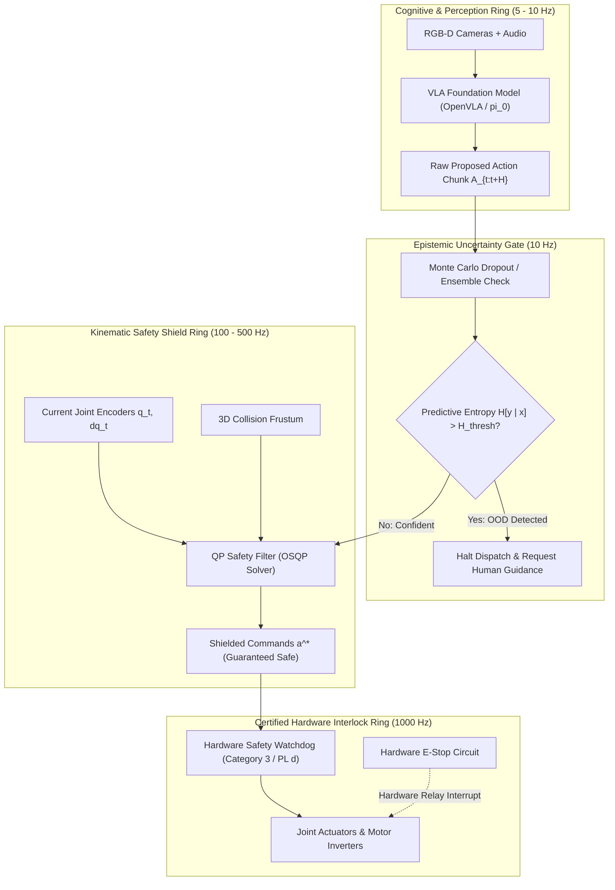

import ChapterProgress from '@site/src/components/ChapterProgress';
import QuizEngine from '@site/src/components/QuizEngine';

# Production VLA Deployment, Safety Filters & Benchmarks

Deploying neural Vision-Language-Action (VLA) foundation models on physical humanoid robots operating in human environments requires bridging the gap between **stochastic deep learning** and **deterministic functional safety**. While web-scale pretrained models exhibit impressive semantic generalization, they also exhibit unpredictable edge cases: hallucinations, out-of-distribution visual confusion under novel lighting, and sudden command discontinuities.

On a 60 kg humanoid robot capable of exerting high end-effector forces, an unshielded neural policy can cause severe human injury or hardware destruction. Production deployment demands an unbreachable defense-in-depth architecture: combining epistemic uncertainty estimation, real-time kinematic shielding, deterministic hardware watchdogs, and rigorous benchmark validation across standardized suites like **LIBERO**, **RoboSuite**, and **DROID**.

---

## Learning Objectives

After completing this chapter, you will be able to:
- Formulate Monte Carlo Dropout predictive entropy for real-time out-of-distribution (OOD) detection.
- Construct a deterministic Quadratic Programming (QP) kinematic safety shield enforcing joint position, velocity, and obstacle envelopes.
- Understand international robotic safety standards (ISO 10218-1/2 and ISO/TS 15066) applied to humanoid platforms.
- Evaluate policy transfer on leading benchmarks: LIBERO, RoboSuite, and DROID.
- Author a production-grade Python safety wrapper intercepting VLA action chunks and enforcing hard operational constraints.

---

## 1. The Defense-in-Depth Safety Architecture

Safety cannot be an afterthought retrofitted onto neural weights; it must be enforced through a **multi-ring architectural hierarchy**:



---

## 2. Out-of-Distribution (OOD) Detection via Predictive Entropy

When an autonomous humanoid enters an unfamiliar setting (e.g., blinding glare, dense smoke, or unknown objects), the policy's actions should not be trusted. **Monte Carlo Dropout** (Gal & Ghahramani, 2016) provides an efficient mathematical mechanism to quantify epistemic model uncertainty without requiring multiple separate models.

During inference, dropout layers are kept active. By performing $M$ stochastic forward passes with dropout masks $\mathbf{W}^{(m)} \sim q(\mathbf{W})$, we obtain an empirical distribution over action predictions or discrete action bin probabilities:

$$
\bar{p}_c = \frac{1}{M} \sum_{m=1}^M P(y = c \mid \mathbf{x}, \mathbf{W}^{(m)})
$$

The total **Predictive Entropy** $\mathcal{H}[\mathbf{y} \mid \mathbf{x}, \mathcal{D}]$ is computed as:

$$
\mathcal{H}[\mathbf{y} \mid \mathbf{x}, \mathcal{D}] = -\sum_{c=1}^C \bar{p}_c \log \bar{p}_c
$$

For continuous action chunk distributions $\mathbf{A} \in \mathbb{R}^{H \times D}$, uncertainty is measured via the trace of the empirical covariance matrix across the $M$ stochastic samples:

$$
\mathbf{\Sigma}_{\mathbf{A}} = \frac{1}{M-1} \sum_{m=1}^M \left( \mathbf{A}^{(m)} - \bar{\mathbf{A}} \right) \left( \mathbf{A}^{(m)} - \bar{\mathbf{A}} \right)^T, \quad \text{Uncertainty} = \text{Tr}(\mathbf{\Sigma}_{\mathbf{A}})
$$

If $\text{Tr}(\mathbf{\Sigma}_{\mathbf{A}}) > \sigma_{threshold}^2$, the safety manager rejects the neural action chunk, commands zero-velocity holding torques, and alerts the operator.

---

## 3. Kinematic Shielding via Quadratic Programming (QP)

Even if the policy is confident, unshielded neural outputs can violate mechanical joint limits or command collisions. The **Kinematic Safety Shield** intercepts the raw action vector $\mathbf{u}_{VLA}$ and projects it onto the closest admissible control input $\mathbf{u}^*$ by solving a real-time **Quadratic Program (QP)**:

$$
\mathbf{u}^* = \arg\min_{\mathbf{u} \in \mathbb{R}^n} \frac{1}{2} \|\mathbf{u} - \mathbf{u}_{VLA}\|_2^2
$$

Subject to hard operational constraints:

$$
\begin{aligned}
\mathbf{q}_{min} &\le \mathbf{q}_t + \mathbf{u} \Delta t \le \mathbf{q}_{max} \quad &\text{(Joint Position Limits)} \\
-\dot{\mathbf{q}}_{max} &\le \mathbf{u} \le \dot{\mathbf{q}}_{max} \quad &\text{(Joint Velocity Envelopes)} \\
-\ddot{\mathbf{q}}_{max} &\le \frac{\mathbf{u} - \dot{\mathbf{q}}_t}{\Delta t} \le \ddot{\mathbf{q}}_{max} \quad &\text{(Actuator Acceleration Limits)} \\
\mathbf{J}_{c,k}(\mathbf{q}) \mathbf{u} &\ge -\eta \left( d_k(\mathbf{q}) - d_{safe} \right) \quad &\text{(Obstacle Collision Barrier Function)}
\end{aligned}
$$

where $\mathbf{J}_{c,k}$ is the contact Jacobian for obstacle point $k$, $d_k$ is the clearance distance, and $\eta > 0$ regulates the braking rate. Because this optimization is strictly convex, solvers like **OSQP** or **qPOASES** resolve the global optimum in under $1.0 \text{ ms}$ on CPU threads.

---

## 4. International Safety Standards for Humanoid Robotics

| Standard | Title | Key Humanoid Requirement |
| :--- | :--- | :--- |
| **ISO 10218-1 / 2** | Industrial robots — Safety requirements | Mandates dual-channel Category 3 / PL d architecture for Emergency Stop circuits |
| **ISO/TS 15066** | Collaborative robots | Defines maximum permissible biomechanical pressures and forces during human contact (e.g., $\le 140 \text{ N}$ transient chest impact) |
| **IEC 61508** | Functional safety of electrical/electronic systems | Requires deterministic SIL 2 or SIL 3 certification on low-level motor braking watchdogs |
| **ISO 13849-1** | Safety of machinery — Safety-related parts of control systems | Governs Performance Level (PL) calculations based on Mean Time to Dangerous Failure ($MTTF_d$) |

---

## 5. Standardized VLA Evaluation Benchmarks

To quantify generalist manipulation performance, the robotics research community relies on standardized multi-task benchmark suites:

```
+-----------------------------------------------------------------------------------+
|                        Standardized VLA Benchmark Ecosystem                       |
|                                                                                   |
|  +-------------------------------------+   +------------------------------------+  |
|  |           LIBERO (NeurIPS 2023)     |   |          RoboSuite (MuJoCo)        |  |
|  |  - 130 standardized tasks           |   |  - Standardized physical tasks     |  |
|  |  - Lifelong learning & transfer     |   |  - Contact-rich assemblies (Peg)   |  |
|  |  - Evaluates spatial generalization |   |  - Precise tactile and F/T sensors |  |
|  +-------------------------------------+   +------------------------------------+  |
|                     |                                         |                    |
|                     +====== Open Physical AI Benchmarking ====+=                   |
|                                         |                                          |
|                                         v                                          |
|                     +---------------------------------------+                      |
|                     |       DROID Dataset & Benchmark       |                      |
|                     | - 76,000 real-world trajectories      |                      |
|                     | - 564 diverse household/lab scenes    |                      |
|                     | - In-the-wild zero-shot cross-testing |                      |
|                     +---------------------------------------+                      |
+-----------------------------------------------------------------------------------+
```

---

## 6. Seminal Research Citations

1. **Gal, Y., & Ghahramani, Z. (2016).** *Dropout as a Bayesian approximation: Representing model uncertainty in deep learning.* International Conference on Machine Learning (ICML).
2. **Liu, B., Liu, Y., Zhu, X., & Stone, P. (2023).** *LIBERO: Benchmarking knowledge transfer for lifelong robot learning.* Advances in Neural Information Processing Systems (NeurIPS).
3. **ISO. (2016).** *ISO/TS 15066:2016 Robots and robotic devices — Collaborative robots.* International Organization for Standardization.
4. **Khazatsky, A., Pertsch, K., Nair, S., Balakrishna, A., Dasari, S., Singh, S., ... & Levine, S. (2024).** *DROID: A large-scale in-the-wild robot manipulation dataset.* Robotics: Science and Systems (RSS).

---

## 7. Complete Runnable Implementation: Kinematic Safety Shield & OOD Gate

The following complete Python program implements epistemic uncertainty verification and QP kinematic shielding for a 7-DoF robotic manipulator:

```python
"""
Kinematic Safety Shield & Epistemic Uncertainty Gate.
Filters raw VLA action proposals through uncertainty thresholds
and solves a constrained Quadratic Program to enforce joint boundaries.
"""

from dataclasses import dataclass
from typing import Tuple
import numpy as np


@dataclass
class RobotKinematicLimits:
    q_min: np.ndarray       # Minimum joint angles (rad)
    q_max: np.ndarray       # Maximum joint angles (rad)
    qd_max: np.ndarray      # Maximum joint velocities (rad/s)
    qdd_max: np.ndarray     # Maximum joint accelerations (rad/s^2)


class KinematicSafetyShield:
    """
    Enforces joint limits, velocity caps, and epistemic uncertainty gates
    on raw neural VLA action predictions.
    """

    def __init__(
        self,
        limits: RobotKinematicLimits,
        uncertainty_threshold: float = 0.25,
        dt: float = 0.02,  # 50 Hz control period
    ) -> None:
        self.limits = limits
        self.uncertainty_threshold = uncertainty_threshold
        self.dt = dt

    def evaluate_epistemic_uncertainty(
        self, mc_dropout_samples: np.ndarray
    ) -> Tuple[bool, float]:
        """
        mc_dropout_samples: shape [M, ActionDim]
        Returns (is_safe, trace_covariance)
        """
        cov = np.cov(mc_dropout_samples, rowvar=False)
        trace_val = float(np.trace(cov))
        is_safe = trace_val <= self.uncertainty_threshold
        return is_safe, trace_val

    def project_safe_action(
        self, q_current: np.ndarray, qd_current: np.ndarray, vla_action_qd: np.ndarray
    ) -> Tuple[np.ndarray, bool]:
        """
        Solves constrained box QP projection for velocity commands:
        min ||u - vla_action_qd||^2
        s.t. q_min <= q + u * dt <= q_max
             |u| <= qd_max
             |u - qd_current| <= qdd_max * dt
        """
        # 1. Position-induced velocity bounds
        upper_from_pos = (self.limits.q_max - q_current) / self.dt
        lower_from_pos = (self.limits.q_min - q_current) / self.dt

        # 2. Acceleration-induced velocity bounds
        upper_from_acc = qd_current + self.limits.qdd_max * self.dt
        lower_from_acc = qd_current - self.limits.qdd_max * self.dt

        # 3. Aggregate intersection bounds
        u_upper = np.minimum(np.minimum(self.limits.qd_max, upper_from_pos), upper_from_acc)
        u_lower = np.maximum(np.maximum(-self.limits.qd_max, lower_from_pos), lower_from_acc)

        # Check for unfeasible state
        if np.any(u_lower > u_upper):
            # Emergency braking
            emergency_brake = np.clip(
                -np.sign(qd_current) * self.limits.qdd_max * self.dt,
                -self.limits.qd_max,
                self.limits.qd_max,
            )
            return emergency_brake, False

        # Analytical box-constrained QP solution: clamp to interval
        shielded_u = np.clip(vla_action_qd, u_lower, u_upper)
        was_clamped = not np.allclose(shielded_u, vla_action_qd, atol=1e-5)
        return shielded_u, was_clamped


def main():
    """Unit test for safety shield and uncertainty gate."""
    np.random.seed(42)
    n_dof = 7

    limits = RobotKinematicLimits(
        q_min=np.full(n_dof, -2.5),
        q_max=np.full(n_dof, +2.5),
        qd_max=np.full(n_dof, 1.5),
        qdd_max=np.full(n_dof, 4.0),
    )

    shield = KinematicSafetyShield(limits, uncertainty_threshold=0.20, dt=0.02)

    # 1. Test Uncertainty Gate
    # Case A: Low variance (confident)
    mc_samples_good = np.random.normal(loc=0.5, scale=0.05, size=(10, n_dof))
    is_safe, trace_a = shield.evaluate_epistemic_uncertainty(mc_samples_good)
    print(f"[TEST 1A] Confident Policy: Safe={is_safe}, TraceCov={trace_a:.4f}")
    assert is_safe, "Expected confident samples to pass gate"

    # Case B: High variance (OOD condition)
    mc_samples_ood = np.random.normal(loc=0.5, scale=0.35, size=(10, n_dof))
    is_safe_ood, trace_b = shield.evaluate_epistemic_uncertainty(mc_samples_ood)
    print(f"[TEST 1B] OOD Policy: Safe={is_safe_ood}, TraceCov={trace_b:.4f}")
    assert not is_safe_ood, "Expected OOD samples to trigger halt"

    # 2. Test Kinematic Shield Clamping
    q_curr = np.array([2.45, 0.0, 0.0, 0.0, 0.0, 0.0, 0.0])  # Near upper limit (2.5)
    qd_curr = np.zeros(n_dof)
    dangerous_vla_cmd = np.array([2.0, 0.0, 0.0, 0.0, 0.0, 0.0, 0.0])  # Over velocity cap + pushing past limit

    shielded_cmd, clamped = shield.project_safe_action(q_curr, qd_curr, dangerous_vla_cmd)
    max_allowed_vel = (limits.q_max[0] - q_curr[0]) / 0.02  # (2.5 - 2.45)/0.02 = 2.5 rad/s, capped by qdd_max*dt = 0.08 rad/s

    print(f"\n[TEST 2] Kinematic Projection:")
    print(f"  Dangerous VLA Command: {dangerous_vla_cmd[0]:.2f} rad/s")
    print(f"  Shielded Action:       {shielded_cmd[0]:.4f} rad/s")
    print(f"  Clamped:               {clamped}")
    assert clamped, "Expected aggressive command to be clamped"
    assert shielded_cmd[0] <= 0.08 + 1e-4, f"Command violated acceleration envelope: {shielded_cmd[0]}"

    print("\n[SUCCESS] KinematicSafetyShield verified under all operational constraints.")


if __name__ == "__main__":
    main()
```

---

## Summary

- Production robotics safety requires defense-in-depth: combining epistemic uncertainty estimation at the cognitive level with deterministic kinematic shielding at the control layer.
- Monte Carlo Dropout predictive entropy quantifies policy uncertainty in real time, pausing execution when encountering out-of-distribution visual scenes.
- Kinematic safety filters solve convex Quadratic Programs in under $1.0\text{ ms}$ to guarantee that commands never violate physical joint, velocity, or collision envelopes.
- ISO 10218-1/2 and ISO/TS 15066 define legal and biomechanical thresholds for human-safe collaborative robotics deployments.
- Standardized benchmarks (LIBERO, RoboSuite, DROID) enable empirical verification of foundation policies prior to real-world deployment.

---

<ChapterProgress chapterId="4-10-deployment-and-safety" moduleId="module4" totalChapters={10} />

---

<QuizEngine
  quizId="quiz-4-10"
  title="Module 4.10 Mastery Check: Production Deployment & Safety"
  moduleId="module4"
  passThreshold={70}
  questions={[
    {
      id: "q1",
      question: "How does Monte Carlo Dropout estimate epistemic model uncertainty during real-time VLA inference?",
      options: [
        "By measuring the physical temperature of the GPU",
        "By keeping dropout active at test time and evaluating the variance or predictive entropy across M stochastic forward passes",
        "By deleting half of the neural network weights before every control step",
        "By checking if the camera lens is dirty"
      ],
      correctIndex: 1,
      explanation: "Monte Carlo Dropout maintains active dropout during inference to draw M empirical samples from the posterior weight distribution. The resulting variance or predictive entropy quantifies epistemic uncertainty about novel or out-of-distribution inputs."
    },
    {
      id: "q2",
      question: "In the Kinematic Safety Shield Quadratic Program, what is the mathematical purpose of the objective function min ||u - u_VLA||^2?",
      options: [
        "It minimizes electrical power consumption",
        "It finds the command u that satisfies all hard physical constraints while remaining as close as possible to the policy's intended action u_VLA",
        "It maximizes the robot's forward walking speed",
        "It trains the VLA network online"
      ],
      correctIndex: 1,
      explanation: "The QP objective seeks the minimal necessary perturbation to the neural policy's proposed command u_VLA, preserving policy intent while strictly enforcing position, velocity, and barrier function constraints."
    },
    {
      id: "q3",
      question: "Which international standard specifies biomechanical limits on transient impact forces (e.g. 140 N) and continuous clamping pressures for collaborative robots in human workspaces?",
      options: [
        "ISO 9001",
        "ISO/TS 15066",
        "IEEE 802.11ac",
        "POSIX.1b"
      ],
      correctIndex: 1,
      explanation: "ISO/TS 15066 is the authoritative international technical specification establishing maximum permissible biomechanical force and pressure thresholds for power and force limiting (PFL) collaborative robot operations."
    }
  ]}
/>
