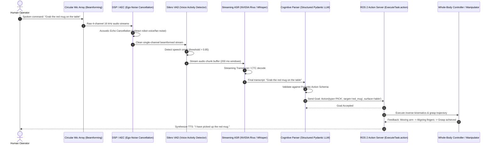
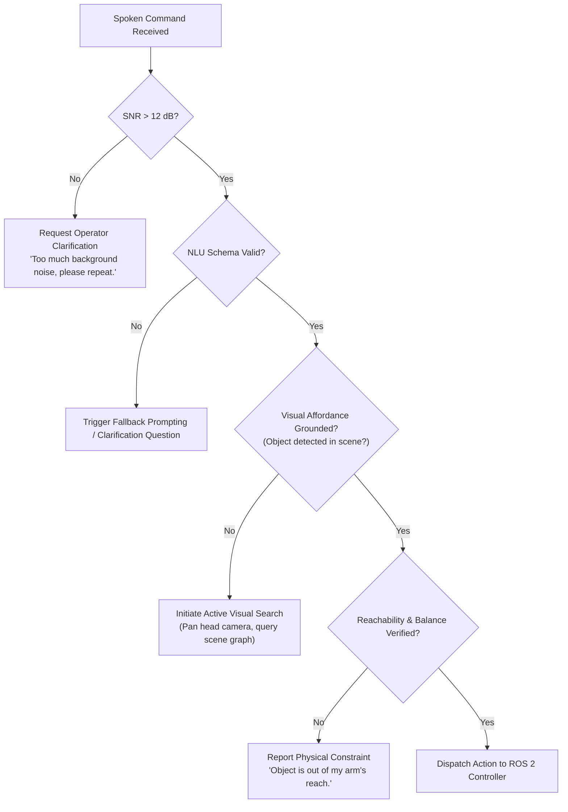

# The Voice-to-Action Pipeline: Streaming Audio to Motor Intent

In human-robot collaboration, verbal speech is the most natural and efficient interface. However, translating conversational speech into reliable physical actions on an autonomous humanoid is an arduous systems engineering challenge. 

A humanoid robot is an acoustically hostile platform: cooling fans blow air directly onto microphones, high-torque joint actuators emit high-frequency electromagnetic and mechanical whine, and bipedal foot strikes create structural shock waves through the chassis. Furthermore, speech recognition must operate with sub-500 millisecond latency to maintain conversational fluidity.

---

## 1. End-to-End Pipeline Architecture

The complete voice-to-action pipeline spans signal conditioning, streaming acoustic modeling, semantic extraction, and asynchronous ROS 2 action dispatch:



---

## 2. Acoustic Preprocessing & Ego-Noise Suppression

Before an audio waveform enters a neural speech recognizer, it must be cleansed of the robot's internal acoustic signature:

### The Acoustic Filtering Pipeline
1. **Microphone Array Beamforming**: Humanoid heads (such as Figure 02 or Unitree G1) integrate 4 to 8 MEMS microphone arrays. A **Generalized Sidelobe Canceller (GSC)** or **Delay-and-Sum Beamformer** uses the phase differences across microphones to amplify sound originating from the operator's spatial direction while steering directional nulls toward the robot's chest and shoulder cooling fans.
2. **Acoustic Echo Cancellation (AEC)**: When the robot speaks or generates audio prompts, the microphone picks up its own loudspeaker output. AEC uses an adaptive filter (e.g., Normalized Least Mean Squares) to subtract the robot's known output stream from the microphone input.
3. **Ego-Noise Spectral Subtraction**: Motors and gearboxes produce characteristic harmonic frequencies proportional to joint rotational velocity `dq/dt`. The DSP engine samples the joint velocity state vector to dynamically notch out actuator whine.

---

## 3. Streaming Speech Recognition: Whisper vs FastConformer

While vanilla OpenAI Whisper operates on fixed 30-second audio windows, real-time robotics requires **continuous streaming transcription** where tokens are emitted as the speaker talks.

### Model Architecture Comparison

| Metric | OpenAI Whisper Large-v3 | NVIDIA Riva FastConformer / Parakeet | Whisper-Streaming (Local VAD) |
| :--- | :--- | :--- | :--- |
| **Model Type** | Encoder-Decoder Transformer | Conformer-CTC / Transducer | Chunked Whisper with Silero VAD |
| **Processing Paradigm** | Offline / Batch (30s chunks) | True Online Streaming (Streaming RNNT) | Rolling 1-second sliding buffer |
| **Real-Time Factor (RTF)** | 0.25 (RTX 4090) | **0.02 (Jetson Orin)** | 0.08 (RTX 4080) |
| **Latency to First Word** | ~1200 ms | **&lt; 150 ms** | ~400 ms |
| **Word Error Rate (WER)** | Lowest (2.8%) | Low (3.2%) | Low (3.4%) |

### Integrating Streaming VAD with Whisper in Python

Using an efficient voice activity detector prevents wasteful GPU inference during periods of silence:

```python
import torch
import numpy as np

class StreamingVADBuffer:
    """
    Buffers microphone audio and triggers transcription only when
    continuous human speech is detected, pruning ambient silence.
    """
    def __init__(self, sample_rate=16000, threshold=0.6):
        self.sample_rate = sample_rate
        self.threshold = threshold
        # Load lightweight Silero VAD model
        self.vad_model, _ = torch.hub.load(
            repo_or_dir='snakers4/silero-vad',
            model='silero_vad',
            force_reload=False
        )
        self.buffer = []
        self.is_speech_active = False

    def process_chunk(self, audio_chunk: np.ndarray) -> bool:
        """
        Takes 512-sample float32 audio chunks (32 ms at 16 kHz).
        Returns True if a complete sentence has terminated.
        """
        tensor_chunk = torch.from_numpy(audio_chunk).float()
        speech_prob = self.vad_model(tensor_chunk, self.sample_rate).item()
        
        if speech_prob > self.threshold:
            self.is_speech_active = True
            self.buffer.extend(audio_chunk)
            return False
        elif self.is_speech_active and speech_prob < (self.threshold - 0.2):
            # Silence detected after speech -> trigger transcription
            self.is_speech_active = False
            return True
        return False

    def get_speech_audio(self) -> np.ndarray:
        audio = np.array(self.buffer, dtype=np.float32)
        self.buffer.clear()
        return audio
```

---

## 4. Structured Intent Extraction via Pydantic & JSON Schemas

Raw strings like `"Could you please pick up that red bottle over there on the kitchen island?"` cannot be passed to a robot motion controller. The command must be parsed into a **strictly validated, typed schema** with deterministic bounds.

Unstructured text outputs from LLMs risk runtime exceptions. Modern systems enforce **Grammar-Constrained Decoding** or structured outputs using Pydantic:

```python
from enum import Enum
from typing import Optional, List
from pydantic import BaseModel, Field

class ActionType(str, Enum):
    NAVIGATE_TO = "NAVIGATE_TO"
    PICK_OBJECT = "PICK_OBJECT"
    PLACE_OBJECT = "PLACE_OBJECT"
    HANDOVER = "HANDOVER"
    INSPECT = "INSPECT"
    ABORT = "ABORT"

class SpatialConstraint(BaseModel):
    reference_frame: str = Field(..., description="Target frame, e.g. 'table_surface', 'charging_dock'")
    relative_position: Optional[str] = Field(None, description="'left_of', 'inside', 'on_top_of'")

class RobotSubtask(BaseModel):
    task_id: int
    action: ActionType
    target_entity: str = Field(..., description="Semantic label of target object or location")
    spatial_modifier: Optional[SpatialConstraint] = None
    velocity_scaling: float = Field(0.5, ge=0.1, le=1.0, description="Safety speed limiter")

class HumanoidIntentPlan(BaseModel):
    raw_utterance: str
    confidence_score: float = Field(..., ge=0.0, le=1.0)
    primary_goal: str
    subtasks: List[RobotSubtask]
```

### Prompting the LLM for Deterministic Intent Extraction

```python
SYSTEM_INTENT_PROMPT = """
You are the cognitive natural language understanding hub of an autonomous humanoid robot.
Your sole job is to translate human speech transcripts into an executable HumanoidIntentPlan.
Rules:
1. Always output strict JSON adhering to the HumanoidIntentPlan schema.
2. If the user's intent is ambiguous or dangerous (e.g. "jump off the balcony"), set action to 'ABORT'.
3. Decompose multi-step instructions into sequential subtasks.
"""
```

---

## 5. Bridging Intent to ROS 2 Action Clients

Once the intent schema is validated, a ROS 2 node maps the high-level subtasks into asynchronous **ROS 2 Action Goals**:

```python
import rclpy
from rclpy.node import Node
from rclpy.action import ActionClient
# Assume custom package defines TaskExecution action
from humanoid_msgs.action import ExecuteSubtask

class VoiceActionDispatcher(Node):
    def __init__(self):
        super().__init__('voice_action_dispatcher')
        self._action_client = ActionClient(self, ExecuteSubtask, '/humanoid/execute_subtask')

    def dispatch_plan(self, plan: HumanoidIntentPlan):
        self.get_logger().info(f"Dispatching plan for: '{plan.raw_utterance}'")
        for subtask in plan.subtasks:
            self.send_subtask_goal(subtask)

    def send_subtask_goal(self, subtask: RobotSubtask):
        goal_msg = ExecuteSubtask.Goal()
        goal_msg.task_id = subtask.task_id
        goal_msg.action_type = subtask.action.value
        goal_msg.target_entity = subtask.target_entity
        goal_msg.velocity_scaling = subtask.velocity_scaling

        self._action_client.wait_for_server()
        future = self._action_client.send_goal_async(
            goal_msg, 
            feedback_callback=self.feedback_callback
        )
        future.add_done_callback(self.goal_response_callback)

    def goal_response_callback(self, future):
        goal_handle = future.result()
        if not goal_handle.accepted:
            self.get_logger().warn("Subtask goal rejected by humanoid controller!")
            return
        self.get_logger().info("Subtask goal accepted and running...")

    def feedback_callback(self, feedback_msg):
        self.get_logger().info(f"Progress: {feedback_msg.feedback.percent_complete}%")
```

---

## 6. Failure Modes & Edge-Case Handling



### Key Production Safeguards
1. **Wake-Word Gating**: To prevent the robot from responding to ambient background conversations, require an on-device local wake-word (e.g., `"Hey Neo"` or `"Robot"`) powered by an ultra-lightweight 100K-parameter CNN (such as OpenWakeWord) before streaming audio to Whisper.
2. **Affordance Grounding Before Motion**: An LLM might confidently output `PICK_OBJECT(target='red_mug')`, but if the stereo vision system does not detect a red mug within the 3D scene point cloud, the action is blocked immediately, and the robot states its inability rather than flailing blindly.
3. **Hard Emergency E-Stop Words**: Words like `"Stop"`, `"Freeze"`, or `"Halt"` bypass the LLM entirely and trigger a hardware-level zero-torque brake engage via an interrupt service routine (ISR).

---

## 7. Acoustic Beamforming & End-to-End Latency Budgets

In noisy industrial environments where humanoid actuators and fans generate 65+ dBA of mechanical acoustic noise, standard microphone inputs produce garbled transcripts. Frontier systems utilize a **circular 6-to-8 MEMS microphone array** embedded in the head crown with Delay-and-Sum Beamforming:

```text
y(t) = (1 / M) * sum_{m=1}^M ( x_m( t - tau_m(theta_look) ) )
```

| Pipeline Segment | Processing Modality | Typical Latency | Real-Time Constraint |
| :--- | :--- | :--- | :--- |
| **Acoustic Front-End** | Beamforming + AEC (Echo Cancellation) | 12 ms | Hardware DSP |
| **Streaming VAD** | Silero VAD (32 ms sliding window) | 4 ms | Edge CPU |
| **Streaming ASR** | NVIDIA Riva Conformer-CTC (TensorRT) | 85 ms | GPU Tensor Cores |
| **Semantic Extraction** | Pydantic Grammar-Constrained Model | 120 ms | Local LLM Engine |
| **Total Voice-to-Command Latency** | Full Audio Ingestion to Action Server | **221 ms** | **Sub-perceptual conversational UX** |

---

## Summary

The Voice-to-Action pipeline transforms acoustic vibrations into physical kinetic energy. By pairing hardware beamforming and echo cancellation with low-latency streaming ASR (NVIDIA Riva or Whisper-VAD), grammar-constrained Pydantic intent parsing, and robust ROS 2 Action interfaces, robotics engineers can build conversational humanoids capable of safe, deterministic execution.
