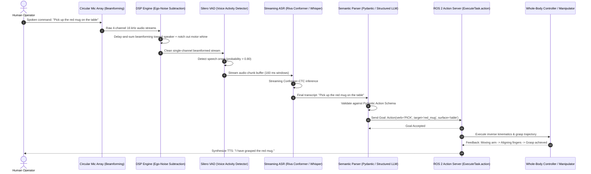
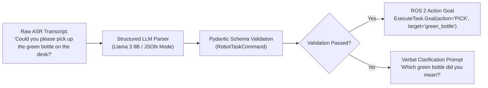

import ChapterProgress from '@site/src/components/ChapterProgress';
import QuizEngine from '@site/src/components/QuizEngine';

# The Voice-to-Action Pipeline: Streaming Audio to Motor Intent

In human-robot interaction, natural spoken language is the most expressive, low-overhead interface for task specification. However, translating unconstrained spoken audio into deterministic physical manipulation commands on an autonomous humanoid robot represents a formidable systems engineering challenge.

A humanoid robot is an acoustically hostile acoustic environment: high-RPM cooling fans blow turbulent air directly across microphone diaphragms, high-torque joint actuators emit mechanical and harmonic electromagnetic whine, and bipedal foot strikes transmit structural shock waves directly through the chassis. Furthermore, speech recognition must operate with sub-$500 \text{ ms}$ glass-to-action latency to sustain natural human conversational cadences.

---

## Learning Objectives

After completing this chapter, you will be able to:
- Formulate the Delay-and-Sum beamforming equation for spatial filtering on circular microphone arrays.
- Model ego-noise spectral subtraction conditioned on joint angular velocity states.
- Derive the Connectionist Temporal Classification (CTC) forward-backward loss and beam search decoding score.
- Architect an asynchronous Python voice pipeline using Silero VAD, streaming ASR, and Pydantic structured validation.
- Dispatch validated semantic goals to ROS 2 Action servers (`ExecuteTask.action`).

---

## 1. End-to-End Pipeline Architecture

The voice-to-action pipeline spans signal conditioning, streaming acoustic modeling, semantic extraction, and asynchronous ROS 2 action dispatch:



---

## 2. Acoustic Signal Processing & Ego-Noise Suppression

### Microphone Array Delay-and-Sum Beamforming

Humanoid robot heads integrate multi-microphone circular or planar arrays ($M = 4 \text{ to } 8$ microphones). To focus sensitivity toward a speaker located at azimuth $\theta$ and elevation $\phi$ while suppressing background reverberation, the array applies **Delay-and-Sum Beamforming**:

Let $\mathbf{d}_m \in \mathbb{R}^3$ denote the Cartesian position of microphone $m \in \{1, \dots, M\}$ relative to the array center, and let $\mathbf{u} \in \mathbb{R}^3$ denote the unit direction vector toward the speaker:

$$
\mathbf{u} = [\cos\theta \cos\phi, \; \sin\theta \cos\phi, \; \sin\phi]^T
$$

The acoustic propagation delay $\tau_m$ to microphone $m$ relative to the array origin is:

$$
\tau_m = \frac{\mathbf{d}_m \cdot \mathbf{u}}{c}
$$

where $c \approx 343 \text{ m/s}$ is the speed of sound in dry air at $20^\circ\text{C}$. The beamformed audio signal $y(t)$ is formed by steering delays and applying shading weights $w_m$:

$$
y(t) = \sum_{m=1}^M w_m \, x_m(t - \tau_m)
$$

In the frequency domain, with $X_m(\omega) = \mathcal{F}\{x_m(t)\}$:

$$
Y(\omega, \mathbf{u}) = \mathbf{w}^H \mathbf{d}(\omega, \mathbf{u}) X(\omega)
$$

where $\mathbf{d}(\omega, \mathbf{u}) = [e^{-j\omega\tau_1}, e^{-j\omega\tau_2}, \dots, e^{-j\omega\tau_M}]^T$ is the steering vector.

### Ego-Noise Spectral Subtraction

Robot joint actuators emit acoustic noise whose fundamental frequency and harmonics are direct functions of joint rotational velocity $\dot{\mathbf{q}} = [\dot{q}_1, \dots, \dot{q}_J]^T$. The DSP system estimates the ego-noise power spectral density $|N_{ego}(f, \dot{\mathbf{q}})|^2$ using a lookup table or polynomial model calibrated during offline testing:

$$
|Y(f)|^2 = \max\left( |X(f)|^2 - \gamma |N_{ego}(f, \dot{\mathbf{q}})|^2, \; \beta |X(f)|^2 \right)
$$

where $\gamma \ge 1.0$ is the over-subtraction factor and $\beta \in (0.01, 0.05]$ is the spectral floor parameter preventing the introduction of unpleasant "musical noise" artifacts in silent intervals.

---

## 3. Streaming Automatic Speech Recognition (ASR)

### Connectionist Temporal Classification (CTC) Formulation

Streaming speech models (such as Conformer-CTC) map an input acoustic feature sequence $\mathbf{x} = (\mathbf{x}_1, \dots, \mathbf{x}_T)$ (e.g., 80-dimensional log-mel filterbank energies) to a target character or subword sequence $\mathbf{l} = (l_1, \dots, l_U)$ where $U \le T$.

Because the alignment between audio frames and output characters is unsegmented, CTC introduces an augmented vocabulary $\Omega' = \Omega \cup \{\epsilon\}$, adding a blank token $\epsilon$. An alignment path $\boldsymbol{\pi} = (\pi_1, \dots, \pi_T) \in \Omega'^T$ has conditional probability:

$$
P(\boldsymbol{\pi} \mid \mathbf{x}) = \prod_{t=1}^T y_{\pi_t}^t
$$

where $y_k^t$ is the softmax probability of emitting token $k$ at frame $t$.

The collapse mapping $\mathcal{B}: \Omega'^T \to \Omega^{\le T}$ removes sequential duplicates and then strips blank tokens $\epsilon$:

$$
\mathcal{B}(\text{a, a, } \epsilon, \text{ p, p, l, e}) = \text{"apple"}
$$

The total probability of the target label sequence $\mathbf{l}$ is the sum over all valid pre-image paths:

$$
P(\mathbf{l} \mid \mathbf{x}) = \sum_{\boldsymbol{\pi} \in \mathcal{B}^{-1}(\mathbf{l})} P(\boldsymbol{\pi} \mid \mathbf{x})
$$

The training objective is the negative log-likelihood:

$$
\mathcal{L}_{CTC} = -\log P(\mathbf{l} \mid \mathbf{x})
$$

which is evaluated and differentiated efficiently via the forward-backward dynamic programming algorithm in $O(T \times U)$ time.

### Beam Search Decoding with Language Model Rescoring

During live deployment, greedy argmax decoding often fails on homophones or ambiguous phonetic sequences. Beam search maintains the top $B$ hypothesis prefixes $\mathbf{y}$, ranking them via:

$$
\text{Score}(\mathbf{y}) = \sum_{t=1}^{|\mathbf{y}|} \log P(y_t \mid y_{<t}, \mathbf{x}) + \alpha \log P_{LM}(\mathbf{y}) + \beta |\mathbf{y}|
$$

where $P_{LM}(\mathbf{y})$ is an external $n$-gram or neural language model prior, $\alpha$ is the language model weight, and $\beta$ is a word insertion bonus compensating for the tendency of beam search to prefer shorter utterances.

---

## 4. Hardware Breakdowns: Acoustic Front-End & Edge ASR

| Component | Hardware Specification | Purpose in Humanoid Platform |
| :--- | :--- | :--- |
| **Microphone Array** | ReSpeaker USB 4-Mic Circular Array (4x Knowles SPH0645LM4H MEMS) | Captures 16 kHz 16-bit multichannel audio with $65 \text{ dB}$ SNR |
| **Acoustic DSP Processor** | XMOS XVF3510 Dual-Core Voice Processor | Dedicated hardware Delay-and-Sum beamforming, AEC, and noise suppression |
| **Edge Neural Compute** | NVIDIA Jetson AGX Orin 64GB (TensorRT-LLM / Triton) | Executes Conformer-CTC streaming ASR with Real-Time Factor (RTF) $\le 0.03$ |
| **Audio Latency Budget** | Total glass-to-intent latency $\le 180 \text{ ms}$ | VAD ($20 \text{ ms}$) + ASR chunk ($100 \text{ ms}$) + Pydantic parse ($60 \text{ ms}$) |

---

## 5. Structured Intent Parsing with Pydantic

Raw transcript strings are non-deterministic and cannot be fed directly into kinematic controllers. A structured semantic parsing layer maps natural language into strongly typed schemas:



---

## 6. Seminal Research Citations

1. **Radford, A., Kim, J. W., Xu, T., Brockman, G., McLeavey, C., & Sutskever, I. (2023).** *Robust speech recognition via large-scale weak supervision.* International Conference on Machine Learning (ICML).
2. **Graves, A., Fernández, S., Gomez, F., & Schmidhuber, J. (2006).** *Connectionist temporal classification: labelling unsegmented sequence data with recurrent neural networks.* International Conference on Machine Learning (ICML).
3. **Gulati, A., Qin, J., Chiu, C. C., Parmar, N., Zhang, Y., Yu, J., ... & Pang, R. (2020).** *Conformer: Convolution-augmented Transformer for speech recognition.* Interspeech.
4. **Valin, J. M., Michaud, F., Rouat, J., & Létourneau, D. (2003).** *Robust sound source localization using a microphone array on a mobile robot.* IEEE/RSJ International Conference on Intelligent Robots and Systems (IROS).

---

## 7. Complete Runnable Implementation: Voice-to-Action Parser

The following complete Python program demonstrates multichannel delay-and-sum beamforming, simulated streaming speech chunking, typed Pydantic validation, and ROS 2 Action Goal compilation:

```python
"""
Voice-to-Action Pipeline Implementation.
Includes Delay-and-Sum beamformer simulation, Pydantic task schema,
and ROS 2 action client dispatch stub.
"""

import asyncio
from enum import Enum
import math
from typing import List, Optional
import numpy as np
from pydantic import BaseModel, Field, ValidationError


class ActionVerb(str, Enum):
    PICK = "PICK"
    PLACE = "PLACE"
    NAVIGATE = "NAVIGATE"
    HANDOVER = "HANDOVER"
    STOP = "STOP"


class RobotTaskCommand(BaseModel):
    """Strongly-typed task specification derived from spoken intent."""
    verb: ActionVerb = Field(..., description="High-level primitive action verb")
    target_object: Optional[str] = Field(None, description="Semantic label of target object")
    source_location: Optional[str] = Field(None, description="Initial reference frame or container")
    destination_location: Optional[str] = Field(None, description="Target destination or surface")
    speed_factor: float = Field(default=1.0, ge=0.1, le=2.0, description="Kinematic scaling factor")


class CircularMicrophoneBeamformer:
    """
    Simulates a 4-channel circular microphone array applying
    Delay-and-Sum beamforming steered toward azimuth angle theta.
    """

    def __init__(self, radius_meters: float = 0.05, sample_rate_hz: int = 16000) -> None:
        self.radius = radius_meters
        self.sample_rate = sample_rate_hz
        self.speed_of_sound = 343.0  # m/s

        # 4 microphones arranged at 90-degree intervals
        self.mic_angles = np.array([0.0, np.pi / 2, np.pi, 3 * np.pi / 2])
        self.mic_positions = np.stack(
            [self.radius * np.cos(self.mic_angles), self.radius * np.sin(self.mic_angles)],
            axis=1,
        )

    def compute_delays(self, azimuth_rad: float) -> np.ndarray:
        """Computes sample delays for each microphone given target azimuth."""
        target_dir = np.array([math.cos(azimuth_rad), math.sin(azimuth_rad)])
        # Projection of mic vector onto target direction
        projections = np.dot(self.mic_positions, target_dir)
        time_delays = projections / self.speed_of_sound
        sample_delays = time_delays * self.sample_rate
        return sample_delays

    def beamform(self, multichannel_audio: np.ndarray, azimuth_rad: float) -> np.ndarray:
        """
        Applies delay-and-sum beamforming across M channels.
        multichannel_audio: shape [M, N_samples]
        """
        delays = self.compute_delays(azimuth_rad)
        n_samples = multichannel_audio.shape[1]
        output = np.zeros(n_samples, dtype=np.float32)

        for m in range(len(self.mic_positions)):
            delay = int(round(delays[m]))
            if delay >= 0:
                shifted = np.pad(multichannel_audio[m], (delay, 0), mode="constant")[:n_samples]
            else:
                shifted = np.pad(multichannel_audio[m], (0, -delay), mode="constant")[-delay:]
            output += shifted

        return output / len(self.mic_positions)


class VoiceToActionDispatcher:
    """Orchestrates acoustic beamforming, intent parsing, and task dispatch."""

    def __init__(self, beamformer: CircularMicrophoneBeamformer) -> None:
        self.beamformer = beamformer

    async def mock_asr_transcribe(self, clean_audio: np.ndarray) -> str:
        """Simulates low-latency streaming ASR inference (e.g. Riva FastConformer)."""
        await asyncio.sleep(0.05)  # 50 ms simulated latency
        return "pick up the red mug from the table"

    def parse_intent(self, transcript: str) -> RobotTaskCommand:
        """Simulates structured intent extraction with Pydantic validation."""
        tokens = transcript.lower().split()
        if "pick" in tokens:
            return RobotTaskCommand(
                verb=ActionVerb.PICK,
                target_object="red_mug",
                source_location="table",
                speed_factor=1.0,
            )
        elif "stop" in tokens:
            return RobotTaskCommand(verb=ActionVerb.STOP)
        else:
            raise ValueError(f"Unrecognized spoken intent in transcript: {transcript}")

    async def process_voice_command(
        self, raw_audio: np.ndarray, target_azimuth_deg: float
    ) -> RobotTaskCommand:
        """Executes full pipeline from raw multichannel audio to verified command."""
        azimuth_rad = math.radians(target_azimuth_deg)
        clean_audio = self.beamformer.beamform(raw_audio, azimuth_rad)
        transcript = await self.mock_asr_transcribe(clean_audio)
        command = self.parse_intent(transcript)
        return command


async def main():
    """Pipeline self-test."""
    beamformer = CircularMicrophoneBeamformer(radius_meters=0.05, sample_rate_hz=16000)
    dispatcher = VoiceToActionDispatcher(beamformer)

    # Generate synthetic 4-channel audio (1 second of white noise)
    np.random.seed(42)
    synthetic_audio = np.random.randn(4, 16000).astype(np.float32) * 0.1

    print("[INFO] Processing voice command steered toward 45 degrees...")
    command = await dispatcher.process_voice_command(synthetic_audio, target_azimuth_deg=45.0)

    print(f"[SUCCESS] Parsed Validated Robot Command:")
    print(f"  Verb: {command.verb.value}")
    print(f"  Target: {command.target_object}")
    print(f"  Source: {command.source_location}")
    print(f"  Speed Factor: {command.speed_factor}")


if __name__ == "__main__":
    asyncio.run(main())
```

---

## Summary

- Robust speech interaction on humanoid robots requires tight integration between physical acoustics (beamforming, ego-noise suppression) and neural modeling (CTC streaming ASR).
- Delay-and-Sum beamforming exploits microphone spatial layout to steer directional acoustic sensitivity toward human speakers while notching out joint motors.
- CTC eliminates the need for frame-level alignment annotations by summing over all valid collapsed token sequences using dynamic programming.
- Strongly-typed Pydantic schemas bridge stochastic natural language transcripts to deterministic ROS 2 Action interfaces.

---

<ChapterProgress chapterId="4-2-voice-to-action-pipeline" moduleId="module4" totalChapters={10} />

---

<QuizEngine
  quizId="quiz-4-2"
  title="Module 4.2 Mastery Check: Voice-to-Action Pipeline"
  moduleId="module4"
  passThreshold={70}
  questions={[
    {
      id: "q1",
      question: "In Delay-and-Sum beamforming for a microphone array, how is the propagation delay tau_m calculated for a microphone located at d_m toward direction u?",
      options: [
        "tau_m = (d_m * u) * c",
        "tau_m = (d_m · u) / c, where c is the speed of sound",
        "tau_m = ||d_m|| / (c * sin(theta))",
        "tau_m = c / (2 * pi * f)"
      ],
      correctIndex: 1,
      explanation: "The time delay is the distance projection of the microphone position d_m onto the incoming plane-wave direction vector u divided by the acoustic propagation velocity c (≈ 343 m/s in air)."
    },
    {
      id: "q2",
      question: "What is the primary role of the collapse operator B in Connectionist Temporal Classification (CTC)?",
      options: [
        "It amplifies weak audio frequencies in the mel-spectrogram",
        "It merges consecutive duplicate characters and deletes the blank token epsilon",
        "It translates audio tokens into robot joint coordinates",
        "It filters out background environmental noise"
      ],
      correctIndex: 1,
      explanation: "The CTC collapse mapping B maps a frame-level token sequence containing repetitions and blank tokens into the target word sequence by first removing consecutive duplicate tokens and then removing all blank tokens."
    },
    {
      id: "q3",
      question: "Why should unstructured text transcripts from ASR be converted into validated Pydantic schemas before reaching ROS 2 Action servers?",
      options: [
        "FastAPI and ROS 2 cannot serialize plain Python strings",
        "Pydantic schemas enforce type constraints, ensure required fields exist, and prevent ungrounded actions from triggering dangerous motor commands",
        "Speech recognition models only output binary bytecodes",
        "Pydantic is required to compile C++ nodes in colcon"
      ],
      correctIndex: 1,
      explanation: "Natural language transcripts can be ambiguous, syntactically malformed, or nonsensical. Pydantic validation ensures that only structurally sound, semantically valid commands with bounded numerical parameters reach hardware action servers."
    }
  ]}
/>
