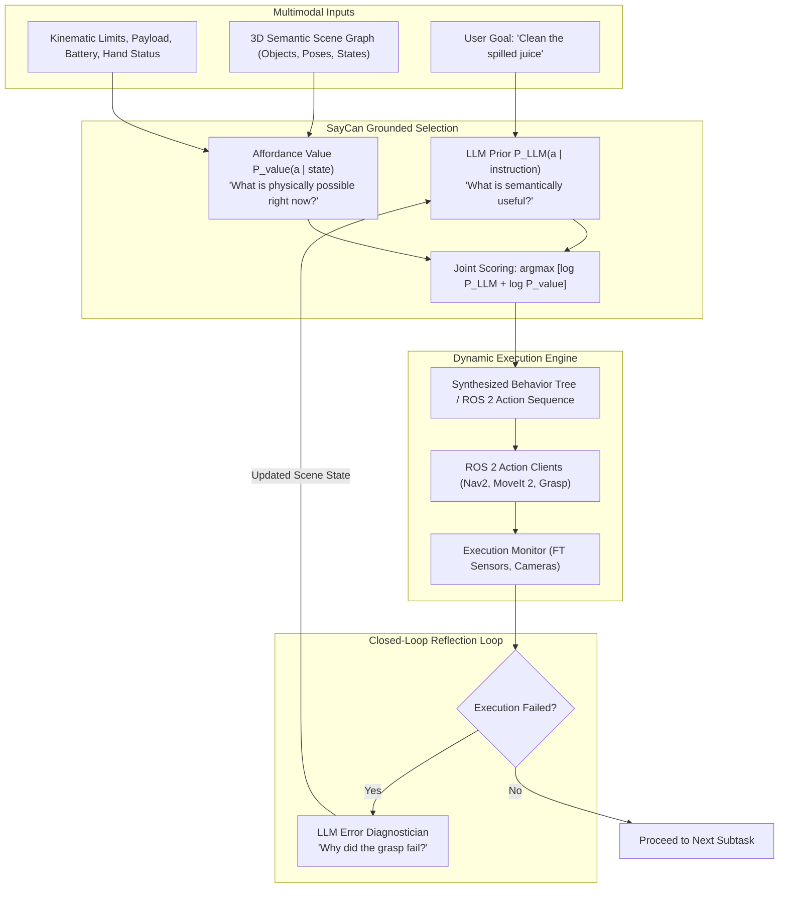
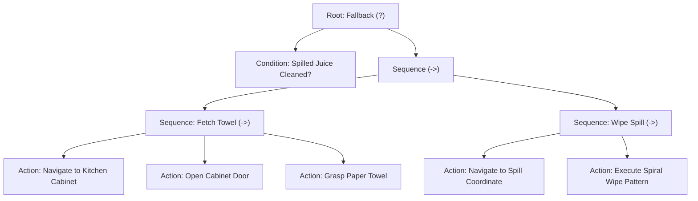
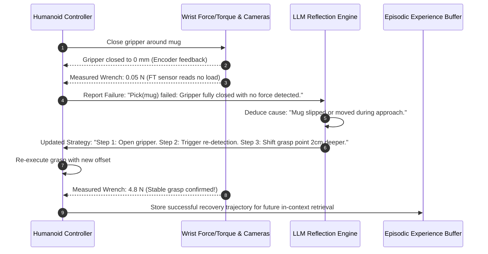

# Cognitive Planning & Grounding with Large Language Models

Frontier Large Language Models (LLMs) such as GPT-4o, Claude 3.5 Sonnet, and Gemini 1.5 Pro possess vast semantic reasoning and commonsense knowledge. They know that dirty dishes belong in the dishwasher, that milk cartons must be refrigerated, and that wine glasses are fragile.

However, deploying an unconstrained LLM as a physical robot controller introduces the notorious **Symbol Grounding Problem**:
1. **Hallucination of Physical Affordances**: An LLM might instruct a humanoid to `"Pick up the refrigerator and move it to the living room"`, oblivious to payload limits (e.g., a 15 kg maximum payload for Unitree H1 or Figure 02).
2. **Ignorance of Spatial Geometry**: An LLM might plan to place an object on a table that is already physically occluded or out of kinematic reach.
3. **Open-Loop Execution Fragility**: If an object slips from the robot's fingers during a grasp, a static LLM plan continues executing subsequent steps, pouring air from an empty hand.

Solving these challenges requires **Physical Grounding, Affordance Verification, and Closed-Loop Reflection**.

---

## 1. Grounding Architectures: SayCan and Code as Policies

Modern cognitive architectures bridge the gap between abstract tokens and physical reality using two dominant methodologies:



### The SayCan Formulation (Ahn et al., Google Research)
SayCan decouples planning into two distinct probabilities:
1. **LLM Probability `P_LLM(a | i)`**: How probable is action `a` given the user's high-level instruction `i`?
2. **Affordance Probability `P_affordance(a | s)`**: How physically feasible is action `a` given the current world state `s`?

The optimal next action $a^*$ is selected by maximizing their product:

```text
a^* = argmax_{a in A} [ log P_{LLM}(a | i) + log P_{affordance}(a | s) ]
```

Where:
- If the instruction is `"I spilled my drink"`, the LLM assigns high scores to `find_sponge`, `vacuum_floor`, and `call_waiter`.
- If the robot's camera observes a sponge on the table 2 meters away, but no vacuum cleaner in the building, the perception system assigns:
  ```text
  P_affordance(find_sponge | s) = 0.95
  P_affordance(vacuum_floor | s) = 0.00
  ```
- The combined argmax immediately filters out impossible actions without fine-tuning the LLM weights.

---

## 2. Dynamic Behavior Tree Generation

Rather than executing a rigid list of sequential steps, robust cognitive planners generate **Behavior Trees (BTs)**. Behavior Trees inherently support preemption, fallback conditions, and reactive recovery loops.



If the humanoid drops the towel mid-transit, the `GoalCondition` evaluates to `FAILURE`, the fallback branch activates, and the robot re-executes `GraspTowel` without needing human intervention.

---

## 3. Code as Policies (CaP): Generating Executable Python Logic

Pioneered by Liang et al., **Code as Policies** prompts code-generating LLMs to output parameterized Python code that directly interfaces with the robot's ROS 2 API:

```python
import rclpy
from humanoid_control_api import HumanoidRobot

def execute_autonomous_cleaning(robot: HumanoidRobot):
    """
    LLM-Generated Execution Script for: 'Clear the table of all empty soda cans'
    """
    # 1. Perception query to 3D Scene Graph
    objects = robot.perception.get_detected_objects()
    soda_cans = [obj for obj in objects if "soda_can" in obj.label and obj.is_empty]
    
    if not soda_cans:
        robot.speech.say("No empty soda cans found on the table.")
        return

    robot.speech.say(f"Found {len(soda_cans)} empty cans. Starting cleanup.")

    for can in soda_cans:
        # Spatial feasibility check
        if not robot.kinematics.is_reachable(can.pose):
            # Step closer using Nav2 footstep planner
            robot.locomotion.step_to_approach(can.pose)
        
        # Dual-arm grasp selection based on object position relative to robot midline
        arm = "left_arm" if can.pose.position.y > 0 else "right_arm"
        
        success = robot.manipulation.pick(
            target_pose=can.pose, 
            arm=arm, 
            grasp_width_m=0.065
        )
        
        if not success:
            robot.speech.say("Grasp failed, re-evaluating grasp angle.")
            continue
            
        # Navigate to recycling bin
        robot.locomotion.navigate_to_named_pose("recycling_station")
        robot.manipulation.place(target_location="bin_opening", arm=arm)

    robot.speech.say("Cleanup task completed.")
```

---

## 4. Closed-Loop Error Recovery & Environmental Reflection

When physical execution deviates from expectations, an intelligent robot does not crash. It performs **Environmental Reflection**:



### Prompt Engineering for Cognitive Reflection
```python
REFLECTION_PROMPT = """
You are the failure analysis engine of a humanoid robot.
Action Executed: {action_name}
Target: {target_object}
Expected Outcome: {expected_outcome}
Sensor Discrepancy: {sensor_data}

Analyze why the failure occurred in physical space.
Provide an updated JSON corrective sub-plan using only available primitives:
[RE_DETECT, ADJUST_GRASP_DEPTH, BACK_OFF_AND_RETRY, ABORT_WITH_WARNING]
"""
```

---

## 5. Formal Safety Verification Layer

Because LLMs are non-deterministic, industry-standard architectures (such as those employed by Boston Dynamics, Tesla, and Figure) never connect LLM outputs directly to physical joint inverters. 

All generated plans pass through an **Invariant Safety Filter**:

```text
Safety Invariants:
1. Max End-Effector Velocity:  ||v_ee|| <= 0.5 m/s
2. Max Torso Pitch Angle:      |theta_pitch| <= 15 degrees
3. Zero-Moment Point Margin:   ZMP in S_support_polygon
4. Kinetic Energy Budget:      E_k <= 120 Joules
5. Keep-Out Zones:             d(arm, head) >= 0.15 m
```

If an LLM hallucinates an aggressive motion that violates any of these physical invariants, the Safety Filter clamps the command, decelerates the robot to a controlled standing stop, and demands replanning.

---

## 5. Mathematical SayCan Scoring: Semantic vs. Affordance Fusion

The fundamental mathematical formulation of grounded cognitive planning (Ahn et al., Google DeepMind) chooses optimal skill `a*` at step `t` by maximizing the product of semantic probability and physical value affordance:

```text
a*_t = argmax_{a in A} [ P_LLM(a | instruction, past_steps)^alpha * V_affordance(a | current_observation)^beta ]
```

where:
- `P_LLM(a | ...)` represents the linguistic prior of how logically sound the subtask is given the high-level goal.
- `V_affordance(a | s)` represents the learned value function (trained via Q-learning) estimating the probability that skill `a` can succeed given current physical reality.
- `alpha, beta` balance common-sense reasoning versus physical feasibility.

If a human asks to `"Pick up a can of soda"`, but the soda can is in a closed refrigerator, `V_affordance(pick_can | s) approx 0`. The system automatically selects `open_fridge` because its combined score is maximized.

---

## Summary

Cognitive planning with LLMs transforms humanoid robots from pre-programmed automations into adaptable agents. By combining high-level semantic reasoning with **SayCan affordance grounding**, **dynamic Behavior Trees**, **Code-as-Policies execution**, and **formal invariant safety shields**, robotics engineers achieve the optimal compromise between open-world intelligence and absolute physical safety.
