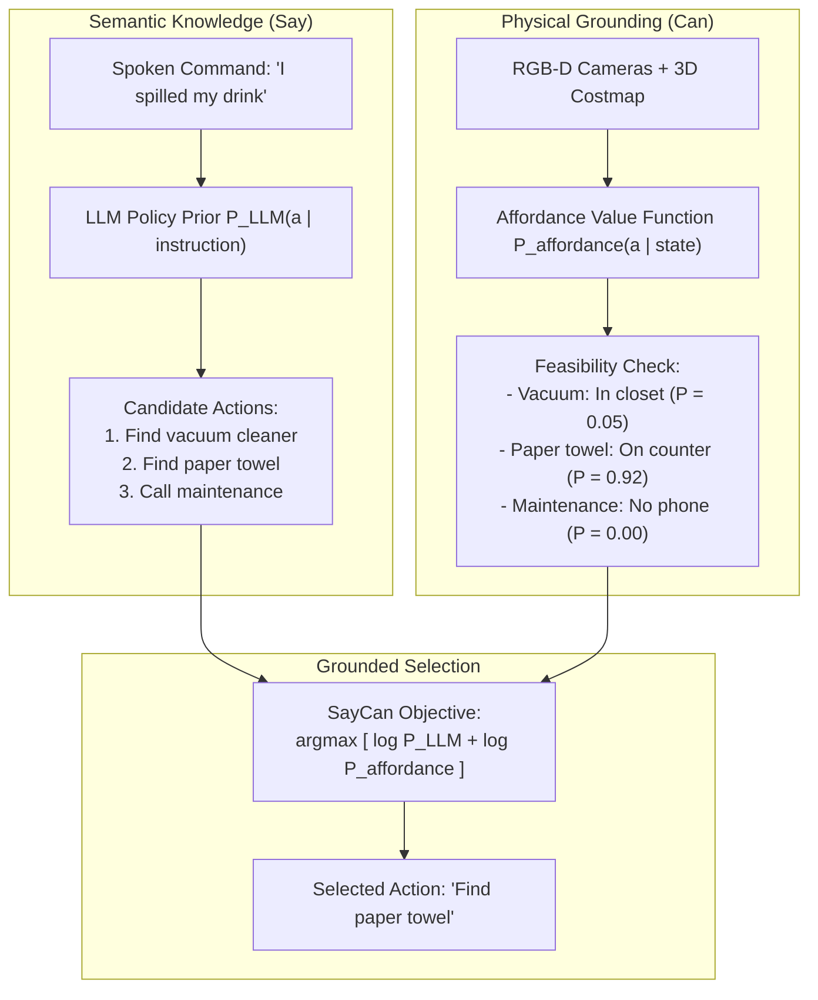
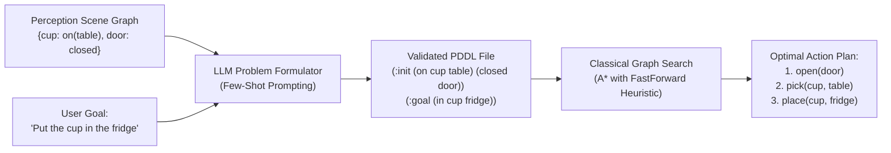
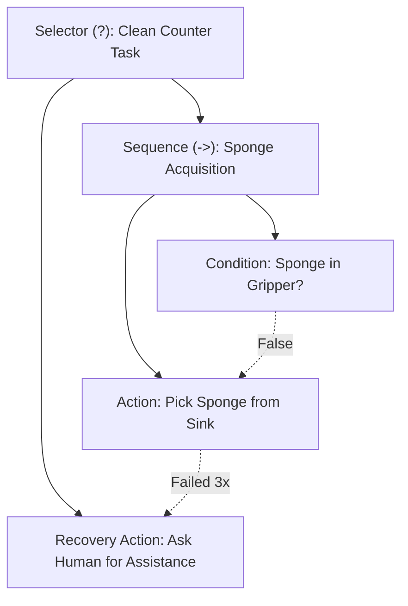

import ChapterProgress from '@site/src/components/ChapterProgress';
import QuizEngine from '@site/src/components/QuizEngine';

# Cognitive Planning & Grounding with Large Language Models

Frontier Large Language Models (LLMs) trained on web-scale text corpora exhibit extraordinary commonsense reasoning, task decomposition, and code generation capabilities. When instructed with an abstract human objective—such as *"I spilled my tea on the counter, could you clean it up?"*—an LLM can readily generate a logical sequence: find sponge, wipe counter, rinse sponge, return to home base.

However, deploying an ungrounded LLM directly as a robotic controller exposes the **Physical Grounding Problem**: language models lack native knowledge of physical embodiment, battery state, current room topography, joint torque limits, and immediate object availability. Without grounding, an LLM may confidently plan to *"use the sponge"* when no sponge is present in the workspace, or command an impossible motion that breaches kinematic reachability limits.

---

## Learning Objectives

After completing this chapter, you will be able to:
- Formulate the SayCan joint affordance-grounded scoring law.
- Specify Planning Domain Definition Language (PDDL) state transition mechanics: $\delta(s, a) = (s \setminus \text{del}(a)) \cup \text{add}(a)$.
- Synthesize reactive Behavior Trees (BTs) with fallback recovery nodes from high-level task plans.
- Profile memory footprint and generation throughput for 4-bit AWQ quantized LLMs on NVIDIA Jetson Orin silicon.
- Implement a complete closed-loop cognitive planner with affordance verification in Python.

---

## 1. The Physical Grounding Problem & The SayCan Paradigm

The core tension in cognitive robotics lies between **semantic relevance** (what an LLM believes is logical) and **physical affordance** (what the robot can physically execute right now).



### The SayCan Joint Optimization Law

Introduced by Google DeepMind (Ahn et al., 2022), the **SayCan** framework decouples task reasoning into a semantic language prior and a physical affordance value function.

Let $\mathcal{A} = \{a_1, a_2, \dots, a_M\}$ represent a library of pre-trained atomic manipulation skills (e.g., `pick(apple)`, `open(drawer)`). Given a user instruction $\mathbf{x}$ and current sensory state $\mathbf{s}$, the grounded next action $a^*$ is chosen via:

$$
a^* = \arg\max_{a \in \mathcal{A}} \left[ \alpha \log P_{LLM}(a \mid \mathbf{x}, \text{history}) + \beta \log P_{affordance}(a \mid \mathbf{s}) \right]
$$

where:
- $P_{LLM}(a \mid \mathbf{x}, \text{history})$ is the probability of the text sequence representing action $a$ under the language model.
- $P_{affordance}(a \mid \mathbf{s})$ is the probability that skill $a$ can be successfully executed from physical state $\mathbf{s}$, evaluated via a learned Value Function $V(s) \in [0, 1]$ or geometric reachability filter.
- $\alpha, \beta > 0$ are hyperparameter weighting coefficients balancing semantic creativity against physical caution.

---

## 2. Symbolic Planning with PDDL

While SayCan evaluates skills greedily step-by-step, long-horizon tasks requiring backtracking or complex temporal dependencies benefit from **classical symbolic planning** grounded by language models.

### PDDL Formal Semantics

A deterministic planning domain in the **Planning Domain Definition Language (PDDL)** is formalized as a tuple:

$$
\Pi = \langle \mathcal{P}, \mathcal{A}, s_0, g \rangle
$$

where:
- $\mathcal{P} = \{p_1, \dots, p_N\}$ is a set of first-order predicates representing environmental facts (e.g., `(holding cup)`, `(on cup table)`).
- A state $s \subseteq \mathcal{P}$ is a set of concurrently true predicates.
- $s_0 \subseteq \mathcal{P}$ is the initial state.
- $g \subseteq \mathcal{P}$ is the goal condition.
- Each action schema $a \in \mathcal{A}$ defines three predicate sets:
  - $\text{pre}(a)$: Preconditions required for activation ($\text{pre}(a) \subseteq s$).
  - $\text{add}(a)$: Predicates added to the world upon completion.
  - $\text{del}(a)$: Predicates deleted from the world upon completion.

The deterministic state transition mapping $\delta(s, a)$ is governed by:

$$
\delta(s, a) = (s \setminus \text{del}(a)) \cup \text{add}(a)
$$

### LLMs as PDDL Problem Generators

Rather than having an LLM generate unstructured text, modern cognitive architectures query frontier LLMs to translate raw visual scene graphs into formal PDDL problem definitions, which are then solved with mathematical optimality by classical symbolic planners (such as FastDownward or Pyperplan):



---

## 3. Dynamic Behavior Tree Synthesis & Closed-Loop Recovery

Linear execution plans fail when physical reality diverges from expectation (e.g., a grasped mug slips from the fingers). To ensure robust closed-loop execution, cognitive planners convert high-level steps into **Behavior Trees (BTs)** equipped with Fallback recovery nodes:



In a Behavior Tree:
- **Sequence nodes ($\to$)** tick children sequentially; all must succeed for the sequence to succeed.
- **Fallback / Selector nodes ($?$)** tick children until one succeeds, providing immediate reactive recovery paths if a primary manipulation skill fails.

---

## 4. Hardware Breakdowns: Edge NPU Profiling for Quantized LLMs

Running multi-billion parameter foundation LLMs directly on humanoid edge compute avoids fragile cloud Wi-Fi dependencies and eliminates cloud transmission latency:

| Metric | Full FP16 Baseline | 4-bit AWQ Quantized (Jetson Orin) | GGUF Q4_K_M (CPU Fallback) |
| :--- | :--- | :--- | :--- |
| **Model Size** | Llama 3 8B Instruct | Llama 3 8B Instruct | Llama 3 8B Instruct |
| **Weight Precision** | 16-bit Float ($2.0 \text{ bytes/param}$) | 4-bit Integer ($0.5 \text{ bytes/param}$) | 4-bit Integer ($0.56 \text{ bytes/param}$) |
| **Model VRAM Footprint** | $16.2 \text{ GB}$ | **$5.4 \text{ GB}$** | $5.8 \text{ GB}$ System RAM |
| **KV-Cache (2048 Context)**| $1.2 \text{ GB}$ | **$0.6 \text{ GB}$ (FP8 KV Cache)** | $0.8 \text{ GB}$ |
| **Generation Speed** | $12 \text{ tokens/s}$ (Out of VRAM on 30W) | **$35 \text{ tokens/s}$ (60W Mode 0)** | $6 \text{ tokens/s}$ (12-core A78AE) |
| **Power Consumption** | $\approx 55\text{W}$ | **$38\text{W}$** | $22\text{W}$ |

The operational memory requirement on Jetson AGX Orin is governed by:

$$
M_{VRAM} = \frac{N_{params} \times b_{quant}}{8 \times 10^9} + M_{KV-cache} + M_{runtime\_overhead} \quad (\text{GB})
$$

For an 8-billion parameter model ($N_{params} = 8 \times 10^9$) with 4-bit quantization ($b_{quant} = 4$):

$$
M_{weights} = \frac{8 \times 10^9 \times 4}{8 \times 10^9} = 4.0 \text{ GB}
$$

Adding FP8 KV-cache and TensorRT runtime overhead yields a total footprint of $\approx 5.4 \text{ GB}$, leaving over $58 \text{ GB}$ of unified memory on a 64GB Jetson Orin for vision transformers and real-time ROS 2 nodes.

---

## 5. Seminal Research Citations

1. **Ahn, M., Brohan, A., Brown, N., Chebotar, Y., Cortes, O., David, B., ... & Zitkovich, B. (2022).** *Do as I can, not as I say: Grounding language in robotic affordances.* arXiv preprint arXiv:2204.01691 (SayCan).
2. **Huang, W., Abbeel, P., Pathak, D., & Mordatch, I. (2022).** *Language models as zero-shot planners: Extracting actionable knowledge for embodied agents.* International Conference on Machine Learning (ICML).
3. **Lin, J., Tang, J., Tang, H., Yang, S., Dang, X., & Han, S. (2023).** *AWQ: Activation-aware weight quantization for LLM compression and acceleration.* arXiv preprint arXiv:2306.00978.
4. **Colledanchise, M., & Ögren, P. (2018).** *Behavior Trees in Robotics and AI: An Introduction.* CRC Press.

---

## 6. Complete Runnable Implementation: SayCan Affordance Planner

The following executable Python script implements the SayCan affordance-grounded action selection algorithm with simulated sensory feedback and closed-loop fallback execution:

```python
"""
SayCan Affordance Planner with Closed-Loop Error Recovery.
Demonstrates combining semantic LLM priors with physical affordance probabilities.
"""

from dataclasses import dataclass
import math
from typing import Dict, List, Optional, Tuple


@dataclass
class SkillPrimitive:
    name: str
    target_object: str
    preconditions: List[str]
    effects: List[str]
    base_llm_prior: float  # Unconditioned semantic relevance


class RobotWorldState:
    """Maintains physical environment predicates and sensor observations."""

    def __init__(self) -> None:
        self.predicates = {
            "robot_at_counter": True,
            "sponge_on_counter": True,
            "holding_sponge": False,
            "spill_on_counter": True,
            "counter_clean": False,
        }

    def check_preconditions(self, preconditions: List[str]) -> bool:
        """Verifies if all required predicates hold true in physical state."""
        return all(self.predicates.get(pre, False) for pre in preconditions)

    def apply_effects(self, effects: List[str]) -> None:
        """Applies action effects to the physical world state."""
        for eff in effects:
            if eff.startswith("not_"):
                key = eff.replace("not_", "")
                self.predicates[key] = False
            else:
                self.predicates[eff] = True


class SayCanCognitivePlanner:
    """
    Evaluates candidate skills by scoring semantic relevance
    multiplied by physical affordance feasibility.
    """

    def __init__(
        self,
        skill_library: List[SkillPrimitive],
        alpha: float = 1.0,
        beta: float = 1.5,
    ) -> None:
        self.skills = skill_library
        self.alpha = alpha  # Weight for LLM semantic prior
        self.beta = beta    # Weight for physical affordance probability

    def evaluate_affordance(self, skill: SkillPrimitive, state: RobotWorldState) -> float:
        """
        Simulates an affordance value function V(s, a) in [0, 1].
        Returns 0.95 if preconditions hold, 0.05 otherwise.
        """
        if state.check_preconditions(skill.preconditions):
            return 0.95
        return 0.05

    def select_next_action(
        self, state: RobotWorldState
    ) -> Tuple[Optional[SkillPrimitive], float]:
        """Computes joint SayCan score and selects the optimal grounded skill."""
        best_skill: Optional[SkillPrimitive] = None
        best_score: float = -float("inf")

        print("\n--- Evaluating Candidate Skills ---")
        for skill in self.skills:
            p_llm = max(skill.base_llm_prior, 1e-4)
            p_afford = self.evaluate_affordance(skill, state)

            # SayCan Law: S = alpha * log(P_LLM) + beta * log(P_affordance)
            joint_score = self.alpha * math.log(p_llm) + self.beta * math.log(p_afford)

            print(
                f"  Skill: {skill.name:<24} | P(LLM): {p_llm:.2f} | "
                f"P(Afford): {p_afford:.2f} | Score: {joint_score:.3f}"
            )

            if joint_score > best_score:
                best_score = joint_score
                best_skill = skill

        return best_skill, best_score


def run_cognitive_plan_demo():
    """Runs a simulated multi-step SayCan execution loop."""
    # Define available skills
    skills = [
        SkillPrimitive(
            name="pick_sponge",
            target_object="sponge",
            preconditions=["sponge_on_counter", "robot_at_counter"],
            effects=["holding_sponge", "not_sponge_on_counter"],
            base_llm_prior=0.85,
        ),
        SkillPrimitive(
            name="wipe_counter",
            target_object="counter",
            preconditions=["holding_sponge", "spill_on_counter"],
            effects=["counter_clean", "not_spill_on_counter"],
            base_llm_prior=0.90,
        ),
        SkillPrimitive(
            name="vacuum_floor",
            target_object="floor",
            preconditions=["vacuum_plugged_in"],
            effects=["floor_clean"],
            base_llm_prior=0.40,
        ),
        SkillPrimitive(
            name="call_human_help",
            target_object="none",
            preconditions=[],
            effects=["help_requested"],
            base_llm_prior=0.10,
        ),
    ]

    world = RobotWorldState()
    planner = SayCanCognitivePlanner(skills, alpha=1.0, beta=1.5)

    max_steps = 4
    for step in range(1, max_steps + 1):
        print(f"\n================ Step {step} ================")
        chosen_skill, score = planner.select_next_action(world)

        if not chosen_skill or score < -5.0:
            print("[TERMINATION] No valid grounded skill can proceed.")
            break

        print(f"\n[ACTION DISPATCH] Executing: {chosen_skill.name} (Score: {score:.3f})")
        world.apply_effects(chosen_skill.effects)

        if world.predicates.get("counter_clean", False):
            print("\n[SUCCESS] Goal achieved: Counter has been cleaned successfully!")
            break


if __name__ == "__main__":
    run_cognitive_plan_demo()
```

---

## Summary

- Large Language Models provide rich commonsense reasoning for high-level robot task planning but require physical affordance grounding to avoid hallucinating physically impossible commands.
- The SayCan formulation balances semantic priors against sensory value functions via joint logarithmic probability scoring.
- PDDL formalizes deterministic discrete task transitions, allowing LLMs to act as problem generators for provably optimal classical graph-search planners.
- 4-bit AWQ weight quantization enables $8\text{B}$ parameter language models to run natively on edge Jetson AGX Orin silicon at $35 \text{ tokens/s}$ within a $38\text{W}$ power budget.

---

<ChapterProgress chapterId="4-3-cognitive-planning-with-llms" moduleId="module4" totalChapters={10} />

---

<QuizEngine
  quizId="quiz-4-3"
  title="Module 4.3 Mastery Check: Cognitive Planning with LLMs"
  moduleId="module4"
  passThreshold={70}
  questions={[
    {
      id: "q1",
      question: "In the SayCan framework, what is the role of the affordance probability P_affordance(a | s)?",
      options: [
        "It translates English text into ROS 2 topic names",
        "It quantifies the physical feasibility of executing skill 'a' given current physical sensor state 's'",
        "It calculates the monetary cost of cloud LLM API tokens",
        "It measures the grammatical correctness of the spoken prompt"
      ],
      correctIndex: 1,
      explanation: "P_affordance(a | s) represents the likelihood that the physical robot can successfully carry out skill 'a' from the current physical state 's', grounding the LLM's semantic suggestions in physical reality."
    },
    {
      id: "q2",
      question: "Given state s, what is the PDDL state transition equation delta(s, a) for an action with delete list del(a) and add list add(a)?",
      options: [
        "delta(s, a) = s ∩ del(a) ∩ add(a)",
        "delta(s, a) = (s \\ del(a)) ∪ add(a)",
        "delta(s, a) = s + del(a) - add(a)",
        "delta(s, a) = (s ∪ del(a)) \\ add(a)"
      ],
      correctIndex: 1,
      explanation: "In PDDL semantics, when action 'a' executes, the facts in del(a) are removed from the current state s, and the facts in add(a) are inserted: delta(s, a) = (s \\ del(a)) ∪ add(a)."
    },
    {
      id: "q3",
      question: "On an NVIDIA Jetson AGX Orin 64GB edge computer, what is the primary advantage of 4-bit AWQ quantization over full 16-bit float execution for an 8B parameter LLM?",
      options: [
        "It eliminates the need for an operating system",
        "It reduces model VRAM from ~16.2 GB to ~5.4 GB while accelerating inference throughput to ~35 tokens/s within a constrained thermal budget",
        "It increases the parameter count of the model to 32B",
        "It allows the model to bypass robot joint limits"
      ],
      correctIndex: 1,
      explanation: "4-bit AWQ reduces the weight memory footprint by ~75% (from 16.2 GB to 5.4 GB), fitting easily within Jetson unified memory while boosting memory-bandwidth-bound token generation to ~35 tokens/sec at low power consumption."
    }
  ]}
/>
