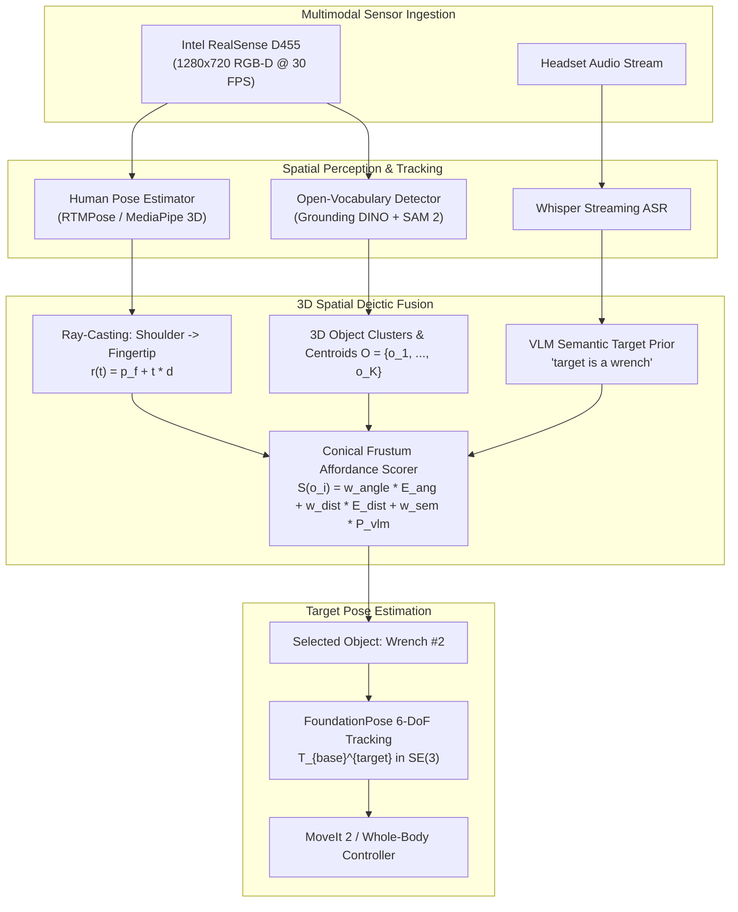
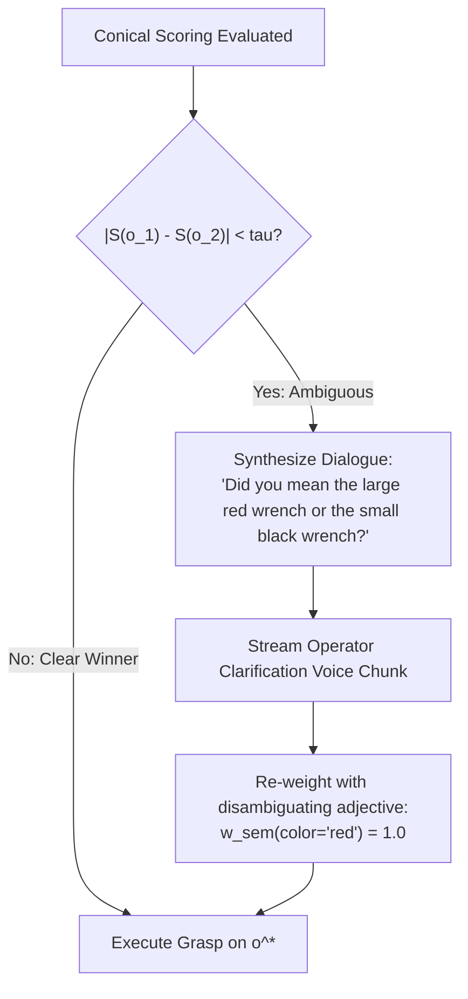

import ChapterProgress from '@site/src/components/ChapterProgress';
import QuizEngine from '@site/src/components/QuizEngine';

# Multimodal Interaction: Vision, Deictic Gestures, and 3D Affordances

When humans collaborate in shared workspaces, communication relies heavily on **deictic references**—spatial cues that depend on shared context, such as pointing toward a tabletop while saying: *"Pass me that tool, please."* 

For an autonomous humanoid robot, resolving *"that tool"* requires fusing auditory speech transcripts, 3D spatial human skeletal poses, depth perception, and open-vocabulary visual semantic grounding. If the robot misinterprets the pointing angle or fails to disambiguate two adjacent wrenches, catastrophic manipulation errors can occur.

---

## Learning Objectives

After completing this chapter, you will be able to:
- Formulate camera pinhole projection and unprojection transformations between pixel coordinates and 3D metric camera frames.
- Derive the 3D pointing ray vector equation and conical Gaussian scoring law for candidate object selection.
- Implement zero-shot 6-DoF object pose estimation pipelines using FoundationPose principles.
- Design active head gaze tracking kinematics for 2-DoF pan-tilt camera gimbals.
- Deploy an end-to-end Python multimodal grounding node resolving ambiguous spatial queries.

---

## 1. Multimodal Grounding Pipeline Architecture

The multimodal disambiguation pipeline transforms raw multimodal sensor streams into a verified 6-DoF target grasp pose:



---

## 2. Geometric Foundations: Projective Geometry & Ray Casting

### Pinhole Camera Geometry & Depth Unprojection

A calibrated depth sensor maps a 3D point $\mathbf{P}_{cam} = [X_c, Y_c, Z_c]^T$ in the optical camera frame to homogeneous pixel coordinates $\mathbf{p}_{img} = [u, v, 1]^T$ via the intrinsic camera matrix $\mathbf{K}$:

$$
\mathbf{p}_{img} = \begin{bmatrix} u \\ v \\ 1 \end{bmatrix} = \frac{1}{Z_c} \mathbf{K} \mathbf{P}_{cam} = \frac{1}{Z_c} \begin{bmatrix} f_x & 0 & c_x \\ 0 & f_y & c_y \\ 0 & 0 & 1 \end{bmatrix} \begin{bmatrix} X_c \\ Y_c \\ Z_c \end{bmatrix}
$$

Given pixel coordinates $(u, v)$ and registered metric depth $Z = D(u, v)$ from an RGB-D sensor, the exact 3D Cartesian coordinates in the camera optical frame are recovered via:

$$
\mathbf{P}_{cam} = Z \cdot \mathbf{K}^{-1} \begin{bmatrix} u \\ v \\ 1 \end{bmatrix} = \begin{bmatrix} \frac{(u - c_x) Z}{f_x} \\ \frac{(v - c_y) Z}{f_y} \\ Z \end{bmatrix}
$$

Transforming this point into the robot's base coordinate frame $\mathbf{P}_{base} \in SE(3)$ uses the kinematic forward transform $\mathbf{T}_{base}^{cam} = [\mathbf{R} \mid \mathbf{t}]$:

$$
\mathbf{P}_{base} = \mathbf{R}_{base}^{cam} \mathbf{P}_{cam} + \mathbf{t}_{base}^{cam}
$$

### 3D Deictic Pointing Ray Formulation

When a human points at an object, their intention is geometrically represented by a 3D ray originating at the dominant eye or shoulder $\mathbf{p}_s \in \mathbb{R}^3$ passing through the index fingertip $\mathbf{p}_f \in \mathbb{R}^3$:

$$
\hat{\mathbf{d}} = \frac{\mathbf{p}_f - \mathbf{p}_s}{\|\mathbf{p}_f - \mathbf{p}_s\|_2}
$$

The parametric 3D pointing ray is:

$$
\mathbf{r}(t) = \mathbf{p}_f + t \hat{\mathbf{d}}, \quad t \ge 0
$$

```
   Human Shoulder (p_s)
          \
           \
            v
       Fingertip (p_f) ------------ Pointing Ray d ----------->
                                   \
                                    \  theta_i
                                     \
                                      * Object Centroid (o_i)
                                      |
                                      | d_perp
                                      v
```

### Conical Gaussian Scoring Law

For each segmented candidate object centroid $\mathbf{o}_i \in \mathbb{R}^3$, the angular deviation $\theta_i$ relative to the pointing ray is:

$$
\theta_i = \arccos \left( \frac{(\mathbf{o}_i - \mathbf{p}_f) \cdot \hat{\mathbf{d}}}{\|\mathbf{o}_i - \mathbf{p}_f\|_2} \right)
$$

The perpendicular projection distance $d_i^\perp$ from centroid $\mathbf{o}_i$ to the infinite ray line is:

$$
d_i^\perp = \left\| (\mathbf{o}_i - \mathbf{p}_f) - \left( (\mathbf{o}_i - \mathbf{p}_f) \cdot \hat{\mathbf{d}} \right) \hat{\mathbf{d}} \right\|_2
$$

The total grounding score $S(\mathbf{o}_i)$ combines angular alignment, spatial proximity, and semantic VLM class probability:

$$
S(\mathbf{o}_i) = w_{ang} \exp\left( -\frac{\theta_i^2}{2 \sigma_\theta^2} \right) + w_{dist} \exp\left( -\frac{(d_i^\perp)^2}{2 \sigma_d^2} \right) + w_{sem} P_{VLM}(\text{class} \mid \mathbf{I}, \mathbf{o}_i)
$$

where $\sigma_\theta \approx 0.15 \text{ rad}$ ($8.6^\circ$) and $\sigma_d \approx 0.10 \text{ m}$ reflect human motor pointing uncertainty.

---

## 3. 6-DoF Pose Estimation with FoundationPose

Once candidate object $\mathbf{o}^* = \arg\max_i S(\mathbf{o}_i)$ is isolated, robotic grasping requires tracking its full 6-DoF transformation matrix $\mathbf{T}_{base}^{obj} \in SE(3)$:

$$
\mathbf{T}_{base}^{obj} = \begin{bmatrix} \mathbf{R} & \mathbf{t} \\ \mathbf{0}^T & 1 \end{bmatrix}, \quad \mathbf{R} \in SO(3), \; \mathbf{t} \in \mathbb{R}^3
$$

### Unified Model-Based & Model-Free Tracking

Modern architectures like **FoundationPose** (Wen et al., 2024) solve 6-DoF registration for novel objects without per-instance training:
1. **Pose Hypothesis Generation**: Renders synthetic neural representations from candidate poses and evaluates structural similarity against observed depth maps.
2. **Nonlinear Optimization**: Minimizes robust Huber loss over point clouds and neural surface normals:

$$
\mathbf{T}^* = \arg\min_{\mathbf{T} \in SE(3)} \sum_{k=1}^K \rho_{Huber} \left( \left\| \mathbf{T} \, \mathbf{p}_k^{cad} - \mathbf{p}_k^{obs} \right\|_2 \right)
$$

---

## 4. Hardware Breakdowns: Active Head Gimbal & Sensor Rig

Humanoid robots maintain active situational awareness by orienting their visual sensors toward human interlocutors and manipulation workspaces:

| System Component | Hardware Specification | Role in Multimodal Perception |
| :--- | :--- | :--- |
| **Active Head Gimbal** | 2-DoF Neck Gimbal (Yaw $\pm 90^\circ$, Pitch $-45^\circ \text{ to } +30^\circ$) | Dynamically tracks human gaze and centers candidate objects in optical FOV |
| **Actuators & Encoders** | Maxon EC-max 22 brushless motors with 19-bit magnetic absolute encoders | Provides sub-milliradian positioning accuracy for head frame transforms |
| **Stereo Depth Camera** | Intel RealSense D455 (Global shutter, 95° $\times$ 65° FOV) | Captures 1280 $\times$ 720 depth registered with RGB at 30 Hz |
| **Gaze Tracking Engine** | MediaPipe Iris + FaceMesh running on Jetson Orin PVA | Computes 3D human gaze vector $\hat{\mathbf{g}}$ at 60 Hz to resolve ambiguities |

---

## 5. Conversational Disambiguation Loops

When two objects have nearly identical pointing scores ($\vert S(\mathbf{o}_1) - S(\mathbf{o}_2) \vert < \tau_{ambig}$), the robot must not guess arbitrarily. It initiates an active conversational disambiguation dialogue:



---

## 6. Seminal Research Citations

1. **Chen, B., Xu, Z., Kirmani, S., Ichter, B., Dai, F., & Song, S. (2024).** *SpatialVLM: Endowing vision-language models with spatial reasoning capabilities.* IEEE/CVF Conference on Computer Vision and Pattern Recognition (CVPR).
2. **Wen, B., Tremblay, J., Blukis, V., Tyree, S., Müller, T., Evans, A., ... & Fox, D. (2024).** *FoundationPose: Unified 6D pose estimation and tracking of novel objects.* IEEE/CVF Conference on Computer Vision and Pattern Recognition (CVPR).
3. **Kirillov, A., Mintun, E., Ravi, N., Mao, H., Rolland, C., Gustafson, L., ... & Dollár, P. (2023).** *Segment anything.* IEEE/CVF International Conference on Computer Vision (ICCV).
4. **Hartley, R., & Zisserman, A. (2003).** *Multiple View Geometry in Computer Vision.* Cambridge University Press.

---

## 7. Complete Runnable Implementation: 3D Deictic Affordance Scorer

The following self-contained Python script performs camera unprojection, 3D pointing ray geometry, and multi-candidate object scoring with simulated spatial keypoints:

```python
"""
3D Deictic Gesture Affordance Scorer.
Projects camera frames to 3D metric coordinates, casts human pointing rays,
and scores target objects using conical Gaussian likelihoods.
"""

from dataclasses import dataclass
import math
from typing import List, Tuple
import numpy as np


@dataclass
class CandidateObject:
    object_id: str
    semantic_label: str
    centroid_3d: np.ndarray  # [X, Y, Z] in meters relative to robot base
    vlm_confidence: float   # P(target | image, label)


class DeicticAffordanceResolver:
    """
    Resolves ambiguous deictic spatial references using 3D ray-casting
    and conical Gaussian affordance scoring.
    """

    def __init__(
        self,
        w_ang: float = 0.45,
        w_dist: float = 0.35,
        w_sem: float = 0.20,
        sigma_theta_rad: float = math.radians(10.0),
        sigma_dist_m: float = 0.15,
    ) -> None:
        self.w_ang = w_ang
        self.w_dist = w_dist
        self.w_sem = w_sem
        self.sigma_theta = sigma_theta_rad
        self.sigma_dist = sigma_dist_m

    def compute_pointing_ray(
        self, shoulder_3d: np.ndarray, fingertip_3d: np.ndarray
    ) -> Tuple[np.ndarray, np.ndarray]:
        """
        Computes the origin and normalized direction vector of human pointing ray.
        """
        delta = fingertip_3d - shoulder_3d
        norm = np.linalg.norm(delta)
        if norm < 1e-4:
            raise ValueError("Fingertip and shoulder keypoints are coincident.")
        unit_direction = delta / norm
        return fingertip_3d, unit_direction

    def score_candidate(
        self,
        ray_origin: np.ndarray,
        ray_dir: np.ndarray,
        candidate: CandidateObject,
    ) -> Tuple[float, float, float]:
        """
        Calculates angular deviation, perpendicular distance, and overall score.
        """
        to_object = candidate.centroid_3d - ray_origin
        dist_to_obj = np.linalg.norm(to_object)

        if dist_to_obj < 1e-4:
            return 0.0, 0.0, 1.0

        # Cosine angle between ray and object vector
        cos_theta = np.dot(to_object, ray_dir) / dist_to_obj
        cos_theta = np.clip(cos_theta, -1.0, 1.0)
        theta_rad = math.acos(cos_theta)

        # Perpendicular distance to ray
        proj_length = np.dot(to_object, ray_dir)
        proj_point = ray_origin + proj_length * ray_dir
        perp_dist = np.linalg.norm(candidate.centroid_3d - proj_point)

        # Conical Gaussian likelihood components
        angle_likelihood = math.exp(-(theta_rad ** 2) / (2 * (self.sigma_theta ** 2)))
        dist_likelihood = math.exp(-(perp_dist ** 2) / (2 * (self.sigma_dist ** 2)))

        total_score = (
            self.w_ang * angle_likelihood
            + self.w_dist * dist_likelihood
            + self.w_sem * candidate.vlm_confidence
        )
        return theta_rad, perp_dist, total_score

    def resolve_target(
        self,
        shoulder_3d: np.ndarray,
        fingertip_3d: np.ndarray,
        candidates: List[CandidateObject],
    ) -> Tuple[CandidateObject, float]:
        """Identifies best grounded object from candidate set."""
        ray_origin, ray_dir = self.compute_pointing_ray(shoulder_3d, fingertip_3d)

        best_candidate = None
        highest_score = -1.0

        print("\n--- Evaluating Candidate Objects Under Pointing Ray ---")
        for cand in candidates:
            theta, perp_d, score = self.score_candidate(ray_origin, ray_dir, cand)
            print(
                f"  Object: {cand.object_id:<12} ({cand.semantic_label}) | "
                f"Angle: {math.degrees(theta):5.1f} deg | "
                f"Perp Dist: {perp_d:5.2f} m | Score: {score:.4f}"
            )
            if score > highest_score:
                highest_score = score
                best_candidate = cand

        return best_candidate, highest_score


def main():
    """Unit test and demonstration."""
    resolver = DeicticAffordanceResolver()

    # Human standing near robot: shoulder at [0.8, -0.4, 1.4], pointing to table
    shoulder = np.array([0.8, -0.4, 1.4])
    fingertip = np.array([0.5, -0.2, 1.1])  # Ray points toward tabletop

    # Tabletop candidate objects in robot base frame
    candidates = [
        CandidateObject("obj_01", "red_mug", np.array([0.3, -0.05, 0.85]), vlm_confidence=0.92),
        CandidateObject("obj_02", "blue_pen", np.array([0.3, +0.35, 0.85]), vlm_confidence=0.40),
        CandidateObject("obj_03", "sponge", np.array([0.6, -0.30, 0.85]), vlm_confidence=0.85),
    ]

    best_target, score = resolver.resolve_target(shoulder, fingertip, candidates)
    print(f"\n[GROUNDING RESULT] Selected: {best_target.object_id} ({best_target.semantic_label}) with Score: {score:.4f}")
    assert best_target.object_id == "obj_01", "Expected red_mug to have highest pointing score"


if __name__ == "__main__":
    main()
```

---

## Summary

- Resolving ambiguous human deictic gestures requires strict mathematical projection between camera coordinates, 3D metric space, and robot kinematic base frames.
- 3D pointing rays cast from the human shoulder through the index fingertip define conical Gaussian likelihood fields that evaluate candidate object proximity.
- Zero-shot 6-DoF pose estimation (FoundationPose) eliminates object-specific retraining, providing exact SE(3) transforms for robot grasp execution.
- Active head gaze stabilization centers ambiguous objects in the optical frustum, enabling conversational clarification when candidate scores are within uncertainty margins.

---

<ChapterProgress chapterId="4-4-multimodal-interaction" moduleId="module4" totalChapters={10} />

---

<QuizEngine
  quizId="quiz-4-4"
  title="Module 4.4 Mastery Check: Multimodal Interaction & Gestures"
  moduleId="module4"
  passThreshold={70}
  questions={[
    {
      id: "q1",
      question: "Given a depth camera with focal lengths (f_x, f_y), principal point (c_x, c_y), and registered depth Z, what is the metric X coordinate in the optical camera frame?",
      options: [
        "X = (u - c_x) * Z / f_x",
        "X = (u + c_x) * f_x / Z",
        "X = u * f_x * Z",
        "X = (u - c_x) / (Z * f_x)"
      ],
      correctIndex: 0,
      explanation: "From pinhole camera geometry, u = f_x * (X / Z) + c_x. Solving for X yields X = (u - c_x) * Z / f_x."
    },
    {
      id: "q2",
      question: "In 3D deictic ray casting, why is a conical Gaussian likelihood preferred over a simple line-intersection threshold?",
      options: [
        "Line intersection fails because rays in 3D almost never intersect mathematical point centroids exactly, and human pointing has inherent angular dispersion (approx 5-10 degrees)",
        "Conical likelihoods eliminate the need for depth cameras",
        "Gaussian curves run faster on GPUs than vector dot products",
        "Robots cannot compute 3D cross products"
      ],
      correctIndex: 0,
      explanation: "In continuous 3D space, an infinite ray almost never passes exactly through a point centroid (measure zero). Conical Gaussian models capture human pointing uncertainty by penalizing angular deviation and perpendicular distance smoothly."
    },
    {
      id: "q3",
      question: "When two candidate objects have pointing scores within an ambiguity threshold |S(o_1) - S(o_2)| < tau, what is the safest control response?",
      options: [
        "Execute emergency hardware power shutoff",
        "Grasp whichever object is closer to the robot's base",
        "Initiate an active verbal disambiguation prompt asking the user to specify distinct attributes (e.g. color or size)",
        "Ignore the user command and return to home pose"
      ],
      correctIndex: 2,
      explanation: "Arbitrary guessing risks picking the wrong object or colliding with an unintended target. Initiating conversational disambiguation resolves physical ambiguity safely and transparently."
    }
  ]}
/>
