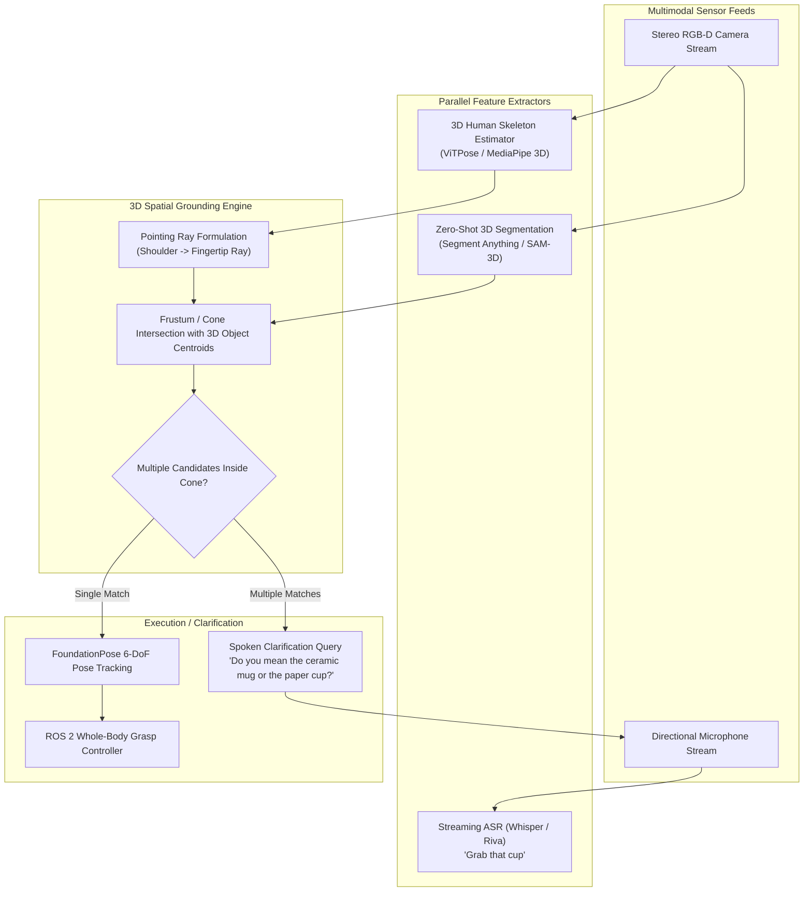
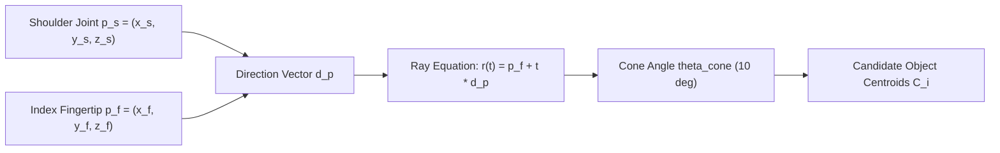
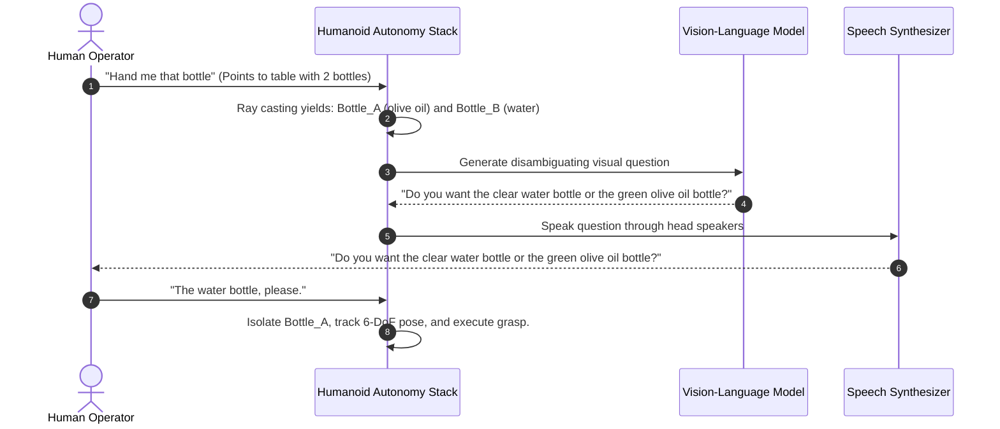

# Multimodal Interaction: Vision, Deictic Gestures, and 3D Affordances

Human communication is intrinsically multimodal. In daily factory or household interactions, people rarely say: `"Navigate to coordinates (x=3.42, y=1.15) and pick up the cylindrical object with RGB value (0.8, 0.1, 0.1)"`. Instead, a human points across the room and says: `"Hey, can you grab *that* cup over there?"`

To operate effectively alongside humans, a humanoid robot must fuse **acoustic speech**, **3D vision**, **human skeletal tracking**, and **3D spatial scene geometry** to resolve ambiguous deictic references (words like *this*, *that*, *there*, *here*).

---

## 1. Multimodal Deictic Fusion Architecture

The multimodal perception pipeline reconciles human intent with 3D physical coordinate frames:



---

## 2. Mathematical Formulation of 3D Pointing Ray Casting

Resolving *"that object"* requires projecting the human's skeletal vectors into the robot's world coordinate frame `map` using the transform tree `tf2`.



### The Ray Equation
Let `p_shoulder in R^3` and `p_fingertip in R^3` represent the detected 3D joint locations in the robot's base frame. The normalized pointing direction vector `d_hat` is:

```text
d_hat = (p_fingertip - p_shoulder) / ||p_fingertip - p_shoulder||
```

A semi-infinite 3D ray parameterized by distance `t >= 0` is defined as:

```text
r(t) = p_fingertip + t * d_hat,  t >= 0
```

### Cone Intersection & Scoring
Because human pointing is imprecise (exhibiting an average angular deviation of 5 to 12 degrees), each candidate object centroid `o_i in R^3` in the scene point cloud is evaluated using angular deviation `theta_i` and orthogonal distance `d_i^perp`:

```text
theta_i = arccos( (o_i - p_fingertip) . d_hat / ||o_i - p_fingertip|| )
d_i^perp = || (o_i - p_fingertip) - ((o_i - p_fingertip) . d_hat) * d_hat ||
```

The candidate score `S(o_i)` combines angular alignment with semantic relevance predicted by the language model:

```text
S(o_i) = w_angle * exp( - theta_i^2 / (2 * sigma_theta^2) ) + w_sem * P_VLM(class_i == 'cup')
```

The candidate object with the highest score `S(o_i) > S_threshold` is selected as the grounded referent.

---

## 3. Zero-Shot 6-DoF Pose Tracking with FoundationPose

Once an object candidate is identified by semantic category and pointing intersection, the robot requires its precise **6-DoF SE(3) pose** `(R, T)` to guide its end-effector fingers.

Historically, this required offline 3D CAD models for every household object. With modern foundation models like **NVIDIA FoundationPose**, humanoids perform unified zero-shot pose estimation and tracking for novel, unseen objects:

```python
import numpy as np

class ZeroShotPoseEstimator:
    """
    Interfaces with NVIDIA FoundationPose to track novel objects
    identified via language and gesture without pre-scanned CAD models.
    """
    def __init__(self, camera_intrinsics):
        self.K = camera_intrinsics
        self.is_tracking = False
        self.target_object_id = None

    def initialize_object_from_mask(self, rgb_image: np.ndarray, depth_image: np.ndarray, object_mask: np.ndarray):
        """
        Uses Segment Anything (SAM) 2D mask + Depth to initialize 6-DoF pose.
        Returns: 4x4 Transformation Matrix T_cam_object in SE(3)
        """
        # FoundationPose model registers reference point cloud
        # and outputs initial transformation matrix
        initial_pose = np.eye(4)
        initial_pose[:3, 3] = [0.12, -0.05, 0.85]  # Target center in camera frame
        self.is_tracking = True
        return initial_pose

    def track_frame(self, rgb_image: np.ndarray, depth_image: np.ndarray):
        """
        Real-time 60 Hz pose tracking using GPU-accelerated optical flow
        and point cloud registration.
        """
        if not self.is_tracking:
            raise RuntimeError("Tracker not initialized.")
        
        # Emits current updated SE(3) pose matrix
        updated_pose = np.eye(4)
        return updated_pose
```

---

## 4. Conversational Disambiguation Protocol

When the human points toward a crowded countertop containing three different cups, candidate scores are nearly identical (`S(o_1) ~ S(o_2) ~ S(o_3)`), forcing the robot to initiate an active clarification dialogue:



By maintaining stateful conversational memory within the cognitive layer, the robot eliminates dangerous misinterpretations.

---

## 5. Industrial Application: Human-Robot Handover

Human-to-robot handover is the ultimate benchmark of multimodal fluidity. It requires synchronizing:
1. **Gaze Tracking**: The humanoid's head tracks the human's eyes to signal social attention.
2. **Wrist Force-Torque Sensing**: Detecting the precise moment the human releases their grip (`F_drop > 1.2 N`) to clamp the robot's fingers without yanking the human's arm.
3. **Impedance Compliance**: Operating arm actuators in soft floating mode to prevent joint damage during physical contact.

---

## 6. FoundationPose: Zero-Shot 6D Object Pose Estimation

For precision humanoid grasping, 2D bounding boxes are insufficient. The robot must predict the full spatial pose `T in SE(3)` (3D translation `p in R^3` and 3D rotation `R in SO(3)`).

**FoundationPose** (Wen et al., NVIDIA, 2024) achieves state-of-the-art zero-shot 6D object pose tracking without per-object CAD model training:
1. **Pose Initialization**: Uses a Large Reconstruction Model (LRM) to estimate initial 6D pose from a single RGB-D image and 2D segmentation mask.
2. **Pose Refinement**: Iteratively minimizes the chamfer distance between the measured depth point cloud and the rendered object hypothesis:
   ```text
   L_{chamfer}(T) = sum_{p in P_{depth}} min_{q in T * Q_{mesh}} ||p - q||^2 + sum_{q in T * Q_{mesh}} min_{p in P_{depth}} ||q - p||^2
   ```
3. **Real-Time Tracking**: Runs at **60 Hz on Jetson AGX Orin**, providing low-latency visual servoing feedback to the arm controller.

---

## Summary

Multimodal interaction is the bridge that transforms a humanoid from an isolated machine into an intuitive collaborator. By unifying **3D pointing ray geometry**, **zero-shot 6-DoF FoundationPose tracking**, and **stateful conversational disambiguation**, humanoid robots can comprehend natural, ambiguous human commands with industrial-grade precision.
