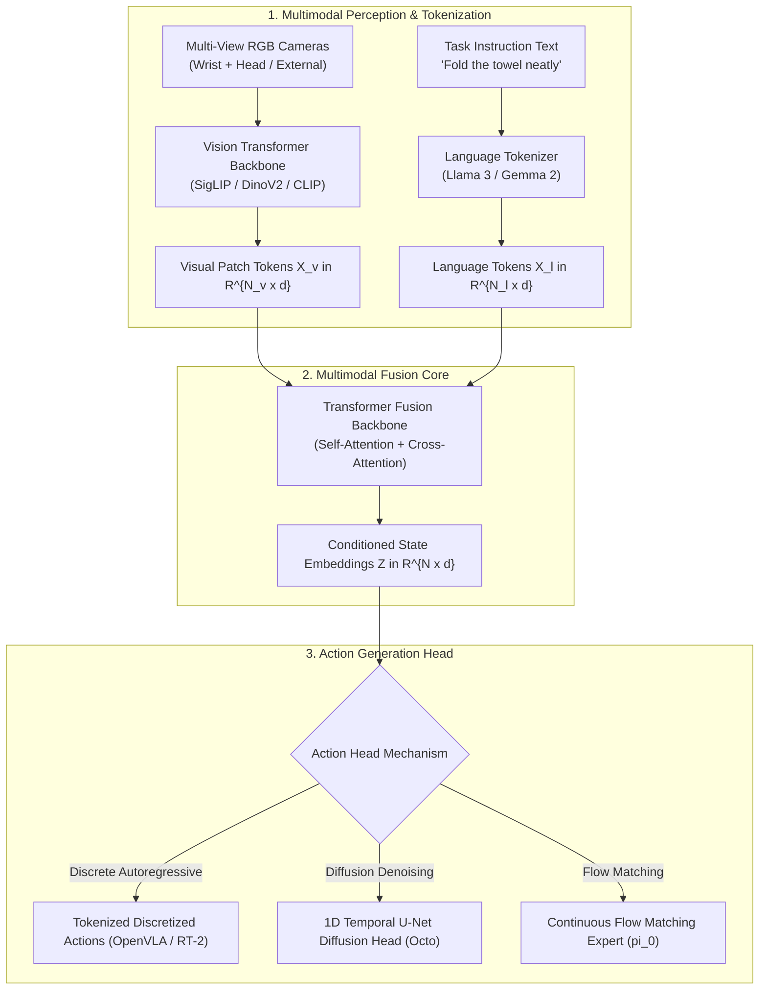
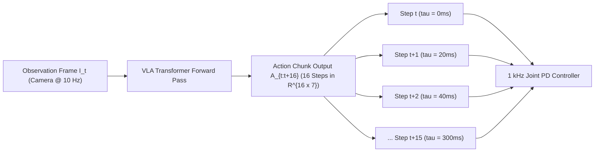

import ChapterProgress from '@site/src/components/ChapterProgress';
import QuizEngine from '@site/src/components/QuizEngine';

# VLA Foundation Model Architectures & Cross-Embodiment Training

The emergence of **Vision-Language-Action (VLA)** foundation models has unified computer vision, natural language processing, and robotic control into single scalable architectures. Instead of training isolated policies from scratch for every new robotic task and embodiment, modern VLA systems initialize from large-scale web-pretrained vision-language backbones and fine-tune across multi-robot demonstration datasets.

Understanding the internal anatomy of these foundation models—from patch-level visual tokenization and cross-attention fusion to temporal action decoders—is essential for engineering reliable embodied AI systems.

---

## Learning Objectives

After completing this chapter, you will be able to:
- Deconstruct the multi-stage architecture of leading VLA models (OpenVLA, Octo, RT-2, and $\pi_0$).
- Contrast vision encoder representations (CLIP, SigLIP, DinoV2) and formulate the SigLIP pairwise sigmoid loss.
- Derive the mathematical mechanics of cross-attention between visual patch tokens and language prompt embeddings.
- Formulate temporal action chunking over receding horizons: $\mathbf{A}_{t:t+H} \in \mathbb{R}^{H \times D}$.
- Implement a complete, modular PyTorch VLA action predictor with multi-token cross-attention conditioning.

---

## 1. Deconstructing Modern VLA Architectures

Contemporary VLA models are structured as hierarchical pipelines containing three primary subsystems:



### Architectural Comparison of Leading VLA Foundation Models

| Model Architecture | Vision Backbone | Language / Core Backbone | Action Prediction Head | Chunk Horizon ($H$) | Training Demonstrations |
| :--- | :--- | :--- | :--- | :--- | :--- |
| **RT-2 (Google)** | PaLI-X / PaLM-E ($55\text{B}$) | PaLM ($540\text{B}$ / $62\text{B}$) | Autoregressive discrete tokenization | $H = 1$ (single-step) | OXE + Google fleet ($130\text{k}$) |
| **Octo (Berkeley/Stanford)** | ViT-B ($86\text{M}$) / DinoV2 | Transformer Decoder ($93\text{M}$) | Score-based Diffusion (DDPM) | $H = 4 \text{ to } 8$ | Open X-Embodiment ($800\text{k}$) |
| **OpenVLA (Stanford)** | SigLIP ViT-SO400M | Llama 2 7B / Prismatic VLM | Autoregressive discrete tokenization ($256$ bins) | $H = 1$ (single-step) | Open X-Embodiment ($970\text{k}$) |
| **$\pi_0$ (Physical Intelligence)** | SigLIP / DinoV2 | PaliGemma ($3\text{B}$) | Conditional Flow Matching (CFM) | $H = 50$ ($1.0 \text{ s}$ @ $50\text{ Hz}$) | Real humanoid & dual-arm teleop |

---

## 2. Vision Encoders: CLIP vs. SigLIP vs. DinoV2

Robotic manipulation places unique demands on visual representations. Standard image classifiers focus on global semantic class labels (e.g., *"dog"* vs *"cat"*), whereas robotic controllers require fine-grained spatial geometry, surface normals, depth discontinuities, and precise object boundary locations.

### SigLIP: Sigmoid Loss for Vision-Language Alignment

While vanilla CLIP relies on a global softmax denominator over all batch items (requiring large batch sizes and cross-accelerator memory synchronization), **SigLIP** (Zhai et al., 2023) replaces the softmax with independent pairwise sigmoid classifications:

$$
\mathcal{L}_{SigLIP} = -\sum_{i=1}^B \sum_{j=1}^B \left[ y_{ij} \log \sigma\left( \mathbf{v}_i^T \mathbf{t}_j \cdot \tau + b \right) + (1 - y_{ij}) \log \left( 1 - \sigma\left( \mathbf{v}_i^T \mathbf{t}_j \cdot \tau + b \right) \right) \right]
$$

where:
- $\mathbf{v}_i \in \mathbb{R}^d$ is the $L_2$-normalized visual embedding from image patch pooling.
- $\mathbf{t}_j \in \mathbb{R}^d$ is the $L_2$-normalized text embedding for caption $j$.
- $\tau = e^t$ is a learnable positive temperature parameter, and $b$ is a learnable bias.
- $y_{ij} = 1$ if $i = j$ (matching positive pair) and $y_{ij} = 0$ if $i \ne j$.

SigLIP stabilizes training at smaller batch sizes and exhibits superior spatial feature localization, making it the preferred vision backbone for OpenVLA and $\pi_0$.

---

## 3. Mathematical Formulation of Multimodal Cross-Attention

Given visual patch tokens $\mathbf{X}_v \in \mathbb{R}^{N_v \times d}$ extracted from the vision encoder and language instruction tokens $\mathbf{X}_l \in \mathbb{R}^{N_l \times d}$, multimodal fusion layers blend sensory modalities via parameterized multi-head cross-attention.

Let the queries $\mathbf{Q}$, keys $\mathbf{K}$, and values $\mathbf{V}$ be linear projections:

$$
\mathbf{Q} = \mathbf{X}_l \mathbf{W}_Q, \quad \mathbf{K} = [\mathbf{X}_l \; ; \; \mathbf{X}_v] \mathbf{W}_K, \quad \mathbf{V} = [\mathbf{X}_l \; ; \; \mathbf{X}_v] \mathbf{W}_V
$$

where $\mathbf{W}_Q, \mathbf{W}_K, \mathbf{W}_V \in \mathbb{R}^{d \times d_k}$.

The scaled dot-product attention computes compatibility weights over the joint token sequence:

$$
\text{Attention}(\mathbf{Q}, \mathbf{K}, \mathbf{V}) = \text{softmax}\left( \frac{\mathbf{Q} \mathbf{K}^T}{\sqrt{d_k}} \right) \mathbf{V}
$$

For multi-head attention with $M$ heads:

$$
\text{MHA}(\mathbf{X}_l, \mathbf{X}_v) = \left[ \text{head}_1 \; ; \; \text{head}_2 \; ; \; \dots \; ; \; \text{head}_M \right] \mathbf{W}_O
$$

This allows each query token in the instruction (e.g., *"red"* or *"handle"*) to dynamically attend to relevant visual patches in the scene while ignoring background distractions.

---

## 4. Action Chunking Horizon Parameterization

Traditional reinforcement learning policies predict actions point-by-point: $\mathbf{a}_t \sim \pi(\cdot \mid \mathbf{s}_t)$. In high-frequency humanoid teleoperation, single-step policies suffer from compounding tracking errors and high-frequency joint jerk.

**Action Chunking** reformulates policy output as a continuous future trajectory horizon $H$:

$$
\mathbf{A}_{t:t+H} = \begin{bmatrix} \mathbf{a}_t \\ \mathbf{a}_{t+1} \\ \vdots \\ \mathbf{a}_{t+H-1} \end{bmatrix} \in \mathbb{R}^{H \times D}
$$

During execution, the robot executes the chunk open-loop for $K \le H$ steps (or applies receding-horizon temporal smoothing) before conditioning on fresh sensory observations, amortizing heavy vision backbone inference over multiple control cycles.



---

## 5. Hardware Breakdowns: Training Cluster vs. Edge Execution

| System Specification | Distributed Pretraining Cluster | Edge Humanoid Deployment (Jetson AGX Orin) |
| :--- | :--- | :--- |
| **Compute Engines** | 8x NVIDIA H100 SXM5 ($80\text{ GB}$ HBM3 each) | 1x NVIDIA Jetson AGX Orin $64\text{ GB}$ (Ampere) |
| **Distributed Protocol** | DeepSpeed ZeRO-3 + FlashAttention-2 over InfiniBand | TensorRT-LLM with FP8 Tensor Core acceleration |
| **Memory Bandwidth** | $3.35 \text{ TB/s}$ per GPU | $204.8 \text{ GB/s}$ Unified LPDDR5 |
| **Model Size** | 7B Parameters (OpenVLA / Prismatic VLM) | 7B Parameters quantized to 4-bit AWQ / FP8 |
| **Inference Frequency** | N/A (Batch Training: $1024$ samples/step) | $10 \text{ Hz}$ closed-loop VLA action generation |
| **Power Consumption** | $\approx 5.6 \text{ kW}$ per server node | $15\text{W} - 60\text{W}$ system TDP |

---

## 6. Seminal Research Citations

1. **Padalkar, A., Pooley, A., Jain, A., Bewley, A., Herzog, A., Irpan, A., ... & Zitkovich, B. (2024).** *Open X-Embodiment: Robotic learning datasets and RT-X models.* IEEE Transactions on Robotics.
2. **Octo Model Team, Ghosh, D., Walke, H., Pertsch, K., Black, K., Zheng, O. Y., ... & Levine, S. (2024).** *Octo: An open-source generalist robot policy.* Robotics: Science and Systems (RSS).
3. **Zhai, X., Mustafa, B., Kolesnikov, A., & Beyer, L. (2023).** *Sigmoid loss for language image pre-training.* IEEE/CVF International Conference on Computer Vision (ICCV).
4. **Oquab, M., Darcet, T., Moutakanni, T., Vo, H. V., Szafraniec, M., Khalidov, V., ... & Bojanowski, P. (2023).** *Dinov2: Learning robust visual features without supervision.* arXiv preprint arXiv:2304.07193.

---

## 7. Complete Runnable Implementation: Modular VLA Action Chunk Predictor

The following complete PyTorch module implements a modern VLA architecture coupling a visual patch projector, language token cross-attention, and an action chunk prediction head predicting $H=16$ steps of 7-DoF actions:

```python
"""
Modular VLA Action Chunk Predictor in PyTorch.
Implements patch projection, multimodal cross-attention fusion,
and multi-step continuous action chunk prediction.
"""

import math
import torch
import torch.nn as nn
import torch.nn.functional as F


class VLAMultimodalActionChunker(nn.Module):
    """
    Lightweight Vision-Language-Action policy network predicting
    a continuous trajectory chunk A_{t:t+H} in R^{H x D}.
    """

    def __init__(
        self,
        vision_dim: int = 768,      # e.g. SigLIP / DinoV2 patch embedding dim
        text_dim: int = 512,        # e.g. Tokenizer embedding dim
        embed_dim: int = 384,       # Internal shared latent dimension
        action_dim: int = 7,        # [dx, dy, dz, droll, dpitch, dyaw, gripper]
        chunk_horizon: int = 16,    # Number of future time steps
        num_heads: int = 6,
        num_decoder_layers: int = 4,
    ) -> None:
        super().__init__()
        self.chunk_horizon = chunk_horizon
        self.action_dim = action_dim
        self.embed_dim = embed_dim

        # Input modality projection layers
        self.vision_proj = nn.Linear(vision_dim, embed_dim)
        self.text_proj = nn.Linear(text_dim, embed_dim)

        # Learnable temporal action queries for chunk horizon H
        self.action_queries = nn.Parameter(torch.randn(1, chunk_horizon, embed_dim))

        # Positional encodings for queries
        self.query_pos_embed = nn.Parameter(torch.randn(1, chunk_horizon, embed_dim) * 0.02)

        # Multimodal Transformer Decoder
        decoder_layer = nn.TransformerDecoderLayer(
            d_model=embed_dim,
            nhead=num_heads,
            dim_feedforward=embed_dim * 4,
            dropout=0.1,
            batch_first=True,
            norm_first=True,
        )
        self.transformer_decoder = nn.TransformerDecoder(decoder_layer, num_layers=num_decoder_layers)

        # Final Action Projection Head: maps latent vectors to physical units
        self.action_head = nn.Sequential(
            nn.Linear(embed_dim, embed_dim // 2),
            nn.GELU(),
            nn.Linear(embed_dim // 2, action_dim),
        )

    def forward(
        self, visual_tokens: torch.Tensor, language_tokens: torch.Tensor
    ) -> torch.Tensor:
        """
        Forward pass.
        visual_tokens: [Batch, N_v, vision_dim]
        language_tokens: [Batch, N_l, text_dim]
        Returns:
            action_chunk: [Batch, chunk_horizon, action_dim]
        """
        batch_size = visual_tokens.size(0)

        # 1. Project modalities into common latent dimension
        v_proj = self.vision_proj(visual_tokens)    # [Batch, N_v, embed_dim]
        l_proj = self.text_proj(language_tokens)    # [Batch, N_l, embed_dim]

        # 2. Concatenate memory tokens along sequence length
        multimodal_memory = torch.cat([l_proj, v_proj], dim=1)  # [Batch, N_l + N_v, embed_dim]

        # 3. Expand action queries for the batch
        queries = self.action_queries.expand(batch_size, -1, -1) + self.query_pos_embed

        # 4. Cross-attend queries over multimodal visual-language memory
        decoded_tokens = self.transformer_decoder(tgt=queries, memory=multimodal_memory)

        # 5. Project each temporal token to physical action vector
        action_chunk = self.action_head(decoded_tokens)  # [Batch, H, D]
        return action_chunk


def test_vla_chunker():
    """Unit test for tensor dimensions and gradient propagation."""
    torch.manual_seed(42)
    batch_size = 4
    num_patches = 196  # 14x14 patches from 224x224 image
    num_words = 12
    v_dim = 768
    t_dim = 512
    action_dim = 7
    horizon = 16

    model = VLAMultimodalActionChunker(
        vision_dim=v_dim,
        text_dim=t_dim,
        embed_dim=256,
        action_dim=action_dim,
        chunk_horizon=horizon,
    )

    v_tokens = torch.randn(batch_size, num_patches, v_dim)
    t_tokens = torch.randn(batch_size, num_words, t_dim)

    action_preds = model(v_tokens, t_tokens)
    assert action_preds.shape == (batch_size, horizon, action_dim), (
        f"Shape mismatch: {action_preds.shape}"
    )

    # Verify loss calculation and backpropagation
    target_actions = torch.randn(batch_size, horizon, action_dim)
    loss = F.mse_loss(action_preds, target_actions)
    loss.backward()

    print(f"[SUCCESS] VLAMultimodalActionChunker verified.")
    print(f"  Input visual tokens: {v_tokens.shape}")
    print(f"  Input text tokens:   {t_tokens.shape}")
    print(f"  Predicted actions:   {action_preds.shape}")
    print(f"  Sample MSE loss:     {loss.item():.4f}")


if __name__ == "__main__":
    test_vla_chunker()
```

---

## Summary

- Vision-Language-Action models synthesize multimodal representations by pretraining vision and text encoders on large internet corpora and fine-tuning with robot action decoders.
- SigLIP's pairwise sigmoid loss provides superior localized spatial visual features compared to global softmax contrastive loss.
- Multimodal cross-attention enables text instruction queries to dynamically focus attention onto relevant visual patch tokens.
- Action chunking over receding horizons ($H \ge 16$) mitigates compounding single-step errors and reduces computational bottlenecks during real-time closed-loop control.

---

<ChapterProgress chapterId="4-6-foundation-model-architectures" moduleId="module4" totalChapters={10} />

---

<QuizEngine
  quizId="quiz-4-6"
  title="Module 4.6 Mastery Check: VLA Foundation Architectures"
  moduleId="module4"
  passThreshold={70}
  questions={[
    {
      id: "q1",
      question: "How does SigLIP's training objective differ fundamentally from standard CLIP contrastive loss?",
      options: [
        "SigLIP removes text tokens and trains solely on images",
        "SigLIP replaces the global batch softmax normalization with independent pairwise sigmoid classifications, stabilizing training across varied batch sizes",
        "SigLIP uses mean squared error directly on pixel values",
        "SigLIP requires an autoregressive decoder to generate captions"
      ],
      correctIndex: 1,
      explanation: "CLIP computes a cross-entropy loss normalized via a global softmax across all batch candidates. SigLIP evaluates independent sigmoid cross-entropy on each image-text pair, eliminating global normalization and enabling efficient scaling."
    },
    {
      id: "q2",
      question: "What is the primary operational advantage of action chunking (predicting H steps into the future) over single-step action prediction in robotics?",
      options: [
        "It eliminates the need for joint actuators",
        "It reduces compounding drift, amortizes expensive vision model forward passes over H control steps, and avoids high-frequency command jitter",
        "It makes the neural network completely linear",
        "It guarantees the robot will never drop an object"
      ],
      correctIndex: 1,
      explanation: "Single-step autoregression accumulates compounding prediction drift and forces the heavy vision backbone to execute at high frequency. Predicting temporal chunks allows open-loop or smoothed execution between perception ticks, producing smoother motions."
    },
    {
      id: "q3",
      question: "In the Open X-Embodiment dataset pretraining, how is the 'embodiment gap' across distinct robot morphologies addressed?",
      options: [
        "All robots are mechanically modified to have identical link lengths",
        "Actions are normalized into canonical end-effector relative coordinate frames (delta SE(3) pose and gripper state) with embodiment-specific LoRA adapters",
        "The model is restricted to single-joint position commands",
        "Images from different robots are converted to grayscale"
      ],
      correctIndex: 1,
      explanation: "The Open X-Embodiment methodology standardizes heterogeneous robot actions into end-effector relative delta SE(3) coordinates and gripper velocities, paired with low-rank adapters (LoRA) for morphology-specific joints."
    }
  ]}
/>
