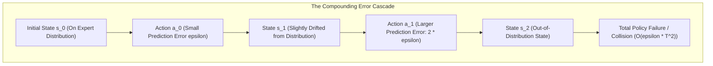
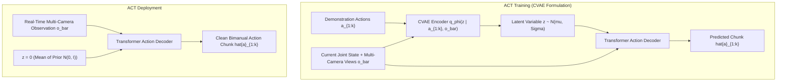

import ChapterProgress from '@site/src/components/ChapterProgress';
import QuizEngine from '@site/src/components/QuizEngine';

# Imitation Learning, Action Chunking & LEROBOT

Imitation learning—learning from human teleoperated demonstrations—remains the most reliable and data-efficient method for acquiring fine-grained, contact-rich manipulation skills on physical robots. Rather than hand-crafting dense reward functions or exploring randomly through trial and error, a robot policy directly learns to reproduce expert behaviors captured during physical teleoperation.

However, scaling imitation learning to humanoid platforms requires solving two fundamental challenges: **covariate shift** (the quadratic compounding of errors along open-loop rollouts) and **temporal consistency** across bimanual degrees of freedom. Modern frameworks like **Action Chunking with Transformers (ACT)** and Hugging Face's **LeRobot** provide the theoretical and tooling foundations to train robust policies from real-world human data.

---

## Learning Objectives

After completing this chapter, you will be able to:
- Derive the quadratic compounding error bound in Behavioral Cloning: $\mathcal{O}(\epsilon T^2)$.
- Contrast Behavioral Cloning with the Dataset Aggregation (DAgger) algorithm.
- Formulate the Conditional Variational Autoencoder (CVAE) loss for Action Chunking with Transformers (ACT).
- Architect hardware teleoperation rigs using bilateral exoskeletons (GELLO) and spatial computing headsets (Apple Vision Pro).
- Implement an end-to-end ACT CVAE training loop in PyTorch compatible with the LeRobot dataset specification.

---

## 1. The Compounding Error Dilemma: BC vs. DAgger

In standard **Behavioral Cloning (BC)**, an agent trains via supervised learning on expert demonstrations $\mathcal{D} = \{(s_t, a_t^*)\}_{t=1}^T$ drawn from the expert state distribution $d_{\pi^*}(s)$.



### The Quadratic Error Bound (Ross & Bagnell, 2011)

Assume the single-step policy error is bounded by $\epsilon$:

$$
\mathbb{E}_{s \sim d_{\pi^*}} \left[ \mathbb{I}(\pi_\theta(s) \ne \pi^*(s)) \right] \le \epsilon
$$

At time step $t$, the probability that the learned policy has deviated from the expert distribution at least once in the past is $1 - (1 - \epsilon)^t \approx t\epsilon$. Once the robot enters an unvisited state, its expected cost for all remaining steps is bounded by $C_{max}$.

Summing across an execution horizon of length $T$:

$$
\mathbb{E} \left[ \sum_{t=1}^T c(s_t, \pi_\theta(s_t)) \right] \le C_{max} \sum_{t=1}^T t \epsilon = C_{max} \cdot \epsilon \frac{T(T + 1)}{2} \in \mathcal{O}(C_{max} \epsilon T^2)
$$

This quadratic $\mathcal{O}(T^2)$ growth explains why naive single-step behavioral cloning drifts off course during extended tasks.

### DAgger: Dataset Aggregation

**DAgger** mitigates covariate shift by querying the expert during execution to label states visited by the learned policy:

```
Algorithm: Dataset Aggregation (DAgger)
1. Initialize dataset D with expert rollouts: D <- D_expert
2. Train policy pi_1 on D
3. For iteration i = 1 to N:
4.    Rollout trajectory using mixed policy: pi_mix = beta_i * pi* + (1 - beta_i) * pi_i
5.    For each visited state s_t, query expert for optimal action a_t* = pi*(s_t)
6.    Aggregate new samples: D <- D U {(s_t, a_t*)}
7.    Train policy pi_{i+1} on aggregated dataset D
```

Under DAgger, because the training set distribution converges toward the policy's own state visitation distribution $d_{\pi_i}(s)$, the total expected cost bound becomes **linear in horizon**:

$$
\mathbb{E} \left[ \sum_{t=1}^T c(s_t, \pi_N(s_t)) \right] \le C_{max} \left( \epsilon_N T + \mathcal{O}(1) \right)
$$

---

## 2. Action Chunking with Transformers (ACT)

Introduced by Zhao et al. (2023), **Action Chunking with Transformers (ACT)** addresses covariate shift and temporal inconsistencies without requiring online human expert intervention. By predicting a sequence of $K$ future actions simultaneously, the effective decision horizon decreases from $T$ to $T / K$, slashing compounding error propagation.



### The CVAE Loss Function

Human demonstrations exhibit multi-modal styles (e.g., reaching with a high vs. low arc). ACT models this style variation using a **Conditional Variational Autoencoder (CVAE)** with latent variable $\mathbf{z} \sim \mathcal{N}(\mathbf{0}, \mathbf{I})$.

The overall loss balances $L_1$ trajectory reconstruction with Kullback-Leibler (KL) divergence regularization:

$$
\mathcal{L}_{ACT}(\theta, \phi) = \sum_{t=1}^k \left\| \mathbf{a}_t - \hat{\mathbf{a}}_t \right\|_1 + \beta \cdot D_{KL}\left( q_\phi(\mathbf{z} \mid \mathbf{a}_{1:k}, \bar{\mathbf{o}}) \;\Big\|\; p(\mathbf{z} \mid \bar{\mathbf{o}}) \right)
$$

where:
- $\bar{\mathbf{o}} = (\mathbf{o}_{proprio}, \mathbf{I}_{head}, \mathbf{I}_{wrist})$ is the aggregated sensory observation.
- $q_\phi(\mathbf{z} \mid \mathbf{a}_{1:k}, \bar{\mathbf{o}}) = \mathcal{N}(\boldsymbol{\mu}_\phi, \boldsymbol{\Sigma}_\phi)$ is the learned recognition encoder.
- $p(\mathbf{z} \mid \bar{\mathbf{o}}) = \mathcal{N}(\mathbf{0}, \mathbf{I})$ is the standard multivariate normal prior.
- $\beta > 0$ weights the information bottleneck. During test-time deployment, the encoder is dropped and $\mathbf{z}$ is deterministically set to the prior mean $\mathbf{z} = \mathbf{0}$.

---

## 3. Humanoid Teleoperation Hardware & Data Pipelines

Collecting high-quality demonstration datasets requires low-latency, intuitive teleoperation interfaces:

```
+-----------------------------------------------------------------------------------+
|                        Humanoid Teleoperation Architecture                        |
|                                                                                   |
|  +-------------------------------------+   +------------------------------------+  |
|  |       Leader Arm System (GELLO)     |   |    Spatial Computing (Vision Pro)  |  |
|  |  - 3D-printed passive kinematics    |   |  - WebRTC stereo video @ 90 Hz     |  |
|  |  - 7x AS5600 magnetic encoders      |   |  - 6-DoF spatial wrist tracking    |  |
|  |  - Direct 1:1 joint mapping (1 kHz) |   |  - Hand pinch gesture tracking     |  |
|  +-------------------------------------+   +------------------------------------+  |
|                     |                                         |                    |
|                     +====== Real-Time Teleoperation Host =====+                    |
|                                         |                                          |
|                                         v                                          |
|                     +---------------------------------------+                      |
|                     | Hugging Face LeRobot Recorder Engine  |                      |
|                     | - Joint positions, velocities, effort |                      |
|                     | - Multi-camera H.264 video streams    |                      |
|                     | - High-throughput HDF5 dataset chunks |                      |
|                     +---------------------------------------+                      |
+-----------------------------------------------------------------------------------+
```

### LeRobot Dataset Schema

Hugging Face's **LeRobot** standardizes robotics demonstration datasets using Apache Arrow and MP4 video containers:
- `observation.state`: Float32 array of proprioceptive joint angles and gripper positions.
- `observation.images.laptop`: 30 FPS RGB video stream from overhead perspective.
- `observation.images.wrist`: 30 FPS RGB video stream from gripper wrist camera.
- `action`: Commanded continuous joint targets for the next time step.
- `episode_index`: Unique integer identifier per recording session.

---

## 4. Hardware Breakdowns: Demonstration Storage & Training Compute

| System Specification | Teleoperation Data Capture Rig | Training Compute Node (NVIDIA RTX 4090) |
| :--- | :--- | :--- |
| **Data Ingestion** | 3x USB 3.2 Gen 2 cameras ($1080\text{p}$ @ $30\text{ FPS}$) + 2x CAN buses | PyTorch DataLoader with GPU image decoding (NVDEC) |
| **Storage Throughput** | NVMe RAID-0 ($3500 \text{ MB/s}$ write bandwidth) | Local PCIe Gen4 NVMe cache |
| **Dataset Size** | 50 episodes $\approx 15 \text{ GB}$ (H.264 compressed video) | Batch size $32$ consuming $14 \text{ GB}$ VRAM |
| **Training Duration** | 2 hours of physical demonstration collection | 45 minutes for 100,000 steps of ACT training |
| **Inference Frequency** | 1 kHz Leader joint polling | $50 \text{ Hz}$ policy inference loop ($20 \text{ ms}$ budget) |

---

## 5. Seminal Research Citations

1. **Zhao, T. Z., Kumar, V., Levine, S., & Finn, C. (2023).** *Learning fine-grained bimanual manipulation with low-cost hardware.* arXiv preprint arXiv:2304.13705 (ACT).
2. **Ross, S., Gordon, G., & Bagnell, D. (2011).** *A reduction of imitation learning and structured prediction to no-regret online learning.* Proceedings of the Fourteenth International Conference on Artificial Intelligence and Statistics (AISTATS).
3. **Cadene, R., Alibert, S., Tuleu, A., & Wolf, T. (2024).** *LeRobot: State-of-the-art machine learning for real-world robotics in PyTorch.* Hugging Face.
4. **Pomerleau, D. A. (1988).** *ALVINN: An autonomous land vehicle in a neural network.* Advances in Neural Information Processing Systems (NeurIPS).

---

## 6. Complete Runnable Implementation: ACT CVAE Action Predictor

The following standalone PyTorch script implements the complete Action Chunking with Transformers (ACT) CVAE architecture, including the recognition encoder, KL divergence loss, and transformer action decoder:

```python
"""
Action Chunking with Transformers (ACT) CVAE Architecture.
Implements the CVAE encoder, KL divergence regularization, and chunk decoder.
"""

from typing import Tuple
import torch
import torch.nn as nn
import torch.nn.functional as F


class ACTEncoder(nn.Module):
    """
    CVAE Recognition Encoder: maps demonstration action chunks and observations
    into latent distribution parameters mu and log_var.
    """

    def __init__(
        self,
        action_dim: int = 7,
        chunk_horizon: int = 16,
        obs_dim: int = 14,
        latent_dim: int = 32,
        embed_dim: int = 256,
    ) -> None:
        super().__init__()
        self.action_proj = nn.Linear(action_dim, embed_dim)
        self.obs_proj = nn.Linear(obs_dim, embed_dim)
        self.cls_token = nn.Parameter(torch.randn(1, 1, embed_dim))

        encoder_layer = nn.TransformerEncoderLayer(
            d_model=embed_dim, nhead=4, dim_feedforward=512, batch_first=True
        )
        self.transformer = nn.TransformerEncoder(encoder_layer, num_layers=3)

        self.fc_mu = nn.Linear(embed_dim, latent_dim)
        self.fc_logvar = nn.Linear(embed_dim, latent_dim)

    def forward(
        self, actions: torch.Tensor, obs: torch.Tensor
    ) -> Tuple[torch.Tensor, torch.Tensor]:
        batch_size = actions.size(0)

        # Project actions and observation
        a_tokens = self.action_proj(actions)          # [Batch, Horizon, embed_dim]
        o_token = self.obs_proj(obs).unsqueeze(1)    # [Batch, 1, embed_dim]
        cls = self.cls_token.expand(batch_size, -1, -1)

        # Concatenate: [CLS, Observation, Actions...]
        seq = torch.cat([cls, o_token, a_tokens], dim=1)
        h = self.transformer(seq)

        # Latent distribution from CLS token
        cls_out = h[:, 0]
        mu = self.fc_mu(cls_out)
        logvar = self.fc_logvar(cls_out)
        return mu, logvar


class ACTDecoder(nn.Module):
    """
    Action Decoder: transforms latent sample z and observations
    into multi-step predicted continuous action chunks.
    """

    def __init__(
        self,
        action_dim: int = 7,
        chunk_horizon: int = 16,
        obs_dim: int = 14,
        latent_dim: int = 32,
        embed_dim: int = 256,
    ) -> None:
        super().__init__()
        self.chunk_horizon = chunk_horizon
        self.action_dim = action_dim

        self.latent_proj = nn.Linear(latent_dim, embed_dim)
        self.obs_proj = nn.Linear(obs_dim, embed_dim)
        self.action_queries = nn.Parameter(torch.randn(1, chunk_horizon, embed_dim))

        decoder_layer = nn.TransformerDecoderLayer(
            d_model=embed_dim, nhead=4, dim_feedforward=512, batch_first=True
        )
        self.transformer = nn.TransformerDecoder(decoder_layer, num_layers=3)
        self.action_head = nn.Linear(embed_dim, action_dim)

    def forward(self, z: torch.Tensor, obs: torch.Tensor) -> torch.Tensor:
        batch_size = z.size(0)

        z_token = self.latent_proj(z).unsqueeze(1)
        o_token = self.obs_proj(obs).unsqueeze(1)
        memory = torch.cat([z_token, o_token], dim=1)

        queries = self.action_queries.expand(batch_size, -1, -1)
        decoded = self.transformer(tgt=queries, memory=memory)
        pred_actions = self.action_head(decoded)
        return pred_actions


class ACTPolicy(nn.Module):
    """Full ACT CVAE Policy model."""

    def __init__(
        self,
        action_dim: int = 7,
        chunk_horizon: int = 16,
        obs_dim: int = 14,
        latent_dim: int = 32,
        beta_kl: float = 10.0,
    ) -> None:
        super().__init__()
        self.beta_kl = beta_kl
        self.latent_dim = latent_dim

        self.encoder = ACTEncoder(action_dim, chunk_horizon, obs_dim, latent_dim)
        self.decoder = ACTDecoder(action_dim, chunk_horizon, obs_dim, latent_dim)

    def reparameterize(self, mu: torch.Tensor, logvar: torch.Tensor) -> torch.Tensor:
        std = torch.exp(0.5 * logvar)
        eps = torch.randn_like(std)
        return mu + eps * std

    def forward(
        self, actions: torch.Tensor, obs: torch.Tensor
    ) -> Tuple[torch.Tensor, torch.Tensor, torch.Tensor]:
        """Training forward pass."""
        mu, logvar = self.encoder(actions, obs)
        z = self.reparameterize(mu, logvar)
        pred_actions = self.decoder(z, obs)
        return pred_actions, mu, logvar

    def compute_loss(
        self, actions: torch.Tensor, obs: torch.Tensor
    ) -> Tuple[torch.Tensor, torch.Tensor, torch.Tensor]:
        pred_actions, mu, logvar = self(actions, obs)

        # L1 reconstruction loss
        recon_loss = F.l1_loss(pred_actions, actions)

        # KL Divergence: -0.5 * sum(1 + log(sigma^2) - mu^2 - sigma^2)
        kl_div = -0.5 * torch.mean(torch.sum(1 + logvar - mu.pow(2) - logvar.exp(), dim=1))

        total_loss = recon_loss + self.beta_kl * kl_div
        return total_loss, recon_loss, kl_div

    @torch.no_grad()
    def select_action_chunk(self, obs: torch.Tensor) -> torch.Tensor:
        """Inference forward pass with zeroed latent prior."""
        batch_size = obs.size(0)
        z = torch.zeros(batch_size, self.latent_dim, device=obs.device)
        return self.decoder(z, obs)


def test_act_pipeline():
    """Unit test verifying ACT forward and loss computation."""
    torch.manual_seed(42)
    batch_size = 4
    action_dim = 7
    horizon = 16
    obs_dim = 14

    model = ACTPolicy(
        action_dim=action_dim,
        chunk_horizon=horizon,
        obs_dim=obs_dim,
        latent_dim=32,
        beta_kl=5.0,
    )

    dummy_actions = torch.randn(batch_size, horizon, action_dim)
    dummy_obs = torch.randn(batch_size, obs_dim)

    total_loss, recon, kl = model.compute_loss(dummy_actions, dummy_obs)
    assert not torch.isnan(total_loss), "Loss contained NaN"
    total_loss.backward()

    # Inference test
    test_chunk = model.select_action_chunk(dummy_obs)
    assert test_chunk.shape == (batch_size, horizon, action_dim), (
        f"Inference output shape mismatch: {test_chunk.shape}"
    )

    print(f"[SUCCESS] ACTPolicy verified.")
    print(f"  Total CVAE Loss: {total_loss.item():.4f}")
    print(f"  L1 Reconstruction: {recon.item():.4f}")
    print(f"  KL Divergence:    {kl.item():.4f}")
    print(f"  Inference Chunk:  {test_chunk.shape}")


if __name__ == "__main__":
    test_act_pipeline()
```

---

## Summary

- Behavioral Cloning suffers from compounding covariate shift errors scaling quadratically as $\mathcal{O}(\epsilon T^2)$ along open-loop rollouts.
- DAgger rectifies covariate shift by querying expert corrections on states visited by the policy, restoring linear error growth $\mathcal{O}(\epsilon T)$.
- Action Chunking with Transformers (ACT) reduces the effective planning horizon by predicting $K$-step continuous trajectory segments, stabilizing bimanual coordination.
- The CVAE framework captures multimodal demonstration strategies during training and provides deterministic mean execution during inference.

---

<ChapterProgress chapterId="4-8-imitation-learning" moduleId="module4" totalChapters={10} />

---

<QuizEngine
  quizId="quiz-4-8"
  title="Module 4.8 Mastery Check: Imitation Learning & ACT"
  moduleId="module4"
  passThreshold={70}
  questions={[
    {
      id: "q1",
      question: "Why does naive Behavioral Cloning (BC) exhibit quadratic O(epsilon * T^2) compounding error over an execution horizon of length T?",
      options: [
        "Because neural networks have quadratic memory complexity",
        "A small error at time step t knocks the robot into an out-of-distribution state where errors compound for all remaining (T - t) steps",
        "Because joint motor torque is proportional to the square of angular velocity",
        "Because camera resolution scales quadratically with distance"
      ],
      correctIndex: 1,
      explanation: "When an agent makes an epsilon-error at step t, it enters a state unvisited during training. From then on, errors compound across the remaining horizon (T - t). Integrating this over the full episode produces an O(T^2) bound."
    },
    {
      id: "q2",
      question: "During test-time physical robot deployment of an ACT policy, how is the latent variable z sampled?",
      options: [
        "It is sampled randomly from N(0, I) at every single millisecond",
        "It is deterministically set to z = 0 (the mean of the Gaussian prior) to produce consistent, high-probability execution",
        "It is computed from human brainwave EEG signals",
        "It is set to positive infinity"
      ],
      correctIndex: 1,
      explanation: "During inference, the recognition encoder is discarded and the latent variable z is set deterministically to the prior mean z = 0, ensuring smooth and predictable trajectory generation."
    },
    {
      id: "q3",
      question: "How does Action Chunking (predicting K steps into the future) mitigate compounding tracking drift?",
      options: [
        "It divides the effective sequence decision horizon by K, reducing the frequency of closed-loop branching where drift can accumulate",
        "It increases the clock frequency of the CPU",
        "It forces the robot to move K times faster",
        "It eliminates the need for sensor observations"
      ],
      correctIndex: 0,
      explanation: "Predicting chunks of length K reduces the number of sequential closed-loop autoregressive transitions by a factor of K, shrinking compounding error accumulation over the task horizon."
    }
  ]}
/>
