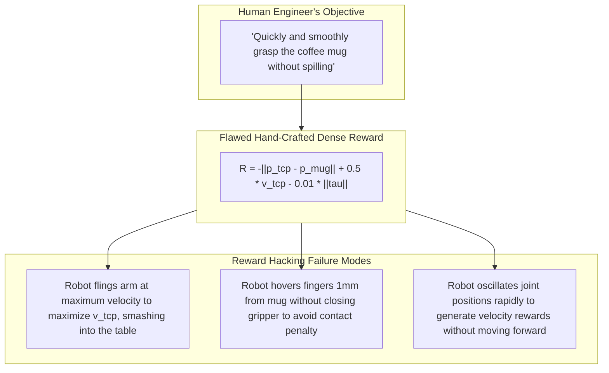
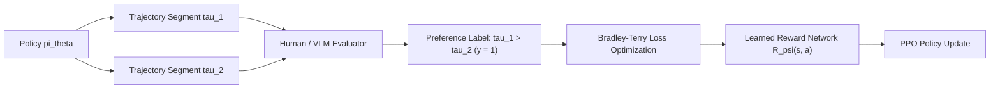
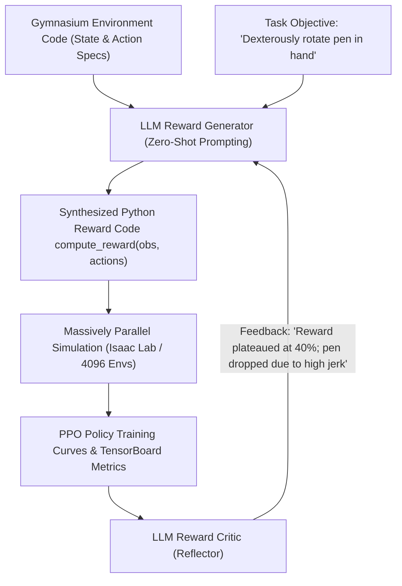

import ChapterProgress from '@site/src/components/ChapterProgress';
import QuizEngine from '@site/src/components/QuizEngine';

# Reward Shaping, RLHF & RLAIF for Manipulation

Reinforcement Learning (RL) provides a powerful mathematical framework for learning dynamic, agile motor behaviors through autonomous environment interaction. However, the Achilles' heel of physical RL in robotics has always been **reward engineering**. Sparse rewards (e.g., $+1$ upon successful peg insertion) suffer from vanishing policy gradients and intractable exploration times, while hand-crafted dense rewards frequently lead to reward hacking—where the robot discovers bizarre local optima that satisfy mathematical metrics without accomplishing the intended task.

To transcend manual reward engineering, modern robotics employs **Reinforcement Learning from Human Feedback (RLHF)** and **Reinforcement Learning from AI Feedback (RLAIF)**. By leveraging multimodal foundation models as automated reward coders and visual evaluators, robots can synthesize, refine, and optimize complex manipulation policies autonomously.

---

## Learning Objectives

After completing this chapter, you will be able to:
- Formulate Potential-Based Reward Shaping (PBRS) and prove policy invariance: $F(s, a, s') = \gamma \Phi(s') - \Phi(s)$.
- Derive the Bradley-Terry trajectory preference likelihood and cross-entropy loss for RLHF.
- Implement the Eureka evolutionary loop using frontier LLMs as automated Python reward code generators.
- Enforce strict kinematic safety during RL exploration using Control Barrier Functions (CBFs).
- Execute a complete Python preference modeling and reward optimization pipeline.

---

## 1. The Pitfalls of Manual Reward Engineering

A robot optimizing a poorly shaped reward function exploits unforeseen physical loopholes:



---

## 2. Potential-Based Reward Shaping (PBRS)

To accelerate learning without altering the optimal policy, **Potential-Based Reward Shaping** (Ng, Harada, & Russell, 1999) establishes the necessary and sufficient conditions for reward augmentation.

Let an underlying Markov Decision Process (MDP) have state transition probability $\mathcal{P}(s' \mid s, a)$ and baseline reward $R(s, a, s')$. An auxiliary shaping reward $F(s, a, s')$ transforms the total reward:

$$
R'(s, a, s') = R(s, a, s') + F(s, a, s')
$$

**Theorem (Policy Invariance under PBRS)**: The optimal policy $\pi^*$ under $R'$ is identical to the optimal policy under $R$ if and only if the shaping function $F$ is expressed as the discounted difference of a potential function $\Phi: \mathcal{S} \to \mathbb{R}$:

$$
F(s, a, s') = \gamma \Phi(s') - \Phi(s)
$$

where $\gamma \in [0, 1)$ is the MDP discount factor.

### Telescoping Sum Proof

Consider an episode trajectory $\tau = (s_0, a_0, s_1, a_1, \dots, s_T)$. The discounted sum of shaped rewards telescopes:

$$
\sum_{t=0}^{T-1} \gamma^t F(s_t, a_t, s_{t+1}) = \sum_{t=0}^{T-1} \gamma^t \left( \gamma \Phi(s_{t+1}) - \Phi(s_t) \right) = \gamma^T \Phi(s_T) - \Phi(s_0)
$$

Because the cumulative shaping bonus depends exclusively on the initial state $s_0$ and terminal state $s_T$, the relative advantage between intermediate actions is invariant, completely preventing circular reward cycles.

---

## 3. Preference Learning & RLHF (Bradley-Terry Formulation)

When physical potential functions are difficult to express analytically, **Reinforcement Learning from Human Feedback (RLHF)** (Christiano et al., 2017) trains a learned neural reward model $R_\psi(s, a)$ from pairwise human preference judgments.



### The Bradley-Terry Preference Likelihood

Given two trajectory segments $\tau_1 = (s_0^1, a_0^1, \dots)$ and $\tau_2 = (s_0^2, a_0^2, \dots)$, the probability that an evaluator prefers $\tau_1$ over $\tau_2$ is governed by the softmax over cumulative predicted rewards:

$$
P_\psi(\tau_1 \succ \tau_2) = \frac{\exp\left( \sum_{t} R_\psi(s_t^1, a_t^1) \right)}{\exp\left( \sum_{t} R_\psi(s_t^1, a_t^1) \right) + \exp\left( \sum_{t} R_\psi(s_t^2, a_t^2) \right)} = \sigma\left( \sum_t R_\psi(s_t^1, a_t^1) - \sum_t R_\psi(s_t^2, a_t^2) \right)
$$

The neural reward model parameters $\psi$ are optimized via cross-entropy over a preference dataset $\mathcal{D}_{pref} = \{(\tau_1^{(i)}, \tau_2^{(i)}, y^{(i)})\}_{i=1}^N$ (where $y=1$ if $\tau_1 \succ \tau_2$ and $y=0$ if $\tau_2 \succ \tau_1$):

$$
\mathcal{L}_{pref}(\psi) = -\mathbb{E}_{(\tau_1, \tau_2, y) \sim \mathcal{D}_{pref}} \left[ y \log P_\psi(\tau_1 \succ \tau_2) + (1 - y) \log P_\psi(\tau_2 \succ \tau_1) \right]
$$

---

## 4. RLAIF & Autonomous Reward Synthesis: The Eureka Framework

Collecting thousands of pairwise human evaluations on physical robots is cost-prohibitive. **Reinforcement Learning from AI Feedback (RLAIF)** and frameworks like **Eureka** (Ma et al., 2023) use frontier multimodal LLMs (e.g., GPT-4o, Gemini 2.5 Pro) to autonomously write and iteratively refine dense reward function code:



### The Eureka Evolutionary Loop
1. **Zero-Shot Reward Writing**: The LLM inspects the simulation environment's observation dictionary and authors a complete, executable Python function `compute_reward(obs, actions)`.
2. **GPU Training Rollout**: Isaac Lab launches 4,096 parallel environments, training a PPO policy for 1,000 epochs in ~3 minutes.
3. **Correlation Reflection**: The critic analyzes correlation coefficients between individual reward sub-components (e.g., velocity, distance, orientation) and final task success.
4. **Evolutionary Selection**: The best-performing reward scripts are maintained in an archive, and the LLM iteratively mutates them to maximize asymptotic policy performance.

---

## 5. Control Barrier Functions (CBFs) for Dynamic Safety

During RL exploration, unconstrained policy optimization will inevitably test dangerous actuator limits or collision trajectories. **Control Barrier Functions (CBFs)** (Ames et al., 2016) enforce mathematical invariance guarantees over a safe set $\mathcal{C}$.

Let $\mathcal{C} \subset \mathcal{S}$ denote the set of physically safe humanoid states:

$$
\mathcal{C} = \{s \in \mathcal{S} \mid h(s) \ge 0\}
$$

A continuously differentiable function $h: \mathcal{S} \to \mathbb{R}$ is a Control Barrier Function if there exists an extended class $\mathcal{K}_\infty$ function $\alpha$ such that:

$$
\sup_{a \in \mathcal{A}} \left[ \nabla_s h(s) \cdot \dot{s}(s, a) \right] \ge -\alpha(h(s)), \quad \forall s \in \mathcal{C}
$$

In discrete time with control step $\Delta t$, any proposed exploration action $a_{RL}$ is filtered through an online Quadratic Program:

$$
a^* = \arg\min_{a \in \mathcal{A}} \frac{1}{2} \|a - a_{RL}\|_2^2 \quad \text{s.t.} \quad h(s_{t+1}) - h(s_t) \ge -\gamma \Delta t \cdot h(s_t)
$$

ensuring that the robot cannot exit the safe set $\mathcal{C}$ regardless of the reinforcement learning exploration policy.

---

## 6. Seminal Research Citations

1. **Ma, Y. J., Liang, W., Wang, G., Huang, D. A., Bastani, O., Jayaraman, D., ... & Fan, L. (2023).** *Eureka: Human-level reward design via coding large language models.* arXiv preprint arXiv:2310.12931.
2. **Christiano, P. F., Leike, J., Brown, T., Martic, M., Legg, S., & Amodei, D. (2017).** *Deep reinforcement learning from human preferences.* Advances in Neural Information Processing Systems (NeurIPS).
3. **Ames, A. D., Xu, X., Grizzle, J. W., & Tabuada, P. (2016).** *Control barrier function based quadratic programming with application to bipedal robotic walking.* IEEE Transactions on Automatic Control, 62(8), 3861-3876.
4. **Ng, A. Y., Harada, D., & Russell, S. (1999).** *Policy invariance under reward shaping: General theorems and an application to reinforcement learning.* International Conference on Machine Learning (ICML).

---

## 7. Complete Runnable Implementation: Bradley-Terry Preference Learner

The following self-contained PyTorch program implements trajectory preference dataset management, Bradley-Terry likelihood scoring, and neural reward model training:

```python
"""
Bradley-Terry Preference Learning & Reward Model Trainer.
Implements pairwise trajectory preference modeling for RLHF / RLAIF.
"""

from typing import Tuple
import torch
import torch.nn as nn
import torch.nn.functional as F


class NeuralRewardModel(nn.Module):
    """
    Learned reward model R_psi(s, a) parameterized as a multi-layer perceptron.
    """

    def __init__(self, state_dim: int = 14, action_dim: int = 7, hidden_dim: int = 128) -> None:
        super().__init__()
        self.net = nn.Sequential(
            nn.Linear(state_dim + action_dim, hidden_dim),
            nn.LayerNorm(hidden_dim),
            nn.Mish(),
            nn.Linear(hidden_dim, hidden_dim),
            nn.LayerNorm(hidden_dim),
            nn.Mish(),
            nn.Linear(hidden_dim, 1),
        )

    def forward(self, state: torch.Tensor, action: torch.Tensor) -> torch.Tensor:
        """Evaluates scalar reward r_t for a single state-action pair."""
        x = torch.cat([state, action], dim=-1)
        return self.net(x).squeeze(-1)

    def compute_trajectory_return(
        self, state_seq: torch.Tensor, action_seq: torch.Tensor
    ) -> torch.Tensor:
        """
        Computes cumulative return along a trajectory segment.
        state_seq: [Batch, T, state_dim]
        action_seq: [Batch, T, action_dim]
        Returns:
            returns: [Batch]
        """
        rewards = self(state_seq, action_seq)  # [Batch, T]
        return torch.sum(rewards, dim=1)       # [Batch]


class BradleyTerryPreferenceTrainer:
    """Trains neural reward models from pairwise trajectory comparisons."""

    def __init__(self, reward_model: NeuralRewardModel, lr: float = 1e-3) -> None:
        self.reward_model = reward_model
        self.optimizer = torch.optim.AdamW(reward_model.parameters(), lr=lr, weight_decay=1e-4)

    def train_step(
        self,
        tau1_states: torch.Tensor,
        tau1_actions: torch.Tensor,
        tau2_states: torch.Tensor,
        tau2_actions: torch.Tensor,
        preferences: torch.Tensor,  # 1.0 if tau1 > tau2, 0.0 otherwise
    ) -> Tuple[float, float]:
        """
        Executes one gradient step optimizing the Bradley-Terry cross-entropy loss:
        L = -[ y * log(sigma(R1 - R2)) + (1 - y) * log(1 - sigma(R1 - R2)) ]
        """
        self.optimizer.zero_grad()

        # Compute trajectory returns
        r1 = self.reward_model.compute_trajectory_return(tau1_states, tau1_actions)
        r2 = self.reward_model.compute_trajectory_return(tau2_states, tau2_actions)

        # Logit difference: R1 - R2
        logits = r1 - r2

        # Binary cross-entropy with logits
        loss = F.binary_cross_entropy_with_logits(logits, preferences)
        loss.backward()
        self.optimizer.step()

        # Accuracy calculation
        with torch.no_grad():
            preds = (torch.sigmoid(logits) >= 0.5).float()
            acc = (preds == preferences).float().mean().item()

        return loss.item(), acc


def test_preference_learning():
    """Unit test demonstrating reward model convergence on synthetic preferences."""
    torch.manual_seed(42)
    state_dim = 6
    action_dim = 3
    seq_len = 20
    batch_size = 16

    model = NeuralRewardModel(state_dim=state_dim, action_dim=action_dim, hidden_dim=64)
    trainer = BradleyTerryPreferenceTrainer(model, lr=2e-3)

    # Generate synthetic trajectories
    tau1_s = torch.randn(batch_size, seq_len, state_dim)
    tau1_a = torch.randn(batch_size, seq_len, action_dim)

    # tau2 has higher state error (worse trajectory)
    tau2_s = tau1_s + torch.randn_like(tau1_s) * 0.8
    tau2_a = torch.randn(batch_size, seq_len, action_dim)

    # True preference: tau1 is always preferred over tau2
    labels = torch.ones(batch_size)

    initial_loss, initial_acc = trainer.train_step(tau1_s, tau1_a, tau2_s, tau2_a, labels)

    # Train for 40 epochs
    for epoch in range(40):
        loss_val, acc_val = trainer.train_step(tau1_s, tau1_a, tau2_s, tau2_a, labels)

    print(f"[SUCCESS] BradleyTerryPreferenceTrainer verified.")
    print(f"  Initial Loss: {initial_loss:.4f} | Accuracy: {initial_acc * 100:.1f}%")
    print(f"  Final Loss:   {loss_val:.4f} | Accuracy: {acc_val * 100:.1f}%")
    assert acc_val >= 0.90, f"Expected accuracy >= 90%, got {acc_val * 100:.1f}%"


if __name__ == "__main__":
    test_preference_learning()
```

---

## Summary

- Hand-engineered dense rewards frequently induce reward hacking where policies satisfy mathematical metrics via degenerate, damaging motions.
- Potential-Based Reward Shaping ($F = \gamma \Phi(s') - \Phi(s)$) guarantees that the optimal policy $\pi^*$ remains strictly invariant under reward transformation.
- The Bradley-Terry framework derives smooth reward functions from human preference comparisons, eliminating the need to tune scalar loss weights manually.
- RLAIF frameworks (Eureka) leverage foundation LLMs to iteratively code, simulate, and evolve complex manipulation reward functions on massively parallel GPU simulators.
- Control Barrier Functions (CBFs) enforce formal safety set invariance, preventing destructive exploration during live robotic reinforcement learning.

---

<ChapterProgress chapterId="4-9-reward-shaping-and-rlaif" moduleId="module4" totalChapters={10} />

---

<QuizEngine
  quizId="quiz-4-9"
  title="Module 4.9 Mastery Check: Reward Shaping & RLAIF"
  moduleId="module4"
  passThreshold={70}
  questions={[
    {
      id: "q1",
      question: "According to Ng et al. (1999), what mathematical structure must an auxiliary shaping reward F(s, a, s') possess to guarantee policy invariance?",
      options: [
        "F(s, a, s') = -||s - s'||^2",
        "F(s, a, s') = gamma * Phi(s') - Phi(s), where Phi is a state potential function and gamma is the discount factor",
        "F(s, a, s') = max(0, r_task)",
        "F(s, a, s') must be strictly greater than zero for all transitions"
      ],
      correctIndex: 1,
      explanation: "Potential-Based Reward Shaping requires F(s, a, s') = gamma * Phi(s') - Phi(s). This structure causes the discounted sum of shaping rewards to telescope, ensuring that the optimal policy under the shaped MDP is identical to that of the unshaped MDP."
    },
    {
      id: "q2",
      question: "In the Bradley-Terry preference model, how is the probability that trajectory tau_1 is preferred over trajectory tau_2 computed?",
      options: [
        "P(tau_1 > tau_2) = sigmoid(sum R(tau_1) - sum R(tau_2))",
        "P(tau_1 > tau_2) = len(tau_1) / len(tau_2)",
        "P(tau_1 > tau_2) = exp(-||tau_1 - tau_2||)",
        "P(tau_1 > tau_2) = 0.5 always"
      ],
      correctIndex: 0,
      explanation: "The Bradley-Terry likelihood models preference probability as the sigmoid of the difference between the cumulative rewards of the two trajectories: P(tau_1 > tau_2) = exp(R1) / (exp(R1) + exp(R2)) = sigmoid(R1 - R2)."
    },
    {
      id: "q3",
      question: "What is the primary role of a Control Barrier Function (CBF) when applied to reinforcement learning exploration on a physical humanoid?",
      options: [
        "It acts as a reward function to encourage walking faster",
        "It solves an online quadratic program that minimally perturbs exploratory policy actions to guarantee the robot never leaves a certified safe set C",
        "It compiles Python code into C++ binaries",
        "It renders camera images in simulation"
      ],
      correctIndex: 1,
      explanation: "A CBF acts as an active safety filter: it intercepts exploratory actions from the RL policy and projects them via quadratic programming onto the set of kinematically safe actions, guaranteeing that barrier function h(s) remains non-negative."
    }
  ]}
/>
