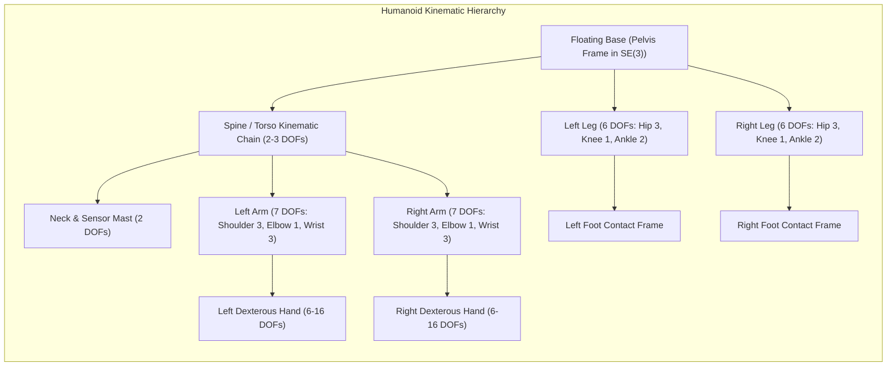
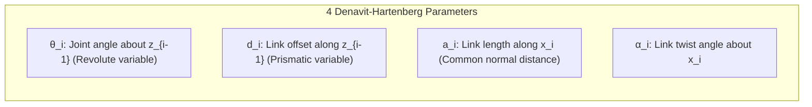

# Introduction to Humanoid Kinematics & Coordinate Geometry

Kinematics forms the mathematical geometry of humanoid robotics: it describes the relationship between joint angles, actuator displacements, and the spatial poses of the robot's limbs, pelvis, and end-effectors without considering the forces that cause motion. For an autonomous bipedal humanoid—with 28 to 50+ degrees of freedom (DOFs) operating under unconstrained 3D spatial transformations—kinematics is the essential foundation for spatial perception, balance estimation, whole-body manipulation, and trajectory execution.



---

## 1. Reference Frames and Rigid Body Transformations in SE(3)

A rigid body in Euclidean 3-space possesses six degrees of freedom: three translational components specifying position, and three rotational components specifying orientation. The configuration space of a rigid body is the Special Euclidean Group `SE(3)`, defined as:

```text
SE(3) = { T = [ R,  p ] in R^{4x4} | R in SO(3), p in R^3 }
              [ 0,  1 ]
```

where `SO(3)` is the Special Orthogonal Group representing 3D rotations:

```text
SO(3) = { R in R^{3x3} | R^T * R = I_{3x3}, det(R) = +1 }
```

### 1.1 Homogeneous Coordinates
To compose spatial translation and rotation through linear matrix multiplications, 3D points `p = [x, y, z]^T` are represented in homogeneous coordinates as `p_tilde = [x, y, z, 1]^T in P^3`.

A coordinate transformation from body frame `B` to reference frame `A` maps coordinates according to:

```text
p_A = (^A T_B) * p_B = [ ^A R_B   ^A p_B ] [ p_B ] = [ ^A R_B * p_B + ^A p_B ]
                       [   0        1    ] [  1  ]   [           1          ]
```

The inverse transformation `^B T_A = (^A T_B)^{-1}` leverages the orthogonality of `R` (`R^{-1} = R^T`):

```text
^B T_A = [ (^A R_B)^T   -(^A R_B)^T * (^A p_B) ]
         [      0                  1           ]
```

This property is computationally critical: computing the inverse transform of any limb or sensor link requires zero matrix inversions—merely a transpose and matrix-vector multiply.

---

## 2. Mathematical Representations of 3D Rotation

Choosing the correct rotational representation is critical in humanoid robotics. The table below provides an analytical comparison of the primary parameterizations:

| Representation | Dimensions | Constraints | Singularity Free? | Computation Cost (Composition) | Primary Use Case in Humanoids |
| :--- | :--- | :--- | :--- | :--- | :--- |
| **Rotation Matrix `R in SO(3)`** | 9 | `R^T * R = I`, `det = +1` (6 constraints) | Yes | 27 mults, 18 adds | Kinematic transformations, point transforms |
| **Euler Angles `(phi, theta, psi)`** | 3 | None | **No (Gimbal Lock at pitch +/- 90 deg)** | Trigonometric functions | Human intuition, UI displays, trajectory bounds |
| **Axis-Angle `(k_hat, theta)`** | 4 | `||k_hat|| = 1` | Singular at `theta = 0` | High (Rodrigues formula) | Exponential coordinates, Lie algebra `so(3)` |
| **Unit Quaternion `q in H`** | 4 | `||q|| = 1` (1 constraint) | **Yes (No Gimbal Lock)** | 16 mults, 12 adds | Real-time IMU filtering, SLERP, SLAM, Optimization |

### 2.1 The Gimbal Lock Problem with Euler Angles
Euler angles express any rotation as a sequence of three principal rotations (e.g., `Z-Y-X` yaw-pitch-roll):

```text
R_ZYX(psi, theta, phi) = R_z(psi) * R_y(theta) * R_x(phi)
```

When the pitch angle `theta = pi / 2` radians (90 degrees), the first rotation axis (`Z`) aligns with the third rotation axis (`X`). This causes the loss of one rotational degree of freedom, known as **Gimbal Lock**:

```text
R_ZYX(psi, pi/2, phi) = [  0,   sin(phi - psi),  cos(phi - psi) ]
                        [  0,         0,               0        ]
                        [ -1,   cos(phi - psi), -sin(phi - psi) ]
```

In humanoid control, encountering a gimbal lock during high-speed balancing or acrobatic maneuvers produces infinite mathematical joint velocities (`dq/dt -> infinity`), destabilizing the control loop and causing physical tipping. Consequently, **modern humanoid controllers exclusively use unit quaternions or rotation matrices for spatial orientation**.

---

## 3. Quaternion Algebra for Humanoid Robotics

A unit quaternion `q in H` is defined as a hyper-complex number:

```text
q = q_w + q_x * i + q_y * j + q_z * k = [q_w, v]^T, where v in R^3
```

where the imaginary basis units satisfy Hamilton's fundamental identity: `i^2 = j^2 = k^2 = ijk = -1`.

For a pure spatial rotation by angle `theta` about a unit axis `u_hat = [u_x, u_y, u_z]^T`:

```text
q = [ cos(theta / 2),  u_hat * sin(theta / 2) ]^T
```

### 3.1 Quaternion Operations
1. **Hamilton Product**: The composition of two consecutive rotations `q1` and `q2` is:
```text
q_net = q1 (x) q2 = [ q1_w * q2_w - v1 . v2                  ]
                    [ q1_w * v2 + q2_w * v1 + v1 (cross) v2  ]
```

2. **Conjugate and Inverse**:
```text
q* = [q_w, -v]^T,    q^{-1} = q* / ||q||^2 = q*  (for unit quaternions)
```

3. **Rotating a 3D Vector**: A spatial vector `p in R^3` is expressed as a pure quaternion `p_q = [0, p]^T`. The rotated vector `p'` is:
```text
p'_q = q (x) p_q (x) q*
```

4. **Double Cover**: `q` and `-q` represent the identical physical 3D rotation in `SO(3)`. In optimization algorithms, the geodesic sign must be checked: `q1 . q2 >= 0`.

### 3.2 Spherical Linear Interpolation (SLERP)
To generate smooth, constant angular velocity trajectories between two humanoid limb orientations `q0` and `q1` parameterized by `t in [0, 1]`:

```text
SLERP(q0, q1; t) = ( sin((1 - t) * Omega) / sin(Omega) ) * q0 + ( sin(t * Omega) / sin(Omega) ) * q1
```

where the subtended angle `Omega` satisfies `cos(Omega) = q0 . q1`. If `cos(Omega) < 0`, we invert `q1 <- -q1` to ensure motion along the shortest spherical geodesic path.

---

## 4. Denavit-Hartenberg (DH) Parameter Convention

The classical kinematic representation for serial robot chains uses Denavit-Hartenberg (DH) parameters. Each joint `i` is characterized by four geometric parameters defined between consecutive joint axis frames:



The individual homogeneous transformation matrix from frame `i-1` to `i` under standard DH convention is:

```text
^{i-1} T_i = Rot_z(theta_i) * Trans_z(d_i) * Trans_x(a_i) * Rot_x(alpha_i)

^{i-1} T_i = [ cos(theta_i)  -sin(theta_i)*cos(alpha_i)   sin(theta_i)*sin(alpha_i)  a_i*cos(theta_i) ]
             [ sin(theta_i)   cos(theta_i)*cos(alpha_i)  -cos(theta_i)*sin(alpha_i)  a_i*sin(theta_i) ]
             [      0                 sin(alpha_i)                 cos(alpha_i)             d_i        ]
             [      0                      0                            0                    1         ]
```

While DH parameters remain widely taught and supported in industrial robot software, modern humanoid robotics increasingly favors the **Product of Exponentials (PoE)** formulation on Lie Groups, which avoids frame alignment ambiguities and singularities when consecutive joint axes are parallel.

---

## 5. Practical Implementation: 7-DOF Humanoid Arm Kinematic Chain

Here is a complete, production-grade Python script computing coordinate transformations, quaternion algebra, SLERP, and homogeneous forward transforms for a 7-DOF anthropomorphic humanoid arm (Shoulder 3 DOF, Elbow 1 DOF, Wrist 3 DOF):

```python
#!/usr/bin/env python3
"""
Humanoid 7-DOF Arm Kinematics & Quaternion Geometry Module
Reference: Standard Anthropometric Model (e.g., Unitree G1 / Tesla Optimus arm structure)
"""

import numpy as np
from scipy.spatial.transform import Rotation as R
from typing import List, Tuple, Dict


class HumanoidArmKinematics:
    """
    Kinematic model of a 7-DOF humanoid manipulator:
    Joint 1: Shoulder Pitch (Sagittal)
    Joint 2: Shoulder Roll (Coronal)
    Joint 3: Shoulder Yaw (Transverse)
    Joint 4: Elbow Pitch (Flexion/Extension)
    Joint 5: Wrist Yaw (Pronation/Supination)
    Joint 6: Wrist Pitch (Flexion/Extension)
    Joint 7: Wrist Roll (Radial/Ulnar Deviation)
    """

    def __init__(self, upper_arm_length: float = 0.28, forearm_length: float = 0.25, hand_offset: float = 0.10):
        self.d_upper = upper_arm_length  # Shoulder-to-elbow distance (meters)
        self.d_forearm = forearm_length  # Elbow-to-wrist distance (meters)
        self.d_hand = hand_offset        # Wrist-to-end-effector distance (meters)

        # Standard DH Parameters: [a_i, alpha_i, d_i, theta_offset]
        self.dh_params = [
            [0.0, -np.pi / 2, 0.0, 0.0],          # Joint 1: Shoulder Pitch
            [0.0,  np.pi / 2, 0.0, 0.0],          # Joint 2: Shoulder Roll
            [0.0, -np.pi / 2, self.d_upper, 0.0], # Joint 3: Shoulder Yaw
            [0.0,  np.pi / 2, 0.0, 0.0],          # Joint 4: Elbow Pitch
            [0.0, -np.pi / 2, self.d_forearm, 0.0],# Joint 5: Wrist Yaw
            [0.0,  np.pi / 2, 0.0, 0.0],          # Joint 6: Wrist Pitch
            [0.0,  0.0,       self.d_hand, 0.0],  # Joint 7: Wrist Roll
        ]

    @staticmethod
    def dh_transform(a: float, alpha: float, d: float, theta: float) -> np.ndarray:
        """Compute the 4x4 homogeneous transformation matrix from DH parameters."""
        ct, st = np.cos(theta), np.sin(theta)
        ca, sa = np.cos(alpha), np.sin(alpha)

        return np.array([
            [ct, -st * ca,  st * sa, a * ct],
            [st,  ct * ca, -ct * sa, a * st],
            [0.0,     sa,       ca,      d],
            [0.0,    0.0,      0.0,    1.0]
        ], dtype=np.float64)

    def forward_kinematics(self, joint_angles: np.ndarray) -> Tuple[np.ndarray, Dict[str, np.ndarray]]:
        """
        Compute Forward Kinematics for 7 joint angles.
        Returns:
            T_end_effector: 4x4 transformation matrix
            frame_positions: Dict containing intermediate link origin positions
        """
        assert len(joint_angles) == 7, "Requires exactly 7 joint angles in radians."

        T_current = np.eye(4, dtype=np.float64)
        intermediate_positions = {"base": T_current[:3, 3].copy()}

        for i, (q, dh) in enumerate(zip(joint_angles, self.dh_params)):
            a, alpha, d, theta_offset = dh
            theta = q + theta_offset
            T_link = self.dh_transform(a, alpha, d, theta)
            T_current = T_current @ T_link
            intermediate_positions[f"joint_{i+1}"] = T_current[:3, 3].copy()

        return T_current, intermediate_positions

    @staticmethod
    def matrix_to_quaternion(T: np.ndarray) -> np.ndarray:
        """Extract unit quaternion [w, x, y, z] from 4x4 transformation matrix."""
        rot = R.from_matrix(T[:3, :3])
        xyzw = rot.as_quat()
        return np.array([xyzw[3], xyzw[0], xyzw[1], xyzw[2]], dtype=np.float64)

    @staticmethod
    def slerp_interpolate(q0: np.ndarray, q1: np.ndarray, t: float) -> np.ndarray:
        """
        Spherical Linear Interpolation between unit quaternions q0 and q1.
        Inputs format: [w, x, y, z]
        """
        q0 = q0 / np.linalg.norm(q0)
        q1 = q1 / np.linalg.norm(q1)

        dot = np.dot(q0, q1)

        if dot < 0.0:
            q1 = -q1
            dot = -dot

        if dot > 0.9995:
            q_interp = q0 + t * (q1 - q0)
            return q_interp / np.linalg.norm(q_interp)

        theta_0 = np.arccos(np.clip(dot, -1.0, 1.0))
        sin_theta_0 = np.sin(theta_0)
        theta_t = theta_0 * t
        sin_theta_t = np.sin(theta_t)

        s0 = np.sin(theta_0 - theta_t) / sin_theta_0
        s1 = sin_theta_t / sin_theta_0

        return (s0 * q0) + (s1 * q1)


if __name__ == "__main__":
    arm = HumanoidArmKinematics()

    q_neutral = np.zeros(7)
    q_reach = np.array([np.radians(45), np.radians(15), np.radians(0),
                        np.radians(90), np.radians(0),  np.radians(30), np.radians(0)])

    T_neutral, _ = arm.forward_kinematics(q_neutral)
    T_reach, _ = arm.forward_kinematics(q_reach)

    print("=== Humanoid 7-DOF Arm Kinematics Test ===")
    print(f"Neutral End-Effector Position: {np.round(T_neutral[:3, 3], 4)} m")
    print(f"Reaching End-Effector Position: {np.round(T_reach[:3, 3], 4)} m")

    q_quat_neutral = arm.matrix_to_quaternion(T_neutral)
    q_quat_reach = arm.matrix_to_quaternion(T_reach)
    print(f"Neutral Quaternion [w, x, y, z]: {np.round(q_quat_neutral, 4)}")
    print(f"Reaching Quaternion [w, x, y, z]: {np.round(q_quat_reach, 4)}")

    print("\n--- SLERP Orientation Trajectory (t=0.0 to t=1.0) ---")
    for t in np.linspace(0.0, 1.0, 5):
        q_t = arm.slerp_interpolate(q_quat_neutral, q_quat_reach, t)
        print(f"t={t:.2f} | q(t) = [w: {q_t[0]:.4f}, x: {q_t[1]:.4f}, y: {q_t[2]:.4f}, z: {q_t[3]:.4f}]")
```

---

## 6. Summary and Architectural Takeaways

1. **Kinematics is Foundation**: The high degrees of freedom in humanoid systems require coordinate representations that are singularity-free and computationally optimal for 1 kHz control cycles.
2. **Quaternions for Rotations**: Euler angles suffer catastrophic gimbal lock; unit quaternions provide minimal 4-parameter singularity-free representations with straightforward geodesic interpolation via SLERP.
3. **From DH to Lie Groups**: While DH parameters decompose serial chains into link-by-link geometric offsets, modern humanoid kinematics relies on Lie Group formulations (`SE(3)`) and the Product of Exponentials (PoE).

---

## Further Reading & Seminal Papers

- Craig, J. J. (2005). *Introduction to Robotics: Mechanics and Control* (3rd ed.). Pearson Prentice Hall.
- Lynch, K. M., & Park, F. C. (2017). *Modern Robotics: Mechanics, Planning, and Control*. Cambridge University Press.
- Shoemake, K. (1985). *Animating rotation with quaternion curves*. ACM SIGGRAPH Computer Graphics, 19(3), 245–254.

In the next chapter, **[5-2: Forward Kinematics & Lie Group SE(3)](./5-2-forward-kinematics)**, we formulate the Product of Exponentials formula and derive analytic Jacobians for whole-body humanoid systems.
