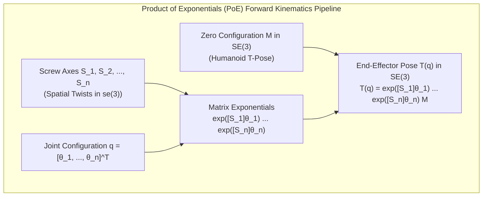

# Forward Kinematics, Screw Theory & Lie Group SE(3)

Forward Kinematics (FK) is the mapping from joint configuration space to task space `SE(3)`, determining the exact spatial position and orientation of every link in the humanoid robot. While classical robotics frequently utilized Denavit-Hartenberg (DH) conventions, modern high-DOF humanoids—such as Boston Dynamics Atlas, Unitree G1, and Tesla Optimus—rely on **Screw Theory** and the **Product of Exponentials (PoE)** formulation on the Lie Group `SE(3)`.



---

## 1. Lie Algebra so(3) and Rodrigues' Formula

The Lie Group `SO(3)` is a smooth differentiable manifold representing 3D rotations. Its tangent space at the identity element `I_{3x3}` is the Lie Algebra `so(3)`, which consists of all 3x3 skew-symmetric matrices:

```text
so(3) = { [omega] in R^{3x3} | [omega]^T = -[omega] }
```

Given an angular velocity or rotation axis `omega = [omega_1, omega_2, omega_3]^T in R^3`, the skew-symmetric matrix operator `[.] : R^3 -> so(3)` is:

```text
[omega] = [     0     -omega_3   omega_2 ]
          [  omega_3      0     -omega_1 ]
          [ -omega_2   omega_1      0    ]
```

### 1.1 The Matrix Exponential on SO(3)
The exponential map `exp : so(3) -> SO(3)` transforms an axis-angle rotation vector `omega * theta` (where `||omega_hat|| = 1`) into an orthogonal rotation matrix via the Taylor series:

```text
exp([omega_hat] * theta) = I + [omega_hat]*theta + ([omega_hat]*theta)^2 / 2! + ...
```

By leveraging the cyclic powers of skew-symmetric matrices (`[omega_hat]^3 = -[omega_hat]`), this series sums analytically to **Rodrigues' Rotation Formula**:

```text
exp([omega_hat] * theta) = I + sin(theta) * [omega_hat] + (1 - cos(theta)) * [omega_hat]^2
```

---

## 2. Screw Theory and the Lie Algebra se(3)

According to **Mozzi-Chasles' Theorem**, any rigid body displacement in 3D space can be produced by a translation along a line combined with a rotation about that same line. This motion is called a **screw motion**.

A spatial twist `V in R^6` represents instantaneous velocity:

```text
V = [ omega ] in R^6
    [   v   ]
```

where `omega in R^3` is the angular velocity, and `v in R^3` is the linear velocity of an arbitrary point on the rigid body passing through the reference frame origin.

### 2.1 The Lie Algebra se(3)
The bracket operator `[.] : R^6 -> se(3)` maps a 6D twist vector to a 4x4 matrix:

```text
[V] = [ [omega]   v ] in R^{4x4}
      [    0      0 ]
```

For a revolute joint rotating about unit axis `omega_hat` passing through point `q in R^3`, the normalized screw axis `S` is:

```text
S = [ omega_hat             ]
    [ -omega_hat (cross) q  ]
```

For a prismatic joint translating along unit direction `v_hat`:

```text
S = [   0   ]
    [ v_hat ]
```

### 2.2 Matrix Exponential on SE(3)
The exponential of a twist `[S]*theta in se(3)` yields the homogeneous transformation matrix in `SE(3)`:

```text
exp([S] * theta) = [ exp([omega_hat] * theta)   G(theta) * v ]
                   [            0                     1      ]
```

where the translational integration matrix `G(theta)` is given by:

```text
G(theta) = I * theta + (1 - cos(theta)) * [omega_hat] + (theta - sin(theta)) * [omega_hat]^2
```

---

## 3. The Product of Exponentials (PoE) Formula

Let `M in SE(3)` denote the home configuration (initial pose) of the humanoid end-effector relative to the base frame when all joint variables are zero (`theta = 0`).

### 3.1 Space Form of the PoE Formula
If all screw axes `S_1, S_2, ..., S_n` are expressed in the fixed space reference frame `s`:

```text
T(theta) = exp([S_1]*theta_1) * exp([S_2]*theta_2) * ... * exp([S_n]*theta_n) * M
```

### 3.2 Body Form of the PoE Formula
If all screw axes `B_1, B_2, ..., B_n` are expressed in the end-effector body frame `b`:

```text
T(theta) = M * exp([B_1]*theta_1) * exp([B_2]*theta_2) * ... * exp([B_n]*theta_n)
```

The space screw axes `S_i` and body screw axes `B_i` are related by the Adjoint transformation of the home configuration:

```text
S_i = [Ad_M] * B_i
```

where the Adjoint representation `[Ad_T]` of a transformation `T = [ R, p; 0, 1 ]` is the 6x6 matrix:

```text
[Ad_T] = [   R       0   ] in R^{6x6}
         [ [p]*R     R   ]
```

### 3.3 Systematic Comparison: PoE vs. Denavit-Hartenberg

| Evaluation Criterion | Denavit-Hartenberg (DH) | Product of Exponentials (PoE) |
| :--- | :--- | :--- |
| **Frame Definition** | Requires assigning a coordinate frame at every joint link | Only requires base frame `s` and end-effector frame `b` |
| **Singularities** | Singular when two consecutive joint axes become parallel | **Globally singularity-free parameterization** |
| **Geometric Intuition** | Non-intuitive parameters (`a_i, alpha_i, d_i`) prone to sign errors | Direct physical meaning: rotation axis and point on the axis |
| **Differentiation** | Complex trigonometric derivatives | Elegant Lie derivative using the Adjoint map |
| **Floating-Base Humanoids** | Awkward handling of 6-DOF floating base | **Native representation in SE(3)** |

---

## 4. Geometric vs. Analytical Jacobians

The robot Jacobian `J(theta)` relates joint velocities `dq/dt in R^n` to end-effector velocity:

```text
V = J(theta) * (dq / dt)
```

In humanoid control, distinguishing between the **Geometric Jacobian** and the **Analytical Jacobian** is vital:

```mermaid
graph TD
    JointVel["Joint Velocities: dq/dt in R^n"]
    
    GeoJ["Geometric Jacobian: J_g(q) in R^(6 x n)"]
    AnaJ["Analytical Jacobian: J_a(q) in R^(6 x n)"]
    
    SpatialTwist["Spatial / Body Twist: V = [ω; v]"]
    CoordRates["Coordinate Rates: dx/dt = [dphi/dt; dp/dt]"]
    
    JointVel -->|J_g(q)| SpatialTwist
    JointVel -->|J_a(q)| CoordRates
    SpatialTwist <-->|Representation Mapping Matrix T_A(phi)| CoordRates
```

### 4.1 The Space Jacobian
The columns of the space Jacobian correspond to the physical screw axis of joint `i` transformed into the space frame under the current robot configuration:

```text
J_s(theta) = [ S_1,  J_{s2}(theta),  ...,  J_{sn}(theta) ]

J_{si}(theta) = [Ad_{ exp([S_1]*theta_1) ... exp([S_{i-1}]*theta_{i-1}) }] * S_i
```

The geometric Jacobian maps directly to physical contact forces and moments via the principle of virtual work:

```text
tau = J^T(theta) * F_wrench
```

where `tau in R^n` are joint torques, and `F_wrench = [m^T, f^T]^T in R^6` is the spatial wrench (moment `m`, force `f`) applied at the end-effector.

---

## 5. Production Implementation: PoE Forward Kinematics & Space Jacobian

Here is a complete, standalone Python implementation of the Product of Exponentials algorithm for a 6-DOF humanoid leg (Hip Yaw, Hip Roll, Hip Pitch, Knee Pitch, Ankle Pitch, Ankle Roll):

```python
#!/usr/bin/env python3
"""
Humanoid Leg Forward Kinematics & Geometric Jacobian via Product of Exponentials (PoE)
Reference: Modern Robotics (Lynch & Park, 2017)
"""

import numpy as np
from typing import Tuple, List


def skew3(w: np.ndarray) -> np.ndarray:
    """Return 3x3 skew-symmetric matrix [w]."""
    return np.array([
        [0.0, -w[2], w[1]],
        [w[2], 0.0, -w[0]],
        [-w[1], w[0], 0.0]
    ], dtype=np.float64)


def matrix_exp3(w_hat: np.ndarray, theta: float) -> np.ndarray:
    """Compute SO(3) matrix exponential via Rodrigues' formula."""
    w_mat = skew3(w_hat)
    return np.eye(3) + np.sin(theta) * w_mat + (1.0 - np.cos(theta)) * (w_mat @ w_mat)


def matrix_exp6(S: np.ndarray, theta: float) -> np.ndarray:
    """Compute SE(3) matrix exponential for screw axis S = [w; v]."""
    w = S[:3]
    v = S[3:]

    T = np.eye(4, dtype=np.float64)
    if np.linalg.norm(w) < 1e-9:
        T[:3, 3] = v * theta
        return T

    w_hat = w / np.linalg.norm(w)
    R = matrix_exp3(w_hat, theta)
    w_mat = skew3(w_hat)
    G = np.eye(3) * theta + (1.0 - np.cos(theta)) * w_mat + (theta - np.sin(theta)) * (w_mat @ w_mat)
    
    T[:3, :3] = R
    T[:3, 3] = G @ (v / np.linalg.norm(w))
    return T


def adjoint_transform(T: np.ndarray) -> np.ndarray:
    """Compute the 6x6 Adjoint matrix [Ad_T] of a 4x4 homogeneous transformation T."""
    R = T[:3, :3]
    p = T[:3, 3]
    p_skew = skew3(p)

    Ad = np.zeros((6, 6), dtype=np.float64)
    Ad[:3, :3] = R
    Ad[3:, :3] = p_skew @ R
    Ad[3:, 3:] = R
    return Ad


class HumanoidLegPoE:
    """
    6-DOF Humanoid Leg Kinematic Chain:
    J1: Hip Yaw   (Axis: Z-up)
    J2: Hip Roll  (Axis: X-forward)
    J3: Hip Pitch (Axis: Y-left)
    J4: Knee Pitch (Axis: Y-left)
    J5: Ankle Pitch (Axis: Y-left)
    J6: Ankle Roll (Axis: X-forward)
    """

    def __init__(self, thigh_len: float = 0.40, calf_len: float = 0.40, foot_h: float = 0.08):
        self.L1 = thigh_len
        self.L2 = calf_len
        self.L3 = foot_h

        # Home configuration M (foot frame pose relative to hip base when q = 0)
        self.M = np.array([
            [1.0, 0.0, 0.0, 0.0],
            [0.0, 1.0, 0.0, 0.0],
            [0.0, 0.0, 1.0, -(self.L1 + self.L2 + self.L3)],
            [0.0, 0.0, 0.0, 1.0]
        ], dtype=np.float64)

        # Define screw axes in base frame: S = [w; -w x q]
        w1, q1 = np.array([0, 0, 1]), np.array([0, 0, 0])
        S1 = np.concatenate([w1, -np.cross(w1, q1)])

        w2, q2 = np.array([1, 0, 0]), np.array([0, 0, 0])
        S2 = np.concatenate([w2, -np.cross(w2, q2)])

        w3, q3 = np.array([0, 1, 0]), np.array([0, 0, 0])
        S3 = np.concatenate([w3, -np.cross(w3, q3)])

        w4, q4 = np.array([0, 1, 0]), np.array([0, 0, -self.L1])
        S4 = np.concatenate([w4, -np.cross(w4, q4)])

        w5, q5 = np.array([0, 1, 0]), np.array([0, 0, -(self.L1 + self.L2)])
        S5 = np.concatenate([w5, -np.cross(w5, q5)])

        w6, q6 = np.array([1, 0, 0]), np.array([0, 0, -(self.L1 + self.L2)])
        S6 = np.concatenate([w6, -np.cross(w6, q6)])

        self.S_list = [S1, S2, S3, S4, S5, S6]

    def forward_kinematics(self, theta: np.ndarray) -> np.ndarray:
        """Compute end-effector pose T(theta) in SE(3) using space PoE."""
        T = np.eye(4, dtype=np.float64)
        for S, q in zip(self.S_list, theta):
            T = T @ matrix_exp6(S, q)
        return T @ self.M

    def space_jacobian(self, theta: np.ndarray) -> np.ndarray:
        """Compute the 6x6 Space Geometric Jacobian J_s(theta)."""
        J_s = np.zeros((6, 6), dtype=np.float64)
        J_s[:, 0] = self.S_list[0]

        T_accum = np.eye(4, dtype=np.float64)
        for i in range(1, 6):
            T_accum = T_accum @ matrix_exp6(self.S_list[i - 1], theta[i - 1])
            Ad_T = adjoint_transform(T_accum)
            J_s[:, i] = Ad_T @ self.S_list[i]

        return J_s


if __name__ == "__main__":
    leg = HumanoidLegPoE(thigh_len=0.42, calf_len=0.42, foot_h=0.08)

    q_test = np.radians([0.0, 0.0, -20.0, 45.0, -25.0, 0.0])

    T_foot = leg.forward_kinematics(q_test)
    J_space = leg.space_jacobian(q_test)

    print("=== Humanoid Leg PoE Forward Kinematics ===")
    print(f"Foot Position [X, Y, Z]: {np.round(T_foot[:3, 3], 4)} m")
    print(f"Foot Orientation Matrix R:\n{np.round(T_foot[:3, :3], 3)}")

    print("\n=== Space Jacobian J_s(q) [6x6] ===")
    print(np.round(J_space, 3))
    print(f"Jacobian Rank: {np.linalg.matrix_rank(J_space)} (6 = Full Rank / Non-Singular)")
```

---

## 6. Summary and Architectural Takeaways

1. **Screw Theory Simplifies Humanoid Kinematics**: By parameterizing joint motions as twists in the Lie Algebra `se(3)`, the Product of Exponentials eliminates complex coordinate assignments and avoids kinematic singularities.
2. **Matrix Exponentials via Rodrigues**: Fast analytic computation of `exp([omega]*theta)` allows microsecond-level forward kinematics evaluation suitable for 1 kHz real-time control threads.
3. **Geometric Jacobians for Dynamics**: The geometric Jacobian maps directly to rigid body contact forces via the Adjoint representation, forming the cornerstone for whole-body operational space control.

---

## Further Reading & Seminal Papers

- Brockett, R. W. (1984). *Robotic manipulators and the product of exponentials formula*. Mathematical Theory of Networks and Systems, 120–129.
- Murray, R. M., Li, Z., & Sastry, S. S. (1994). *A Mathematical Introduction to Robotic Manipulation*. CRC Press.
- Featherstone, R. (2008). *Rigid Body Dynamics Algorithms*. Springer Science & Business Media.

In the next chapter, **[5-3: Inverse Kinematics & Optimization Solvers](./5-3-inverse-kinematics)**, we formulate whole-body inverse kinematics, redundancy resolution, and real-time Quadratic Programming (QP) solvers with collision avoidance.
