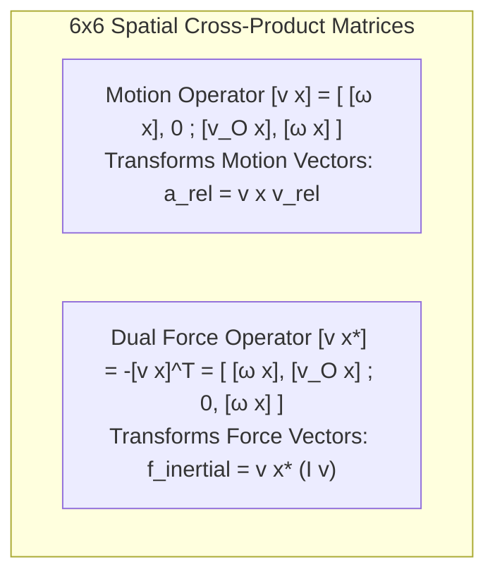

# Spatial Vector Algebra & Plücker Coordinates

In classical 3D Newtonian mechanics, calculating the kinematics and dynamics of a multi-link humanoid robot requires tracking linear velocities, angular velocities, forces, moments, centers of mass, and varying points of application separately. This separation leads to cumbersome cross-product equations and high risk of algebraic errors.

**Spatial Vector Algebra**, pioneered by Roy Featherstone, resolves this complexity by consolidating linear and rotational quantities into unified **6-dimensional spatial vectors**. By operating in dual vector spaces with Plücker coordinates, all rigid body kinematic and dynamic equations condense into compact, computationally efficient linear algebraic operations.

```mermaid
flowchart LR
    subgraph SpatialDuality["Featherstone Spatial Vector Duality"]
        direction TB
        subgraph MotionSpace["Motion Space M^6 (Twists)"]
            Vel["Spatial Velocity: v = [ω; v_O]"]
            Acc["Spatial Acceleration: a = [α; a_O]"]
            MotionCross["Cross Product: v_1 × v_2"]
        end

        subgraph ForceSpace["Force Space F^6 (Wrenches)"]
            Force["Spatial Force / Wrench: f = [n_O; f]"]
            Impulse["Spatial Momentum: h = I v = [h_O; p]"]
            ForceCross["Dual Cross Product: v ×* f"]
        end

        ScalarProduct["Scalar Product (Duality Pairing):\nMechanical Power P = f · v = n_O · ω + f · v_O"]
    end

    MotionSpace <-->|Spatial Inertia Tensor I (6x6)| ForceSpace
    MotionSpace --- ScalarProduct
    ForceSpace --- ScalarProduct
```

---

## 1. Spatial Motion Vectors in M^6

A spatial motion vector represents the instantaneous velocity or acceleration of a rigid body.

### 1.1 Spatial Velocity v in M^6
The spatial velocity combines the angular velocity `omega` of the body and the linear velocity `v_O` of a body-fixed point currently coinciding with the origin `O`:

```text
v = [ omega ] in R^6
    [  v_O  ]
```

If a point `P` is located at offset vector `r` from origin `O`, its physical linear velocity is:

```text
v_P = v_O + omega (cross) r
```

### 1.2 Spatial Acceleration a in M^6
Spatial acceleration is defined as the time derivative of spatial velocity:

```text
a = dv / dt = [ alpha ] in R^6
              [  a_O  ]
```

Importantly, `a_O` is the rate of change of the velocity of the body point passing through `O`, which differs from the acceleration of a moving particle by the centrifugal Coriolis term `omega (cross) v_O`.

---

## 2. Spatial Force Vectors in F^6

Spatial forces (also known as **wrenches**) live in the dual vector space `F^6 = (M^6)*`.

### 2.1 Spatial Force f in F^6
A spatial force encapsulates the total moment `n_O` about the coordinate origin `O` and the net linear force `f`:

```text
f = [ n_O ] in R^6
    [  f  ]
```

If the line of action of force `f` passes through point `P` at offset `r`, the resulting moment about origin `O` is:

```text
n_O = r (cross) f
```

### 2.2 The Scalar Product and Mechanical Power
The inner product between a force `f in F^6` and a velocity `v in M^6` produces a coordinate-independent scalar representing instantaneous mechanical power `P`:

```text
P = f . v = f^T * v = n_O . omega + f . v_O    [Watts]
```

---

## 3. Spatial Cross-Product Operators

In 3D vector space, velocity and force transformations rely on the cross product `a (cross) b`. In spatial vector algebra, there are two distinct cross-product operators: one for motion vectors (`cross`), and one for force vectors (`cross*`).



### 3.1 Spatial Motion Cross Product (cross)
Given `v1 = [omega1^T, v_O1^T]^T` and `v2 = [omega2^T, v_O2^T]^T`:

```text
v1 (cross) v2 = [ omega1 (cross) omega2                        ]
                [ omega1 (cross) v_O2 + v_O1 (cross) omega2    ]
```

In matrix form, `[v cross]` is the 6x6 matrix:

```text
[v cross] = [ [omega cross]         0       ] in R^{6x6}
            [ [v_O cross]     [omega cross] ]
```

### 3.2 Dual Spatial Force Cross Product (cross*)
Because force space is the dual of motion space, the force cross-product operator satisfies the identity `(v (cross) m) . f = m . (v (cross*) f)`. Consequently:

```text
[v cross*] = -[v cross]^T = [ [omega cross]   [v_O cross]   ] in R^{6x6}
                            [       0        [omega cross]  ]
```

Explicitly:

```text
v (cross*) f = [ omega (cross) n_O + v_O (cross) f ]
               [ omega (cross) f                   ]
```

---

## 4. The 6D Spatial Inertia Tensor

The spatial inertia tensor `I in R^{6x6}` maps a spatial motion acceleration to a spatial inertial wrench:

```text
f = I * a + v (cross*) (I * v)
```

For a rigid body of mass `m`, with center of mass at vector offset `c in R^3` from origin `O`, and rotational inertia tensor `I_cm` about the center of mass:

```text
I = [ I_cm + m * [c][c]^T    m * [c]   ] = [   I_O       m * [c]   ] in R^{6x6}
    [    m * [c]^T           m * I     ]   [ -m * [c]     m * I    ]
```

Notice that the spatial inertia tensor is **symmetric** (`I = I^T`) and **positive-definite** (`v^T * I * v > 0` for all non-zero `v`), directly encoding both the parallel axis theorem and linear momentum coupling.

---

## 5. Plücker Coordinate Transformations

Let coordinate frame `B` be related to frame `A` by rotation matrix `R in SO(3)` and origin displacement `p in R^3`.

### 5.1 Motion Transformation Matrix ^B X_A
To transform a spatial motion vector (velocity or acceleration) from frame `A` to frame `B`:

```text
^B v = (^B X_A) * (^A v)

where:
^B X_A = [   R        0   ] = [   I     0 ] [ R   0 ]
         [ -R*[p]     R   ]   [ -[R*p]  I ] [ 0   R ]
```

### 5.2 Force Transformation Matrix (^B X_A)*
Forces transform according to the inverse transpose:

```text
^B f = (^B X_A)* * (^A f) = (^B X_A)^{-T} * (^A f)

(^B X_A)* = [   R     -R*[p] ]
            [   0        R   ]
```

This guarantees that power is frame-invariant:

```text
(^B f) . (^B v) = (^A f) . (^A v)
```

---

## 6. Production Implementation: 6D Spatial Algebra Class in Python

The following Python class implements Featherstone's spatial motion and force vectors, cross-products, spatial inertias, and Plücker transformations:

```python
#!/usr/bin/env python3
"""
Featherstone 6D Spatial Vector Algebra Engine
Reference: Roy Featherstone, Rigid Body Dynamics Algorithms (2008)
"""

import numpy as np


def skew(v: np.ndarray) -> np.ndarray:
    """Return 3x3 skew-symmetric matrix [v×]."""
    return np.array([
        [0.0, -v[2], v[1]],
        [v[2], 0.0, -v[0]],
        [-v[1], v[0], 0.0]
    ], dtype=np.float64)


def spatial_motion_cross(v: np.ndarray) -> np.ndarray:
    """Compute 6x6 spatial motion cross-product matrix [v×]."""
    w = v[:3]
    v_O = v[3:]
    w_skew = skew(w)
    v_skew = skew(v_O)

    X = np.zeros((6, 6), dtype=np.float64)
    X[:3, :3] = w_skew
    X[3:, :3] = v_skew
    X[3:, 3:] = w_skew
    return X


def spatial_force_cross(v: np.ndarray) -> np.ndarray:
    """Compute 6x6 spatial force dual cross-product matrix [v×*] = -[v×]^T."""
    return -spatial_motion_cross(v).T


def spatial_inertia(mass: float, com: np.ndarray, I_com: np.ndarray) -> np.ndarray:
    """Construct 6x6 spatial inertia tensor."""
    c_skew = skew(com)
    I_O = I_com - mass * (c_skew @ c_skew)

    I_sp = np.zeros((6, 6), dtype=np.float64)
    I_sp[:3, :3] = I_O
    I_sp[:3, 3:] = mass * c_skew
    I_sp[3:, :3] = -mass * c_skew
    I_sp[3:, 3:] = mass * np.eye(3)
    return I_sp


def plucker_motion_transform(R: np.ndarray, p: np.ndarray) -> np.ndarray:
    """Construct 6x6 Plücker motion transform matrix ^B X_A."""
    X = np.zeros((6, 6), dtype=np.float64)
    X[:3, :3] = R
    X[3:, :3] = -R @ skew(p)
    X[3:, 3:] = R
    return X


if __name__ == "__main__":
    link_mass = 5.0
    com_offset = np.array([0.0, 0.0, -0.20])
    I_thigh_com = np.diag([0.06, 0.06, 0.01])

    I_spatial = spatial_inertia(link_mass, com_offset, I_thigh_com)
    print("=== 6x6 Spatial Inertia Tensor I_link ===")
    print(np.round(I_spatial, 4))

    v_link = np.array([0.0, 2.0, 0.0, 0.5, 0.0, 0.0])

    h_link = I_spatial @ v_link
    print(f"\nSpatial Velocity v: {v_link}")
    print(f"Spatial Momentum h = [n_O; p]: {np.round(h_link, 4)}")

    cross_star = spatial_force_cross(v_link)
    f_bias = cross_star @ h_link
    print(f"Centrifugal/Coriolis Wrench v ×* (I v): {np.round(f_bias, 4)}")

    R_knee = np.eye(3)
    p_knee = np.array([0.0, 0.0, -0.40])
    X_knee_hip = plucker_motion_transform(R_knee, p_knee)

    v_knee = X_knee_hip @ v_link
    print(f"\nSpatial Velocity Transformed to Knee Frame: {np.round(v_knee, 4)}")

    f_knee_ext = np.array([10.0, 0.0, 0.0, 0.0, 0.0, 50.0])
    f_hip_ext = X_knee_hip.T @ f_knee_ext

    power_knee = np.dot(f_knee_ext, v_knee)
    power_hip = np.dot(f_hip_ext, v_link)
    print(f"\nPower at Knee: {power_knee:.6f} W | Power at Hip: {power_hip:.6f} W (Identical!)")
```

---

## 7. Summary and Architectural Takeaways

1. **Unified Mechanics**: Spatial vector algebra reduces messy 3D vector equations into clean, coordinate-free linear transformations in 6D.
2. **Dual Spaces**: Motion vectors live in `M^6` and force vectors live in `F^6`; their pairing directly yields frame-invariant mechanical power.
3. **Foundation of Pinocchio and Drake**: High-performance robotics engines (`pinocchio`, `drake`, `bullet`) use spatial vector algebra internally for all recursive dynamics passes.

---

## Further Reading & Seminal Papers

- Featherstone, R. (2010). *A beginner's guide to 6-D vectors (spatial vectors) in robotics*. IEEE Robotics & Automation Magazine, 17(3), 88–99.
- Ball, R. S. (1900). *A Treatise on the Theory of Screws*. Cambridge University Press.
- Duindam, V., et al. (2009). *Modeling and Control of Complex Physical Systems*. Springer Science & Business Media.

In the next chapter, **[5-6: Floating-Base Modeling & Anthropometry](./5-6-humanoid-skeleton-modeling)**, we apply spatial vectors to floating-base humanoid skeletons, formulating unactuated 6-DOF dynamics, contact Jacobians, and operational space equations.
