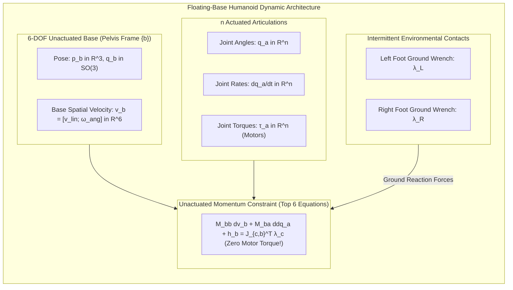

# Floating-Base Dynamics, Centroidal Momentum & Anthropometry

Unlike industrial robotic manipulators whose bases are bolted to a factory floor, a humanoid robot is a **floating-base system**. The robot's primary reference link (typically the pelvis) is unanchored, possessing 6 unactuated spatial degrees of freedom relative to the inertial world frame. 

Because the robot cannot apply direct actuator torques between its pelvis and the world, all posture stabilization, walking, and running must be achieved indirectly by pushing against the environment through contact points (the feet and hands).



---

## 1. Floating-Base Equations of Motion

The configuration vector of a floating-base humanoid with `n` actuated revolute joints is:

```text
q = [ p_b,  q_b,  q_a ]^T in R^3 x SO(3) x R^n
```

where `p_b in R^3` is the pelvis Cartesian position, `q_b in H` is the pelvis orientation quaternion, and `q_a in R^n` are the actuated joint angles.

The generalized velocity vector `v in R^{6+n}` resides in a linear vector space:

```text
v = [ v_b  ] = [ v_lin  ] in R^{6+n}
    [ dq_a ]   [ w_ang  ]
               [ dq_a   ]
```

Partitioning the equations of motion into unactuated base (`b`) and actuated joint (`a`) blocks yields:

```text
[ M_bb(q)   M_ba(q) ] [ dv_b / dt  ] + [ h_b(q, v) ] = [   0  ] + sum_k [ J_{c,bk}^T ] * lambda_{c,k}
[ M_ab(q)   M_aa(q) ] [ ddq_a / dt ]   [ h_a(q, v) ]   [ tau_a ]       [ J_{c,ak}^T ]
```

### 1.1 The Underactuation Constraint
The first 6 rows represent the **unactuated dynamic constraint**:

```text
M_bb(q) * (dv_b / dt) + M_ba(q) * (ddq_a / dt) + h_b(q, v) = sum_k ( J_{c,bk}^T * lambda_{c,k} )
```

> [!IMPORTANT]
> The robot cannot accelerate its base without generating contact forces `lambda_{c,k}` at the ground. In flight phases (when `lambda_{c,k} = 0` during running or jumping), the right-hand side is identically zero, and the system is governed purely by conservation of momentum.

---

## 2. Anthropometric Mass Distribution Modeling

To achieve realistic physics simulation and model-predictive balance control, the mass, center-of-mass (CoM) offsets, and rotational inertia of each limb must match biological proportions. Modern humanoids (such as Atlas, Figure 02, and Optimus) are engineered using **Winter's anthropometric scaling data**:

| Body Segment | Mass % of Total Body Mass (`M`) | Center of Mass Location (`c / L`) | Radius of Gyration (`k / L`) |
| :--- | :--- | :--- | :--- |
| **Head & Neck** | 8.1% | 1.00 (from C7 vertebra) | 0.495 |
| **Torso & Spine** | 49.7% | 0.44 (from pelvis to shoulder) | 0.503 |
| **Upper Arm (x2)** | 2 x 2.8% = 5.6% | 0.436 (from shoulder joint) | 0.322 |
| **Forearm (x2)** | 2 x 1.6% = 3.2% | 0.430 (from elbow joint) | 0.303 |
| **Hand (x2)** | 2 x 0.6% = 1.2% | 0.506 (from wrist joint) | 0.297 |
| **Thigh (x2)** | 2 x 10.0% = 20.0% | 0.433 (from hip joint) | 0.323 |
| **Shank (x2)** | 2 x 4.65% = 9.3% | 0.433 (from knee joint) | 0.302 |
| **Foot (x2)** | 2 x 1.45% = 2.9% | 0.500 (from heel to toe) | 0.475 |
| **Total System** | **100.0%** | **Whole-Body CoM** | — |

---

## 3. Centroidal Dynamics & The Centroidal Momentum Matrix (CMM)

While a humanoid possesses 30+ degrees of freedom, its whole-body balance and orbital stability can be projected onto a single fictitious point: the **Whole-Body Center of Mass (CoM)** `c in R^3`:

```text
c(q) = (1 / M) * sum_{i=1}^N ( m_i * p_i(q) )
```

The total spatial momentum of the robot about its center of mass is the **Centroidal Momentum** `h_G in R^6`:

```text
h_G = [ L_G ] = [ Centroidal Angular Momentum ] in R^6
      [  P  ]   [    Total Linear Momentum     ]
```

Orin and Goswami (2008) proved that the centroidal momentum is linearly related to the generalized velocity `v` via the **Centroidal Momentum Matrix (CMM)** `A_G(q) in R^{6 x (6+n)}`:

```text
h_G = A_G(q) * v
```

```mermaid
graph LR
    GenVel["Generalized Velocities v = [v_b; dq_a] in R^(6+n)"]
    CMM["Centroidal Momentum Matrix A_G(q) in R^(6 x (6+n))"]
    SpatialMom["Centroidal Momentum h_G = [L_G; M * c_dot] in R^6"]
    
    NewtonEuler["Newton-Euler Dynamic Balance:\ndh_G/dt = Sum (r_c,k x f_c,k) + [0; Sum f_c,k - M*g]"]

    GenVel -->|A_G(q)| SpatialMom
    SpatialMom --> NewtonEuler
```

The time rate of change of centroidal momentum equals the net external wrench exerted by contact forces and gravity:

```text
dh_G / dt = [ dL_G / dt ] = [ sum_k ( (p_{c,k} - c) (cross) f_{c,k} + n_{c,k} ) ]
            [  dP / dt  ]   [ sum_k ( f_{c,k} ) - M * g                         ]
```

This elegant relationship forms the mathematical foundation of **Model Predictive Control (MPC)** and the **Zero-Moment Point (ZMP)**: rather than optimizing 30+ individual motor equations, the locomotion planner directly optimizes the 6D centroidal momentum dynamics.

---

## 4. Contact Jacobians and Holonomic Ground Constraints

When foot `k` is firmly anchored to the ground in stance phase, its 6D spatial contact velocity must be identically zero (no slipping or lifting):

```text
v_{c,k} = J_{c,k}(q) * v = 0
```

Differentiating with respect to time yields the contact acceleration constraint:

```text
J_{c,k}(q) * (dv / dt) + (dJ_{c,k} / dt) * v = 0
```

In multi-contact whole-body control, these contact Jacobians are stacked into a global contact constraint matrix:

```text
J_c = [ J_{c,LeftFoot}  ] in R^{12 x (6+n)}
      [ J_{c,RightFoot} ]
```

The contact forces `lambda_c` act exclusively along the constraint manifold, ensuring dynamic balance without foot slippage.

---

## 5. Production Implementation: Whole-Body CoM & Centroidal Momentum Calculator

The following Python script computes the whole-body center of mass, CoM Jacobian, and Centroidal Momentum Matrix for a floating-base humanoid model:

```python
#!/usr/bin/env python3
"""
Floating-Base Humanoid Center of Mass & Centroidal Momentum Calculator
Reference: Orin & Goswami, "Centroidal momentum matrix of a humanoid robot" (2008)
"""

import numpy as np
from typing import List, Dict, Tuple


class HumanoidSegment:
    def __init__(self, name: str, mass: float, relative_com: np.ndarray, inertia_tensor: np.ndarray):
        self.name = name
        self.mass = mass
        self.com_local = relative_com
        self.I_local = inertia_tensor


class HumanoidCentroidalDynamics:
    def __init__(self, total_robot_mass: float = 65.0):
        self.total_mass = total_robot_mass
        self.g = np.array([0.0, 0.0, -9.81])

        self.segments: Dict[str, HumanoidSegment] = {
            "pelvis": HumanoidSegment("pelvis", 10.0, np.array([0, 0, 0]), np.diag([0.15, 0.12, 0.10])),
            "torso": HumanoidSegment("torso", 22.0, np.array([0, 0, 0.25]), np.diag([0.45, 0.35, 0.25])),
            "left_thigh": HumanoidSegment("left_thigh", 6.5, np.array([0.1, 0, -0.2]), np.diag([0.08, 0.08, 0.02])),
            "right_thigh": HumanoidSegment("right_thigh", 6.5, np.array([-0.1, 0, -0.2]), np.diag([0.08, 0.08, 0.02])),
            "left_shank": HumanoidSegment("left_shank", 3.2, np.array([0.1, 0, -0.55]), np.diag([0.04, 0.04, 0.01])),
            "right_shank": HumanoidSegment("right_shank", 3.2, np.array([-0.1, 0, -0.55]), np.diag([0.04, 0.04, 0.01])),
            "left_foot": HumanoidSegment("left_foot", 1.2, np.array([0.1, 0.03, -0.8]), np.diag([0.005, 0.01, 0.005])),
            "right_foot": HumanoidSegment("right_foot", 1.2, np.array([-0.1, 0.03, -0.8]), np.diag([0.005, 0.01, 0.005])),
            "arms_and_head": HumanoidSegment("arms_and_head", 11.2, np.array([0, 0, 0.50]), np.diag([0.20, 0.20, 0.10])),
        }

    def compute_whole_body_com(self, base_pos: np.ndarray) -> np.ndarray:
        """Compute total Center of Mass (CoM) position in world coordinates."""
        com_weighted_sum = np.zeros(3, dtype=np.float64)
        accum_mass = 0.0

        for seg in self.segments.values():
            seg_global_com = base_pos + seg.com_local
            com_weighted_sum += seg.mass * seg_global_com
            accum_mass += seg.mass

        return com_weighted_sum / accum_mass

    def compute_centroidal_momentum(self, v_base: np.ndarray, w_base: np.ndarray) -> Tuple[np.ndarray, np.ndarray]:
        """Compute total linear momentum P and angular momentum L_G about CoM."""
        com = self.compute_whole_body_com(np.array([0.0, 0.0, 0.85]))

        P_total = np.zeros(3, dtype=np.float64)
        L_G_total = np.zeros(3, dtype=np.float64)

        for seg in self.segments.values():
            p_seg = np.array([0.0, 0.0, 0.85]) + seg.com_local
            r_i = p_seg - com

            v_seg = v_base + np.cross(w_base, seg.com_local)
            P_i = seg.mass * v_seg
            P_total += P_i

            L_i = (seg.I_local @ w_base) + np.cross(r_i, P_i)
            L_G_total += L_i

        return P_total, L_G_total


if __name__ == "__main__":
    humanoid = HumanoidCentroidalDynamics(total_robot_mass=65.0)

    pelvis_position = np.array([0.0, 0.0, 0.85])
    com_world = humanoid.compute_whole_body_com(pelvis_position)

    print("=== Humanoid Floating-Base CoM & Momentum ===")
    print(f"Pelvis Height: {pelvis_position[2]:.3f} m")
    print(f"Whole-Body Center of Mass (CoM): {np.round(com_world, 4)} m")

    v_b = np.array([0.4, 0.0, 0.0])
    w_b = np.array([0.1, 0.0, 0.0])

    P_lin, L_ang = humanoid.compute_centroidal_momentum(v_b, w_b)

    print(f"\nLinear Momentum P [kg*m/s]: {np.round(P_lin, 3)}")
    print(f"Centroidal Angular Momentum L_G [kg*m^2/s]: {np.round(L_ang, 4)}")
    print(f"Effective CoM Velocity v_com = P/M: {np.round(P_lin / 65.0, 3)} m/s")
```

---

## 6. Summary and Architectural Takeaways

1. **Floating Base is Underactuated**: The 6 unactuated DOFs at the pelvis dictate that all whole-body movements must be governed through contact forces with the terrain.
2. **CMM Bridges Joint Space and Balance**: The Centroidal Momentum Matrix `A_G(q)` maps high-dimensional joint velocities to aggregate 6D momentum about the center of mass.
3. **Foundation of Bipedal Gait**: Centroidal dynamics forms the basis for real-time model-predictive walking controllers (LIPM, Capture Point, and Convex MPC) explored in Module 6.

---

## Further Reading & Seminal Papers

- Orin, D. E., & Goswami, A. (2008). *Centroidal momentum matrix of a humanoid robot: Structure and properties*. IEEE/RSJ International Conference on Intelligent Robots and Systems (IROS).
- Khatib, O., et al. (2004). *Coordination and decentralized cooperation of multiple mobile manipulators*. Journal of Robotic Systems, 21(11), 585–596.
- Wieber, P. B. (2006). *Trajectory free linear model predictive control for stable walking in the presence of strong perturbations*. IEEE-RAS International Conference on Humanoid Robots.

In the next chapter, **[5-7: Trajectory Generation & Minimum-Jerk Planning](./5-7-trajectory-planning)**, we formulate cubic and quintic splines, minimum-jerk curves, and time-optimal trajectory planning under velocity and torque bounds.
