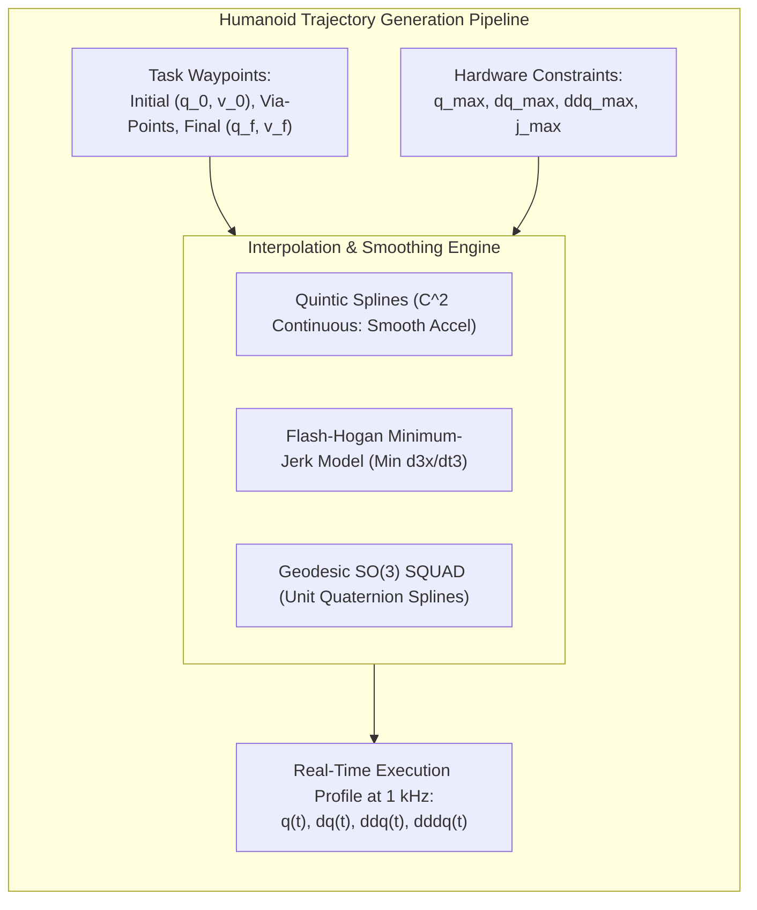
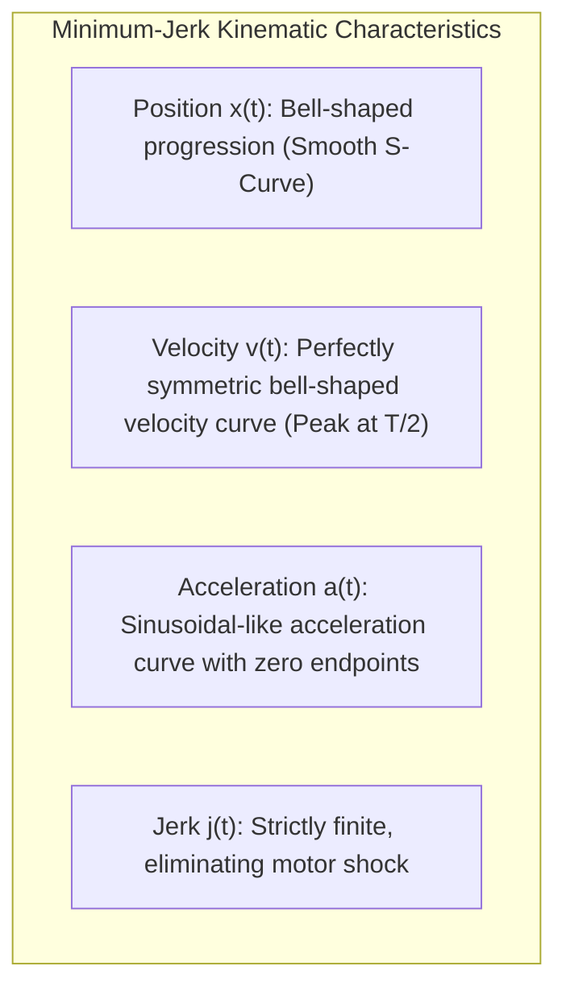
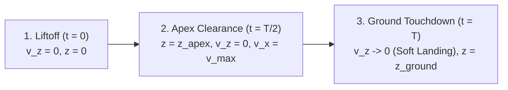

# Trajectory Generation, Minimum-Jerk Profiles & Splines

In humanoid robotics, executing rough, discontinuous, or high-jerk joint trajectories leads to catastrophic consequences: severe actuator gearbox fatigue, motor current saturation, destructive structural vibration, and immediate loss of bipedal balance. 

**Trajectory generation** transforms geometric paths into continuous, time-parameterized trajectories `q(t), dq(t), ddq(t), dddq(t)` that strictly respect actuator kinematics, current thresholds, ground impact constraints, and dynamic feasibility.



---

## 1. Path vs. Trajectory: Fundamental Distinctions

- **Path `s(sigma)`**: A pure geometric curve in configuration space or task space `SE(3)`, parameterized by a scalar arc length `sigma in [0, 1]`, with no concept of time or velocity.
- **Trajectory `q(t)`**: A time-parameterized path where each state is explicitly associated with an instant in time `t in [0, T]`, yielding well-defined velocity `dq(t)/dt`, acceleration `ddq(t)/dt^2`, and jerk `dddq(t)/dt^3`.

### 1.1 Continuity Classes for Humanoid Control
- **C^0 Continuous**: Position is continuous, but velocity is discontinuous. *Unacceptable: generates infinite acceleration impulses.*
- **C^1 Continuous**: Position and velocity are continuous; acceleration has step jumps. *Acceptable for slow positioning, but creates acoustic chatter and vibration in high-gain controllers.*
- **C^2 Continuous (Standard)**: Position, velocity, and acceleration are continuous; jerk is finite and bounded. *The minimum standard for humanoid bipedal swing legs and dexterous manipulation.*
- **C^3 Continuous (Minimum Jerk)**: Jerk is smooth and continuous. *Required for high-speed dynamic balancing, jumping, and compliant physical human-robot interaction.*

---

## 2. Polynomial Spline Interpolation

### 2.1 Cubic Spline (C^1 Continuity)
A third-order polynomial segment connecting `(q_0, v_0)` at `t = 0` to `(q_f, v_f)` at `t = T`:

```text
q(t) = a_0 + a_1 * t + a_2 * t^2 + a_3 * t^3
```

Matching boundary conditions yields:

```text
[ a_0 ]   [     1          0           0          0     ] [ q_0 ]
[ a_1 ] = [     0          1           0          0     ] [ v_0 ]
[ a_2 ]   [ -3 / T^2    -2 / T      3 / T^2    -1 / T   ] [ q_f ]
[ a_3 ]   [  2 / T^3     1 / T^2   -2 / T^3     1 / T^2 ] [ v_f ]
```

Because acceleration varies linearly, acceleration jumps instantaneously at the start and end of motion.

### 2.2 Quintic Spline (C^2 Continuity)
To guarantee zero or smooth acceleration at both boundaries, we employ a fifth-order polynomial:

```text
q(t) = a_0 + a_1 * t + a_2 * t^2 + a_3 * t^3 + a_4 * t^4 + a_5 * t^5
```

Normalized by `s = t / T in [0, 1]`, the quintic interpolation law with rest-to-rest boundary conditions becomes:

```text
q(s) = q_0 + (q_f - q_0) * ( 10 * s^3 - 15 * s^4 + 6 * s^5 )
```

---

## 3. Flash & Hogan's Minimum-Jerk Principle

In seminal biomechanical studies, Flash and Hogan (1985) discovered that human multi-joint arm reaches instinctively optimize the integral of squared jerk:

```text
minimize J = 0.5 * integral_0^T || d3x / dt3 ||^2 dt
```

By calculus of variations, Euler-Lagrange optimization yields the sixth-order differential equation `d6x / dt6 = 0`, whose unique closed-form solution is precisely the **quintic polynomial**:

```text
x(t) = x_0 + (x_f - x_0) * [ 10*(t/T)^3 - 15*(t/T)^4 + 6*(t/T)^5 ]
```



The peak velocity and peak acceleration under minimum-jerk planning are analytically bounded by:

```text
v_max = (15 / 8) * ( ||x_f - x_0|| / T ) = 1.875 * v_avg

a_max = (10 / sqrt(3)) * ( ||x_f - x_0|| / T^2 ) approx 5.77 * ( ||x_f - x_0|| / T^2 )
```

---

## 4. Bipedal Swing-Leg Trajectory Generation

During humanoid locomotion, the swing leg must detach smoothly from the ground, lift upward to avoid ground obstacles, swing forward, and decelerate to touch down with **near-zero vertical velocity** to prevent destructive foot impact.



### 4.1 3D Foot Trajectory Parameterization
- **Sagittal Axis (X)**: Moves from initial stance position `x_0` to target footstep `x_f` using a minimum-jerk profile:
```text
x(s) = x_0 + (x_f - x_0) * ( 10*s^3 - 15*s^4 + 6*s^5 )
```
- **Lateral Axis (Y)**: Follows the lateral footstep coordinate `y(s)` with a minimum-jerk curve.
- **Vertical Axis (Z)**: Uses a cycloidal trajectory that reaches apex clearance `h_step` at mid-swing (`s = 0.5`):
```text
z(s) = z_0 + h_step * sin^2(pi * s)
```

Differentiating vertical position `z(s)` yields:

```text
dz / dt = (pi * h_step / T) * sin(2 * pi * s)
```

Notice that at liftoff (`s = 0`) and touchdown (`s = 1`):

```text
dz/dt(0) = 0,    dz/dt(1) = 0
```

This guarantees a **zero-impact soft touchdown**, preventing the state estimator from being corrupted by high-frequency accelerometer shocks.

---

## 5. Production Implementation: 3D Swing-Foot Trajectory Generator

The following Python class generates real-time, jerk-bounded 3D swing-leg trajectories for humanoid locomotion:

```python
#!/usr/bin/env python3
"""
Humanoid Bipedal Swing-Leg Trajectory Generator
Features: Minimum-Jerk Sagittal Translation + Cycloidal Vertical Clearance + Soft Touchdown
"""

import numpy as np
from typing import Tuple, Dict


class HumanoidSwingLegPlanner:
    def __init__(self, step_duration: float = 0.40, apex_clearance: float = 0.06):
        self.T = step_duration
        self.h_clearance = apex_clearance

    def evaluate(self, p_start: np.ndarray, p_goal: np.ndarray, t: float) -> Tuple[np.ndarray, np.ndarray, np.ndarray]:
        tau = np.clip(t / self.T, 0.0, 1.0)

        # 1. Minimum-Jerk Polynomial for Horizontal Motion (X and Y)
        s = 10 * (tau ** 3) - 15 * (tau ** 4) + 6 * (tau ** 5)
        ds = (30 * (tau ** 2) - 60 * (tau ** 3) + 30 * (tau ** 4)) / self.T
        dds = (60 * tau - 180 * (tau ** 2) + 120 * (tau ** 3)) / (self.T ** 2)

        p_xy = p_start[:2] + (p_goal[:2] - p_start[:2]) * s
        v_xy = (p_goal[:2] - p_start[:2]) * ds
        a_xy = (p_goal[:2] - p_start[:2]) * dds

        # 2. Cycloidal Profile for Vertical Motion (Z-axis)
        z_base = p_start[2] + (p_goal[2] - p_start[2]) * s
        z_clearance = self.h_clearance * (np.sin(np.pi * tau) ** 2)
        p_z = z_base + z_clearance

        dz_base = (p_goal[2] - p_start[2]) * ds
        dz_clearance = (self.h_clearance * np.pi / self.T) * np.sin(2.0 * np.pi * tau)
        v_z = dz_base + dz_clearance

        ddz_base = (p_goal[2] - p_start[2]) * dds
        ddz_clearance = (2.0 * self.h_clearance * (np.pi ** 2) / (self.T ** 2)) * np.cos(2.0 * np.pi * tau)
        a_z = ddz_base + ddz_clearance

        pos = np.array([p_xy[0], p_xy[1], p_z], dtype=np.float64)
        vel = np.array([v_xy[0], v_xy[1], v_z], dtype=np.float64)
        acc = np.array([a_xy[0], a_xy[1], a_z], dtype=np.float64)

        return pos, vel, acc


if __name__ == "__main__":
    planner = HumanoidSwingLegPlanner(step_duration=0.40, apex_clearance=0.06)

    foot_init = np.array([0.00, 0.10, 0.00])
    foot_target = np.array([0.30, 0.10, 0.00])

    print("=== Humanoid Bipedal Swing-Foot Trajectory Test ===")
    print(f"Swing Duration: {planner.T} s | Apex Ground Clearance: {planner.h_clearance * 100:.1f} cm")
    print("Time (s) | Pos X (m) | Pos Z (m) | Vel X (m/s) | Vel Z (m/s) | Acc Z (m/s^2)")
    print("-" * 75)

    sample_times = np.linspace(0.0, planner.T, 9)
    for t_cur in sample_times:
        p, v, a = planner.evaluate(foot_init, foot_target, t_cur)
        print(f" {t_cur:5.3f}   |   {p[0]:5.3f}   |   {p[2]:5.3f}   |   {v[0]:6.3f}    |   {v[2]:6.3f}    |   {a[2]:7.3f}")

    _, v_final, _ = planner.evaluate(foot_init, foot_target, planner.T)
    print(f"\nFinal Touchdown Velocity (Target = 0.0 m/s): {np.round(v_final, 6)} m/s")
```

---

## 6. Summary and Architectural Takeaways

1. **Jerk Minimization is Mandatory**: Bounded jerk prevents gearbox wear, structural excitation, and tipping perturbations during fast walking and dynamic manipulation.
2. **Quintic Splines for Smooth Control**: Quintic polynomials satisfy C^2 continuity, ensuring continuous joint accelerations that directly map to feasible motor torque requests.
3. **Soft Touchdown Dynamics**: Cycloidal vertical clearance profiles eliminate ground contact shocks, enabling stable state estimation and continuous ground-reaction force transfer.

---

## Further Reading & Seminal Papers

- Flash, T., & Hogan, N. (1985). *The coordination of arm movements: an experimentally confirmed mathematical model*. Journal of Neuroscience, 5(7), 1688–1703.
- Biagiotti, L., & Melchiorri, C. (2008). *Trajectory Planning for Automatic Machines and Robots*. Springer Science & Business Media.
- Kajita, S., et al. (2003). *Biped walking pattern generation by using preview control of zero-moment point*. IEEE ICRA.

In the next chapter, **[5-8: Differential Kinematics, Manipulability & Singularities](./5-8-differential-kinematics)**, we analyze velocity kinematics, Singular Value Decomposition (SVD), Yoshikawa's manipulability ellipsoids, and kinematic calibration.
