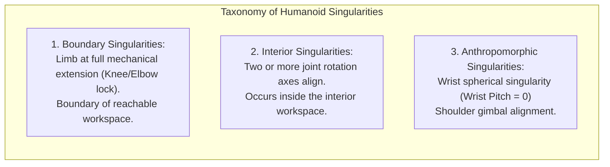
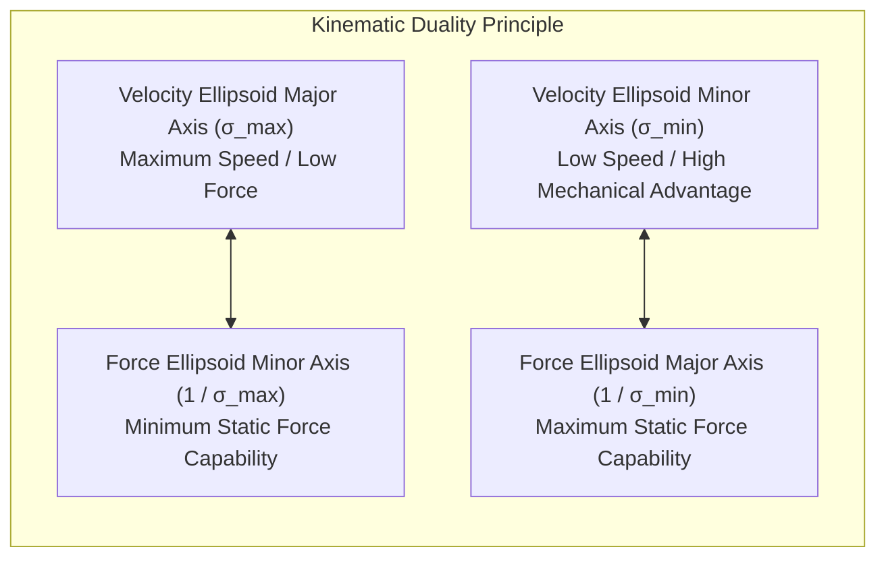

# Differential Kinematics, Manipulability & Singularities

Differential kinematics formalizes the first-order differential mapping between joint velocity space `dq in R^n` and end-effector operational velocity space `R^6` through the manipulator Jacobian `J(q)`. 

For a high-DOF humanoid robot, understanding differential kinematics is critical for:
1. Detecting and evading **kinematic singularities** where control authority is lost and mathematical inversions blow up.
2. Quantifying directional dexterity using **Yoshikawa's manipulability ellipsoids**.
3. Exploiting the **duality between velocity and force transmission** during heavy object lifting and precision manipulation.
4. Performing **kinematic calibration** to correct manufacturing tolerances and joint encoder zero-offsets.

```mermaid
flowchart TD
    subgraph DifferentialKinematics["Differential Kinematics & Singular Value Decomposition"]
        direction TB
        JointVelocity["Joint Velocity: dq in R^n"]
        JacobianMap["Manipulator Jacobian: J(q) in R^(6 x n)"]
        TaskVelocity["End-Effector Spatial Twist: V in R^6"]

        subgraph SVDDecomposition["Singular Value Decomposition (SVD): J = U Σ V^T"]
            U_Matrix["U Matrix: Task-Space Principal Directions (u_1, ..., u_6)"]
            Sigma_Matrix["Σ Matrix: Singular Values (σ_1 ≥ σ_2 ≥ ... ≥ σ_6 ≥ 0)"]
            V_Matrix["V Matrix: Joint-Space Principal Directions (v_1, ..., v_n)"]
        end

        subgraph Metrics["Performance & Dexterity Indices"]
            Manipulability["Yoshikawa Measure: w(q) = sqrt(det(J J^T)) = Π σ_i"]
            ConditionNumber["Condition Number: κ(J) = σ_max / σ_min ≥ 1"]
            EllipsoidVolume["Manipulability Ellipsoid Volume in R^6"]
        end
    end

    JointVelocity -->|J(q)| TaskVelocity
    JacobianMap --> SVDDecomposition
    SVDDecomposition --> Metrics
```

---

## 1. Kinematic Singularities: Taxonomy and Physical Manifestation

A configuration `q*` is defined as a **kinematic singularity** if the Jacobian matrix loses rank:

```text
rank( J(q*) ) < min(m, n)
```

When a humanoid arm or leg enters a singularity:
1. **Loss of Mobility**: The robot loses the ability to move its end-effector along at least one Cartesian direction in task space.
2. **Infinite Joint Rates**: Commanding an infinitesimal task-space velocity along the lost direction produces infinite joint velocity demands (`dq = J^dagger * v -> infinity`).
3. **Loss of Controllability**: High control gains in closed-loop Cartesian controllers cause severe actuator motor saturation and explosive mechanical vibration.



### 1.1 Boundary vs. Interior Singularities
- **Boundary Singularity (Elbow/Knee Full Extension)**: Occurs when the elbow or knee joint angle reaches 0 degrees (straight arm/leg). The robot cannot move the wrist or foot radially outward; radial velocity is strictly zero.
- **Interior Singularity (Wrist Gimbal Lock)**: For a 3-axis spherical wrist (Roll-Pitch-Roll or Yaw-Pitch-Roll), when the intermediate pitch angle becomes zero, the first and third axes become collinear. One rotational degree of freedom is extinguished.

---

## 2. Singular Value Decomposition (SVD) of the Jacobian

The Singular Value Decomposition (SVD) provides the ultimate mathematical tool for analyzing the local geometry of differential kinematics:

```text
J(q) = U * Sigma * V^T = sum_{i=1}^m ( sigma_i * u_i * v_i^T )
```

where:
- `U = [u_1, ..., u_m] in R^{mxm}` is an orthogonal matrix whose columns `u_i` define the **principal axes of dexterity** in task space.
- `V = [v_1, ..., v_n] in R^{nxn}` is an orthogonal matrix whose columns `v_i` define the corresponding principal directions in joint velocity space.
- `Sigma in R^{mxn}` contains the ordered singular values: `sigma_1 >= sigma_2 >= ... >= sigma_m >= 0`.

### 2.1 Physical Interpretation of Singular Values
- If `sigma_m = 0`, the Jacobian is singular, and direction `u_m` is the exact direction of lost Cartesian mobility.
- If all `sigma_i > 0`, the smallest singular value `sigma_min` represents the **distance to the nearest singularity** in the configuration space.

---

## 3. Yoshikawa's Manipulability Measure

In 1985, Tsuneo Yoshikawa introduced the scalar **manipulability measure** `w(q)`, defined as:

```text
w(q) = sqrt( det( J(q) * J^T(q) ) )
```

Using the properties of the SVD, the product of the singular values is identically:

```text
w(q) = sigma_1 * sigma_2 * ... * sigma_m = prod_{i=1}^m ( sigma_i )
```

### 3.1 Properties of Manipulability w(q)
1. **Non-negativity**: `w(q) >= 0` everywhere in configuration space.
2. **Singularity Identification**: `w(q) = 0` if and only if `q` is a kinematic singularity.
3. **Volume Proportionality**: `w(q)` is strictly proportional to the volume of the 6D velocity manipulability ellipsoid.

### 3.2 The Condition Number and Isotropy
The **kinematic condition number** `kappa(J) in [1, infinity)` measures the uniformity of dexterity across all Cartesian directions:

```text
kappa(J) = sigma_max / sigma_min = sigma_1 / sigma_m
```

- **Isotropic Posture (`kappa = 1`)**: The manipulability ellipsoid is a perfect sphere. The robot can accelerate its end-effector with identical ease in every spatial direction.
- **Ill-Conditioned Posture (`kappa >> 1`)**: The ellipsoid is highly elongated into a thin needle. Motion along the major axis is effortless, but motion along the minor axis requires extreme joint speeds.

---

## 4. Duality: Velocity vs. Force Ellipsoids

The principle of virtual work establishes a fundamental physical duality between task-space velocities `v` and static contact wrenches `f`:

```text
tau = J^T(q) * f
```

Consider a unit sphere of allowable joint velocities `||dq|| <= 1`. Under the Jacobian mapping, this sphere transforms into the **Velocity Manipulability Ellipsoid**:

```text
E_v = { v in R^m | v^T * ( J * J^T )^{-1} * v <= 1 }
```

Conversely, a unit sphere of available joint motor torques `||tau|| <= 1` maps into the **Force Manipulability Ellipsoid**:

```text
E_f = { f in R^m | f^T * ( J * J^T ) * f <= 1 }
```



> [!TIP]
> **Biomechanical Synergy**: When a humanoid lifts a heavy payload (e.g., squatting or opening a stiff door), it should configure its limbs near full extension (low velocity manipulability, high mechanical advantage), allowing tiny motor torques to sustain massive contact forces without motor overheating.

---

## 5. Kinematic Calibration

Nominal CAD models and URDF files assume ideal link lengths and perfect orthogonal joint alignments. In physical humanoid manufacturing:
- Machining tolerances introduce link length offsets.
- Structural deflection under heavy torso payloads bends links.
- Rotary optical encoders possess zero-offset installation errors.

The calibrated kinematic model computes the differential error mapping:

```text
delta_x = J_geom(q) * delta_q_0 + J_param(q) * delta_xi
```

Updating the robot description with the identified parameters typically reduces end-effector absolute positioning error from 8-15 mm down to sub-millimeter precision (under 0.5 mm).

---

## 6. Production Implementation: Manipulability & SVD Analyzer

The Python module below computes the Jacobian, performs SVD decomposition, and evaluates Yoshikawa manipulability and condition numbers across humanoid limb configurations:

```python
#!/usr/bin/env python3
"""
Humanoid Differential Kinematics & Manipulability Ellipsoid Analyzer
Reference: Tsuneo Yoshikawa, "Manipulability of Robotic Mechanisms" (1985)
"""

import numpy as np
from typing import Dict, Tuple


class ManipulabilityAnalyzer:
    def __init__(self):
        # 3-DOF Anthropomorphic Arm (Shoulder Pitch, Shoulder Roll, Elbow Pitch)
        self.L1 = 0.32  # Upper arm length (m)
        self.L2 = 0.28  # Forearm length (m)

    def analytical_jacobian(self, q: np.ndarray) -> np.ndarray:
        """
        Compute 3x3 translational Jacobian for 3-DOF arm.
        q = [q_shoulder_pitch, q_shoulder_roll, q_elbow_pitch]
        """
        q1, q2, q3 = q
        s1, c1 = np.sin(q1), np.cos(q1)
        s2, c2 = np.sin(q2), np.cos(q2)
        s123 = np.sin(q1 + q3)
        c123 = np.cos(q1 + q3)

        J = np.zeros((3, 3), dtype=np.float64)

        # dx/dq
        J[0, 0] = -self.L1 * s1 * c2 - self.L2 * s123 * c2
        J[0, 1] = -self.L1 * c1 * s2 - self.L2 * c123 * s2
        J[0, 2] = -self.L2 * s123 * c2

        # dy/dq
        J[1, 0] = 0.0
        J[1, 1] = self.L1 * c2 + self.L2 * c2
        J[1, 2] = 0.0

        # dz/dq
        J[2, 0] = self.L1 * c1 * c2 + self.L2 * c123 * c2
        J[2, 1] = -self.L1 * s1 * s2 - self.L2 * s123 * s2
        J[2, 2] = self.L2 * c123 * c2

        return J

    def analyze_dexterity(self, q: np.ndarray) -> Dict[str, float]:
        """Perform SVD and extract dexterity metrics."""
        J = self.analytical_jacobian(q)

        U, S, Vt = np.linalg.svd(J)

        w = np.prod(S)
        cond_num = S[0] / S[-1] if S[-1] > 1e-9 else np.inf
        sigma_min = S[-1]
        isotropy = 1.0 / cond_num if cond_num < np.inf else 0.0

        return {
            "manipulability": float(w),
            "condition_number": float(cond_num),
            "isotropy_index": float(isotropy),
            "sigma_max": float(S[0]),
            "sigma_min": float(sigma_min),
            "singular_values": S,
            "principal_axes_U": U
        }


if __name__ == "__main__":
    analyzer = ManipulabilityAnalyzer()

    # Case A: Dexterous Reaching Posture (Elbow bent 60 deg)
    q_dexterous = np.radians([20.0, 15.0, 60.0])
    metrics_a = analyzer.analyze_dexterity(q_dexterous)

    # Case B: Boundary Singularity (Elbow fully locked straight: q_elbow = 0 deg)
    q_singular = np.radians([20.0, 15.0, 0.0])
    metrics_b = analyzer.analyze_dexterity(q_singular)

    print("=== Humanoid Differential Kinematics & Dexterity Benchmark ===")
    print("\n--- Configuration A: Natural Bent Posture (Elbow 60 deg) ---")
    print(f"Yoshikawa Manipulability w(q): {metrics_a['manipulability']:.6f}")
    print(f"Condition Number κ(J):         {metrics_a['condition_number']:.2f}")
    print(f"Isotropy Index:                {metrics_a['isotropy_index']:.4f} (Uniform dexterity)")
    print(f"Singular Values [σ1, σ2, σ3]:  {np.round(metrics_a['singular_values'], 4)}")

    print("\n--- Configuration B: Singular Posture (Elbow Locked 0 deg) ---")
    print(f"Yoshikawa Manipulability w(q): {metrics_b['manipulability']:.6f} (Lost mobility!)")
    print(f"Condition Number κ(J):         {metrics_b['condition_number']:.2f}")
    print(f"Isotropy Index:                {metrics_b['isotropy_index']:.4f}")
    print(f"Singular Values [σ1, σ2, σ3]:  {np.round(metrics_b['singular_values'], 4)}")
```

---

## 7. Summary and Architectural Takeaways

1. **Singularities Cripple Inverses**: Approaching a singularity drives joint velocity demands to infinity; controllers must incorporate manipulability gradients into the null-space to push joints away from singularities.
2. **SVD Reveals True Dexterity**: The singular values `sigma_i` and eigenvectors `u_i` define the principal axes of velocity propagation and provide exact distance metrics to loss of control.
3. **Duality Governs Mechanics**: Velocity manipulability and force manipulability are inverse ellipsoids; high-speed motion requires bent limbs, while heavy load bearing exploits extended limb configurations.

---

## Further Reading & Seminal Papers

- Yoshikawa, T. (1985). *Manipulability of robotic mechanisms*. The International Journal of Robotics Research, 4(2), 3–9.
- Salisbury, J. K., & Craig, J. J. (1982). *Articulated hands: Force control and kinematic issues*. The International Journal of Robotics Research, 1(1), 4–17.
- Mooring, B. W., Roth, Z. S., & Driels, M. R. (1991). *Fundamentals of Manipulator Calibration*. John Wiley & Sons.

In the next chapter, **[5-9: Contact Mechanics, Friction Cones & Ground Reaction Forces](./5-9-contact-mechanics)**, we formulate Coulomb friction cones, polyhedral approximations, grasp matrices, and impact mechanics for bipedal contact stability.
