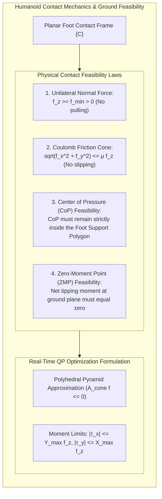
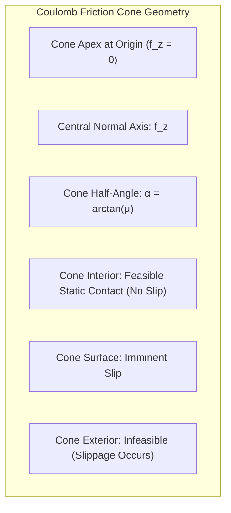
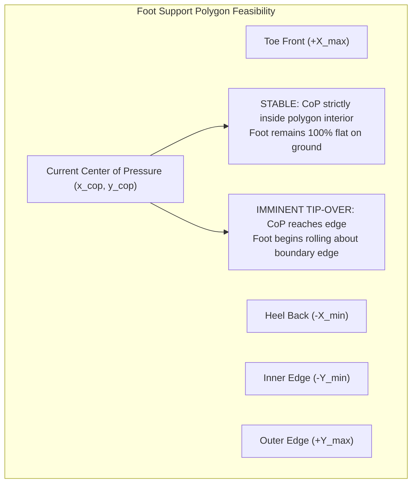

# Contact Mechanics, Friction Cones & Ground Reaction Forces

Every physical accomplishment of a humanoid robot—standing erect, taking a step, climbing stairs, or pushing an object—is mediated through **contact mechanics**. Unlike wheeled vehicles or fixed-base manipulators, a humanoid is governed by **unilateral, frictional constraints**: the ground can exert upward compressive normal forces and tangential friction, but cannot exert tensile pulling forces.

Failing to properly respect contact constraints results in immediate physical failure: foot slippage, ankle rolling, or complete dynamic tip-over.



---

## 1. Classification of Robotic Contacts

Following the classical taxonomy established by Salisbury and Mason, contact interactions between a humanoid and its environment are categorized into four canonical types:

| Contact Model | Degrees of Constraint | Transmitted Wrench Components | Physical Example on Humanoid |
| :--- | :--- | :--- | :--- |
| **Point Contact Without Friction** | 1 | Normal force only: `f_z >= 0` | Ice surface, frictionless roller |
| **Point Contact With Friction (Hard Finger)** | 3 | Spatial force vector: `f = [f_x, f_y, f_z]^T` | Rounded rubber foot toe, fingertip contact |
| **Soft-Finger Contact** | 4 | Force vector + Torsional moment: `[f_x, f_y, f_z, tau_z]^T` | Deformable silicone humanoid fingertips |
| **Planar Surface Contact (Rigid Foot)** | 6 | Full spatial wrench: `f in R^3, tau in R^3` | Rectangular humanoid foot sole on flat floor |

---

## 2. Coulomb Friction Cone Formulation

The classical Coulomb friction law states that relative tangential slippage between two contacting surfaces is prevented if and only if the magnitude of the tangential shear force does not exceed the maximum static friction:

```text
||f_t|| = sqrt(f_x^2 + f_y^2) <= mu * f_z
```

where `mu in [0.4, 0.9]` is the static friction coefficient (typically `mu approx 0.6` for rubber soles on industrial flooring), and `f_z >= 0` is the compressive normal force.

In mathematical optimization, this constraint defines a **Second-Order Cone (SOC)**:

```text
K_friction = { f in R^3 | sqrt(f_x^2 + f_y^2) <= mu * f_z,  f_z >= 0 }
```



---

## 3. Polyhedral Linear Approximation for Real-Time QP Solvers

While Second-Order Cone Programming (SOCP) solvers can handle nonlinear quadratic cones directly, standard humanoid Whole-Body Controllers (WBC) run at 1,000 Hz and rely on ultra-fast linear-inequality **Quadratic Programming (QP)** solvers (e.g., `qpOASES`, `OSQP`, `ProxSuite`).

To maintain linear constraints, the circular friction cone is approximated by an inscribed `m`-sided polyhedral pyramid:

```text
A_cone * f <= 0
```

### 3.1 4-Sided Pyramid Approximation (Conservative Box)
The simplest approximation bounds the tangential forces independently:

```text
|f_x| <= (mu / sqrt(2)) * f_z
|f_y| <= (mu / sqrt(2)) * f_z
```

### 3.2 8-Sided Octagonal Approximation (Industry Standard)
To avoid over-conservatism (which unnecessarily restricts the robot's agility by up to 30%), modern humanoids use an 8-sided polyhedral cone:

```text
[  1   0   -mu*cos(pi/8)       ] [ f_x ]   [ 0 ]
[ -1   0   -mu*cos(pi/8)       ] [ f_y ]   [ 0 ]
[  0   1   -mu*cos(pi/8)       ] [ f_z ]   [ 0 ]
[  0  -1   -mu*cos(pi/8)       ]           [ 0 ]
[  1   1   -sqrt(2)*mu*cos(pi/8)]        <= [ 0 ]
[ -1   1   -sqrt(2)*mu*cos(pi/8)]           [ 0 ]
[  1  -1   -sqrt(2)*mu*cos(pi/8)]           [ 0 ]
[ -1  -1   -sqrt(2)*mu*cos(pi/8)]           [ 0 ]
```

---

## 4. Center of Pressure (CoP) & Foot Support Polygon

For a humanoid foot resting flat on the ground, the distributed normal pressure across the sole can be integrated into a single equivalent point of force application: the **Center of Pressure (CoP)** `p_cop = [x_cop, y_cop, 0]^T`.

Given the total contact wrench `F = [n_x, n_y, n_z, f_x, f_y, f_z]^T` measured at the foot sensor frame:

```text
x_cop = -n_y / f_z,    y_cop = n_x / f_z
```



### 4.1 CoP Moment Inequalities
Let the rectangular foot sole extend from `-d_x_neg` to `+d_x_pos` in the sagittal axis, and `-d_y_in` to `+d_y_out` in the lateral axis. The condition that the foot does not roll or tip over translates directly to linear inequality bounds on contact moments:

```text
-d_x_pos * f_z <= n_y <= d_x_neg * f_z
-d_y_in  * f_z <= n_x <= d_y_out * f_z
```

In whole-body quadratic programming, these four linear inequalities are enforced as hard constraints on the decision variables.

---

## 5. Contact Impact Dynamics

When the humanoid swing foot collides with the ground at touchdown, the continuous equations of motion undergo an instantaneous jump due to contact impulse `Lambda_impulse = integral f_c dt in R^6`:

```text
M(q) * ( v^+ - v^- ) = J_c^T(q) * Lambda_impulse
```

where `v^-` is the post-swing velocity immediately prior to impact, and `v^+` is the post-impact velocity.

Assuming a perfectly inelastic impact with no rebound, the post-impact foot velocity must be zero (`J_c * v^+ = 0`). Solving this coupled linear system yields:

```text
Lambda_impulse = -( J_c * M^{-1} * J_c^T )^{-1} * J_c * v^-

v^+ = v^- - M^{-1} * J_c^T * ( J_c * M^{-1} * J_c^T )^{-1} * J_c * v^-
```

Notice the operational space inertia matrix `Lambda_c = ( J_c * M^{-1} * J_c^T )^{-1}`: larger effective foot inertia causes larger impact shocks. This mathematical reality motivates the lightweight carbon-fiber foot designs used in Atlas and Optimus.

---

## 6. Production Implementation: Contact Wrench Feasibility Checker

The following Python class evaluates 6D contact wrenches against Coulomb friction cones, polyhedral approximations, and foot sole support polygons:

```python
#!/usr/bin/env python3
"""
Humanoid Contact Mechanics & Ground Wrench Feasibility Checker
Features: 8-Sided Friction Cone + Center of Pressure (CoP) Polygon Verification
"""

import numpy as np
from typing import Dict, Tuple


class HumanoidContactChecker:
    def __init__(self, mu: float = 0.6,
                 foot_length_front: float = 0.14, foot_length_back: float = 0.08,
                 foot_width_in: float = 0.05, foot_width_out: float = 0.07):
        self.mu = mu
        self.dx_pos = foot_length_front  # Toe (+X)
        self.dx_neg = foot_length_back   # Heel (-X)
        self.dy_in = foot_width_in       # Medial edge
        self.dy_out = foot_width_out     # Lateral edge

    def check_wrench_feasibility(self, wrench: np.ndarray) -> Dict[str, any]:
        nx, ny, nz, fx, fy, fz = wrench

        min_normal_force = 10.0
        unilateral_valid = fz >= min_normal_force

        if not unilateral_valid:
            return {
                "is_feasible": False,
                "failure_mode": "Normal force insufficient (lifting or tension)",
                "fz": fz
            }

        f_tangential = np.sqrt(fx**2 + fy**2)
        friction_margin = (self.mu * fz) - f_tangential
        no_slip = friction_margin >= 0.0

        x_cop = -ny / fz
        y_cop = nx / fz

        cop_x_valid = (-self.dx_neg <= x_cop <= self.dx_pos)
        cop_y_valid = (-self.dy_in <= y_cop <= self.dy_out)
        cop_inside_polygon = cop_x_valid and cop_y_valid

        is_feasible = unilateral_valid and no_slip and cop_inside_polygon

        failure_reasons = []
        if not no_slip:
            failure_reasons.append(f"Foot slipping: F_tangent={f_tangential:.1f}N > Limit={self.mu*fz:.1f}N")
        if not cop_inside_polygon:
            failure_reasons.append(f"Foot tipping: CoP=[{x_cop*100:.1f}, {y_cop*100:.1f}] cm outside support sole")

        return {
            "is_feasible": is_feasible,
            "failure_mode": ", ".join(failure_reasons) if failure_reasons else "None (Feasible)",
            "normal_force_N": fz,
            "tangential_force_N": f_tangential,
            "friction_margin_N": friction_margin,
            "cop_position_m": np.array([x_cop, y_cop]),
            "cop_margin_x_m": min(x_cop + self.dx_neg, self.dx_pos - x_cop),
            "cop_margin_y_m": min(y_cop + self.dy_in, self.dy_out - y_cop),
        }


if __name__ == "__main__":
    checker = HumanoidContactChecker(mu=0.6)

    print("=== Humanoid Ground Contact Feasibility Verification ===")

    # Test Case 1: Healthy Single-Support Standing Stance
    wrench_healthy = np.array([1.2, -2.5, 0.1, 15.0, 8.0, 380.0])
    res_healthy = checker.check_wrench_feasibility(wrench_healthy)
    print("\n--- Test 1: Nominal Balanced Stance ---")
    print(f"Feasible: {res_healthy['is_feasible']}")
    print(f"Normal Force: {res_healthy['normal_force_N']:.1f} N")
    print(f"CoP Position: {np.round(res_healthy['cop_position_m'] * 100.0, 2)} cm")
    print(f"Friction Margin: {res_healthy['friction_margin_N']:.1f} N")

    # Test Case 2: Excessive Push Causing Slipping
    wrench_slip = np.array([0.0, 0.0, 0.0, 260.0, 0.0, 300.0])
    res_slip = checker.check_wrench_feasibility(wrench_slip)
    print("\n--- Test 2: High Tangential Shear Force ---")
    print(f"Feasible: {res_slip['is_feasible']}")
    print(f"Failure Reason: {res_slip['failure_mode']}")

    # Test Case 3: Excessive Tipping Pitch Moment
    wrench_tip = np.array([0.0, -65.0, 0.0, 10.0, 0.0, 350.0])
    res_tip = checker.check_wrench_feasibility(wrench_tip)
    print("\n--- Test 3: Excessive Pitch Tipping Moment ---")
    print(f"Feasible: {res_tip['is_feasible']}")
    print(f"Failure Reason: {res_tip['failure_mode']}")
```

---

## 7. Summary and Architectural Takeaways

1. **Unilateral Constraints Govern Walking**: The ground cannot pull; maintaining compressive normal forces (`f_z > 0`) is the non-negotiable prerequisite for all legged stability.
2. **Polyhedral Pyramids Enable 1 kHz QP**: Linearizing the circular Coulomb friction cone into an 8-sided pyramid allows whole-body controllers to solve optimal contact wrenches in under 1 ms.
3. **CoP is the Indicator of Tipping**: When the Center of Pressure reaches the perimeter of the foot support polygon, the foot begins rotational tipping; active controllers must restore CoP to the interior.

---

## Further Reading & Seminal Papers

- Mason, M. T. (2001). *Mechanics of Robotic Manipulation*. MIT Press.
- Pang, J. S., & Stewart, D. E. (2008). *Differential variational inequalities*. Mathematical Programming, 115(2), 345–380.
- Wieber, P. B. (2002). *On the stability of walking systems*. Proceedings of the International Workshop on Humanoid and Personal Robots, 53–59.

In the next chapter, **[5-10: Computational Tools, Pinocchio & Drake Benchmarking](./5-10-computational-tools)**, we integrate industrial dynamics engines (`Pinocchio`, `Drake`, `CasADi`), compiling high-performance C++ pipelines running at 1 kHz on edge robotics hardware.
