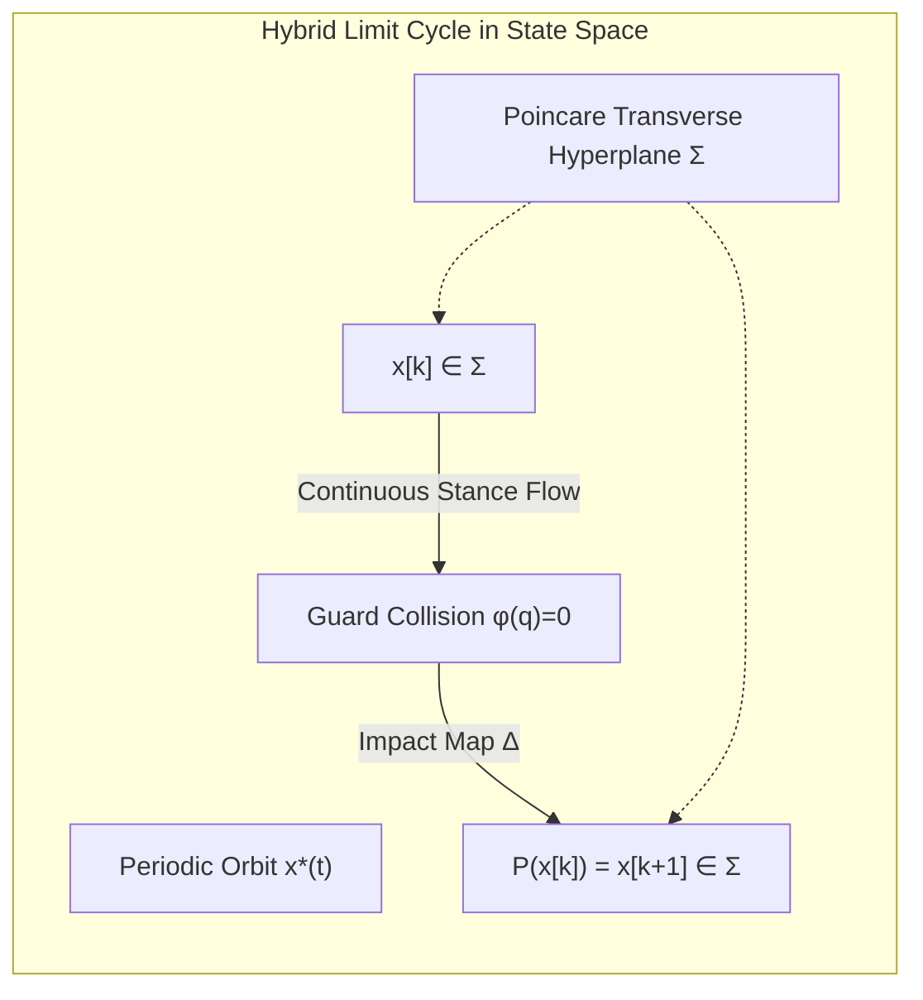

import ChapterProgress from '@site/src/components/ChapterProgress';
import QuizEngine from '@site/src/components/QuizEngine';

# Foundations of Bipedal Locomotion & Underactuated Robotics

Bipedal walking represents one of the most demanding problems in modern robotics. Unlike wheeled mobile platforms that maintain continuous static equilibrium through three or more coplanar contact points, or quadrupeds that can distribute ground reaction forces across wide polygons of support, a humanoid robot is an underactuated, floating-base mechanical system governed by intermittent, non-smooth unilateral contacts. A humanoid must continuously orchestrate its internal joint torques to prevent tipping over while driving its center of mass forward through alternating phases of single-support underactuation and double-support overconstrained contact.

From the pioneering quasi-static steps of Waseda University's WABOT-1 in 1973 to the dynamic hydraulic agility of Boston Dynamics' Atlas and the high-efficiency electric powertrains of Tesla Optimus and Unitree G1, the paradigm of bipedal control has undergone a radical transformation. Engineers have moved from conservative, flat-footed trajectory tracking toward dynamic limit-cycle exploitation, instantaneous push-recovery planning, and predictive contact optimization. Mastering bipedal locomotion requires a deep mathematical understanding of multi-body rigid dynamics, hybrid state transitions, contact wrenches, and orbital stability.

```mermaid
flowchart TD
    subgraph FloatingBaseSystem["Floating-Base Underactuated Humanoid Dynamics"]
        direction TB
        Actuators["Internal Actuators (Torques &tau; &isin; &real;<sup>n</sup>)"]
        Base["Unactuated 6-DoF Floating Base (Position & Orientation in SE(3))"]
        EOM["Equations of Motion: M(q)q&uml; + C(q,q&dot;)q&dot; + g(q) = S<sup>T</sup>&tau; + J<sub>c</sub><sup>T</sup>&lambda;"]
        Actuators --> EOM
        Base -.->|Underactuated Degree = 6| EOM
    end

    subgraph HybridGaitCycle["Hybrid Contact Dynamics & Phase Transitions"]
        direction LR
        SS1["Single Support Phase (Underactuated Flow)"] -->|Foot Touchdown Guard: &phi;(q) = 0| Impact["Plastic Impact & Velocity Reset Map: &Delta;q&dot;"]
        Impact --> DS["Double Support Phase (Overconstrained Flow)"]
        DS -->|Trailing Foot Liftoff: &lambda;<sub>trail</sub> &rarr; 0| SS2["Next Single Support Phase"]
        SS2 -->|Touchdown| Impact2["Plastic Impact"]
        Impact2 --> SS1
    end

    FloatingBaseSystem --> HybridGaitCycle
```

---

## 1. Historical Evolution of Bipedal Systems

The pursuit of stable two-legged walking spans over half a century of mechanical and algorithmic innovation:

1. **Quasi-Static Pioneers (1970s–1980s)**:
   - **WABOT-1 (1973, Waseda University)**: The world's first full-scale anthropomorphic robot. It required approximately 45 seconds to execute a single 65-centimeter step, strictly constraining its Center of Gravity (CoG) within the static footprint of the stance leg.
   - **WL-10RD (1984, Waseda)**: Introduced dynamic walk patterns using pre-computed joint trajectories with flat-foot ground contact.
2. **Dynamic ZMP Era (1990s–2010s)**:
   - **Honda P2 (1996) and ASIMO (2000)**: Breakthrough architectures establishing high-speed dynamic walking via the Zero-Moment Point (ZMP) criterion. ASIMO executed real-time predictive ZMP modifications at 1 kHz, enabling curved walking, stairs, and running at 9 km/h.
   - **HRP Series (AIST / Kawada)**: HRP-2 and HRP-4 demonstrated robust whole-body stabilization, falling recovery, and model-predictive pattern generation on unstructured surfaces.
3. **Passive Dynamics & Underactuated Agility (2000s–Present)**:
   - **Cornell Ranger & McGeer Walkers**: Demonstrated that passive-dynamic mechanical linkages can walk down gentle slopes with zero actuation by harvesting gravitational potential energy, achieving remarkably low Costs of Transport (CoT &approx; 0.05).
   - **Cassie & Digit (Agility Robotics)**: Underactuated spring-loaded five-bar linkages and 3D point-foot architectures utilizing operational space control and Divergent Component of Motion (DCM) reactive stepping.
4. **Modern Electric Humanoids (2020s)**:
   - **Boston Dynamics Atlas (All-Electric 2024)**: Transition from high-pressure variable-displacement hydraulics to high-torque electric rotary actuators with 360-degree joint articulation.
   - **Tesla Optimus Gen 2 & Unitree G1**: Combining lightweight structural frames (47 kg to 57 kg), high-bandwidth planetary/harmonic actuators, and hybrid pipelines merging Convex MPC with end-to-end Deep Reinforcement Learning.

---

## 2. Floating-Base Equations of Motion & Underactuation

A fixed-base industrial manipulator has its base frame mechanically bolted to the ground, guaranteeing that every degree of freedom is directly mapped to a motor drive. In stark contrast, a humanoid robot is free to navigate through three-dimensional space $\mathrm{SE}(3)$.

### Generalized Coordinates

The configuration space of an $n$-joint biped is parameterized by generalized coordinates:

$$
\mathbf{q} = \begin{bmatrix} \mathbf{p}_b \\ \mathbf{R}_b \\ \mathbf{q}_j \end{bmatrix} \in \mathrm{SE}(3) \times \mathbb{R}^n
$$

where $\mathbf{p}_b \in \mathbb{R}^3$ is the Cartesian position of the floating base (typically situated at the pelvis or torso Center of Mass), $\mathbf{R}_b \in \mathrm{SO}(3)$ represents its orientation (often parameterized locally via unit quaternions $\mathbf{q}_b \in \mathbb{S}^3$), and $\mathbf{q}_j \in \mathbb{R}^n$ represents the actuated joint angles.

The generalized velocity vector $\mathbf{v} \in \mathbb{R}^{n+6}$ is defined as:

$$
\mathbf{v} = \begin{bmatrix} \mathbf{v}_b \\ \boldsymbol{\omega}_b \\ \dot{\mathbf{q}}_j \end{bmatrix} \in \mathbb{R}^{6 + n}
$$

where $\mathbf{v}_b = \dot{\mathbf{p}}_b$ and $\boldsymbol{\omega}_b$ is the base angular velocity expressed in the world or body frame.

### Euler-Lagrange Dynamics

The continuous-time equations of motion are formulated via the manipulator equation with floating-base decomposition:

$$
\mathbf{M}(\mathbf{q})\dot{\mathbf{v}} + \mathbf{C}(\mathbf{q}, \mathbf{v})\mathbf{v} + \mathbf{g}(\mathbf{q}) = \mathbf{S}^T \boldsymbol{\tau} + \sum_{k=1}^{N_c} \mathbf{J}_{c,k}^T \boldsymbol{\lambda}_k
$$

where:
- $\mathbf{M}(\mathbf{q}) \in \mathbb{R}^{(n+6) \times (n+6)}$ is the symmetric, positive-definite generalized mass/inertia matrix.
- $\mathbf{C}(\mathbf{q}, \mathbf{v}) \in \mathbb{R}^{(n+6) \times (n+6)}$ captures Coriolis and centrifugal terms.
- $\mathbf{g}(\mathbf{q}) \in \mathbb{R}^{n+6}$ is the gravitational wrench vector.
- $\mathbf{S} = \begin{bmatrix} \mathbf{0}_{n \times 6} & \mathbf{I}_{n \times n} \end{bmatrix} \in \mathbb{R}^{n \times (n+6)}$ is the actuation selection matrix.
- $\boldsymbol{\tau} \in \mathbb{R}^n$ is the vector of internal joint motor torques.
- $\mathbf{J}_{c,k}(\mathbf{q}) \in \mathbb{R}^{6 \times (n+6)}$ is the contact Jacobian at contact point/surface $k$.
- $\boldsymbol{\lambda}_k = \begin{bmatrix} \mathbf{f}_k^T & \mathbf{m}_k^T \end{bmatrix}^T \in \mathbb{R}^6$ represents the ground reaction wrench (linear contact forces and moments) acting on the robot.

### The Underactuation Degree

We partition the floating-base equations into unactuated floating-base dynamics and actuated joint dynamics:

$$
\begin{bmatrix} 
\mathbf{M}_{bb}(\mathbf{q}) & \mathbf{M}_{bj}(\mathbf{q}) \\ 
\mathbf{M}_{jb}(\mathbf{q}) & \mathbf{M}_{jj}(\mathbf{q}) 
\end{bmatrix}
\begin{bmatrix} 
\dot{\mathbf{v}}_b \\ 
\ddot{\mathbf{q}}_j 
\end{bmatrix} 
+ 
\begin{bmatrix} 
\mathbf{h}_b(\mathbf{q}, \mathbf{v}) \\ 
\mathbf{h}_j(\mathbf{q}, \mathbf{v}) 
\end{bmatrix}
= 
\begin{bmatrix} 
\mathbf{0}_{6 \times 1} \\ 
\boldsymbol{\tau} 
\end{bmatrix}
+ 
\begin{bmatrix} 
\mathbf{J}_{c,b}^T \\ 
\mathbf{J}_{c,j}^T 
\end{bmatrix} 
\boldsymbol{\lambda}
$$

Notice that the top 6 rows possess **zero direct control authority** ($\mathbf{S}^T \boldsymbol{\tau} = \mathbf{0}_{6 \times 1}$):

$$
\mathbf{M}_{bb}\dot{\mathbf{v}}_b + \mathbf{M}_{bj}\ddot{\mathbf{q}}_j + \mathbf{h}_b = \mathbf{J}_{c,b}^T \boldsymbol{\lambda}
$$

The robot can accelerate its floating base **only** by modulating ground reaction wrenches $\boldsymbol{\lambda}$ through kinematic coupling $\mathbf{M}_{bj}\ddot{\mathbf{q}}_j$ and contact geometry $\mathbf{J}_{c,b}^T$. The underactuation degree is:

$$
\delta = \dim(\mathbf{q}) - \dim(\boldsymbol{\tau}) = (n + 6) - n = 6
$$

If both feet lose ground contact ($\boldsymbol{\lambda} = \mathbf{0}$, flight phase), the robot cannot alter its total linear momentum or angular momentum about its Center of Mass, obeying strict conservation laws.

---

## 3. Contact Mechanics & Friction Cones

Ground contacts are unilateral: the ground can push the robot, but cannot pull it. For a surface contact (such as a humanoid foot sole with width $W$ and length $L$), the contact wrench $\boldsymbol{\lambda} = [f_x, f_y, f_z, \tau_x, \tau_y, \tau_z]^T$ must satisfy the Coulomb friction cone and unilateral non-tipping conditions:

1. **Unilateral Normal Force**:
   $$
   f_z \ge 0
   $$
2. **Coulomb Friction Cone (Linearized Friction Pyramid)**:
   $$
   \sqrt{f_x^2 + f_y^2} \le \mu f_z \implies |f_x| \le \frac{\mu}{\sqrt{2}} f_z, \quad |f_y| \le \frac{\mu}{\sqrt{2}} f_z
   $$
   where $\mu$ is the static friction coefficient (typically $\mu \approx 0.6\text{--}0.8$ for rubber soles on dry concrete).
3. **No-Tilting Constraint (Center of Pressure within Support Polygon)**:
   The Center of Pressure (CoP) coordinates must remain strictly within the convex hull of the foot sole $\mathcal{S}$:
   $$
   p_x = -\frac{\tau_y}{f_z} \in \left[-\frac{L}{2}, \frac{L}{2}\right], \quad p_y = \frac{\tau_x}{f_z} \in \left[-\frac{W}{2}, \frac{W}{2}\right]
   $$
4. **Torsional Yaw Friction Limit**:
   $$
   |\tau_z| \le \mu_s f_z
   $$
   where $\mu_s$ represents the torsional friction capacity.

---

## 4. Hybrid Dynamics: Continuous Stance & Discrete Impact

Bipedal walking cannot be modeled as a single smooth differential equation. It is a canonical **hybrid dynamical system** featuring continuous vector fields interrupted by discrete algebraic jumps when the swing foot strikes the ground.

```mermaid
stateDiagram-v2
    [*] --> SingleSupport: State Initialized
    state SingleSupport {
        direction TB
        Flow: Integrate d/dt [q; v] = f_SS(q, v, tau)
        SwingCheck: Guard condition phi(q_swing) == 0?
    }
    SingleSupport --> ImpactEvent: phi(q_swing) = 0 and v_swing_z &lt; 0
    state ImpactEvent {
        direction TB
        Conservation: Momentum balance across dt &rarr; 0
        VelocityJump: v^+ = Delta(q) * v^-
        StateSwap: Stance & Swing Leg Coordinates Exchanged
    }
    ImpactEvent --> SingleSupport: Resume integration with v^+
```



### The Continuous Flow Map

During single-support stance on link $k$, the contact point $\mathbf{p}_c(\mathbf{q})$ is constrained to zero acceleration:

$$
\mathbf{a}_c = \mathbf{J}_c(\mathbf{q})\dot{\mathbf{v}} + \dot{\mathbf{J}}_c(\mathbf{q}, \mathbf{v})\mathbf{v} = \mathbf{0}
$$

Solving simultaneously for $\dot{\mathbf{v}}$ and $\boldsymbol{\lambda}$:

$$
\begin{bmatrix} 
\mathbf{M}(\mathbf{q}) & -\mathbf{J}_c^T(\mathbf{q}) \\ 
\mathbf{J}_c(\mathbf{q}) & \mathbf{0} 
\end{bmatrix}
\begin{bmatrix} 
\dot{\mathbf{v}} \\ 
\boldsymbol{\lambda} 
\end{bmatrix}
=
\begin{bmatrix} 
\mathbf{S}^T \boldsymbol{\tau} - \mathbf{C}\mathbf{v} - \mathbf{g} \\ 
-\dot{\mathbf{J}}_c \mathbf{v} 
\end{bmatrix}
$$

### The Guard Condition

The continuous trajectory flows through state manifold $\mathcal{X}$ until the vertical height $\phi(\mathbf{q})$ of the swing foot reaches ground level with negative downward velocity:

$$
\mathcal{S} = \{ (\mathbf{q}, \mathbf{v}) \in \mathcal{X} \mid \phi(\mathbf{q}) = 0, \; \mathbf{J}_{\text{swing}}(\mathbf{q})\mathbf{v} < 0 \}
$$

### The Discrete Impact Map (Inelastic Collision)

At the moment of touchdown $t_I$, an impulsive ground reaction force $\boldsymbol{\Lambda} = \int_{t_I^-}^{t_I^+} \boldsymbol{\lambda}(t) dt$ acts over an infinitesimal interval $[t_I^-, t_I^+]$. The generalized coordinates remain continuous:

$$
\mathbf{q}^+ = \mathbf{q}^-
$$

However, the generalized velocities experience a discontinuous jump governed by conservation of linear and angular momentum:

$$
\mathbf{M}(\mathbf{q})(\mathbf{v}^+ - \mathbf{v}^-) = \mathbf{J}_c^T(\mathbf{q})\boldsymbol{\Lambda}
$$

Enforcing the post-impact rigid foot landing condition $\mathbf{J}_c(\mathbf{q})\mathbf{v}^+ = \mathbf{0}$:

$$
\begin{bmatrix} 
\mathbf{M}(\mathbf{q}) & -\mathbf{J}_c^T(\mathbf{q}) \\ 
\mathbf{J}_c(\mathbf{q}) & \mathbf{0} 
\end{bmatrix}
\begin{bmatrix} 
\mathbf{v}^+ \\ 
\boldsymbol{\Lambda} 
\end{bmatrix}
=
\begin{bmatrix} 
\mathbf{M}(\mathbf{q})\mathbf{v}^- \\ 
\mathbf{0} 
\end{bmatrix}
$$

Solving for post-impact velocity yields the linear reset map:

$$
\mathbf{v}^+ = \boldsymbol{\Delta}_v(\mathbf{q})\mathbf{v}^- = \left[ \mathbf{I} - \mathbf{M}^{-1}\mathbf{J}_c^T (\mathbf{J}_c \mathbf{M}^{-1} \mathbf{J}_c^T)^{-1} \mathbf{J}_c \right] \mathbf{v}^-
$$

Because kinetic energy $T = \frac{1}{2}\mathbf{v}^T \mathbf{M} \mathbf{v}$ is strictly dissipated during plastic collision ($T^+ \le T^-$), energy must be injected during stance (via gravitational potential in passive walkers or actuator work in humanoids) to sustain a periodic gait.

---

## 5. Orbital Stability & The Poincaré Return Map

A walking gait is fundamentally periodic rather than static. Stability cannot be assessed via traditional equilibrium eigenvalues ($\dot{\mathbf{x}} = \mathbf{0}$) because walking is a dynamic limit cycle: a closed trajectory in phase space $\mathbf{x}^*(t) = \mathbf{x}^*(t + T)$.



### The Poincaré Map Formulation

Let $\Sigma$ be a transverse Poincaré section (a codimension-1 switching surface) chosen just before foot impact:

$$
\Sigma = \{ \mathbf{x} = (\mathbf{q}, \mathbf{v}) \in \mathcal{X} \mid \phi(\mathbf{q}) = 0 \}
$$

The Poincaré return map $\mathbf{P}: \Sigma \to \Sigma$ maps a state $\mathbf{x}_k \in \Sigma$ at step $k$ to the state $\mathbf{x}_{k+1}$ at the subsequent impact:

$$
\mathbf{x}_{k+1} = \mathbf{P}(\mathbf{x}_k)
$$

A periodic gait corresponds to a fixed point $\mathbf{x}^* \in \Sigma$:

$$
\mathbf{x}^* = \mathbf{P}(\mathbf{x}^*)
$$

### Orbital Stability via Monodromy Matrix

Linearizing the map around the fixed point $\mathbf{x}^*$:

$$
\delta \mathbf{x}_{k+1} \approx \nabla \mathbf{P}(\mathbf{x}^*) \delta \mathbf{x}_k = \mathbf{D}_P \delta \mathbf{x}_k
$$

where $\mathbf{D}_P \in \mathbb{R}^{(2n+11) \times (2n+11)}$ is the Jacobian of the Poincaré map (the Monodromy Matrix).

- **Asymptotically Orbitally Stable**: If all eigenvalues $\sigma_i$ of $\mathbf{D}_P$ lie strictly inside the unit complex circle:
  $$
  |\sigma_i(\mathbf{D}_P)| < 1, \quad \forall i
  $$
- The spectral radius $\rho(\mathbf{D}_P) = \max_i |\sigma_i|$ determines the convergence rate: perturbations decay at the rate $\mathcal{O}(\rho^k)$.

---

## 6. Stability Paradigms: Comparative Analysis

| Dimension | Static Stability | Dynamic (ZMP / LIPM) | Orbital Stability (Limit Cycles) |
| :--- | :--- | :--- | :--- |
| **Criterion** | CoG projection $\in \mathcal{S}_{\text{support}}$ | $\mathbf{p}_{\text{ZMP}} \in \mathrm{conv}(\text{Foot})$ | Floquet multipliers $\|\sigma_i(\mathbf{D}_P)\| < 1$ |
| **Walking Speed** | Very slow ($v < 0.1$ m/s) | Moderate to Fast ($0.5\text{--}2.5$ m/s) | Fast / Highly dynamic ($1.0\text{--}4.0$ m/s) |
| **Foot Contact** | Flat-foot required | Flat-foot or controlled roll | Point foot, curved foot, roll-over |
| **Underactuation** | None allowed | Minimally allowed | Fully exploited (passive knee/ankle) |
| **Energy Cost (CoT)** | High ($\mathrm{CoT} > 3.0$) | Medium ($\mathrm{CoT} \approx 0.8\text{--}2.0$) | Exceptional ($\mathrm{CoT} \approx 0.05\text{--}0.3$) |
| **Exemplars** | WABOT-1, Early ASIMO | Honda ASIMO, HRP-4, Atlas (flat) | Cornell Ranger, Cassie, RunBot |

---

## 7. Python Implementation: Hybrid Planar Walker Simulation

The script below simulates a canonical 2-DoF planar compass-gait biped walking down a shallow slope $\gamma$. It implements continuous non-linear Euler-Lagrange equations, event-based foot ground impact detection via `scipy.integrate.solve_ivp`, the plastic impact reset map, and calculates the Poincaré return map.

```python
"""
hybrid_compass_biped.py
Simulation of a planar compass-gait biped on an inclined slope.
Models continuous stance dynamics and discrete plastic foot collisions.
"""

import numpy as np
from scipy.integrate import solve_ivp
import matplotlib.pyplot as plt

class CompassGaitBiped:
    def __init__(self, m=5.0, m_h=10.0, l=1.0, a=0.5, b=0.5, gamma=0.04, g=9.81):
        """
        Parameters:
        m: Leg mass (kg)
        m_h: Hip mass (kg)
        l: Leg length (m)
        a: Distance from hip to leg CoM (m)
        b: Distance from foot to leg CoM (m)
        gamma: Slope incline angle (radians)
        g: Gravitational acceleration (m/s^2)
        """
        self.m = m
        self.m_h = m_h
        self.l = l
        self.a = a
        self.b = b
        self.gamma = gamma
        self.g = g

    def mass_matrix(self, theta_ns, theta_s):
        """Compute 2x2 mass matrix M(q). State q = [theta_ns, theta_s] relative to vertical."""
        M11 = self.m * self.b**2
        M12 = -self.m * self.l * self.b * np.cos(theta_s - theta_ns)
        M21 = M12
        M22 = (self.m_h + self.m) * self.l**2 + self.m * self.a**2
        return np.array([[M11, M12], [M21, M22]])

    def coriolis_gravity(self, theta_ns, theta_s, dtheta_ns, dtheta_s):
        """Compute C(q, v)v + g(q) vector."""
        C1 = self.m * self.l * self.b * (dtheta_s**2) * np.sin(theta_s - theta_ns)
        G1 = self.m * self.g * self.b * np.sin(theta_ns)

        C2 = -self.m * self.l * self.b * (dtheta_ns**2) * np.sin(theta_s - theta_ns)
        G2 = -( (self.m_h + self.m) * self.l + self.m * self.a ) * self.g * np.sin(theta_s)

        return np.array([C1 + G1, C2 + G2])

    def continuous_dynamics(self, t, state):
        """Continuous state derivative: state = [theta_ns, theta_s, dtheta_ns, dtheta_s]"""
        theta_ns, theta_s, dtheta_ns, dtheta_s = state
        M = self.mass_matrix(theta_ns, theta_s)
        h = self.coriolis_gravity(theta_ns, theta_s, dtheta_ns, dtheta_s)
        accel = np.linalg.solve(M, -h)
        return [dtheta_ns, dtheta_s, accel[0], accel[1]]

    def impact_reset_map(self, state_minus):
        """
        Calculates post-impact velocities via angular momentum conservation
        and swaps stance/swing leg definitions.
        """
        theta_ns, theta_s, dtheta_ns, dtheta_s = state_minus
        alpha = theta_s - theta_ns  # Inter-leg opening angle

        # Pre-impact configuration
        Q_minus = np.array([
            [-self.m * self.a * self.b, 
             (self.m_h * self.l**2 + 2 * self.m * self.a * self.l) * np.cos(alpha) - self.m * self.a * self.b],
            [0.0, -self.m * self.a * self.b]
        ])

        # Post-impact mass matrix
        Q_plus = np.array([
            [self.m * self.b**2, -self.m * self.l * self.b * np.cos(alpha)],
            [-self.m * self.l * self.b * np.cos(alpha), (self.m_h + self.m) * self.l**2 + self.m * self.a**2]
        ])

        omega_minus = np.array([dtheta_ns, dtheta_s])
        omega_plus = np.linalg.solve(Q_plus, Q_minus @ omega_minus)

        # Coordinate swap: post-impact swing leg becomes previous stance leg
        new_theta_s = theta_ns
        new_theta_ns = theta_s
        new_dtheta_s = omega_plus[0]
        new_dtheta_ns = omega_plus[1]

        return np.array([new_theta_ns, new_theta_s, new_dtheta_ns, new_dtheta_s])

    def foot_strike_event(self, t, state):
        """
        Event function: swing foot hits ground when
        theta_s + theta_ns + 2 * gamma == 0 and theta_s > theta_ns (swing leg ahead)
        """
        theta_ns, theta_s, _, _ = state
        # Ground clearance condition on slope gamma
        return (theta_s + theta_ns + 2 * self.gamma)

    def simulate_steps(self, initial_state, num_steps=6):
        """Simulate multi-step hybrid limit cycle."""
        state = np.copy(initial_state)
        t_current = 0.0
        trajectory = []

        # Configure Scipy event
        def event_func(t, state):
            return self.foot_strike_event(t, state)
        event_func.terminal = True
        event_func.direction = -1.0  # Zero crossing from positive to negative

        for step in range(num_steps):
            # Guard against immediate triggering at t=0
            sol = solve_ivp(
                self.continuous_dynamics,
                [t_current, t_current + 2.0],
                state,
                events=event_func,
                rtol=1e-8,
                atol=1e-9,
                dense_output=True
            )

            trajectory.append(sol)
            if len(sol.t_events[0]) == 0:
                print(f"Biped stopped or fell at step {step}")
                break

            # Impact event detected
            impact_state = sol.y_events[0][0]
            t_current = sol.t_events[0][0]
            state = self.impact_reset_map(impact_state)

        return trajectory

if __name__ == "__main__":
    # Stable limit cycle initial condition for gamma = 0.04 rad (~2.3 degrees)
    biped = CompassGaitBiped(gamma=0.04)
    q0 = np.array([-0.252, 0.172, 0.450, -1.050])

    print("Executing Hybrid Compass-Gait Simulation...")
    trajectories = biped.simulate_steps(q0, num_steps=4)
    print(f"Successfully simulated {len(trajectories)} steps along the limit cycle.")
```

---

## 8. Seminal Literature & Academic References

1. **Vukobratović, M., & Juričić, D. (1969).** *Contribution to the synthesis of biped gait*. IEEE Transactions on Biomedical Engineering, (1), 1-6.
   - *Annotation*: Introduced the fundamental concept of dynamic bipedal stability and the original theoretical underpinnings of the Zero-Moment Point.
2. **McGeer, T. (1990).** *Passive dynamic walking*. The International Journal of Robotics Research, 9(2), 62-82.
   - *Annotation*: Established that passive mechanical linkages can exhibit stable bipedal limit cycles without actuators or microprocessors, purely through gravitational interaction.
3. **Pratt, J. E., & Pratt, G. A. (1998).** *Intuitive control of a planar bipedal walking robot*. In IEEE International Conference on Robotics and Automation (ICRA) (Vol. 3, pp. 2014-2021).
   - *Annotation*: Formulated virtual model control and introduced underactuated stability concepts leading to the Spring Flamingo and modern legged systems.
4. **Westervelt, E. R., Grizzle, J. W., Chevallereau, C., Choi, C. I., & Morris, B. (2007).** *Feedback Control of Dynamic Bipedal Robot Locomotion*. CRC Press.
   - *Annotation*: The definitive treatise on Hybrid Zero Dynamics (HZD), Poincaré return maps, and formal non-linear orbital stabilization for underactuated bipeds (RABBIT).
5. **Kuindersma, S., Deits, R., Fallon, M., Valenzuela, A., Dai, H., Permenter, F., Koolen, T., Marion, P., & Tedrake, R. (2016).** *Optimization-based locomotion planning, estimation, and control design for the Atlas humanoid robot*. Autonomous Robots, 40(3), 429-455.
   - *Annotation*: Documents Boston Dynamics Atlas's full-body operational space controller, QP quadratic programs, and whole-body balance during the DARPA Robotics Challenge.

---

## 9. Hands-On Lab Project: Limit Cycle & Poincaré Analysis

### Objective
Implement a Poincaré return map analyzer for the planar compass-gait walker. Perturb the initial stance velocity by $\pm 10\%$ and compute the 5-step state trajectory.

### Deliverables & Verification
1. Perturb the initial state $q_0$ from Section 7: $\dot{\theta}_{s,0} \to \dot{\theta}_{s,0} \times 1.10$.
2. Run the hybrid simulation for 10 steps.
3. Record the fixed-point coordinate $\mathbf{x}_k \in \Sigma$ at each ground strike event.
4. Verify that the Euclidean state deviation $\|\mathbf{x}_k - \mathbf{x}^*\|$ contracts toward zero, demonstrating asymptotic orbital stability.

```bash
# Execute hybrid biped simulator lab
python3 hybrid_compass_biped.py
```

---

<ChapterProgress chapterId="6-1-introduction-to-bipedal-locomotion" moduleId="module6" totalChapters={10} />

## Chapter Mastery Check

<QuizEngine
  quizId="quiz-6-1"
  title="Module 6.1 Mastery Check: Bipedal Locomotion Foundations"
  moduleId="module6"
  passThreshold={70}
  questions={[
    {
      id: "q1",
      question: "Why is an unconstrained bipedal humanoid classified as an underactuated mechanical system?",
      options: [
        "Because it has fewer motors than the human musculoskeletal system",
        "Because the 6-DoF floating base (pelvis position and orientation) possesses no direct motor actuators, yielding an underactuation degree of 6",
        "Because its contact friction coefficient is always less than 1.0",
        "Because digital microcontrollers cannot process floating-point numbers in real time"
      ],
      correctIndex: 1,
      explanation: "A floating-base humanoid possesses (n + 6) degrees of freedom but only n joint torque actuators (S = [0_{n x 6}, I_{n x n}]). The 6 base coordinates can only be indirectly accelerated via ground reaction wrenches."
    },
    {
      id: "q2",
      question: "What physical conservation law governs the velocity discontinuity Delta(v) when the swing foot experiences a rigid ground impact?",
      options: [
        "Conservation of electric charge in the motor windings",
        "Conservation of generalized linear and angular momentum across the infinitesimal contact impulse duration",
        "Bernoulli's fluid flow principle",
        "Conservation of absolute kinetic energy"
      ],
      correctIndex: 1,
      explanation: "Rigid plastic ground collisions occur over an infinitesimal interval dt -> 0 where impulsive reaction forces dominate, causing a discontinuous jump in velocity governed by the conservation of momentum M(v^+ - v^-) = J_c^T Lambda."
    },
    {
      id: "q3",
      question: "Under the Poincare return map P: Sigma -> Sigma, what mathematical condition confirms that a periodic walking gait is asymptotically orbitally stable?",
      options: [
        "The robot's Center of Mass stays permanently at a constant altitude",
        "All eigenvalues of the Monodromy Matrix (Jacobian of the Poincare map) lie strictly within the unit complex circle (|sigma_i| < 1)",
        "The ground reaction force is strictly equal to the robot's weight at all times",
        "The joint torques are zero"
      ],
      correctIndex: 1,
      explanation: "A fixed point x* on a Poincare section is asymptotically orbitally stable if and only if the spectral radius of the linearized return map is less than 1 (all Floquet multipliers satisfy |sigma_i| < 1)."
    }
  ]}
/>
