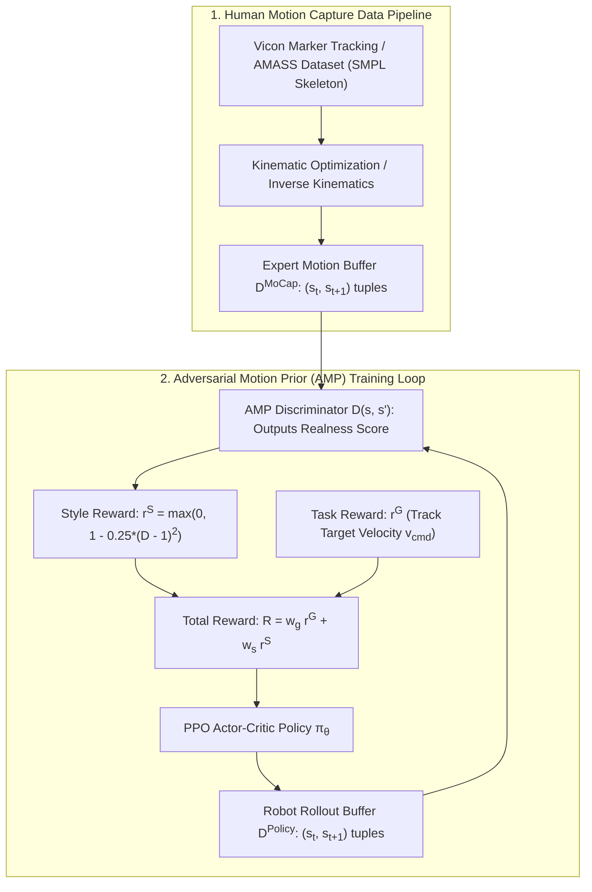
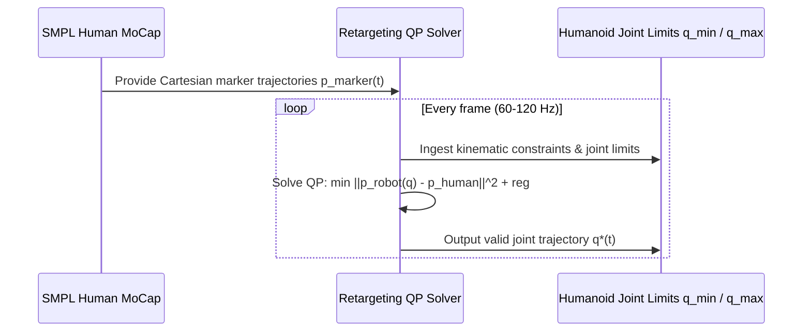

import ChapterProgress from '@site/src/components/ChapterProgress';
import QuizEngine from '@site/src/components/QuizEngine';

# Motion Capture Retargeting & Adversarial Motion Priors (AMP)

When deep reinforcement learning policies are trained from scratch using hand-crafted rewards, the resulting gaits frequently appear unnatural: the humanoid might adopt a high-frequency pigeon-toed waddle, bend awkwardly at the waist, or flail its arms in bizarre patterns that happen to mathematically exploit the simulator's physics integrator. Manually engineering dozens of balancing penalties to sculpt a natural walking style is tedious and often results in fragile, stiff gaits.

The alternative is to teach the humanoid to walk by imitating biological human demonstrations. Using **optical motion capture (MoCap)** systems (such as Vicon or OptiTrack) or massive public databases like **AMASS (Archive of Motion Capture as Surface Shapes)**, high-fidelity human kinematics can be retargeted to the robot's physical degrees of freedom. Through **Adversarial Motion Priors (AMP)**, formulated by Xue Bin Peng et al., an adversarial discriminator network continuously evaluates whether the robot's motion looks indistinguishable from real human demonstrations. This enables humanoids to acquire smooth, expressive, and human-like locomotion without manual reward tuning.



---

## 1. Motion Capture Marker Sets & Datasets

Capturing reference human motions relies on retro-reflective optical tracking markers placed on anatomical bony landmarks:

### Clinical & Animation Marker Protocols
- **Plug-in Gait / Helen Hayes**: A standardized 39-marker protocol tracking the pelvis (ASIS, PSIS), lateral femoral epicondyles, lateral malleoli, calcaneus, and second metatarsal heads.
- **AMASS Archive**: An aggregation of over 40 individual optical motion capture datasets (such as CMU, Human3.6M, and KIT) unified into the **SMPL (Skinned Multi-Person Linear Model)** parameterization. AMASS contains over 300 subjects and 40 hours of diverse walking, turning, jogging, and athletic motions.

---

## 2. Kinematic Retargeting to Humanoid Joint Space

A human skeleton has over 200 degrees of freedom, spherical ball-and-socket joints, and flexible spines. A humanoid robot (such as the Unitree G1 with 23–29 DoF) possesses rigid links, revolute joints with fixed axes of rotation, and strict physical joint travel limits.



### The Retargeting Optimization Problem
At each frame $t$, we solve for the humanoid joint coordinates $\mathbf{q}(t) \in \mathbb{R}^n$ that align key robotic end-effectors (feet, knees, hips, hands, head) with the human target positions $\mathbf{p}_m^{\text{human}}$:

$$
\min_{\mathbf{q}} \sum_{m=1}^M w_m \left\| \mathbf{f}_m(\mathbf{q}) - \mathbf{p}_m^{\text{human}}(t) \right\|^2 + w_{\text{reg}} \|\mathbf{q} - \mathbf{q}_{\text{nom}}\|^2 + w_v \|\dot{\mathbf{q}}\|^2
$$

Subject to:
1. **Joint Position Limits**:
   $$
   \mathbf{q}_{\min} \le \mathbf{q} \le \mathbf{q}_{\max}
   $$
2. **Self-Collision Avoidance**:
   $$
   \|\mathbf{c}_i(\mathbf{q}) - \mathbf{c}_j(\mathbf{q})\| \ge r_i + r_j + d_{\text{margin}}, \quad \forall i \neq j
   $$
3. **Foot Planar Contact Alignment**:
   During stance, the foot sole link must remain strictly parallel to the floor surface.

---

## 3. Adversarial Motion Priors (AMP) Formulation

In early imitation learning architectures (such as DeepMimic), policies tracked reference motion trajectories using explicit tracking error rewards:

$$
r_{\text{track}} = \exp\left( -k_q \|\mathbf{q} - \mathbf{q}_{\text{ref}}(t)\|^2 \right)
$$

While effective for single clips, this approach requires **phase-variable synchronization**, making it difficult to transition seamlessly between arbitrary motions (e.g., from walking to jumping or turning).

**Adversarial Motion Priors (AMP)** (Peng et al., 2021) solves this by abandoning phase-locked tracking. Instead of forcing the robot to follow a single reference trajectory step-by-step, AMP trains a **Discriminator network** $D(\mathbf{s}, \mathbf{s}')$ that simply judges whether the robot's local motion transitions resemble the distribution of unstructured expert human clips.

### The Discriminator Objective
Let $\mathbf{d} = (\mathbf{s}_t, \mathbf{s}_{t+1})$ represent a state transition tuple consisting of link positions, orientations, and linear/angular velocities.

The Discriminator $D_\psi: \mathbb{R}^{2 d_s} \to \mathbb{R}$ is trained via a Least-Squares GAN (LSGAN) objective augmented with a gradient penalty to prevent discriminator divergence:

$$
\min_\psi \mathbb{E}_{\mathbf{d} \sim \mathcal{D}^{\text{MoCap}}} \left[ (D_\psi(\mathbf{d}) - 1)^2 \right] + \mathbb{E}_{\mathbf{d} \sim \mathcal{D}^{\text{Policy}}} \left[ (D_\psi(\mathbf{d}) + 1)^2 \right] + \frac{w_{\text{gp}}}{2} \mathbb{E}_{\mathbf{d} \sim \mathcal{D}^{\text{MoCap}}} \left[ \|\nabla_\mathbf{d} D_\psi(\mathbf{d})\|^2 \right]
$$

where:
- $\mathbf{d} \sim \mathcal{D}^{\text{MoCap}}$ are expert motion transitions sampled from the retargeted dataset.
- $\mathbf{d} \sim \mathcal{D}^{\text{Policy}}$ are transitions generated by the robot policy.
- $w_{\text{gp}} \approx 5.0\text{--}10.0$ stabilizes adversarial training.

### The Style Reward
The Discriminator outputs a scalar score: $D(\mathbf{d}) \approx +1$ for natural human motions, and $D(\mathbf{d}) \approx -1$ for unnatural robot behaviors. The policy receives a bounded **style reward** $r_t^S$:

$$
r_t^S = \max\left( 0, \; 1 - 0.25 \left( D_\psi(\mathbf{s}_t, \mathbf{s}_{t+1}) - 1 \right)^2 \right) \in [0, 1]
$$

When the robot moves naturally like a human, $D \to 1$ and $r_t^S \to 1$.

### Composite Task Objective
The total reinforcement learning reward balances task performance (e.g., walking toward a target velocity vector) with human style:

$$
R_t = w_g r_t^G(\mathbf{v}_{\text{cmd}}) + w_s r_t^S
$$

Typically, $w_g \approx 0.65$ and $w_s \approx 0.35$. The policy discovers how to fulfill task demands while naturally conforming to the human motion manifold.

---

## 4. Imitation Paradigms: Comparative Matrix

| Characteristic | Hand-Crafted Reward Shaping | DeepMimic (Tracking Imitation) | Adversarial Motion Priors (AMP) |
| :--- | :--- | :--- | :--- |
| **Motion Realism** | Low (Frequent unnatural quirks) | High (Strictly mimics reference clip) | **Exceptional** (Natural human style) |
| **Phase Alignment** | Not required | Mandatory (Requires phase clock $\phi \in [0, 1]$) | **Zero phase synchronization required** |
| **Dataset Utilization** | None | Single periodic clip per policy | Unstructured archives (1000s of clips) |
| **Motion Composition** | Emergent, unpredictable | Hard to blend across clips | Seamlessly blends walking, turning, idling |
| **Hyperparameter Sensitivity** | Extreme (Balancing 15+ weights) | Low | Moderate (Adversarial balance) |

---

## 5. PyTorch Implementation: AMP Discriminator & Style Reward

The script below implements the complete AMP Discriminator network, the Least-Squares GAN loss with gradient penalty, and calculates the style reward for the PPO agent.

```python
"""
amp_discriminator.py
Implementation of Adversarial Motion Priors (AMP) for humanoid locomotion.
Features LSGAN loss, gradient penalty, and style reward formulation.
"""

import torch
import torch.nn as nn
import torch.optim as optim

class AMPDiscriminator(nn.Module):
    """
    Discriminator network evaluating state transition tuples (s_t, s_{t+1}).
    Outputs a scalar realness score: +1 for expert human, -1 for robot policy.
    """
    def __init__(self, state_dim=45):
        super().__init__()
        in_dim = state_dim * 2  # Transition tuple (s_t, s_{t+1})
        self.net = nn.Sequential(
            nn.Linear(in_dim, 256),
            nn.ReLU(),
            nn.Linear(256, 128),
            nn.ReLU(),
            nn.Linear(128, 1)
        )

    def forward(self, s_curr, s_next):
        x = torch.cat([s_curr, s_next], dim=-1)
        return self.net(x)

class AMPTrainer:
    def __init__(self, state_dim=45, lr=1e-4, w_gp=5.0):
        self.device = torch.device("cuda" if torch.cuda.is_available() else "cpu")
        self.discriminator = AMPDiscriminator(state_dim).to(self.device)
        self.optimizer = optim.Adam(self.discriminator.parameters(), lr=lr)
        self.w_gp = w_gp

    def compute_style_reward(self, s_curr, s_next):
        """
        Computes style reward r_s = max(0, 1 - 0.25 * (D - 1)^2).
        Returns reward tensor bounded in [0, 1].
        """
        with torch.no_grad():
            d_val = self.discriminator(s_curr, s_next).squeeze(-1)
            reward = torch.clamp(1.0 - 0.25 * (d_val - 1.0)**2, min=0.0)
        return reward

    def update_discriminator(self, expert_curr, expert_next, policy_curr, policy_next):
        """
        Performs one gradient step on the AMP discriminator:
        Minimizes LSGAN error + Gradient Penalty on expert data.
        """
        expert_curr = expert_curr.requires_grad_(True)
        expert_next = expert_next.requires_grad_(True)

        d_expert = self.discriminator(expert_curr, expert_next)
        d_policy = self.discriminator(policy_curr, policy_next)

        # LSGAN Loss
        loss_expert = torch.mean((d_expert - 1.0)**2)
        loss_policy = torch.mean((d_policy + 1.0)**2)

        # Gradient Penalty on Expert Data: ||grad D(d)||^2
        expert_trans = torch.cat([expert_curr, expert_next], dim=-1)
        d_expert_out = self.discriminator.net(expert_trans)
        
        grads = torch.autograd.grad(
            outputs=d_expert_out.sum(),
            inputs=expert_trans,
            create_graph=True,
            retain_graph=True
        )[0]
        grad_penalty = torch.mean(torch.sum(grads**2, dim=-1))

        total_loss = 0.5 * (loss_expert + loss_policy) + (self.w_gp / 2.0) * grad_penalty

        self.optimizer.zero_grad()
        total_loss.backward()
        self.optimizer.step()

        return {
            "loss_expert": loss_expert.item(),
            "loss_policy": loss_policy.item(),
            "grad_penalty": grad_penalty.item(),
            "d_expert_mean": d_expert.mean().item(),
            "d_policy_mean": d_policy.mean().item()
        }

if __name__ == "__main__":
    batch_size = 64
    state_dim = 45

    trainer = AMPTrainer(state_dim=state_dim, lr=1e-4, w_gp=5.0)

    print("Training AMP Discriminator on Synthetic Human vs Policy Data...")
    for step in range(1, 4):
        # Simulated expert human transitions (Gaussian centered around nominal)
        exp_curr = torch.randn(batch_size, state_dim) * 0.5
        exp_next = exp_curr + torch.randn(batch_size, state_dim) * 0.1

        # Simulated naive robot policy transitions (higher variance / jitter)
        pol_curr = torch.randn(batch_size, state_dim) * 1.5
        pol_next = pol_curr + torch.randn(batch_size, state_dim) * 0.8

        metrics = trainer.update_discriminator(exp_curr, exp_next, pol_curr, pol_next)
        style_r = trainer.compute_style_reward(exp_curr, exp_next)

        print(f"Step {step}: Expert D={metrics['d_expert_mean']:.2f}, Policy D={metrics['d_policy_mean']:.2f}, Style Reward={style_r.mean():.3f}")
```

---

## 6. Seminal Literature & Academic References

1. **Peng, X. B., Ma, Z., Abbeel, P., Levine, S., & Kanazawa, A. (2021).** *AMP: Adversarial motion priors for stylized physics-based character control*. ACM Transactions on Graphics (TOG), 40(4), 1-20.
   - *Annotation*: The foundational paper establishing Adversarial Motion Priors, eliminating manual tracking reward engineering for agile, expressive locomotion.
2. **Mahmood, F., Trofimova, D., & Kormushev, P. (2019).** *AMASS: Archive of motion capture as surface shapes*. In IEEE International Conference on Computer Vision (ICCV) (pp. 5442-5451).
   - *Annotation*: Created the definitive public motion capture repository unifying heterogeneous optical marker datasets into SMPL parametric representations.
3. **Loper, M., Mahmood, N., Romero, J., Pons-Moll, G., & Black, M. J. (2015).** *SMPL: A skinned multi-person linear model*. ACM Transactions on Graphics (TOG), 34(6), 1-16.
   - *Annotation*: Established the standard parametric body mesh model utilized across computer vision and robotic retargeting.
4. **Peng, X. B., Abbeel, P., Levine, S., & van de Panne, M. (2018).** *DeepMimic: Example-guided deep reinforcement learning of acrobatic skills*. ACM Transactions on Graphics (TOG), 37(4), 1-14.
   - *Annotation*: Pioneered deep reinforcement learning imitation of dynamic human athletic and martial arts demonstrations.

---

## 7. Hands-On Lab Project: AMP Discriminator Style Transfer Verification

### Objective
Train the AMP Discriminator on a dataset of human walking transitions. Verify that when presented with a clumsy, unnatural robot transition, the discriminator penalizes it with a near-zero style reward ($r^S \approx 0$), while granting natural human-like transitions a style score approaching $1.0$.

### Deliverables & Verification
1. Run `amp_discriminator.py` for 50 training epochs.
2. Feed two test transitions into `compute_style_reward`:
   - Case A: A smooth, bio-realistic transition with natural joint velocities ($\Delta q \approx 0.05$ rad).
   - Case B: An erratic bang-bang transition ($\Delta q \approx 1.2$ rad with rapid reversals).
3. Verify that Case A yields $r_A^S > 0.85$, while Case B is heavily penalized with $r_B^S < 0.10$.

---

<ChapterProgress chapterId="6-10-motion-capture-and-reference" moduleId="module6" totalChapters={10} />

## Chapter Mastery Check

<QuizEngine
  quizId="quiz-6-10"
  title="Module 6.10 Mastery Check: Motion Capture & AMP"
  moduleId="module6"
  passThreshold={70}
  questions={[
    {
      id: "q1",
      question: "What is the primary architectural advantage of Adversarial Motion Priors (AMP) over traditional phase-locked imitation methods like DeepMimic?",
      options: [
        "AMP does not require any neural networks",
        "AMP eliminates the need for phase synchronization or reference trajectory time-warping, allowing the robot to seamlessly blend and transition between thousands of unannotated motion clips",
        "AMP only works on quadrupeds",
        "AMP eliminates the need for physical motors"
      ],
      correctIndex: 1,
      explanation: "AMP trains a discriminator on state transition pairs (s_t, s_{t+1}) rather than tracking a specific trajectory with a phase clock, enabling natural, unstructured motion synthesis across diverse movement libraries."
    },
    {
      id: "q2",
      question: "When retargeting human motion capture data (such as AMASS) to a humanoid robot, why must an optimization QP enforce joint position and torque limits?",
      options: [
        "To compress the file size of the MoCap recording",
        "Because human joints possess different degrees of freedom, ranges of motion, and skeletal proportions than the physical robot, which would otherwise attempt impossible or self-colliding link poses",
        "To make the video render faster in Blender",
        "Because optical markers only emit infrared light"
      ],
      correctIndex: 1,
      explanation: "Human musculoskeletal anatomy differs significantly from robot link geometry. Retargeting must map Cartesian marker positions into valid robot joint configurations that respect physical travel limits and avoid self-collision."
    },
    {
      id: "q3",
      question: "In the AMP discriminator training objective, what is the role of the gradient penalty term ||grad_d D(d)||^2 evaluated on expert data?",
      options: [
        "To accelerate the robot's forward walking speed",
        "To stabilize adversarial GAN training by preventing the discriminator's gradients from exploding, ensuring smooth and reliable style reward signals for the PPO policy",
        "To reduce CPU temperature",
        "To calculate the robot's battery consumption"
      ],
      correctIndex: 1,
      explanation: "Least-squares and Wasserstein GAN discriminators can suffer from exploding gradients and non-convergent oscillations. A gradient penalty regularizes the discriminator function, ensuring stable, informative style rewards."
    }
  ]}
/>
