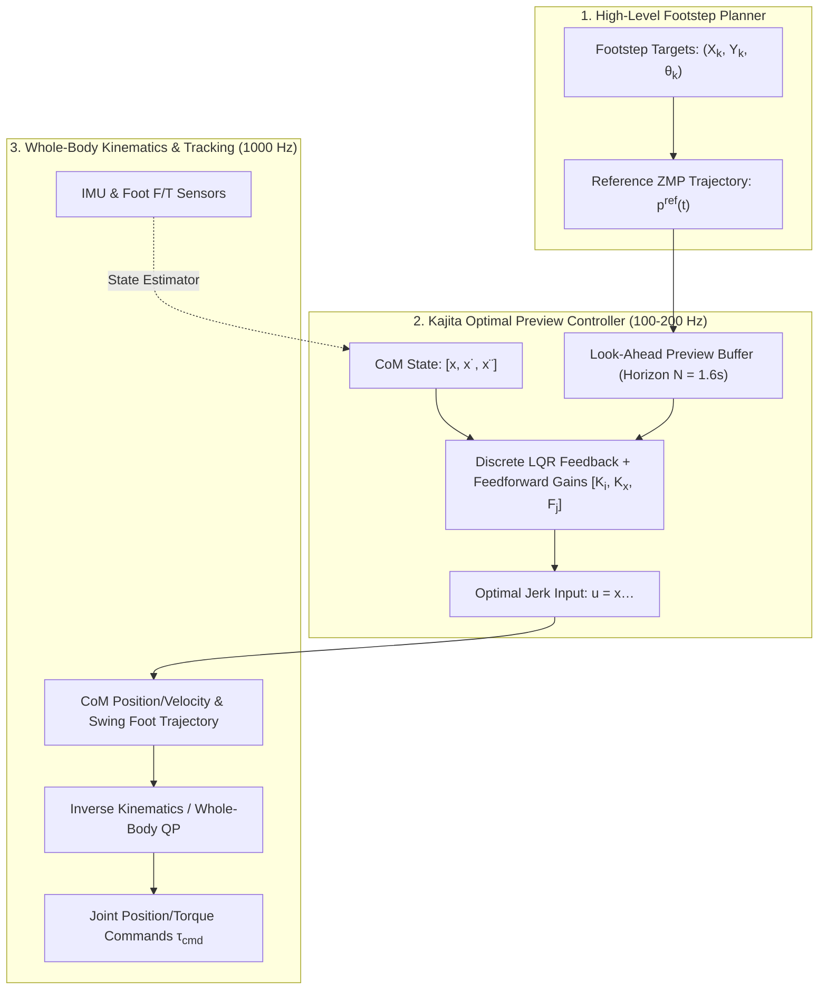
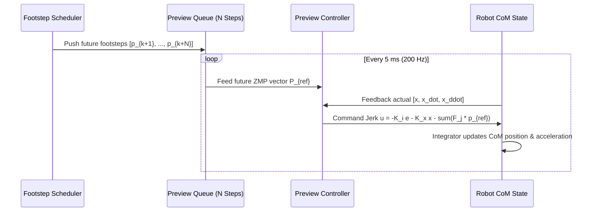

import ChapterProgress from '@site/src/components/ChapterProgress';
import QuizEngine from '@site/src/components/QuizEngine';

# The Zero-Moment Point (ZMP) & 3D Linear Inverted Pendulum Model

The Zero-Moment Point (ZMP) is one of the most influential concepts in bipedal robotics. Pioneered by Miomir Vukobratović in 1968, the ZMP criterion provides a rigorous condition for dynamic balance: as long as the point where the ground reaction force acts with zero horizontal torque remains strictly within the interior of the robot's foot support polygon, the robot will not rotate or tip over its foot edges.

However, calculating the ZMP directly from the full 30+ degree-of-freedom multi-body dynamics of a humanoid robot yields highly non-linear, coupled differential equations that cannot be solved analytically in real-time. The breakthrough that made modern dynamic humanoids like Honda ASIMO and HRP-2 possible was Shuuji Kajita's formulation of the **3D Linear Inverted Pendulum Model (3D-LIPM)** and its integration with **Preview Control**. By constraining the robot's Center of Mass (CoM) to move along a horizontal plane, the non-linear pendulum dynamics decouple into two independent, linear cart-table equations that can be solved with deterministic quadratic preview optimization.



---

## 1. D'Alembert's Principle & The Zero-Moment Point Definition

Consider a multi-link humanoid robot composed of $N$ rigid bodies. Each link $i$ has mass $m_i$, Center of Mass position $\mathbf{r}_i$, linear acceleration $\ddot{\mathbf{r}}_i$, and angular momentum rate $\dot{\mathbf{H}}_i$ about its link CoM.

By D'Alembert's principle, the dynamic equilibrium of the robot under external ground reaction forces $\mathbf{F}_{\text{net}}$ and moments $\mathbf{M}_{\text{net}}$ satisfies:

$$
\mathbf{F}_{\text{net}} + \sum_{i=1}^N m_i (\mathbf{g} - \ddot{\mathbf{r}}_i) = \mathbf{0}
$$

$$
\mathbf{M}_{\text{net}}(\mathbf{p}) + \sum_{i=1}^N \left[ (\mathbf{r}_i - \mathbf{p}) \times m_i (\mathbf{g} - \ddot{\mathbf{r}}_i) - \dot{\mathbf{H}}_i \right] = \mathbf{0}
$$

where $\mathbf{p} = [p_x, p_y, p_z]^T$ is an arbitrary reference point on the ground surface ($p_z = 0$).

### Formal ZMP Definition

The **Zero-Moment Point** $\mathbf{p}_{\text{zmp}} = [p_x, p_y, 0]^T$ is the unique point on the ground contact plane where the horizontal components of the net inertial and gravitational moments are identically zero:

$$
M_x(\mathbf{p}_{\text{zmp}}) = 0, \quad M_y(\mathbf{p}_{\text{zmp}}) = 0
$$

Expanding the cross-product components yields the exact multi-body ZMP equations:

$$
p_x = \frac{\sum_{i=1}^N m_i (\ddot{z}_i + g) x_i - \sum_{i=1}^N m_i \ddot{x}_i z_i - \sum_{i=1}^N \dot{H}_{i,y}}{\sum_{i=1}^N m_i (\ddot{z}_i + g)}
$$

$$
p_y = \frac{\sum_{i=1}^N m_i (\ddot{z}_i + g) y_i - \sum_{i=1}^N m_i \ddot{y}_i z_i + \sum_{i=1}^N \dot{H}_{i,x}}{\sum_{i=1}^N m_i (\ddot{z}_i + g)}
$$

### Center of Pressure (CoP) Equivalence

When the robot's foot is in planar contact with the ground without slippage, the ground reaction force distribution $f_z(x, y)$ generates a Center of Pressure (CoP):

$$
x_{\text{cop}} = \frac{\int_{\mathcal{S}} x f_z(x, y) dx dy}{\int_{\mathcal{S}} f_z(x, y) dx dy}, \quad y_{\text{cop}} = \frac{\int_{\mathcal{S}} y f_z(x, y) dx dy}{\int_{\mathcal{S}} f_z(x, y) dx dy}
$$

Under continuous non-tipping contact, the **ZMP and CoP are physically identical**:

$$
\mathbf{p}_{\text{zmp}} \equiv \mathbf{p}_{\text{cop}} \in \mathrm{conv}(\mathcal{S}_{\text{support}})
$$

If dynamic disturbances force the calculated ZMP to move outside the convex hull of the foot sole, the physical CoP saturates at the foot edge, generating an unbalanced net tipping moment that pivots the robot around its foot boundary.

---

## 2. The 3D Linear Inverted Pendulum Model (3D-LIPM)

To synthesize real-time walking trajectories, Kajita introduced two foundational simplifications:

1. **Lumped Mass Approximation**: The entire mass $M = \sum m_i$ is concentrated at the robot's primary Center of Mass $\mathbf{r} = [x, y, z]^T$, with negligible whole-body angular momentum variation ($\dot{\mathbf{H}} \approx \mathbf{0}$).
2. **Constant CoM Altitude Constraint**: The vertical motion is constrained to a fixed horizontal plane:
   $$
   z(t) \equiv z_c = \text{constant} \implies \dot{z} = 0, \; \ddot{z} = 0
   $$

Substituting $z = z_c$ and $\ddot{z} = 0$ into the multi-body ZMP equations yields the linear 3D-LIPM dynamics:

$$
p_x = x - \frac{z_c}{g}\ddot{x}
$$

$$
p_y = y - \frac{z_c}{g}\ddot{y}
$$

Defining the characteristic natural pendulum frequency $\omega_0$:

$$
\omega_0 = \sqrt{\frac{g}{z_c}}
$$

The equations simplify to the canonical uncoupled forms:

$$
\ddot{x} = \omega_0^2 (x - p_x)
$$

$$
\ddot{y} = \omega_0^2 (y - p_y)
$$

Notice that the acceleration $\ddot{x}$ is directed **away** from the ZMP $p_x$, characterizing an intrinsically unstable, repelling first-order saddle-point system. Stable walking requires active closed-loop modulation.

---

## 3. Kajita's Preview Control Formulation

If one applies standard causal feedback control to track a target ZMP $p^{\text{ref}}(t)$, the non-minimum phase characteristics of the inverted pendulum cause the Center of Mass to lean in the wrong direction before stabilizing. Shuuji Kajita (2003) solved this by recognizing that in bipedal walking, **future footstep locations are known in advance**.

By utilizing a future look-ahead horizon (typically $N \approx 1.6\text{--}2.0$ seconds, corresponding to 2 to 3 future steps), the controller can pre-emptively lean the robot's CoM in anticipation of upcoming footsteps.



### Discrete-Time State-Space Formulation

We choose the third derivative of CoM position (jerk) as the control input:

$$
\dddot{x}(t) = u(t)
$$

Discretizing with sampling period $\Delta t$ yields the continuous state vector $\mathbf{x}_k = [x_k, \dot{x}_k, \ddot{x}_k]^T$:

$$
\mathbf{x}_{k+1} = \mathbf{A} \mathbf{x}_k + \mathbf{B} u_k
$$

$$
p_k = \mathbf{C} \mathbf{x}_k
$$

where the discrete system matrices are:

$$
\mathbf{A} = \begin{bmatrix} 1 & \Delta t & \frac{\Delta t^2}{2} \\ 0 & 1 & \Delta t \\ 0 & 0 & 1 \end{bmatrix}, \quad 
\mathbf{B} = \begin{bmatrix} \frac{\Delta t^3}{6} \\ \frac{\Delta t^2}{2} \\ \Delta t \end{bmatrix}, \quad 
\mathbf{C} = \begin{bmatrix} 1 & 0 & -\frac{z_c}{g} \end{bmatrix}
$$

### Augmented Error System & Optimal Cost Function

To guarantee zero steady-state tracking error, we augment the state vector with the ZMP tracking error $e_k = p_k - p^{\text{ref}}_k$:

$$
\tilde{\mathbf{x}}_{k+1} = \begin{bmatrix} e_{k+1} \\ \Delta \mathbf{x}_{k+1} \end{bmatrix} = \begin{bmatrix} 1 & \mathbf{C}\mathbf{A} \\ \mathbf{0} & \mathbf{A} \end{bmatrix} \begin{bmatrix} e_k \\ \Delta \mathbf{x}_k \end{bmatrix} + \begin{bmatrix} \mathbf{C}\mathbf{B} \\ \mathbf{B} \end{bmatrix} \Delta u_k + \begin{bmatrix} -1 \\ \mathbf{0} \end{bmatrix} \Delta p^{\text{ref}}_{k+1}
$$

where $\Delta \mathbf{x}_k = \mathbf{x}_k - \mathbf{x}_{k-1}$ and $\Delta u_k = u_k - u_{k-1}$.

The preview optimization objective minimizes tracking error, state variation, and control effort over infinite horizon with $N$ look-ahead preview steps:

$$
J = \sum_{i=k}^{\infty} \left[ Q_e e_i^2 + \Delta \mathbf{x}_i^T \mathbf{Q}_x \Delta \mathbf{x}_i + R (\Delta u_i)^2 \right]
$$

### The Optimal Preview Control Law

Solving the algebraic Riccati equation yields the closed-form preview control law:

$$
u_k = -K_i \sum_{i=0}^k (p_i - p_i^{\text{ref}}) - \mathbf{K}_x \mathbf{x}_k - \sum_{j=1}^N F_j p_{k+j}^{\text{ref}}
$$

where:
- $K_i \in \mathbb{R}$ is the integral error tracking gain.
- $\mathbf{K}_x \in \mathbb{R}^{1 \times 3}$ is the state feedback gain vector.
- $F_j \in \mathbb{R}$ are the feedforward preview gains weighting future reference footsteps $j$ steps into the future. The preview gains decay exponentially ($F_j \to 0$ as $j \to \infty$), showing that footsteps beyond 2 seconds have diminishing influence on immediate motion.

---

## 4. Modeling Paradigms: Comparative Matrix

| Characteristic | 3D-LIPM (Kajita) | Cart-Table Model | Full Multi-Body Dynamics |
| :--- | :--- | :--- | :--- |
| **CoM Height $z(t)$** | Fixed horizontal plane ($z \equiv z_c$) | Variable horizontal / inclined | Fully unconstrained 3D motion |
| **Angular Momentum** | Neglected ($\dot{\mathbf{H}} \equiv \mathbf{0}$) | Neglected ($\dot{\mathbf{H}} \equiv \mathbf{0}$) | Rigorously modeled across all links |
| **Mathematical Nature** | Decoupled Linear ODEs | Linear State-Space with Jerk input | Highly non-linear, coupled PDEs |
| **Computational Cost** | $\approx 0.05$ ms (Closed-form LQR) | $\approx 0.1$ ms (Quadratic Program) | $5\text{--}50$ ms (Non-linear Trajectory Opt) |
| **Terrain Capability** | Flat horizontal ground | Stepped flat terraces | Uneven, stairs, steep inclines |
| **Dynamic Range** | Normal walking ($v \le 1.5$ m/s) | Stepping, transitions | High-speed running, jumping |

---

## 5. Python Implementation: Kajita Preview Controller Simulation

The complete Python script below implements Kajita's discrete-time preview controller. It solves the discrete algebraic Riccati equation, synthesizes the preview gains $F_j$, and tracks a sequence of lateral and sagittal footsteps.

```python
"""
kajita_preview_control.py
Full implementation of Kajita's 3D-LIPM ZMP Preview Controller.
Generates dynamically stable CoM trajectories from reference footsteps.
"""

import numpy as np
import scipy.linalg
import matplotlib.pyplot as plt

class ZMPPreviewController:
    def __init__(self, z_c=0.80, dt=0.005, preview_horizon_sec=1.6, Q_e=1.0, R=1e-6):
        """
        Parameters:
        z_c: Constant Center of Mass height (m)
        dt: Control loop sample time (s)
        preview_horizon_sec: Future look-ahead window (s)
        Q_e: ZMP tracking error penalty weight
        R: Control jerk penalty weight
        """
        self.z_c = z_c
        self.g = 9.81
        self.dt = dt
        self.N = int(preview_horizon_sec / dt)
        self.Q_e = Q_e
        self.R = R

        # Discrete-time LIPM state matrices: State x = [pos, vel, accel]^T
        self.A = np.array([
            [1.0, dt, (dt**2) / 2.0],
            [0.0, 1.0, dt],
            [0.0, 0.0, 1.0]
        ])
        self.B = np.array([
            [(dt**3) / 6.0],
            [(dt**2) / 2.0],
            [dt]
        ])
        self.C = np.array([[1.0, 0.0, -self.z_c / self.g]])

        # Synthesize optimal preview gains via Riccati solution
        self._compute_gains()

    def _compute_gains(self):
        """Constructs augmented system and solves Discrete Algebraic Riccati Equation (DARE)."""
        # Augmented system: state is [e_k, delta_x_k]^T
        B_tilde = np.vstack([self.C @ self.B, self.B])
        C_tilde = np.hstack([np.array([[1.0]]), np.zeros((1, 3))])
        A_tilde = np.vstack([
            np.hstack([np.array([[1.0]]), self.C @ self.A]),
            np.hstack([np.zeros((3, 1)), self.A])
        ])

        Q_tilde = np.zeros((4, 4))
        Q_tilde[0, 0] = self.Q_e

        # Solve Riccati equation: P = A^T P A - (A^T P B)(R + B^T P B)^-1 (B^T P A) + Q
        P = scipy.linalg.solve_discrete_are(A_tilde, B_tilde, Q_tilde, np.array([[self.R]]))

        # Compute feedback gains
        factor = np.linalg.inv(np.array([[self.R]]) + B_tilde.T @ P @ B_tilde)
        K_tilde = factor @ (B_tilde.T @ P @ A_tilde)

        self.K_i = K_tilde[0, 0]
        self.K_x = K_tilde[0, 1:]

        # Closed-loop state transition matrix
        A_cl = A_tilde - B_tilde @ K_tilde

        # Synthesize preview feedforward gains F_j
        X_tilde = -A_cl.T @ P @ np.vstack([[1.0], [0.0], [0.0], [0.0]])
        self.F = np.zeros(self.N)
        self.F[0] = (factor @ B_tilde.T @ np.vstack([[1.0], [0.0], [0.0], [0.0]])).item()

        for j in range(1, self.N):
            self.F[j] = (factor @ B_tilde.T @ X_tilde).item()
            X_tilde = A_cl.T @ X_tilde

    def simulate(self, zmp_ref_x, zmp_ref_y):
        """Simulates 2D CoM trajectory following lateral and sagittal ZMP references."""
        num_steps = len(zmp_ref_x)
        # Pad reference to accommodate preview horizon
        padded_ref_x = np.pad(zmp_ref_x, (0, self.N), mode='edge')
        padded_ref_y = np.pad(zmp_ref_y, (0, self.N), mode='edge')

        # States: [pos, vel, accel]
        x_state = np.zeros(3)
        y_state = np.zeros(3)

        com_x = np.zeros(num_steps)
        com_y = np.zeros(num_steps)
        actual_zmp_x = np.zeros(num_steps)
        actual_zmp_y = np.zeros(num_steps)

        err_sum_x = 0.0
        err_sum_y = 0.0

        for k in range(num_steps):
            # Compute current actual ZMP
            p_x = (self.C @ x_state)[0]
            p_y = (self.C @ y_state)[0]
            actual_zmp_x[k] = p_x
            actual_zmp_y[k] = p_y
            com_x[k] = x_state[0]
            com_y[k] = y_state[0]

            # Accumulate tracking error
            err_x = p_x - padded_ref_x[k]
            err_y = p_y - padded_ref_y[k]
            err_sum_x += err_x
            err_sum_y += err_y

            # Compute future preview sum
            preview_sum_x = np.sum(self.F * padded_ref_x[k + 1 : k + 1 + self.N])
            preview_sum_y = np.sum(self.F * padded_ref_y[k + 1 : k + 1 + self.N])

            # Preview control law (jerk commands)
            u_x = -self.K_i * err_sum_x - self.K_x @ x_state - preview_sum_x
            u_y = -self.K_i * err_sum_y - self.K_x @ y_state - preview_sum_y

            # Forward state integration
            x_state = self.A @ x_state + (self.B.flatten() * u_x)
            y_state = self.A @ y_state + (self.B.flatten() * u_y)

        return com_x, com_y, actual_zmp_x, actual_zmp_y

if __name__ == "__main__":
    dt = 0.01
    sim_time = 10.0
    steps = int(sim_time / dt)

    # Generate synthetic footstep ZMP references
    ref_x = np.linspace(0.0, 3.0, steps)
    # Lateral alternating foot placements (+- 0.15 m)
    ref_y = 0.15 * np.sign(np.sin(2 * np.pi * 0.8 * np.linspace(0, sim_time, steps)))

    controller = ZMPPreviewController(z_c=0.8, dt=dt, preview_horizon_sec=1.6)
    cx, cy, zx, zy = controller.simulate(ref_x, ref_y)
    
    print("Preview control simulation complete.")
    print(f"Final CoM Position: X={cx[-1]:.2f}m, Y={cy[-1]:.2f}m")
```

---

## 6. Seminal Literature & Academic References

1. **Vukobratović, M., & Borovac, B. (2004).** *Zero-moment point—thirty five years of its life*. International Journal of Humanoid Robotics, 1(01), 157-173.
   - *Annotation*: Comprehensive historical and mathematical review of the ZMP concept from its 1968 inception through three decades of dynamic humanoid developments.
2. **Kajita, S., Kanehiro, F., Kaneko, K., Fujiwara, K., Harada, K., Yokoi, K., & Hirukawa, H. (2003).** *Biped walking pattern generation by using preview control of zero-moment point*. In IEEE International Conference on Robotics and Automation (ICRA) (Vol. 2, pp. 1620-1626).
   - *Annotation*: The landmark paper that introduced discrete-time optimal preview control for the 3D-LIPM cart-table system, forming the backbone of HRP-2 and ASIMO.
3. **Wieber, P. B. (2006).** *Trajectory free linear model predictive control for stable walking in the presence of strong perturbations*. In IEEE-RAS International Conference on Humanoid Robots (pp. 137-142).
   - *Annotation*: Formulated ZMP walking pattern generation as a receding-horizon Quadratic Program (QP) with inequality constraints, laying the groundwork for modern MPC.
4. **Sardain, P., & Bessonnet, G. (2004).** *Forces acting on a biped robot. Center of pressure-zero moment point*. IEEE Transactions on Systems, Man, and Cybernetics-Part A: Systems and Humans, 34(5), 630-637.
   - *Annotation*: Rigorous mathematical clarification of the relationship between ground contact force distributions, the Center of Pressure (CoP), and the ZMP.

---

## 7. Hands-On Lab Project: Preview Controller Gain Tuning & Perturbation Resistance

### Objective
Examine how preview horizon duration $N$ and tracking penalty $Q_e$ affect the humanoid CoM trajectory. Test the controller's robustness against sudden ground height perturbations.

### Deliverables & Verification
1. Run the Python simulator with preview horizon $T_{\text{prev}} \in [0.4\text{s}, 0.8\text{s}, 1.6\text{s}]$.
2. Plot the resulting CoM trajectory against reference ZMP. Observe that shorter preview horizons produce excessive overshoot and phase lag.
3. Inject an impulsive lateral displacement disturbance $\Delta x = +0.08$ m at $t = 3.0$ s.
4. Verify that the closed-loop controller restores the actual ZMP to the interior of the foot sole without diverging.

---

<ChapterProgress chapterId="6-2-zero-moment-point" moduleId="module6" totalChapters={10} />

## Chapter Mastery Check

<QuizEngine
  quizId="quiz-6-2"
  title="Module 6.2 Mastery Check: ZMP & Preview Control"
  moduleId="module6"
  passThreshold={70}
  questions={[
    {
      id: "q1",
      question: "Under what physical condition does the Zero-Moment Point (ZMP) become completely identical to the Center of Pressure (CoP)?",
      options: [
        "Only when the robot is operating on the surface of the Moon",
        "Whenever the foot maintains planar, non-slipping contact with the ground and does not tip over its edges",
        "Only during ballistic jumping phases",
        "When the robot's joint velocities are all zero"
      ],
      correctIndex: 1,
      explanation: "Under stable, non-tipping surface contact on a flat plane, the point where ground reaction forces produce zero horizontal moment is identically the physical Center of Pressure."
    },
    {
      id: "q2",
      question: "Why does standard causal (non-preview) feedback control struggle to track reference ZMP trajectories accurately?",
      options: [
        "Because the Linear Inverted Pendulum Model possesses non-minimum phase characteristics where the CoM must lean backward before accelerating forward",
        "Because Python cannot compute matrix inversions fast enough",
        "Because the robot's electric motors cannot reverse direction",
        "Because the ground friction coefficient becomes infinite"
      ],
      correctIndex: 0,
      explanation: "The transfer function from CoM acceleration to ZMP contains an unstable zero (non-minimum phase). Looking ahead into future footstep references via preview control allows the controller to anticipate and eliminate phase lag."
    },
    {
      id: "q3",
      question: "In the 3D Linear Inverted Pendulum Model, what primary assumption enables the decoupling and linearization of the equations of motion?",
      options: [
        "The robot walks on an infinite treadmill",
        "The Center of Mass is constrained to move along a strictly horizontal plane with constant altitude z(t) = z_c and zero vertical acceleration",
        "The robot has zero mass",
        "The legs are modeled as massless ropes"
      ],
      correctIndex: 1,
      explanation: "By enforcing constant CoM height z(t) = z_c (which implies z_ddot = 0) and negligible whole-body angular momentum rate, the non-linear pendulum dynamics reduce to two independent linear differential equations."
    }
  ]}
/>
