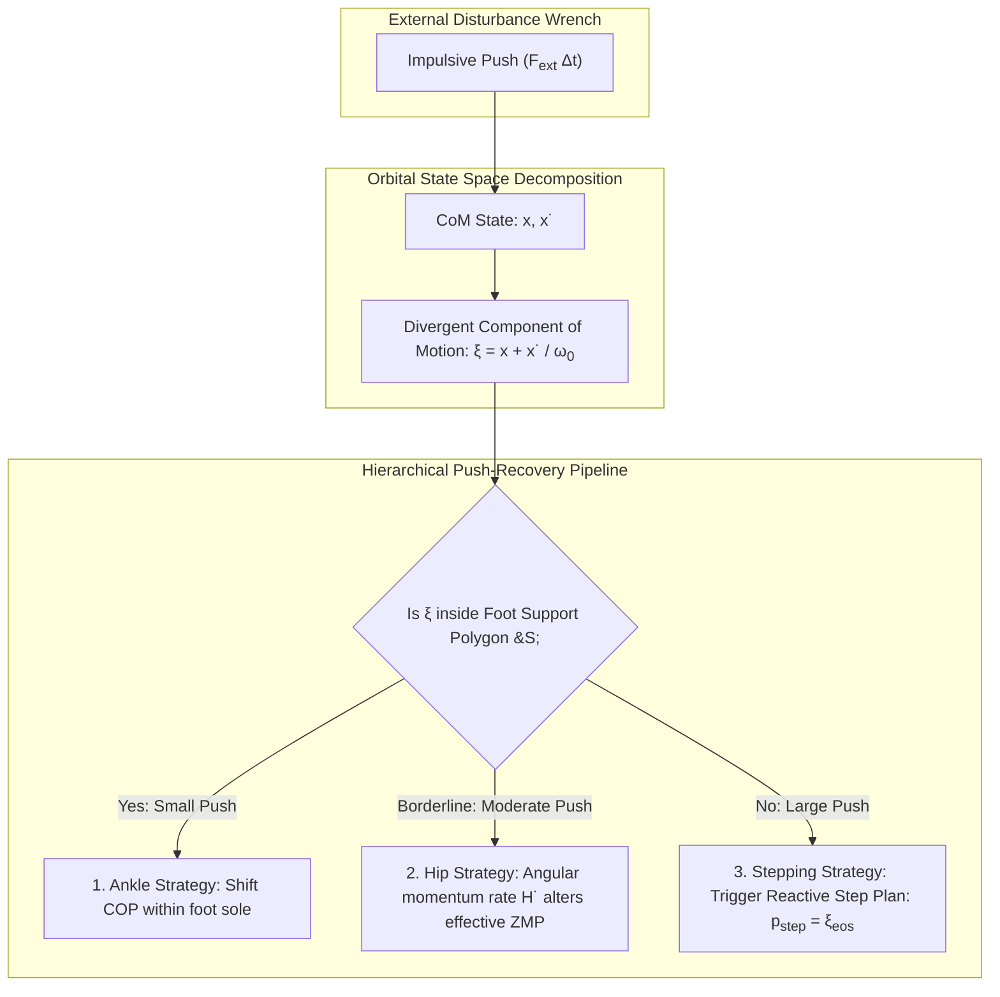
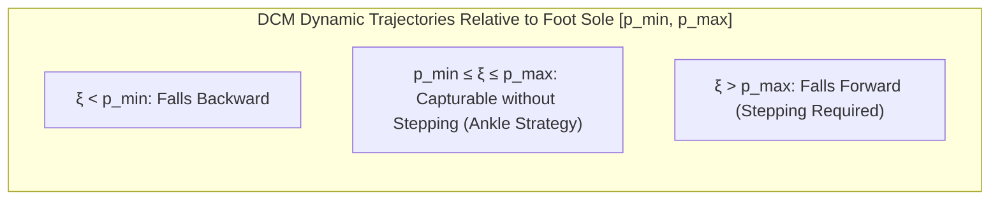

import ChapterProgress from '@site/src/components/ChapterProgress';
import QuizEngine from '@site/src/components/QuizEngine';

# Divergent Component of Motion (DCM) & Capture Point Step Planning

While the Zero-Moment Point (ZMP) preview controller works exceptionally well for generating smooth, planned walking patterns on flat terrain, it is fundamentally an open-loop or low-bandwidth feedforward trajectory generator. When an unexpected physical push occurs—such as a collision with an obstacle or slipping on a slick surface—the robot cannot simply wait for a 1.6-second preview horizon to adapt. It requires an instantaneous, closed-form metric that dictates: *Where must the robot step right now to prevent falling?*

The **Capture Point (CP)**, also formalized as the **Divergent Component of Motion (DCM)**, provides this exact analytical criterion. Developed independently by Jerry Pratt et al. (2006) and Johannes Englsberger et al. (2011, 2015), the DCM decomposes the second-order unstable 3D-LIPM dynamics into two decoupled first-order systems: an unconditionally stable converging mode and a repelling divergent mode. By regulating the divergent component through ankle moments, hip torques, and reactive footstep placement, humanoids can withstand large external impacts and recover their balance within a single step.



---

## 1. Mathematical Derivation of the DCM Decomposition

Recall the canonical 3D Linear Inverted Pendulum Model (3D-LIPM) equation of motion in one horizontal dimension:

$$
\ddot{x} = \omega_0^2 (x - p)
$$

where $\omega_0 = \sqrt{g / z_c}$ and $p$ denotes the Zero-Moment Point.

This second-order ordinary differential equation has eigenvalues $\lambda_{1,2} = \pm \omega_0$, indicating a classic **saddle-point topology** with one exponentially decaying stable eigenvector and one exponentially exploding unstable eigenvector.

### Linear Coordinate Transformation

We define two new state variables representing the stable and unstable modal coordinates:

1. **Divergent Component of Motion (DCM / Instantaneous Capture Point)**:
   $$
   \xi = x + \frac{\dot{x}}{\omega_0}
   $$
2. **Convergent Component of Motion**:
   $$
   \eta = x - \frac{\dot{x}}{\omega_0}
   $$

Differentiating the DCM $\xi$ with respect to time:

$$
\dot{\xi} = \dot{x} + \frac{\ddot{x}}{\omega_0} = \dot{x} + \frac{\omega_0^2 (x - p)}{\omega_0} = \dot{x} + \omega_0 x - \omega_0 p
$$

Noticing that $\dot{x} + \omega_0 x = \omega_0 \left( x + \frac{\dot{x}}{\omega_0} \right) = \omega_0 \xi$, we obtain:

$$
\dot{\xi} = \omega_0 (\xi - p)
$$

Similarly, differentiating the convergent component $\eta$:

$$
\dot{\eta} = \dot{x} - \frac{\ddot{x}}{\omega_0} = \dot{x} - \omega_0 (x - p) = -\omega_0 \left( x - \frac{\dot{x}}{\omega_0} \right) + \omega_0 p = -\omega_0 (\eta - p)
$$

### Physical Interpretation

The second-order system $\ddot{x} = \omega_0^2(x - p)$ has been split into two independent first-order equations:

- **$\dot{\eta} = -\omega_0 (\eta - p)$**: Exponentially stable mode with time constant $\tau = 1/\omega_0 \approx 0.28$ s. Regardless of the control input, $\eta(t)$ automatically contracts toward $p(t)$.
- **$\dot{\xi} = \omega_0 (\xi - p)$**: Strictly unstable mode with positive pole $+\omega_0$. The DCM $\xi(t)$ accelerates **away** from the ZMP $p(t)$.

**All stability problems in bipedal locomotion reduce to controlling the divergent variable $\xi(t)$!** If $\xi(t)$ is brought to rest at a point $\xi^* = p$, then $\dot{\xi} = 0$, which immediately implies $x = p$ and $\dot{x} = 0$: the Center of Mass comes to a complete halt directly over the support point.

---

## 2. The Instantaneous Capture Point (ICP)

The **Instantaneous Capture Point** $\mathbf{r}_{\text{icp}}$ is defined by Jerry Pratt et al. as the exact point on the ground where the robot must step to bring its Center of Mass to a complete stop without requiring any net change in joint angular momentum:

$$
\mathbf{r}_{\text{icp}} = \mathbf{x} + \frac{\dot{\mathbf{x}}}{\omega_0} \equiv \boldsymbol{\xi}
$$

### Capture Point Phase Portrait

Integrating $\dot{\xi} = \omega_0(\xi - p)$ for a constant ZMP location $p$ over duration $\Delta t$:

$$
\xi(t + \Delta t) = p + (\xi(t) - p) e^{\omega_0 \Delta t}
$$

This equation reveals three distinct dynamic regimes:

1. **$\xi(0) = p$**: Equilibrium. $\xi(t) \equiv p$ for all $t$. The CoM coasts smoothly and comes to rest asymptotically directly above the support foot.
2. **$\xi(0) > p$**: The DCM accelerates forward away from $p$. The robot falls forward unless a forward step is taken.
3. **$\xi(0) < p$**: The DCM accelerates backward away from $p$. The robot falls backward.



---

## 3. The Push-Recovery Tri-Strategy

When an external force imparts an impulse $\Delta \mathbf{p} = \int \mathbf{F}_{\text{ext}} dt$, the robot's CoM velocity changes instantaneously by $\Delta \dot{\mathbf{x}} = \Delta \mathbf{p} / M$. This causes an immediate jump in the DCM:

$$
\Delta \boldsymbol{\xi} = \frac{\Delta \dot{\mathbf{x}}}{\omega_0} = \frac{\Delta \mathbf{p}}{M \omega_0}
$$

Humanoids employ three hierarchical control strategies to reject this disturbance:

### Strategy 1: The Ankle Strategy (COP Modulation)
If the perturbed DCM remains inside the foot support polygon ($\boldsymbol{\xi} \in \mathcal{S}_{\text{foot}}$):
- The robot does not need to move its joints or step.
- It shifts the physical Center of Pressure $p$ to the opposite side of $\xi$, exploiting $\dot{\xi} = \omega_0(\xi - p)$ to drive $\xi$ back toward the center of the foot.
- Maximum impulse capacity is bounded by foot length $L$ and width $W$:
  $$
  \Delta p_{\max} \approx M \omega_0 \frac{L}{2}
  $$

### Strategy 2: The Hip Strategy (Torso Angular Acceleration)
If the push exceeds the ankle torque capacity but foot contact must be preserved:
- The robot rapidly articulates its hips and torso, generating angular momentum rate $\dot{\mathbf{H}}_{\text{torso}} = \mathbf{I}_{\text{torso}}\ddot{\boldsymbol{\theta}}_{\text{torso}}$.
- This injects a fictitious moment at the ground, creating a virtual ZMP $p_v$ that temporarily exceeds the physical foot boundary:
  $$
  p_v = p_{\text{cop}} - \frac{\dot{H}_y}{M g}
  $$
- The robot bends forward at the waist to recover from a backward push, or arches backward to recover from a forward push.

### Strategy 3: The Stepping Strategy (Capture Point Replanning)
When $\boldsymbol{\xi}$ is pushed completely outside the reach of ankle and hip strategies:
- The robot must immediately place its swing foot at a new location to capture the DCM.
- Let $T_{\text{step}}$ be the remaining swing duration. At the end of the step (End of Step, EoS), the DCM will have drifted to:
  $$
  \boldsymbol{\xi}_{\text{eos}} = \mathbf{p}_{\text{stance}} + (\boldsymbol{\xi}(t) - \mathbf{p}_{\text{stance}}) e^{\omega_0 (T_{\text{step}} - t)}
  $$
- To capture the walker in the next step, the landing target for the swing foot must satisfy:
  $$
  \mathbf{p}_{\text{step}} = \boldsymbol{\xi}_{\text{eos}}
  $$

---

## 4. Multi-Column Strategy Comparison

| Metric | Ankle Strategy | Hip Strategy | Stepping Strategy |
| :--- | :--- | :--- | :--- |
| **Perturbation Size** | Small ($\Delta v < 0.15$ m/s) | Medium ($0.15 \le \Delta v \le 0.4$ m/s) | Large ($\Delta v > 0.4$ m/s) |
| **Foot Movement** | Zero (Foot stationary) | Zero (Foot stationary) | Active swing foot replanning |
| **Actuation Source** | Ankle pitch/roll motors | Hip pitch & Torso actuators | Full lower-limb kinematic chain |
| **Recovery Latency** | Instantaneous ($< 10$ ms) | Fast ($20\text{--}50$ ms) | Gait-cycle dependent ($200\text{--}400$ ms) |
| **Energy Consumption** | Minimal | High (Vigorous torso motion) | Moderate to High |
| **Footwear Dependency** | Requires rigid, wide foot sole | Requires rigid foot sole | Applicable to point-foot / curved feet |

---

## 5. N-Step Capturability

In real robots, kinematic leg length limits $L_{\max}$ and joint velocity saturation prevent the robot from placing its foot arbitrarily far in a single step. **N-Step Capturability** (Koolen et al., 2012) answers whether a biped can come to a stop in $N$ steps:

1. **0-Step Capturable**: The DCM can be captured purely through ankle and hip strategies within the current support polygon ($\boldsymbol{\xi} \in \mathcal{C}_0 = \mathcal{S}$).
2. **1-Step Capturable**: The DCM can be captured by taking a single step into the reachable footprint basin $\mathcal{R}_1$:
   $$
   \mathcal{C}_1 = \left\{ \mathbf{x} \mid \exists \mathbf{p}_{\text{step}} \in \mathcal{R}_1 \text{ s.t. } \boldsymbol{\xi}_{\text{eos}}(\mathbf{x}, \mathbf{p}_{\text{stance}}) \in \mathbf{p}_{\text{step}} + \mathcal{S} \right\}
   $$
3. **N-Step Capturable**: A recursive backward-reachable set where step $k$ brings the state into the $(N-k)$-step capturable basin:
   $$
   \mathcal{C}_N = \mathrm{Pre}(\mathcal{C}_{N-1})
   $$

If the robot's state ever exits the boundary of $\mathcal{C}_N$, a fall is mathematically unavoidable.

---

## 6. Python Implementation: Reactive DCM Footstep Replanner

The script below implements an online DCM push-recovery controller. It monitors the instantaneous state of the humanoid, detects an impulsive disturbance, and dynamically adjusts the swing foot landing coordinates to capture the DCM.

```python
"""
dcm_push_recovery.py
Instantaneous Capture Point & Divergent Component of Motion Push Recovery.
Simulates ankle strategy COP shifting and dynamic 1-step capture footstep replanning.
"""

import numpy as np
import matplotlib.pyplot as plt

class DCMPushRecoveryPlanner:
    def __init__(self, z_c=0.85, foot_length=0.22, foot_width=0.12, t_step=0.4):
        """
        Parameters:
        z_c: CoM height (m)
        foot_length: Dimension in sagittal plane (m)
        foot_width: Dimension in lateral plane (m)
        t_step: Duration of swing step (s)
        """
        self.g = 9.81
        self.z_c = z_c
        self.omega_0 = np.sqrt(self.g / self.z_c)
        self.foot_l = foot_length
        self.foot_w = foot_width
        self.t_step = t_step

    def compute_dcm(self, com_pos, com_vel):
        """Computes Instantaneous Capture Point xi = x + x_dot / omega_0"""
        return com_pos + (com_vel / self.omega_0)

    def evaluate_recovery_strategy(self, dcm, stance_p, t_remaining):
        """
        Evaluates push recovery hierarchy:
        1. Ankle Strategy: Modulate COP within foot boundaries.
        2. Stepping Strategy: Calculate required swing foot placement.
        """
        # Distance from current stance foot center
        dcm_offset = dcm - stance_p

        # Foot boundary limits
        half_l = self.foot_l / 2.0
        half_w = self.foot_w / 2.0

        # Check Ankle Strategy feasibility
        if abs(dcm_offset[0]) <= half_l and abs(dcm_offset[1]) <= half_w:
            # Capturable via ankle strategy: COP tracks DCM
            target_cop = np.clip(
                dcm,
                [stance_p[0] - half_l, stance_p[1] - half_w],
                [stance_p[0] + half_l, stance_p[1] + half_w]
            )
            return "ANKLE_STRATEGY", target_cop, None

        # Outside foot sole -> Stepping Strategy Required
        # Predict DCM at End of Step (EoS)
        dcm_eos = stance_p + (dcm - stance_p) * np.exp(self.omega_0 * t_remaining)
        
        # New footstep must coincide with predicted DCM EoS
        target_step_pos = np.copy(dcm_eos)

        return "STEPPING_STRATEGY", stance_p, target_step_pos

def simulate_push_event():
    planner = DCMPushRecoveryPlanner(z_c=0.85, t_step=0.4)
    dt = 0.005
    total_time = 0.8
    steps = int(total_time / dt)

    # Initial state: steady walking forward
    com_pos = np.array([0.0, 0.0])
    com_vel = np.array([0.2, 0.0])
    stance_foot = np.array([0.0, 0.0])
    t_remaining = 0.35

    print(f"Initial CoM Pos: {com_pos}, Initial CoM Vel: {com_vel}")
    dcm_initial = planner.compute_dcm(com_pos, com_vel)
    print(f"Initial DCM (ICP): {dcm_initial}")

    # Inject sudden impulsive disturbance at t = 0.1s
    # Large forward push: Delta v = +0.55 m/s
    push_delta_v = np.array([0.55, 0.15])
    com_vel += push_delta_v
    print(f"\n[ALERT] Impulsive Push Received! New CoM Vel: {com_vel}")

    # Re-evaluate DCM immediately after impact
    dcm_perturbed = planner.compute_dcm(com_pos, com_vel)
    print(f"Perturbed DCM (ICP): {dcm_perturbed}")

    strategy, cop_cmd, step_cmd = planner.evaluate_recovery_strategy(
        dcm_perturbed, stance_foot, t_remaining
    )

    print(f"Selected Strategy: {strategy}")
    if step_cmd is not None:
        print(f"Reactive Swing Foot Step Landing Target: X={step_cmd[0]:.3f}m, Y={step_cmd[1]:.3f}m")

if __name__ == "__main__":
    simulate_push_event()
```

---

## 7. Seminal Literature & Academic References

1. **Pratt, J., Carff, J., Drakunov, S., & Goswami, A. (2006).** *Capture point: A step towards formulating intuitive concepts for bipedal locomotion*. In IEEE-RAS International Conference on Humanoid Robots (pp. 399-404).
   - *Annotation*: Introduced the concept of the Instantaneous Capture Point (ICP) and formulated the fundamental physical laws governing where a legged robot must step to stop.
2. **Koolen, T., de Boer, T., Rebula, J., Goswami, A., & Pratt, J. (2012).** *Capturability-based analysis and walking control via N-step capturability and instantaneous capture regions*. Autonomous Robots, 33(4), 307-333.
   - *Annotation*: The definitive expansion of capture point theory into multi-step viability sets, incorporating foot dimensions, kinematic limits, and terrain obstacles.
3. **Englsberger, J., Ott, C., & Albu-Schäffer, A. (2015).** *Three-dimensional bipedal walking control based on Divergent Component of Motion*. IEEE Transactions on Robotics, 31(2), 355-368.
   - *Annotation*: Formulated 3D walking using DCM trajectory generation with non-zero vertical CoM motions and multi-step preview replanning.
4. **Hof, A. L., Gazendam, M. G. J., & Sinke, W. E. (2005).** *The condition for dynamic stability*. Journal of Biomechanics, 38(1), 1-8.
   - *Annotation*: Biological biomechanics foundation defining the "extrapolated center of mass" (XCoM), mathematically identical to the robotic Capture Point.

---

## 8. Hands-On Lab Project: Impulse Boundary Testing

### Objective
Determine the maximum lateral and sagittal impulse velocity $\Delta v_{\max}$ that a simulated humanoid robot can reject using the ankle strategy alone, versus triggering a reactive step.

### Deliverables & Verification
1. Given foot length $L = 0.22$ m and foot width $W = 0.12$ m with $z_c = 0.85$ m:
2. Compute the theoretical maximum sagittal impulse velocity:
   $$
   \Delta v_{x,\max} = \frac{L}{2} \sqrt{\frac{g}{z_c}} = 0.11 \times \sqrt{\frac{9.81}{0.85}} \approx 0.374 \text{ m/s}
   $$
3. Run the Python simulator with impulse velocities from $0.1$ m/s to $0.8$ m/s in steps of $0.05$ m/s.
4. Verify that the planner switches from `ANKLE_STRATEGY` to `STEPPING_STRATEGY` at precisely $\Delta v_x = 0.38$ m/s.

---

<ChapterProgress chapterId="6-3-capture-point-and-dcm" moduleId="module6" totalChapters={10} />

## Chapter Mastery Check

<QuizEngine
  quizId="quiz-6-3"
  title="Module 6.3 Mastery Check: DCM & Capture Point"
  moduleId="module6"
  passThreshold={70}
  questions={[
    {
      id: "q1",
      question: "What physical quantity does the Instantaneous Capture Point (ICP) represent in legged robotics?",
      options: [
        "The highest point reached by the swing foot during toe-off",
        "The exact point on the ground where the robot must step to bring its Center of Mass to a complete stop",
        "The camera coordinate where the object was detected",
        "The geometric center of the pelvis link"
      ],
      correctIndex: 1,
      explanation: "The Instantaneous Capture Point (ICP) is the unique ground location where stepping brings the CoM velocity to zero without requiring internal angular momentum adaptation."
    },
    {
      id: "q2",
      question: "In the Divergent Component of Motion decomposition xi = x + x_dot / omega_0, what is the dynamic behavior of the divergent variable xi?",
      options: [
        "It acts as a first-order stable filter with negative pole",
        "It acts as a strictly unstable first-order system with dynamics xi_dot = omega_0 (xi - p), accelerating away from the Zero-Moment Point",
        "It oscillates with constant amplitude at 1000 Hz",
        "It remains zero under all conditions"
      ],
      correctIndex: 1,
      explanation: "The divergent component xi obeys xi_dot = omega_0 (xi - p). Because omega_0 > 0, xi accelerates away from the ZMP p, acting as the repelling unstable mode of the inverted pendulum."
    },
    {
      id: "q3",
      question: "When an impulsive push causes the DCM to shift outside the boundaries of the stance foot sole, what must the robot do to prevent falling?",
      options: [
        "Turn off all motor drives",
        "Execute a Stepping Strategy by taking a reactive step and placing the swing foot at the predicted End-of-Step DCM location",
        "Double the stiffness of the stance ankle",
        "Increase the camera exposure time"
      ],
      correctIndex: 1,
      explanation: "Once the DCM exits the support polygon, ankle torque can no longer counteract the divergent acceleration. The robot must step to place its new foot support beneath the migrating DCM."
    }
  ]}
/>
