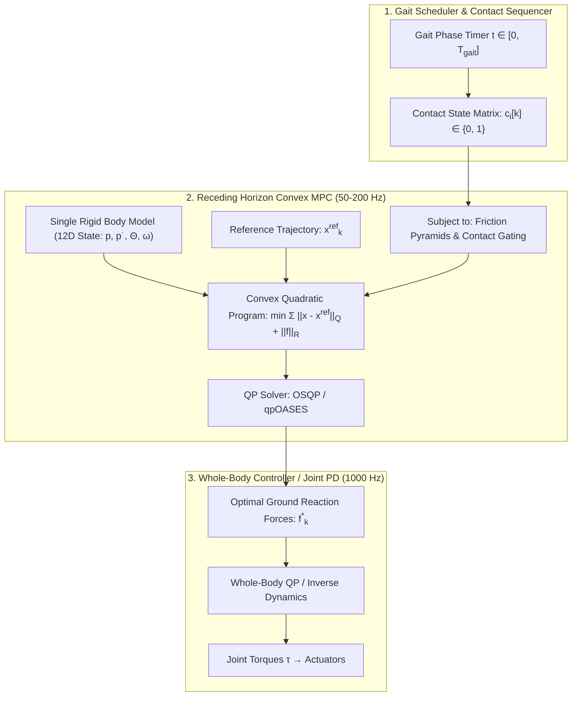
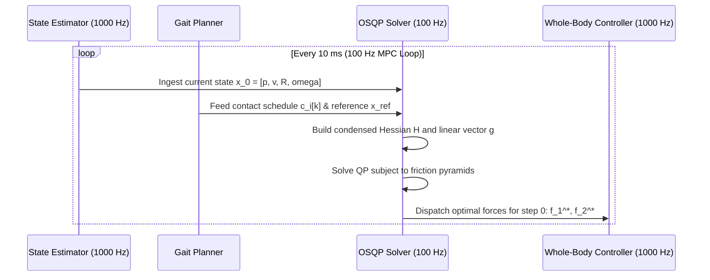

import ChapterProgress from '@site/src/components/ChapterProgress';
import QuizEngine from '@site/src/components/QuizEngine';

# Model Predictive Control for Legged Locomotion

While classical ZMP preview control constraints the Center of Mass to a flat horizontal plane and neglects whole-body angular momentum, real-world humanoid locomotion demands navigating 3D irregular terrain, ascending steep ramps, crouching beneath obstacles, and sustaining massive external collisions. To achieve this level of dynamic versatility, modern legged robotics relies on **Model Predictive Control (MPC)**.

Pioneered for high-speed quadrupeds by Di Carlo et al. (MIT Cheetah 3) and extended to dynamic humanoids (such as Boston Dynamics Atlas, Unitree H1/G1, and MIT Humanoid), **Convex MPC** treats the entire robot as a **Single Rigid Body (SRBD)**. By formulating optimal ground reaction forces over a finite prediction horizon as a convex Quadratic Program (QP), humanoids can solve for 3D contact forces at 100 Hz to 500 Hz while enforcing strict physical friction pyramids, torque ceilings, and contact schedules.



---

## 1. Single Rigid Body Dynamics (SRBD)

In high-degree-of-freedom legged robots, the torso and pelvis constitute the vast majority (typically 60% to 75%) of the total system mass. During stance, the legs act primarily as lightweight kinematic force transmitters between the ground and the torso. The **Single Rigid Body Dynamics (SRBD)** abstraction lumps the total robot mass $M$ and rotational inertia tensor $\mathbf{I}_G \in \mathbb{R}^{3 \times 3}$ into a single floating rigid body subjected to $N_c$ ground contact forces $\mathbf{f}_i$:

### Exact Non-Linear Newton-Euler Equations

$$
M \ddot{\mathbf{p}} = \sum_{i=1}^{N_c} \mathbf{f}_i - M \mathbf{g}
$$

$$
\frac{d}{dt} \left( \mathbf{I}_G \boldsymbol{\omega} \right) = \sum_{i=1}^{N_c} (\mathbf{r}_i - \mathbf{p}) \times \mathbf{f}_i
$$

where:
- $\mathbf{p} \in \mathbb{R}^3$ is the Cartesian position of the Center of Mass in the world inertial frame.
- $\mathbf{r}_i \in \mathbb{R}^3$ is the physical contact point location of foot $i$ in the world frame.
- $\mathbf{f}_i \in \mathbb{R}^3$ is the ground reaction force vector applied at contact $i$.
- $\boldsymbol{\omega} \in \mathbb{R}^3$ is the angular velocity of the torso.
- $\mathbf{g} = [0, 0, 9.81]^T$ is the gravitational acceleration vector.

### Convex Linearization

The rotational dynamics are non-linear due to the orientation rotation matrix $\mathbf{R} \in \mathrm{SO}(3)$ and Coriolis terms $\boldsymbol{\omega} \times (\mathbf{I}_G \boldsymbol{\omega})$. To cast the dynamics into a **convex linear state-space form**, Di Carlo et al. perform two crucial linearizations:

1. **Small Euler Angle Assumption for Roll & Pitch**:
   Assuming roll $\phi$ and pitch $\theta$ remain small ($|\phi|, |\theta| \le 15^\circ$), while yaw $\psi$ can vary arbitrarily, the Euler angle rates $\dot{\boldsymbol{\Theta}} = [\dot{\phi}, \dot{\theta}, \dot{\psi}]^T$ relate to angular velocity via:
   $$
   \dot{\boldsymbol{\Theta}} \approx \mathbf{R}_z(\psi) \boldsymbol{\omega}
   $$
2. **Neglect Bilinear Inertia Rate**:
   In world coordinates, the rotational inertia tensor is $\mathbf{I} = \mathbf{R} \mathbf{I}_{\text{body}} \mathbf{R}^T$. For stable walking, $\dot{\mathbf{I}} \approx \mathbf{0}$, allowing:
   $$
   \mathbf{I} \dot{\boldsymbol{\omega}} \approx \sum_{i=1}^{N_c} [\mathbf{r}_i - \mathbf{p}]_\times \mathbf{f}_i
   $$
   where $[\mathbf{a}]_\times$ denotes the $3 \times 3$ skew-symmetric cross-product matrix:
   $$
   [\mathbf{a}]_\times = \begin{bmatrix} 0 & -a_z & a_y \\ a_z & 0 & -a_x \\ -a_y & a_x & 0 \end{bmatrix}
   $$

### Linear State-Space Representation

We define the 12-dimensional continuous state vector $\mathbf{x}(t)$ and control input vector $\mathbf{u}(t)$:

$$
\mathbf{x} = \begin{bmatrix} \boldsymbol{\Theta} \\ \mathbf{p} \\ \boldsymbol{\omega} \\ \dot{\mathbf{p}} \end{bmatrix} \in \mathbb{R}^{12}, \quad 
\mathbf{u} = \begin{bmatrix} \mathbf{f}_1 \\ \mathbf{f}_2 \end{bmatrix} \in \mathbb{R}^{6}
$$

The continuous state-space dynamics become:

$$
\dot{\mathbf{x}}(t) = \mathbf{A}_c \mathbf{x}(t) + \mathbf{B}_c(t) \mathbf{u}(t) + \mathbf{d}_c
$$

where:

$$
\mathbf{A}_c = \begin{bmatrix} 
\mathbf{0}_3 & \mathbf{0}_3 & \mathbf{R}_z(\psi) & \mathbf{0}_3 \\ 
\mathbf{0}_3 & \mathbf{0}_3 & \mathbf{0}_3 & \mathbf{I}_3 \\ 
\mathbf{0}_3 & \mathbf{0}_3 & \mathbf{0}_3 & \mathbf{0}_3 \\ 
\mathbf{0}_3 & \mathbf{0}_3 & \mathbf{0}_3 & \mathbf{0}_3 
\end{bmatrix}, \quad 
\mathbf{B}_c(t) = \begin{bmatrix} 
\mathbf{0}_3 & \mathbf{0}_3 \\ 
\mathbf{0}_3 & \mathbf{0}_3 \\ 
\mathbf{I}^{-1}[\mathbf{r}_1 - \mathbf{p}]_\times & \mathbf{I}^{-1}[\mathbf{r}_2 - \mathbf{p}]_\times \\ 
\frac{1}{M}\mathbf{I}_3 & \frac{1}{M}\mathbf{I}_3 
\end{bmatrix}, \quad 
\mathbf{d}_c = \begin{bmatrix} \mathbf{0}_3 \\ \mathbf{0}_3 \\ \mathbf{0}_3 \\ -\mathbf{g} \end{bmatrix}
$$

---

## 2. Receding Horizon Convex QP Formulation

We discretize the system over a prediction horizon of $N$ steps with sample interval $\Delta t$ (typically $\Delta t = 0.02$ s, $N = 15\text{--}25$, yielding a look-ahead horizon of $0.3\text{--}0.5$ s):

$$
\mathbf{x}_{k+1} = \mathbf{A}_k \mathbf{x}_k + \mathbf{B}_k \mathbf{u}_k + \mathbf{d}_k
$$

where $\mathbf{A}_k = \mathbf{I}_{12} + \mathbf{A}_c \Delta t$ and $\mathbf{B}_k = \mathbf{B}_c(t_k) \Delta t$.

### The Quadratic Objective Function

At every control cycle, the robot solves for the optimal sequence of contact forces $\mathbf{U} = [\mathbf{u}_0^T, \mathbf{u}_1^T, \dots, \mathbf{u}_{N-1}^T]^T$ that minimizes state deviation from a reference trajectory $\mathbf{x}_k^{\text{ref}}$ and control effort:

$$
\min_{\mathbf{U}} \sum_{k=0}^{N-1} \left( \|\mathbf{x}_k - \mathbf{x}_k^{\text{ref}}\|_{\mathbf{Q}}^2 + \|\mathbf{u}_k\|_{\mathbf{R}}^2 \right) + \|\mathbf{x}_N - \mathbf{x}_N^{\text{ref}}\|_{\mathbf{Q}_N}^2
$$

where $\mathbf{Q} \succeq 0$ penalizes tracking errors on torso orientation, altitude, and forward velocity, and $\mathbf{R} \succ 0$ penalizes force magnitudes.



---

## 3. Physical Inequality Constraints

For the generated contact forces to be physically realizable, they must satisfy unilateral contact, friction cone limits, and contact scheduling at every step $k \in \{0, \dots, N-1\}$:

### 1. Contact Schedule Gating
Let $c_i[k] \in \{0, 1\}$ be the scheduled contact status of foot $i$ at horizon step $k$ ($1$ for stance, $0$ for swing):

$$
c_i[k] f_{z,\min} \le f_{i,z}[k] \le c_i[k] f_{z,\max}
$$

During swing ($c_i[k] = 0$), the upper and lower bounds force $f_{i,z}[k] = 0$, immediately decoupling that foot from the ground.

### 2. Coulomb Friction Pyramid
The non-linear friction cone $\sqrt{f_x^2 + f_y^2} \le \mu f_z$ is approximated by a 4-sided conservative friction pyramid to preserve quadratic program convexity:

$$
-\mu f_{i,z}[k] \le f_{i,x}[k] \le \mu f_{i,z}[k]
$$

$$
-\mu f_{i,z}[k] \le f_{i,y}[k] \le \mu f_{i,z}[k]
$$

In matrix form for each foot $i$:

$$
\begin{bmatrix} 
1 & 0 & -\mu \\ 
-1 & 0 & -\mu \\ 
0 & 1 & -\mu \\ 
0 & -1 & -\mu \\ 
0 & 0 & 1 \\ 
0 & 0 & -1 
\end{bmatrix}
\begin{bmatrix} f_{i,x}[k] \\ f_{i,y}[k] \\ f_{i,z}[k] \end{bmatrix}
\le
\begin{bmatrix} 0 \\ 0 \\ 0 \\ 0 \\ c_i[k] f_{z,\max} \\ -c_i[k] f_{z,\min} \end{bmatrix}
$$

---

## 4. Modeling Paradigms: Comparative Matrix

| Criterion | Convex MPC (SRBD) | Full-Body Nonlinear MPC | Classical ZMP Preview |
| :--- | :--- | :--- | :--- |
| **Model Fidelity** | 6-DoF Rigid Body + Point/Flat Contacts | Full $(n+6)$-DoF multi-body articulated tree | 2D Cart-Table Inverted Pendulum |
| **Mathematical Structure** | Strictly Convex Quadratic Program (QP) | Non-convex Non-linear Program (NLP) | Linear Quadratic Regulator (LQR) |
| **Solver Technology** | OSQP, qpOASES, HPIPM | CasADi + IPOPT, ACADOS, Crocoddyl | Closed-form Riccati / Matrix inversion |
| **Solving Frequency** | $100\text{--}500$ Hz | $20\text{--}50$ Hz | $200\text{--}1000$ Hz |
| **Warm-Starting** | Extremely effective (10-20 iterations) | Sensitive to local minima | Not applicable (Direct solution) |
| **Terrain Versatility** | 3D steps, ramps, moderate obstacles | Full multi-contact acrobatic parkour | Strictly 2D flat planar ground |

---

## 5. Python Implementation: Convex MPC Locomotion Solver

The script below implements a complete, self-contained Convex MPC bipedal solver using quadratic programming. It constructs the prediction matrices over a multi-step horizon and computes optimal contact forces.

```python
"""
convex_mpc_biped.py
Convex Model Predictive Control for Bipedal Locomotion using Single Rigid Body Dynamics.
Solves for optimal ground reaction forces subject to friction pyramid constraints.
"""

import numpy as np
from scipy.optimize import minimize
import matplotlib.pyplot as plt

class BipedConvexMPC:
    def __init__(self, mass=45.0, horizon=10, dt=0.025, mu=0.6):
        """
        Parameters:
        mass: Humanoid total mass (kg)
        horizon: Prediction horizon steps N
        dt: MPC sampling time (s)
        mu: Ground friction coefficient
        """
        self.mass = mass
        self.g = 9.81
        self.N = horizon
        self.dt = dt
        self.mu = mu

        # Inertia tensor of torso (kg*m^2)
        self.I_body = np.diag([1.2, 1.0, 0.8])
        self.I_inv = np.linalg.inv(self.I_body)

        # State weights: [Theta(3), pos(3), omega(3), vel(3)]
        self.Q = np.diag([
            50.0, 50.0, 10.0,    # Roll, Pitch, Yaw
            200.0, 200.0, 500.0, # X, Y, Z CoM pos
            1.0, 1.0, 1.0,       # Angular velocities
            10.0, 10.0, 5.0      # Linear velocities
        ])
        # Force weights: [f1(3), f2(3)]
        self.R = np.eye(6) * 1e-4

    def build_discrete_dynamics(self, foot1_pos, foot2_pos, com_pos):
        """Constructs discrete A and B matrices for SRBD around current CoM."""
        r1 = foot1_pos - com_pos
        r2 = foot2_pos - com_pos

        # Skew-symmetric matrices [r]_x
        r1_hat = np.array([
            [0, -r1[2], r1[1]],
            [r1[2], 0, -r1[0]],
            [-r1[1], r1[0], 0]
        ])
        r2_hat = np.array([
            [0, -r2[2], r2[1]],
            [r2[2], 0, -r2[0]],
            [-r2[1], r2[0], 0]
        ])

        # Continuous Ac and Bc
        Ac = np.zeros((12, 12))
        Ac[0:3, 6:9] = np.eye(3)    # d(Theta)/dt = omega
        Ac[3:6, 9:12] = np.eye(3)   # d(p)/dt = v

        Bc = np.zeros((12, 6))
        Bc[6:9, 0:3] = self.I_inv @ r1_hat
        Bc[6:9, 3:6] = self.I_inv @ r2_hat
        Bc[9:12, 0:3] = np.eye(3) / self.mass
        Bc[9:12, 3:6] = np.eye(3) / self.mass

        # Euler discretization
        A = np.eye(12) + Ac * self.dt
        B = Bc * self.dt

        d = np.zeros(12)
        d[11] = -self.g * self.dt

        return A, B, d

    def solve(self, x0, x_ref, foot1_pos, foot2_pos, contact_schedule):
        """
        Solves QP:
        x0: Current state (12D)
        x_ref: Target state (12D)
        contact_schedule: (N, 2) array of booleans indicating stance status
        """
        num_inputs = 6 * self.N
        A, B, d = self.build_discrete_dynamics(foot1_pos, foot2_pos, x0[3:6])

        # Objective function
        def objective(u_flat):
            u_traj = u_flat.reshape((self.N, 6))
            x_curr = np.copy(x0)
            cost = 0.0

            for k in range(self.N):
                u_k = u_traj[k]
                x_curr = A @ x_curr + B @ u_k + d
                state_err = x_curr - x_ref
                cost += state_err.T @ self.Q @ state_err + u_k.T @ self.R @ u_k

            return cost

        # Linear inequality bounds (Friction Pyramids)
        bounds = []
        for k in range(self.N):
            for foot in range(2):
                c = contact_schedule[k, foot]
                if c == 1:
                    # Stance foot: f_z in [10, 800] N
                    bounds.extend([(-400.0, 400.0), (-400.0, 400.0), (10.0, 800.0)])
                else:
                    # Swing foot: forces clamped to zero
                    bounds.extend([(0.0, 0.0), (0.0, 0.0), (0.0, 0.0)])

        # Initial guess (even weight distribution)
        u0 = np.zeros((self.N, 6))
        for k in range(self.N):
            total_contacts = np.sum(contact_schedule[k])
            if total_contacts > 0:
                fz = (self.mass * self.g) / total_contacts
                if contact_schedule[k, 0]:
                    u0[k, 2] = fz
                if contact_schedule[k, 1]:
                    u0[k, 5] = fz

        res = minimize(objective, u0.flatten(), bounds=bounds, method='L-BFGS-B')
        optimal_forces = res.x.reshape((self.N, 6))
        return optimal_forces

if __name__ == "__main__":
    mpc = BipedConvexMPC(mass=45.0, horizon=8, dt=0.03)

    # Robot at rest standing on two feet
    x0 = np.zeros(12)
    x0[5] = 0.75  # CoM z = 0.75 m

    # Target state: moving forward at 0.5 m/s with z = 0.75 m
    x_ref = np.zeros(12)
    x_ref[5] = 0.75
    x_ref[9] = 0.5  # v_x = 0.5 m/s

    foot1 = np.array([0.0, 0.12, 0.0])   # Left foot
    foot2 = np.array([0.0, -0.12, 0.0])  # Right foot

    # Left foot stance, right foot swing
    schedule = np.zeros((8, 2))
    schedule[:, 0] = 1.0  # Left stance
    schedule[:, 1] = 0.0  # Right swing

    print("Solving Convex MPC Single Rigid Body QP...")
    forces = mpc.solve(x0, x_ref, foot1, foot2, schedule)
    print(f"Optimal Ground Reaction Force on Foot 1 (t=0): {forces[0, 0:3].round(2)} N")
    print(f"Optimal Ground Reaction Force on Foot 2 (t=0): {forces[0, 3:6].round(2)} N")
```

---

## 6. Seminal Literature & Academic References

1. **Di Carlo, J., Wensing, P. M., Katz, B., Bledt, G., & Kim, S. (2018).** *Dynamic locomotion in the MIT Cheetah 3 through convex model-predictive control*. In IEEE/RSJ International Conference on Intelligent Robots and Systems (IROS) (pp. 1-8).
   - *Annotation*: The seminal paper establishing Single Rigid Body Dynamics (SRBD) convex QP formulation for dynamic legged locomotion with friction cone guarantees.
2. **Bledt, G., Powell, M. J., Katz, B., Di Carlo, J., Wensing, P. M., & Kim, S. (2018).** *MIT Cheetah 3: Design and control of a robust, dynamic quadruped robot*. IEEE/ASME Transactions on Mechatronics, 23(6), 2570-2581.
   - *Annotation*: Details the implementation architecture connecting high-frequency MPC forces to low-level leg inverse dynamics.
3. **Grandia, R., Taylor, F., Cadena, C., & Hutter, M. (2019).** *Feedback MPC for torque-controlled legged robots*. IEEE Robotics and Automation Letters, 4(4), 3747-3754.
   - *Annotation*: Formulated continuous-discrete feedback MPC pipelines running at 100 Hz on ANYmal and dynamic bipeds.
4. **Stellato, B., Banjac, G., Moursi, P., Boyd, S., & Verschueren, R. (2020).** *OSQP: An operator splitting solver for quadratic programs*. Mathematical Programming Computation, 12(4), 637-672.
   - *Annotation*: The definitive solver technology utilized across modern robotics MPC for real-time warm-started convex quadratic programming.

---

## 7. Hands-On Lab Project: Real-Time MPC Friction Violation Diagnostic

### Objective
Inspect the impact of ground friction coefficient $\mu$ on horizontal thrust generation. Test how reducing $\mu$ from $0.6$ to $0.1$ (modeling a transition from rubber/concrete to wet ice) alters the optimal contact force vectors and triggers friction saturation.

### Deliverables & Verification
1. Run `convex_mpc_biped.py` with $\mu = 0.6$. Record the ratio $|f_x| / f_z$.
2. Re-run the optimization with $\mu = 0.1$.
3. Verify that the solver clamps $|f_x| \le 0.1 f_z$, causing the robot to throttle its forward acceleration demand to prevent slippage.

---

<ChapterProgress chapterId="6-4-model-predictive-control" moduleId="module6" totalChapters={10} />

## Chapter Mastery Check

<QuizEngine
  quizId="quiz-6-4"
  title="Module 6.4 Mastery Check: Convex MPC for Humanoids"
  moduleId="module6"
  passThreshold={70}
  questions={[
    {
      id: "q1",
      question: "What primary mechanical abstraction underpins Convex MPC for legged robots in the Single Rigid Body Dynamics (SRBD) formulation?",
      options: [
        "Each leg link is treated as an independent wheeled vehicle",
        "The robot's total mass and rotational inertia are lumped into a single floating rigid torso body, with the legs modeled as massless force effectors",
        "The robot is modeled as a passive point mass sliding without friction",
        "The actuators are assumed to produce infinite torque instantly"
      ],
      correctIndex: 1,
      explanation: "SRBD abstracts the entire humanoid as a single 6-DoF rigid body with lumped mass and inertia, directly optimizing the 3D ground reaction forces exerted through the contact feet."
    },
    {
      id: "q2",
      question: "Why is the non-linear Coulomb friction cone sqrt(f_x^2 + f_y^2) <= mu * f_z linearized into a pyramid in Convex MPC?",
      options: [
        "Because pyramids have lower aerodynamic drag",
        "To preserve the convexity of the optimization problem as a Quadratic Program (QP), guaranteeing rapid polynomial-time convergence to a global optimum",
        "Because floating-point microcontrollers cannot compute square roots",
        "To prevent the motors from overheating"
      ],
      correctIndex: 1,
      explanation: "Replacing the quadratic cone constraint with four linear inequality bounds maintains a standard Quadratic Program (QP) with linear constraints, solvable in milliseconds by algorithms like OSQP."
    },
    {
      id: "q3",
      question: "In real-time MPC architectures operating at 100 Hz, what happens to the optimal control inputs during swing phase when contact schedule c_i[k] = 0?",
      options: [
        "The solver sets the vertical contact force bounds to [0, 0], forcing ground reaction forces to identically zero",
        "The solver commands maximum upward force to lift the robot",
        "The solver deletes that foot from the robot's URDF model",
        "The controller switches from C++ to Python"
      ],
      correctIndex: 0,
      explanation: "Contact gating enforces 0 <= f_z <= c_i[k] * f_max. When c_i[k] = 0 during swing phase, f_z (and consequently horizontal friction forces) are clamped strictly to zero."
    }
  ]}
/>
