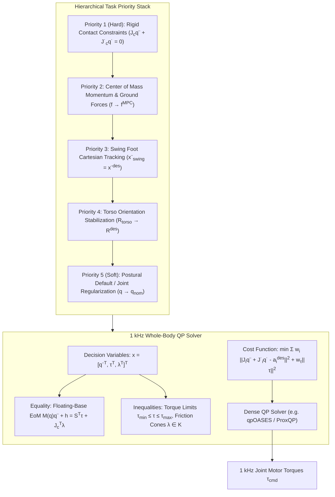
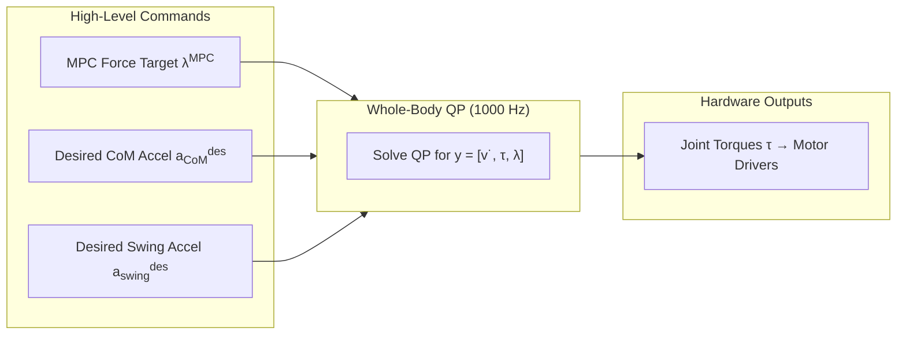

import ChapterProgress from '@site/src/components/ChapterProgress';
import QuizEngine from '@site/src/components/QuizEngine';

# Hierarchical Whole-Body Control & Operational Space Formulations

High-level planners such as Convex MPC or ZMP preview generators synthesize desired Center of Mass accelerations and net ground reaction forces. However, a humanoid robot does not possess actuators that directly produce Cartesian forces in world space; it possesses electric brushless motors that exert internal scalar torques $\boldsymbol{\tau} \in \mathbb{R}^n$ at individual revolute joints. Translating multiple competing operational space tasks—such as keeping the feet anchored to the ground without slipping, regulating torso pitch and roll, guiding the swing foot along an obstacle-clearing trajectory, and maintaining a comfortable joint posture—into dynamically consistent motor torques is the domain of **Whole-Body Control (WBC)**.

Pioneered by Luis Sentis and Oussama Khatib in 2005, and evolved into high-frequency Quadratic Programming (QP) frameworks by Kuindersma et al. (Boston Dynamics Atlas) and Herzog et al., Whole-Body Control orchestrates the complete kinematic and dynamic capabilities of the humanoid. Operating at 1,000 Hz, WBC simultaneously satisfies rigid contact constraints, respects torque and acceleration bounds, and projects lower-priority objectives into the mathematical null-space of higher-priority tasks.



---

## 1. Operational Space Formulations & Dynamically Consistent Inverses

Consider a generic kinematic task coordinate $\mathbf{x}_i \in \mathbb{R}^{m_i}$ (e.g., Cartesian swing foot position or torso orientation). The forward kinematics and differential kinematics map the robot configuration $\mathbf{q} \in \mathbb{R}^{n+6}$ and velocity $\mathbf{v} \in \mathbb{R}^{n+6}$ to the task space:

$$
\mathbf{x}_i = \mathbf{f}_i(\mathbf{q}), \quad \dot{\mathbf{x}}_i = \mathbf{J}_i(\mathbf{q})\mathbf{v}
$$

Differentiating with respect to time yields task-space acceleration:

$$
\ddot{\mathbf{x}}_i = \mathbf{J}_i(\mathbf{q})\dot{\mathbf{v}} + \dot{\mathbf{J}}_i(\mathbf{q}, \mathbf{v})\mathbf{v}
$$

To achieve a desired reference trajectory $\mathbf{x}_i^{\text{des}}(t)$, we synthesize a PD acceleration command:

$$
\ddot{\mathbf{x}}_i^{\text{cmd}} = \ddot{\mathbf{x}}_i^{\text{des}} + \mathbf{K}_{p,i} (\mathbf{x}_i^{\text{des}} - \mathbf{x}_i) + \mathbf{K}_{d,i} (\dot{\mathbf{x}}_i^{\text{des}} - \dot{\mathbf{x}}_i)
$$

### The Dynamically Consistent Generalized Inverse

In a multi-body dynamic system governed by mass matrix $\mathbf{M}(\mathbf{q})$, mapping task-space forces $\mathbf{F}_i$ to generalized torques $\boldsymbol{\tau}$ without inducing spurious accelerations in orthogonal task directions requires the **dynamically consistent generalized inverse** $\mathbf{J}_i^{\#}$:

$$
\mathbf{J}_i^{\#} = \mathbf{M}^{-1} \mathbf{J}_i^T \left( \mathbf{J}_i \mathbf{M}^{-1} \mathbf{J}_i^T \right)^{-1} = \mathbf{M}^{-1} \mathbf{J}_i^T \boldsymbol{\Lambda}_i
$$

where:
- $\boldsymbol{\Lambda}_i(\mathbf{q}) = \left( \mathbf{J}_i \mathbf{M}^{-1} \mathbf{J}_i^T \right)^{-1} \in \mathbb{R}^{m_i \times m_i}$ is the operational space inertia matrix seen at task $i$.
- $\mathbf{J}_i^{\#}$ satisfies $\mathbf{J}_i \mathbf{J}_i^{\#} = \mathbf{I}_{m_i}$.

### Null-Space Projection

The null-space projection matrix $\mathbf{N}_i(\mathbf{q})$ filters out all torque components that would accelerate task $i$:

$$
\mathbf{N}_i = \mathbf{I} - \mathbf{J}_i^T \left(\mathbf{J}_i^{\#}\right)^T = \mathbf{I} - \mathbf{J}_i^T \boldsymbol{\Lambda}_i \mathbf{J}_i \mathbf{M}^{-1}
$$

For a two-task hierarchy where Task 1 has strict priority over Task 2:

$$
\boldsymbol{\tau} = \mathbf{J}_1^T \mathbf{F}_1 + \mathbf{N}_1^T \mathbf{J}_2^T \mathbf{F}_2
$$

Because $\mathbf{J}_1 \mathbf{M}^{-1} \mathbf{N}_1^T = \mathbf{0}$, the control torques dedicated to Task 2 produce **zero acceleration** on Task 1 coordinates.

---

## 2. QP-Based Whole-Body Control Formulation

While analytical null-space projection is elegant, real humanoids must strictly respect unilateral contact friction cones, motor current limits, and joint position stops. Analytical null-space methods cannot incorporate inequality constraints without discontinuous task dropping.

Modern humanoids formulate Whole-Body Control as a unified **Quadratic Program (QP)** solved at 1 kHz.

### Decision Variables

We collect all unknown dynamic quantities into a single optimization vector $\mathbf{y} \in \mathbb{R}^{(n+6) + n + 6 N_c}$:

$$
\mathbf{y} = \begin{bmatrix} \dot{\mathbf{v}} \\ \boldsymbol{\tau} \\ \boldsymbol{\lambda} \end{bmatrix}
$$

where:
- $\dot{\mathbf{v}} \in \mathbb{R}^{n+6}$ is the vector of generalized robot accelerations (base + joints).
- $\boldsymbol{\tau} \in \mathbb{R}^n$ is the vector of actuated motor torques.
- $\boldsymbol{\lambda} = [\boldsymbol{\lambda}_1^T, \dots, \boldsymbol{\lambda}_{N_c}^T]^T \in \mathbb{R}^{6 N_c}$ represents all ground contact wrenches.

### Dynamic Equality Constraints

The solution must rigorously satisfy the floating-base equations of motion and kinematic contact anchoring:

1. **Floating-Base Dynamics**:
   $$
   \mathbf{M}(\mathbf{q})\dot{\mathbf{v}} + \mathbf{h}(\mathbf{q}, \mathbf{v}) = \mathbf{S}^T \boldsymbol{\tau} + \mathbf{J}_c^T(\mathbf{q}) \boldsymbol{\lambda}
   $$
2. **Rigid Contact Constraint (Zero Acceleration at Stance Feet)**:
   $$
   \mathbf{J}_c(\mathbf{q})\dot{\mathbf{v}} + \dot{\mathbf{J}}_c(\mathbf{q}, \mathbf{v})\mathbf{v} = \mathbf{0}
   $$

### Physical Inequality Constraints

1. **Joint Torque Limits**:
   $$
   \boldsymbol{\tau}_{\min} \le \boldsymbol{\tau} \le \boldsymbol{\tau}_{\max}
   $$
2. **Actuator Joint Velocity and Acceleration Limits**:
   $$
   \ddot{\mathbf{q}}_{\min} \le \dot{\mathbf{v}}_{\text{joint}} \le \ddot{\mathbf{q}}_{\max}
   $$
3. **Contact Friction Pyramids**:
   For each active contact $k$, the contact wrench $\boldsymbol{\lambda}_k = [f_x, f_y, f_z, \tau_x, \tau_y, \tau_z]^T$ must reside inside the friction pyramid and Center of Pressure boundary:
   $$
   |f_{x,k}| \le \mu f_{z,k}, \quad |f_{y,k}| \le \mu f_{z,k}, \quad f_{z,\min} \le f_{z,k} \le f_{z,\max}
   $$
   $$
   -\frac{W}{2} f_{z,k} \le \tau_{x,k} \le \frac{W}{2} f_{z,k}, \quad -\frac{L}{2} f_{z,k} \le \tau_{y,k} \le \frac{L}{2} f_{z,k}
   $$

---

## 3. Multi-Objective Cost Function

In a weighted QP formulation, tasks are assigned positive scalar weights $w_i > 0$ reflecting their behavioral hierarchy:

$$
\min_{\dot{\mathbf{v}}, \boldsymbol{\tau}, \boldsymbol{\lambda}} \sum_{i=1}^T w_i \left\| \mathbf{J}_i(\mathbf{q})\dot{\mathbf{v}} + \dot{\mathbf{J}}_i\mathbf{v} - \ddot{\mathbf{x}}_i^{\text{cmd}} \right\|^2 + w_f \left\| \boldsymbol{\lambda} - \boldsymbol{\lambda}^{\text{MPC}} \right\|^2 + w_\tau \|\boldsymbol{\tau}\|^2 + w_v \|\dot{\mathbf{v}}\|^2
$$



The term $w_f \|\boldsymbol{\lambda} - \boldsymbol{\lambda}^{\text{MPC}}\|^2$ creates a seamless bridge between the low-frequency predictive planner (Convex MPC at 100 Hz) and high-frequency whole-body stabilization (WBC at 1000 Hz).

---

## 4. Architectural Paradigms: Comparative Matrix

| Paradigm | Analytical Null-Space (Sentis) | Weighted QP (Kuindersma / MIT) | Hierarchical QP (HQP, Escande) |
| :--- | :--- | :--- | :--- |
| **Priority Handling** | Strict mathematical null-space | Soft weights $w_1 \gg w_2 \gg w_3$ | Strict lexicographic cascade of QPs |
| **Inequality Handling** | Very difficult (Clamping causes jumps) | Native via box & linear constraints | Native via sequential active-set QP |
| **Compute Latency** | $< 0.1$ ms | $0.3\text{--}0.8$ ms | $1.5\text{--}4.0$ ms |
| **Feasibility Guarantee**| Can violate torque limits | Always feasible (Slacks allowed) | Requires strict feasibility cascades |
| **Implementation Complexity** | Medium | Low to Medium | High |
| **Industry Adoption** | Stanford / Humanoids (early) | Atlas, Unitree G1, Cassie, MIT | HRP-4, TALOS (LAAS-CNRS) |

---

## 5. Python Implementation: Multi-Task Whole-Body Controller

The script below implements a complete Whole-Body QP Controller for a floating-base biped model. It balances Center of Mass position, maintains stance foot anchoring, tracks swing foot trajectory, and enforces joint torque and friction pyramid constraints.

```python
"""
whole_body_controller.py
Hierarchical Whole-Body Controller (WBC) for a Floating-Base Humanoid.
Solves a 1000 Hz Quadratic Program enforcing contact constraints and motor torque limits.
"""

import numpy as np
from scipy.optimize import minimize

class HumanoidWholeBodyQP:
    def __init__(self, n_joints=6, mass=40.0):
        """
        Simplified floating-base model:
        6 base DoFs (3 pos, 3 rot) + n_joints actuated joints.
        Total coordinates = 6 + n_joints.
        """
        self.n_joints = n_joints
        self.n_dof = 6 + n_joints
        self.mass = mass
        self.g = 9.81
        self.mu = 0.6

        # Torque limits (N*m)
        self.tau_max = 150.0

    def compute_wbc_torques(self, M, h, J_c, J_com, a_com_des, J_swing, a_swing_des, f_mpc_ref):
        """
        Solves the Whole-Body QP:
        Decision variables y = [v_dot (n_dof), tau (n_joints), lambda (6)]
        """
        n_dof = self.n_dof
        n_act = self.n_joints
        n_lambda = 6  # 3 linear + 3 angular contact wrench components
        dim_y = n_dof + n_act + n_lambda

        # Selection matrix S = [0_{n_joints x 6}, I_{n_joints x n_joints}]
        S = np.zeros((n_act, n_dof))
        S[:, 6:] = np.eye(n_act)

        # Objective Function
        w_com = 100.0
        w_swing = 50.0
        w_lambda = 1.0
        w_tau = 1e-3
        w_reg = 1e-4

        def objective(y):
            v_dot = y[0:n_dof]
            tau = y[n_dof : n_dof + n_act]
            lam = y[n_dof + n_act :]

            # CoM acceleration tracking error
            e_com = J_com @ v_dot - a_com_des
            # Swing foot acceleration tracking error
            e_swing = J_swing @ v_dot - a_swing_des
            # Force reference tracking error
            e_lam = lam - f_mpc_ref

            cost = (
                w_com * np.sum(e_com**2) +
                w_swing * np.sum(e_swing**2) +
                w_lambda * np.sum(e_lam**2) +
                w_tau * np.sum(tau**2) +
                w_reg * np.sum(v_dot**2)
            )
            return cost

        # Constraints
        # 1. Floating-base dynamic equality: M * v_dot + h - S^T * tau - J_c^T * lambda = 0
        def eq_dynamics(y):
            v_dot = y[0:n_dof]
            tau = y[n_dof : n_dof + n_act]
            lam = y[n_dof + n_act :]
            return M @ v_dot + h - (S.T @ tau) - (J_c.T @ lam)

        # 2. Contact anchoring equality: J_c * v_dot = 0 (assuming dot(J_c)*v = 0)
        def eq_contact(y):
            v_dot = y[0:n_dof]
            return J_c @ v_dot

        # Inequality bounds
        bounds = []
        # v_dot bounds (-100 to 100 rad/s^2)
        for _ in range(n_dof):
            bounds.append((-100.0, 100.0))
        # tau bounds (-tau_max to tau_max)
        for _ in range(n_act):
            bounds.append((-self.tau_max, self.tau_max))
        # lambda bounds: [fx, fy, fz, tx, ty, tz]
        # Unilateral normal force fz >= 10 N
        bounds.extend([(-300.0, 300.0), (-300.0, 300.0), (10.0, 600.0)])
        bounds.extend([(-50.0, 50.0), (-50.0, 50.0), (-20.0, 20.0)])

        constraints = [
            {'type': 'eq', 'fun': eq_dynamics},
            {'type': 'eq', 'fun': eq_contact}
        ]

        y0 = np.zeros(dim_y)
        y0[n_dof + n_act + 2] = self.mass * self.g  # Initial fz guess

        res = minimize(objective, y0, method='SLSQP', bounds=bounds, constraints=constraints)

        opt_v_dot = res.x[0:n_dof]
        opt_tau = res.x[n_dof : n_dof + n_act]
        opt_lam = res.x[n_dof + n_act :]

        return opt_tau, opt_v_dot, opt_lam

if __name__ == "__main__":
    wbc = HumanoidWholeBodyQP(n_joints=6, mass=40.0)

    # Synthetic dynamic matrices
    n_dof = 12
    M = np.eye(n_dof) * 5.0
    M[0:3, 0:3] = np.eye(3) * 40.0  # Torso mass
    h = np.zeros(n_dof)
    h[2] = 40.0 * 9.81              # Gravity wrench

    # Contact on stance foot (6 constraints)
    J_c = np.zeros((6, n_dof))
    J_c[:, 0:6] = np.eye(6)

    # CoM Jacobian (3 DoF)
    J_com = np.zeros((3, n_dof))
    J_com[0:3, 0:3] = np.eye(3)
    a_com_des = np.array([0.0, 0.0, 0.0])

    # Swing foot Jacobian (3 DoF)
    J_swing = np.zeros((3, n_dof))
    J_swing[0:3, 6:9] = np.eye(3)
    a_swing_des = np.array([0.2, 0.0, 0.5])

    f_mpc_ref = np.array([0.0, 0.0, 40.0 * 9.81, 0.0, 0.0, 0.0])

    print("Executing Whole-Body Control Quadratic Program...")
    tau_cmd, v_dot, lam = wbc.compute_wbc_torques(
        M, h, J_c, J_com, a_com_des, J_swing, a_swing_des, f_mpc_ref
    )

    print(f"Computed 1 kHz Joint Torques: {tau_cmd.round(2)} N*m")
    print(f"Optimal Ground Reaction Force (fz): {lam[2]:.2f} N")
```

---

## 6. Seminal Literature & Academic References

1. **Sentis, L., & Khatib, O. (2005).** *Synthesis of whole-body behaviors through hierarchical control of behavioral primitives*. International Journal of Humanoid Robotics, 2(04), 505-518.
   - *Annotation*: Introduced dynamically consistent null-space projection for multi-priority task hierarchies in humanoid robots.
2. **Kuindersma, S., Hannigan, F., Ruina, A., & Tedrake, R. (2014).** *Efficiently solving dynamically-consistent whole-body control problems for humanoid robots*. In IEEE International Conference on Robotics and Automation (ICRA) (pp. 3704-3711).
   - *Annotation*: Formulated the inverse dynamics QP that powered the Boston Dynamics Atlas humanoid through the DARPA Robotics Challenge.
3. **Herzog, A., Rotella, N., Mason, S., Grimminger, F., Schaal, S., & Righetti, L. (2016).** *Momentum control with hierarchical inverse dynamics on a torque-controlled humanoid*. Autonomous Robots, 40(3), 473-491.
   - *Annotation*: Evaluated strict lexicographic Hierarchical QP (HQP) vs weighted QP for balance and angular momentum regulation on physical robots.
4. **Escande, C., Mansard, N., & Wieber, P. B. (2014).** *Hierarchical quadratic programming: Fast formations and applications to robot control*. IEEE Transactions on Robotics, 30(1), 236-251.
   - *Annotation*: Introduced active-set algorithms for cascade hierarchical quadratic programming with guaranteed priority preservation.

---

## 7. Hands-On Lab Project: Whole-Body Torque Saturation Diagnostics

### Objective
Observe what happens when motor torque limits are tightened. If knee pitch torque saturates at $\tau_{\max} = 50$ N$\cdot$m during a deep squat, how does the Whole-Body QP compromise lower-priority postural tracking while preserving stance foot contact?

### Deliverables & Verification
1. Run `whole_body_controller.py` with nominal torque limits $\tau_{\max} = 150$ N$\cdot$m. Record tracking errors.
2. Artificially restrict $\tau_{\max} \to 45$ N$\cdot$m.
3. Verify that the solver maintains stance foot constraint satisfaction $J_c \dot{\mathbf{v}} = \mathbf{0}$ exactly, sacrificing swing foot tracking acceleration to avoid violating actuator hardware limits.

---

<ChapterProgress chapterId="6-5-whole-body-control" moduleId="module6" totalChapters={10} />

## Chapter Mastery Check

<QuizEngine
  quizId="quiz-6-5"
  title="Module 6.5 Mastery Check: Whole-Body Control"
  moduleId="module6"
  passThreshold={70}
  questions={[
    {
      id: "q1",
      question: "Why does multi-task control require the dynamically consistent inverse J^# = M^-1 J^T (J M^-1 J^T)^-1 rather than the standard kinematic pseudoinverse J^+?",
      options: [
        "Because kinematic pseudoinverses take longer to compute in Python",
        "Because projecting lower-priority torques through the dynamically consistent null-space guarantees that secondary tasks exert zero acceleration on primary task coordinates",
        "Because kinematic pseudoinverses cannot be computed for non-square matrices",
        "Because motor current sensors measure dynamics, not kinematics"
      ],
      correctIndex: 1,
      explanation: "The dynamically consistent inverse accounts for the robot's mass matrix M(q). Projecting secondary torques into its null-space ensures that secondary motions do not induce dynamic cross-coupling accelerations in higher-priority tasks."
    },
    {
      id: "q2",
      question: "In the decision variable vector y = [v_dot^T, tau^T, lambda^T]^T of a Whole-Body QP, why are generalized accelerations v_dot and contact wrenches lambda optimized simultaneously with joint torques tau?",
      options: [
        "To allow the solver to find the optimal balance between contact friction forces, inertia, and motor limits while strictly satisfying the floating-base equations of motion as an equality constraint",
        "Because motor drivers require lambda as a direct digital input",
        "To eliminate the need for an operating system",
        "Because robot mass matrices are always singular"
      ],
      correctIndex: 0,
      explanation: "By including accelerations, torques, and contact wrenches as simultaneous decision variables, the QP can enforce the full non-linear multi-body equations of motion as linear equality constraints while verifying friction cones."
    },
    {
      id: "q3",
      question: "If a humanoid robot encounters extreme actuator torque saturation during a disturbance, which task must a properly designed WBC hierarchy sacrifice first?",
      options: [
        "Stance foot non-slipping rigid contact constraint",
        "Normal ground reaction force positivity",
        "Lowest-priority tasks such as joint posture centering or arm swing styling",
        "The robot's base coordinate frame definition"
      ],
      correctIndex: 2,
      explanation: "A hierarchical WBC preserves vital contact stability and CoM balance by projecting compromises into lower-priority null-spaces, sacrificing stylistic or postural tasks first."
    }
  ]}
/>
