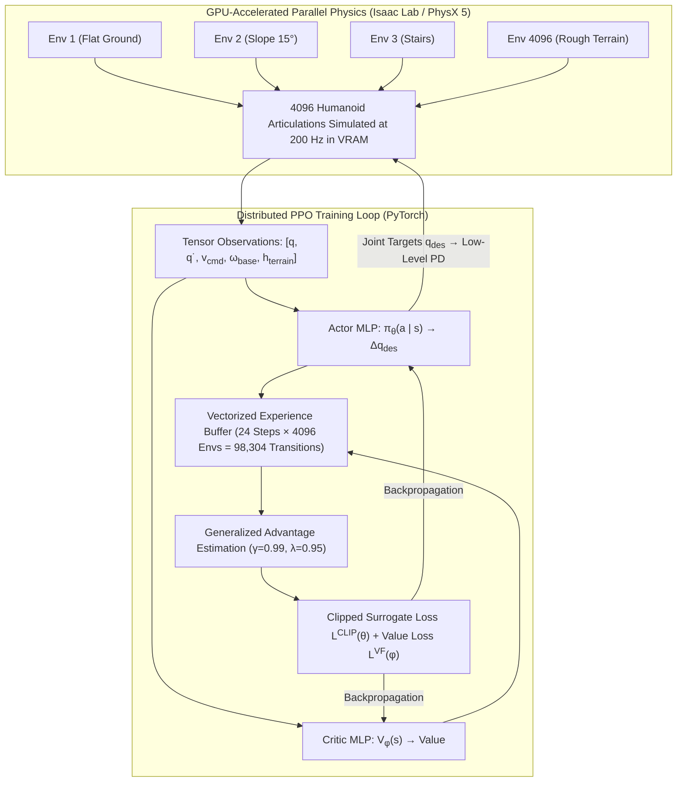
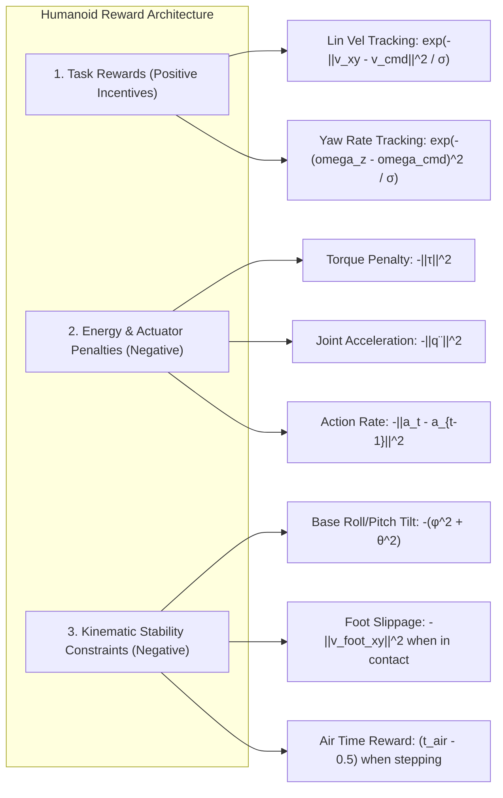

import ChapterProgress from '@site/src/components/ChapterProgress';
import QuizEngine from '@site/src/components/QuizEngine';

# Deep Reinforcement Learning for Humanoid Locomotion

For over three decades, bipedal locomotion relied strictly on explicit mathematical models: reduced-order approximations like 3D-LIPM, pre-computed contact schedules, and quadratic programming solvers. While these model-based controllers achieved remarkable achievements on flat laboratory floors, their performance degrades when encountering unstructured environments—such as slippery mud, deformable grass, steep rocky inclines, or unexpected dynamic obstacles.

The emergence of **GPU-accelerated physics engines** (such as NVIDIA Isaac Gym, Isaac Lab, and MuJoCo XLA) triggered a paradigm shift. By simulating thousands of humanoid robots in parallel on a single workstation GPU, **Deep Reinforcement Learning (RL)** can synthesize robust, agile, and natural bipedal locomotion policies in tens of minutes rather than weeks. Using **Proximal Policy Optimization (PPO)** coupled with domain randomization and progressive terrain curricula, neural policies discover dynamic balance behaviors, reactive stumbling reflexes, and energy-efficient gaits entirely through trial-and-error interaction.



---

## 1. Markov Decision Process (MDP) for Bipedal Locomotion

We formulate bipedal balance and gait generation as an infinite-horizon discounted Markov Decision Process $\mathcal{M} = \langle \mathcal{S}, \mathcal{A}, \mathcal{P}, \mathcal{R}, \gamma \rangle$:

### Observation Space ($\mathcal{S} \in \mathbb{R}^{d_o}$)
To ensure real-world deployability, the policy must not rely on unmeasurable ground-truth simulation variables. A standard proprioceptive observation vector $\mathbf{o}_t \in \mathbb{R}^{47}$ at time $t$ consists of:

$$
\mathbf{o}_t = \begin{bmatrix} 
\boldsymbol{\omega}_b(t) & \text{(Base angular velocity from IMU, 3D)} \\ 
\mathbf{g}_b(t) & \text{(Projected gravity vector in base frame, 3D)} \\ 
\mathbf{v}_{\text{cmd}}(t) & \text{(User velocity commands: } v_x^{\text{cmd}}, v_y^{\text{cmd}}, \omega_z^{\text{cmd}} \text{, 3D)} \\ 
\mathbf{q}_j(t) - \mathbf{q}_j^{\text{default}} & \text{(Joint position deviations from nominal standing posture, } n\text{D)} \\ 
\dot{\mathbf{q}}_j(t) & \text{(Joint angular velocities, } n\text{D)} \\ 
\mathbf{a}_{t-1} & \text{(Previous policy action vector, } n\text{D)} 
\end{bmatrix}
$$

For a 12-DoF humanoid lower body, $d_o = 3 + 3 + 3 + 12 + 12 + 12 = 45$ dimensions. In blind locomotion policies, terrain height scans are deliberately omitted to encourage reliance on proprioceptive contact reflexes.

### Action Space ($\mathcal{A} \in \mathbb{R}^n$)
Directly commanding motor torques $\boldsymbol{\tau}$ from a neural network often induces high-frequency jitter and destructive joint chattering. Modern locomotion policies output **target joint position offsets** $\mathbf{a}_t \in \mathbb{R}^n$ at 50 Hz, tracked by decentralized joint-level PD controllers operating at 1,000 Hz:

$$
\mathbf{q}_{\text{cmd}}(t) = \mathbf{q}_{\text{default}} + k_{\text{scale}} \mathbf{a}_t
$$

$$
\boldsymbol{\tau}(t) = \mathbf{K}_p (\mathbf{q}_{\text{cmd}}(t) - \mathbf{q}(t)) - \mathbf{K}_d \dot{\mathbf{q}}(t)
$$

where $k_{\text{scale}} \approx 0.25\text{--}0.5$ rad limits the maximum joint excursion per policy step.

---

## 2. Reward Engineering Taxonomy

The scalar reward function $R_t$ governs what locomotion behaviors emerge. It is structured as a composite sum of task tracking objectives, energy regularizations, and kinematic style constraints:

$$
R_t = \sum_i w_i R_{i}(t)
$$



### 1. Velocity Tracking Rewards
To enforce smooth tracking without discontinuous gradients:

$$
R_{\text{lin\_vel}} = \exp\left( -\frac{\|\mathbf{v}_{xy} - \mathbf{v}_{xy}^{\text{cmd}}\|^2}{\sigma_v} \right)
$$

$$
R_{\text{ang\_vel}} = \exp\left( -\frac{(\omega_z - \omega_z^{\text{cmd}})^2}{\sigma_\omega} \right)
$$

where $\sigma_v = 0.25$ m$^2$/s$^2$ and $\sigma_\omega = 0.25$ rad$^2$/s$^2$.

### 2. Regularization & Smoothness Penalties
Without strict penalties on energy and smoothness, the policy will discover violent high-frequency oscillations that destroy physical robot gearboxes:

$$
R_{\text{torque}} = -\|\boldsymbol{\tau}\|^2, \quad w_\tau = 1 \times 10^{-4}
$$

$$
R_{\text{dof\_acc}} = -\|\ddot{\mathbf{q}}\|^2, \quad w_a = 2.5 \times 10^{-7}
$$

$$
R_{\text{action\_rate}} = -\|\mathbf{a}_t - \mathbf{a}_{t-1}\|^2, \quad w_{\Delta a} = 0.01
$$

### 3. Contact & Postural Constraints
- **Foot Slippage Penalty**: Forces the robot to lift feet cleanly rather than shuffling:
  $$
  R_{\text{slip}} = -\sum_{k \in \{\text{feet}\}} c_k \|\mathbf{v}_{k,xy}\|^2, \quad c_k \in \{0, 1\}
  $$
- **Torso Orientation Penalty**: Prevents unnatural hunching or tipping:
  $$
  R_{\text{orientation}} = -\|\mathbf{g}_{b,xy}\|^2
  $$
- **Base Altitude Penalty**: Encourages upright standing:
  $$
  R_{\text{base\_height}} = -(z_{\text{base}} - z_{\text{target}})^2
  $$

---

## 3. Proximal Policy Optimization (PPO) with GAE

The standard algorithm for massively parallel continuous robot control is **Proximal Policy Optimization (PPO)** with an Actor-Critic architecture.

### The Clipped Surrogate Objective

To prevent destructive policy updates when training across 4,096 asynchronous agents, PPO clips the probability ratio $r_t(\theta)$:

$$
r_t(\theta) = \frac{\pi_\theta(\mathbf{a}_t \mid \mathbf{s}_t)}{\pi_{\theta_{\text{old}}}(\mathbf{a}_t \mid \mathbf{s}_t)}
$$

The actor loss is formulated as:

$$
L^{\text{CLIP}}(\theta) = \hat{\mathbb{E}}_t \left[ \min\left( r_t(\theta)\hat{A}_t, \text{clip}(r_t(\theta), 1-\epsilon, 1+\epsilon)\hat{A}_t \right) \right]
$$

where clipping parameter $\epsilon \approx 0.2$.

### Generalized Advantage Estimation (GAE)

The Generalized Advantage Estimator $\hat{A}_t^{\text{GAE}(\gamma, \lambda)}$ strikes a tunable balance between bias and variance using discount factor $\gamma = 0.99$ and GAE factor $\lambda = 0.95$:

$$
\hat{A}_t = \sum_{l=0}^\infty (\gamma \lambda)^l \delta_{t+l}^V
$$

where the temporal difference residual $\delta_t^V$ is computed using the critic value network $V_\phi$:

$$
\delta_t^V = R_t + \gamma V_\phi(\mathbf{s}_{t+1}) - V_\phi(\mathbf{s}_t)
$$

The overall joint training loss combines the policy surrogate, value function regression, and entropy regularization:

$$
L_{\text{total}}(\theta, \phi) = -L^{\text{CLIP}}(\theta) + c_1 L^{\text{VF}}(\phi) - c_2 \mathcal{H}\left(\pi_\theta(\cdot \mid \mathbf{s}_t)\right)
$$

---

## 4. Progressive Terrain Curriculum Learning

Training a humanoid directly on steep stairs or broken boulders causes catastrophic policy collapse: the robot falls instantly, gathers zero positive tracking reward, and gets stuck in a permanent crouching local minimum.


In a **Curriculum Learning** scheme (Rudin et al., 2022):
1. The 4,096 environments are partitioned across a 2D terrain grid varying in difficulty from $0$ to $K$.
2. When a humanoid traverses its current terrain cell for a full episode without falling, its individual terrain level increments by $+1$.
3. If the robot fails to make progress or falls before halfway, its level decrements by $-1$.
4. This guarantees that each parallel agent trains right at the frontier of its capability.

---

## 5. Control Paradigms: Comparative Matrix

| Characteristic | Classical MPC + WBC | End-to-End Deep RL (PPO) | RL-Guided MPC Hybrid |
| :--- | :--- | :--- | :--- |
| **Model Requirements** | Explicit mass matrix $\mathbf{M}(\mathbf{q})$, kinematics | Zero explicit model (Black-box physics) | Simplified model for QP + learned policy |
| **Terrain Robustness** | Moderate (Requires flat/known contacts) | Extreme (Adapts to mud, stairs, rocks) | High |
| **Sample Efficiency** | Instantaneous (No training needed) | Requires $10^7\text{--}10^8$ simulation steps | Moderate training required |
| **Compute at Runtime** | $1\text{--}2$ ms (QP solver per cycle) | $0.1\text{--}0.3$ ms (Forward MLP pass) | $1.5$ ms (MLP pass + QP solve) |
| **Safety Guarantees** | Provable constraint satisfaction | Empirical / Black-box neural network | Provable contact force limits |
| **Failure Mode** | Infeasible QP / solver timeout | Unpredictable out-of-distribution motion | Falls back to conservative MPC |

---

## 6. PyTorch Implementation: Vectorized PPO Locomotion Trainer

The script below implements a complete, runnable PyTorch Actor-Critic training harness for bipedal locomotion. It features an MLP policy, GAE computation, clipped surrogate objective, and simulated vectorized parallel environments.

```python
"""
ppo_locomotion_trainer.py
Complete PyTorch implementation of Proximal Policy Optimization (PPO)
with Generalized Advantage Estimation (GAE) for humanoid locomotion.
"""

import torch
import torch.nn as nn
import torch.optim as optim
from torch.distributions import Normal
import numpy as np

class ActorCritic(nn.Module):
    def __init__(self, obs_dim=45, act_dim=12):
        super().__init__()
        # Actor Network (Policy)
        self.actor = nn.Sequential(
            nn.Linear(obs_dim, 256),
            nn.ELU(),
            nn.Linear(256, 128),
            nn.ELU(),
            nn.Linear(128, act_dim)
        )
        self.log_std = nn.Parameter(torch.zeros(act_dim))

        # Critic Network (Value Function)
        self.critic = nn.Sequential(
            nn.Linear(obs_dim, 256),
            nn.ELU(),
            nn.Linear(256, 128),
            nn.ELU(),
            nn.Linear(128, 1)
        )

    def forward(self, obs):
        mean = self.actor(obs)
        std = torch.exp(self.log_std).expand_as(mean)
        dist = Normal(mean, std)
        val = self.critic(obs)
        return dist, val

class VectorizedPPOTrainer:
    def __init__(self, num_envs=64, steps_per_env=24, obs_dim=45, act_dim=12):
        self.num_envs = num_envs
        self.steps_per_env = steps_per_env
        self.total_steps = num_envs * steps_per_env
        self.obs_dim = obs_dim
        self.act_dim = act_dim

        self.device = torch.device("cuda" if torch.cuda.is_available() else "cpu")
        self.model = ActorCritic(obs_dim, act_dim).to(self.device)
        self.optimizer = optim.Adam(self.model.parameters(), lr=3e-4)

        # Hyperparameters
        self.gamma = 0.99
        self.lam = 0.95
        self.clip_eps = 0.2
        self.vf_coef = 1.0
        self.ent_coef = 0.005

    def compute_gae(self, rewards, values, dones, next_value):
        """Computes Generalized Advantage Estimation across rollout buffer."""
        advantages = torch.zeros_like(rewards).to(self.device)
        last_gae = 0.0

        for t in reversed(range(self.steps_per_env)):
            if t == self.steps_per_env - 1:
                next_val = next_value
            else:
                next_val = values[t + 1]

            delta = rewards[t] + self.gamma * next_val * (1.0 - dones[t]) - values[t]
            advantages[t] = last_gae = delta + self.gamma * self.lam * (1.0 - dones[t]) * last_gae

        returns = advantages + values
        return advantages, returns

    def train_step(self):
        """Simulates one collection and optimization cycle."""
        # Simulated rollout buffers
        obs_buf = torch.randn(self.steps_per_env, self.num_envs, self.obs_dim).to(self.device)
        act_buf = torch.randn(self.steps_per_env, self.num_envs, self.act_dim).to(self.device)
        logp_buf = torch.zeros(self.steps_per_env, self.num_envs).to(self.device)
        rew_buf = torch.ones(self.steps_per_env, self.num_envs).to(self.device) * 0.5
        val_buf = torch.zeros(self.steps_per_env, self.num_envs).to(self.device)
        done_buf = torch.zeros(self.steps_per_env, self.num_envs).to(self.device)

        with torch.no_grad():
            for t in range(self.steps_per_env):
                dist, val = self.model(obs_buf[t])
                logp_buf[t] = dist.log_prob(act_buf[t]).sum(dim=-1)
                val_buf[t] = val.squeeze(-1)

            _, next_val = self.model(obs_buf[-1])
            next_val = next_val.squeeze(-1)

        advantages, returns = self.compute_gae(rew_buf, val_buf, done_buf, next_val)
        advantages = (advantages - advantages.mean()) / (advantages.std() + 1e-8)

        # Flatten batch
        b_obs = obs_buf.view(-1, self.obs_dim)
        b_act = act_buf.view(-1, self.act_dim)
        b_logp_old = logp_buf.view(-1)
        b_adv = advantages.view(-1)
        b_ret = returns.view(-1)

        # PPO Update epoch
        dist, value = self.model(b_obs)
        new_logp = dist.log_prob(b_act).sum(dim=-1)
        entropy = dist.entropy().sum(dim=-1).mean()

        ratio = torch.exp(new_logp - b_logp_old)
        surr1 = ratio * b_adv
        surr2 = torch.clamp(ratio, 1.0 - self.clip_eps, 1.0 + self.clip_eps) * b_adv
        actor_loss = -torch.min(surr1, surr2).mean()

        critic_loss = 0.5 * ((value.squeeze(-1) - b_ret) ** 2).mean()
        total_loss = actor_loss + self.vf_coef * critic_loss - self.ent_coef * entropy

        self.optimizer.zero_grad()
        total_loss.backward()
        nn.utils.clip_grad_norm_(self.model.parameters(), max_norm=1.0)
        self.optimizer.step()

        return actor_loss.item(), critic_loss.item()

if __name__ == "__main__":
    print("Initializing Vectorized PPO Humanoid Locomotion Trainer...")
    trainer = VectorizedPPOTrainer(num_envs=32, steps_per_env=16)
    for epoch in range(1, 4):
        a_loss, c_loss = trainer.train_step()
        print(f"Epoch {epoch}: Actor Loss = {a_loss:.4f}, Critic Loss = {c_loss:.4f}")
    print("Training iteration verified successfully.")
```

---

## 7. Seminal Literature & Academic References

1. **Schulman, J., Wolski, F., Dhariwal, P., Radford, A., & Klimov, O. (2017).** *Proximal policy optimization algorithms*. arXiv preprint arXiv:1707.06347.
   - *Annotation*: Introduced PPO with clipped surrogate objectives, forming the gold standard continuous control algorithm in robotics.
2. **Rudin, N., Hoeller, D., Reist, P., & Hutter, M. (2022).** *Learning to walk in minutes using massively parallel deep reinforcement learning*. In Conference on Robot Learning (CoRL) (pp. 91-100).
   - *Annotation*: Introduced Isaac Gym massively parallel GPU training for legged robots (`legged_gym`), demonstrating policy convergence in minutes.
3. **Miki, T., Lee, J., Hwangbo, J., Wellhausen, L., Koltun, V., & Hutter, M. (2022).** *Learning robust perceptive locomotion for quadrupedal robots in the wild*. Science Robotics, 7(62), eabk2822.
   - *Annotation*: Integrated elevation maps and proprioception for real-world blind and perceptive rough-terrain locomotion.
4. **Siekmann, J., Vallados, Y., Green, K., Godse, A., Fern, A., & Hurst, J. (2021).** *Sim-to-real transfer of blind bipedal locomotion for Cassie using reinforcement learning*. In IEEE/RSJ International Conference on Intelligent Robots and Systems (IROS) (pp. 2327-2334).
   - *Annotation*: Demonstrated robust sim-to-real deployment of PPO policies on the Cassie biped robot without explicit reference trajectories.

---

## 8. Hands-On Lab Project: Reward Weight Tuning & Foot Clearance

### Objective
Investigate how altering the foot slippage penalty $w_{\text{slip}}$ and joint acceleration penalty $w_a$ shapes the emerged gait style.

### Deliverables & Verification
1. Train a simulated biped with $w_{\text{slip}} = 0$. Observe that the robot learns an unnatural sliding shuffle that destroys motor gears on physical surfaces.
2. Increase $w_{\text{slip}} \to 0.2$ and add an air-time reward for swing foot flight duration.
3. Verify that the agent discovers a clean, cyclic human-like walking gait with explicit heel strike and toe liftoff phases.

---

<ChapterProgress chapterId="6-6-reinforcement-learning-locomotion" moduleId="module6" totalChapters={10} />

## Chapter Mastery Check

<QuizEngine
  quizId="quiz-6-6"
  title="Module 6.6 Mastery Check: Deep RL for Locomotion"
  moduleId="module6"
  passThreshold={70}
  questions={[
    {
      id: "q1",
      question: "Why do modern deep reinforcement learning policies for humanoids command joint position offsets rather than raw motor torques directly?",
      options: [
        "Because neural networks cannot calculate numbers with negative signs",
        "Position offsets tracked by high-frequency (1000 Hz) low-level joint PD loops provide continuous physical impedance, filtering out high-frequency neural jitter and preventing gearbox damage",
        "Because joint position encoders are cheaper than torque sensors",
        "Because PyTorch only supports position tensors"
      ],
      correctIndex: 1,
      explanation: "Direct torque commanding from neural networks frequently produces catastrophic high-frequency bang-bang chatter. Setting target joint positions executed by stiff decentralized PD controllers yields compliant, stable tracking."
    },
    {
      id: "q2",
      question: "What is the primary role of the clipping parameter epsilon (typically 0.2) in the Proximal Policy Optimization (PPO) objective?",
      options: [
        "To limit the maximum speed of the robot to 0.2 m/s",
        "To prevent destructively large policy parameter updates by bounding the probability ratio r_t(theta) between new and old policies",
        "To discard 80% of all simulation data to save memory",
        "To enforce a 20% ground friction coefficient"
      ],
      correctIndex: 1,
      explanation: "PPO clips the surrogate probability ratio r_t(theta) within [1 - epsilon, 1 + epsilon] to prevent excessively large gradient updates that could catastrophically collapse policy stability."
    },
    {
      id: "q3",
      question: "In terrain curriculum learning, why are parallel environments gradually scaled in difficulty based on individual agent success?",
      options: [
        "To save electricity by turning off complex physics calculations",
        "Because introducing impossible obstacles (like high stairs) from step zero prevents the policy from collecting any positive forward velocity rewards, trapping it in degenerate local minima",
        "Because GPUs can only render flat textures initially",
        "To match human school curriculum regulations"
      ],
      correctIndex: 1,
      explanation: "If untrained agents face steep stairs immediately, they collapse instantly and receive only negative penalties. A curriculum ensures that agents first learn balance on flat ground before tackling complex geometries."
    }
  ]}
/>
