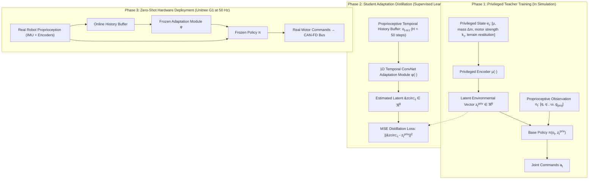

import ChapterProgress from '@site/src/components/ChapterProgress';
import QuizEngine from '@site/src/components/QuizEngine';

# Sim-to-Real Transfer for Locomotion: Domain Randomization to RMA

Training a deep reinforcement learning policy inside a GPU-accelerated simulator takes minutes, but transferring that trained neural policy onto a physical 45-kilogram humanoid robot often results in violent shuddering, uncontrolled motor oscillation, and immediate collapse. This failure is known as the **Reality Gap** (Sim-to-Real Gap).

Simulators rely on idealized mathematical abstractions: rigid bodies, instantaneous Coulomb friction, linear motor models, and zero-latency communication. Physical humanoids, however, operate in a messy physical world dominated by communication bus jitter, actuator thermal saturation, gearbox compliance, sensor noise, variable ground impedance, and battery voltage sag. Bridging this chasm without risking catastrophic hardware damage requires specialized methodologies: **Extensive Domain Randomization (DR)**, data-driven **Actuator Nets (AN)**, and two-stage **Rapid Motor Adaptation (RMA)** architectures that distill privileged environmental states into online proprioceptive representations.



---

## 1. Anatomy of the Bipedal Sim-to-Real Gap

The discrepancy between simulation and reality in bipedal systems arises from four primary physical bottlenecks:

1. **Actuator Non-Linearities & Bandwidth Limits**:
   Simulators typically apply ideal PD torque laws $\tau = K_p (q_{\text{des}} - q) - K_d \dot{q}$. Real electric powertrains feature Field-Oriented Control (FOC) current limits, motor back-EMF, rotor inertia, gear friction, harmonic drive backlash, and bus voltage drop under high instantaneous load.
2. **Communication & Execution Latency**:
   From sensor measurement at the joint encoder to CAN-FD / EtherCAT bus transit, neural network forward inference on the Jetson Orin, and PWM duty cycle update, a real humanoid suffers $10\text{--}30$ ms of pure latency. In an underactuated biped, unmodeled 20 ms latency causes explosive phase lag and destabilizes balance.
3. **Contact Mechanics & Deformable Ground**:
   Simulators assume rigid Signorini-Coulomb contact constraints. Real rubber shoe soles undergo viscoelastic deformation, asphalt has micro-texture roughness, and carpet or grass dissipates energy hysteretically.
4. **Link Flexibility & Structural Compliance**:
   Lightweight carbon fiber and aluminum robot links are not infinitely rigid; they flex under peak impact loads, introducing high-frequency vibration modes absent from rigid-body models.

---

## 2. Actuator Net: Learning Real Motor Dynamics

To overcome actuator discrepancies, Hwangbo et al. (2019) introduced **Actuator Net (AN)**. Rather than relying on simplified analytical motor equations, a neural network is trained on empirical dynamometer bench data or real robot joint logs to predict the actual torque output:

$$
\tau_{\text{real}}(t) = f_{\text{AN}}\left( q(t), \dot{q}(t), q_{\text{cmd}}(t), \tau_{\text{ideal}}(t), \tau_{\text{hist}} \right)
$$

The Actuator Net (typically a small 3-layer MLP or 1D Convolutional network) runs directly inside the GPU simulation physics loop, replacing the default simulator drive model. By exposing the RL policy to genuine motor non-linearities and torque saturation during training, the policy never commands motions that physical motors cannot deliver.

---

## 3. Rapid Motor Adaptation (RMA) Architecture

Introduced by Ashish Kumar et al. (2021), **Rapid Motor Adaptation (RMA)** eliminates the need for manual system identification by enabling the robot to dynamically infer physical environmental properties through its own motion history.

### Stage 1: Asymmetric Privileged Teacher Training
In simulation, the physics engine possesses complete, privileged ground-truth knowledge of environmental parameters $\mathbf{e}_t \in \mathbb{R}^{d_e}$:
- Ground friction coefficient: $\mu \in [0.1, 1.2]$
- Added payload mass: $\Delta m \in [-3.0, 5.0]$ kg
- Payload Center of Mass offset: $\Delta \mathbf{p}_{\text{com}} \in [-0.05, 0.05]^3$ m
- Joint motor torque scaling: $k_\tau \in [0.85, 1.15]$
- Ground compliance / damping: $k_{\text{contact}} \in [500, 5000]$ N/m

An Environmental Encoder $\mu(\mathbf{e}_t)$ compresses these privileged parameters into a compact latent vector $\mathbf{z}_t^{\text{priv}} \in \mathbb{R}^8$:

$$
\mathbf{z}_t^{\text{priv}} = \mu(\mathbf{e}_t)
$$

The base locomotion policy $\pi(\mathbf{a}_t \mid \mathbf{o}_t, \mathbf{z}_t^{\text{priv}})$ is trained with PPO. Because it directly observes $\mathbf{z}_t^{\text{priv}}$, the teacher effortlessly adapts its gait to extreme friction and mass variations.

### Stage 2: Supervised Student Adaptation Distillation
On a physical humanoid, privileged vector $\mathbf{e}_t$ cannot be measured directly. However, the effect of the environment is implicitly encoded in the **temporal history of proprioceptive state errors**. For instance, walking on ice causes unexpected foot slippage ($\dot{q}$ spikes), while carrying a heavy payload causes consistent joint position tracking lag ($q_{\text{des}} - q > 0$).

We record a temporal history buffer of the last $H$ proprioceptive observations and actions:

$$
\mathbf{h}_t = \left[ (\mathbf{o}_{t-H}, \mathbf{a}_{t-H}), (\mathbf{o}_{t-H+1}, \mathbf{a}_{t-H+1}), \dots, (\mathbf{o}_t, \mathbf{a}_t) \right] \in \mathbb{R}^{H \times (d_o + d_a)}
$$

where $H \approx 30\text{--}50$ steps (corresponding to $0.6\text{--}1.0$ second).

A 1D Temporal Convolutional Network (TCN) $\phi(\mathbf{h}_t)$ is trained via supervised learning to reconstruct the teacher's latent vector $\mathbf{z}_t^{\text{priv}}$:

$$
\min_\theta \mathbb{E} \left[ \left\| \phi_\theta(\mathbf{h}_t) - \mathbf{z}_t^{\text{priv}} \right\|^2 \right]
$$

### Stage 3: Zero-Shot Hardware Deployment
During deployment on physical hardware, the privileged encoder is discarded. The frozen student network $\phi(\mathbf{h}_t)$ estimates $\hat{\mathbf{z}}_t$ at 50 Hz from onboard IMU and encoder histories, feeding it directly into the frozen policy $\pi(\mathbf{o}_t, \hat{\mathbf{z}}_t)$ with **zero online gradient updates**.

---

## 4. Sim-to-Real Methodology Matrix

| Methodology | Pros | Cons | Ideal Use Case |
| :--- | :--- | :--- | :--- |
| **Manual System ID (SysID)** | High physical explainability | Extremely time-consuming; parameters drift with temperature | High-precision industrial robot arms |
| **Domain Randomization (ADR)** | Simple to implement; zero extra networks | Conservative gaits; can fail if randomization bounds are too wide | Flat ground walking, mild obstacles |
| **Actuator Net (AN)** | Perfectly captures motor drive dynamics | Requires initial hardware bench dynamometer data | Highly dynamic running, jumping |
| **Rapid Motor Adaptation (RMA)** | Real-time dynamic adaptation; robust to payloads & mud | Requires two-stage training pipeline | Rugged wild terrain, unknown loads |

---

## 5. PyTorch Implementation: RMA Teacher-Student Distillation

The listing below implements the complete two-stage RMA architecture: the privileged environmental encoder, the 1D Temporal Convolutional student adaptation network, and the distillation training loop.

```python
"""
rma_locomotion_distillation.py
Implementation of Rapid Motor Adaptation (RMA) for humanoid locomotion.
Features 1D Temporal Convolutional adaptation module and supervised distillation.
"""

import torch
import torch.nn as nn
import torch.optim as optim

class PrivilegedTeacherEncoder(nn.Module):
    """Encodes ground-truth privileged environmental parameters into latent vector z."""
    def __init__(self, priv_dim=14, latent_dim=8):
        super().__init__()
        self.encoder = nn.Sequential(
            nn.Linear(priv_dim, 64),
            nn.ReLU(),
            nn.Linear(64, 32),
            nn.ReLU(),
            nn.Linear(32, latent_dim)
        )

    def forward(self, e_priv):
        return self.encoder(e_priv)

class StudentAdaptationModule(nn.Module):
    """
    Temporal Convolutional Network (TCN) estimating latent z
    from a history of proprioceptive observations and actions.
    Input shape: (batch_size, channels=(obs_dim + act_dim), history_len)
    """
    def __init__(self, in_channels=57, history_len=50, latent_dim=8):
        super().__init__()
        self.conv_net = nn.Sequential(
            nn.Conv1d(in_channels, 64, kernel_size=5, stride=2, padding=2),
            nn.ReLU(),
            nn.Conv1d(64, 64, kernel_size=5, stride=2, padding=2),
            nn.ReLU(),
            nn.Conv1d(64, 32, kernel_size=3, stride=2, padding=1),
            nn.ReLU(),
            nn.Flatten(),
            nn.Linear(32 * 7, 64),
            nn.ReLU(),
            nn.Linear(64, latent_dim)
        )

    def forward(self, history):
        return self.conv_net(history)

class HumanoidPolicy(nn.Module):
    """Base locomotion policy taking current observation and latent adaptation vector z."""
    def __init__(self, obs_dim=45, latent_dim=8, act_dim=12):
        super().__init__()
        self.net = nn.Sequential(
            nn.Linear(obs_dim + latent_dim, 256),
            nn.ELU(),
            nn.Linear(256, 128),
            nn.ELU(),
            nn.Linear(128, act_dim)
        )

    def forward(self, obs, z):
        x = torch.cat([obs, z], dim=-1)
        return self.net(x)

def run_distillation_demo():
    batch_size = 32
    history_len = 50
    obs_dim = 45
    act_dim = 12
    priv_dim = 14
    latent_dim = 8
    in_channels = obs_dim + act_dim

    teacher_enc = PrivilegedTeacherEncoder(priv_dim, latent_dim)
    student_mod = StudentAdaptationModule(in_channels, history_len, latent_dim)
    policy = HumanoidPolicy(obs_dim, latent_dim, act_dim)

    optimizer = optim.Adam(student_mod.parameters(), lr=1e-3)
    loss_fn = nn.MSELoss()

    print("Executing RMA Student Adaptation Distillation Loop...")
    for epoch in range(1, 4):
        # Simulated batch of data
        e_priv = torch.randn(batch_size, priv_dim)
        history = torch.randn(batch_size, in_channels, history_len)
        current_obs = torch.randn(batch_size, obs_dim)

        # Teacher generates ground-truth target latent z
        with torch.no_grad():
            z_teacher = teacher_enc(e_priv)

        # Student estimates latent z from history
        z_student = student_mod(history)

        loss = loss_fn(z_student, z_teacher)

        optimizer.zero_grad()
        loss.backward()
        optimizer.step()

        # Run action forward inference with student latent
        with torch.no_grad():
            actions = policy(current_obs, z_student)

        print(f"Distillation Epoch {epoch}: MSE Loss = {loss.item():.4f}, Action Norm = {actions.norm(dim=-1).mean():.3f}")

if __name__ == "__main__":
    run_distillation_demo()
```

---

## 6. Physical Hardware Deployment: C++ ONNX Runtime Pipeline

On physical robots such as the Unitree G1, the control loop executes within a hard real-time C++ thread (using PREEMPT_RT Linux). The PyTorch models are exported to ONNX format and executed via ONNX Runtime with zero dynamic memory allocation:

```cpp
// unitree_g1_rma_deploy.cpp: Real-time inference loop
#include <onnxruntime_cxx_api.h>
#include <vector>
#include <deque>

class RMAPolicyRunner {
public:
  void update_sensor_history(const std::vector<float>& current_obs, const std::vector<float>& last_action) {
    std::vector<float> step_data;
    step_data.insert(step_data.end(), current_obs.begin(), current_obs.end());
    step_data.insert(step_data.end(), last_action.begin(), last_action.end());
    history_buffer_.push_back(step_data);
    if (history_buffer_.size() > 50) history_buffer_.pop_front();
  }

  void step_50hz(const std::vector<float>& current_obs, std::vector<float>& target_positions) {
    // 1. Flatten history buffer into contiguous tensor
    // 2. Run Student Adaptation ONNX model -> Output: z_hat (8 floats)
    // 3. Concatenate current_obs + z_hat -> Run Policy ONNX model
    // 4. Output: target_positions (12 floats) dispatched to joint motor controllers
  }
private:
  std::deque<std::vector<float>> history_buffer_;
};
```

---

## 7. Seminal Literature & Academic References

1. **Kumar, A., Fu, Z., Pathak, D., & Malik, J. (2021).** *RMA: Rapid motor adaptation for legged robots*. In Robotics: Science and Systems (RSS).
   - *Annotation*: Landmark work establishing the two-stage privileged teacher and history-based student adaptation framework for real-world legged locomotion.
2. **Hwangbo, J., Lee, J., Dosovitskiy, A., Bellicoso, D., Tsounis, V., Koltun, V., & Hutter, M. (2019).** *Learning agile robotic locomotion on complex terrain*. Science Robotics, 4(26), eaau5872.
   - *Annotation*: Introduced data-driven Actuator Nets to model complex motor dynamics, demonstrating zero-shot quadrupedal running.
3. **Peng, X. B., Andrychowicz, M., Zaremba, W., & Abbeel, P. (2018).** *Sim-to-real transfer of robotic control with dynamics randomization*. In IEEE International Conference on Robotics and Automation (ICRA) (pp. 3803-3810).
   - *Annotation*: Foundational formulation of Domain Randomization (DR) across masses, inertias, latencies, and contact friction coefficients.
4. **Tan, J., Zhang, T., Coumans, E., Iscen, A., Bai, Y., Hafner, D., Bohez, S., & Vanhoucke, V. (2018).** *Sim-to-real: Learning agile locomotion for quadruped robots*. In Robotics: Science and Systems (RSS).
   - *Annotation*: Analyzed latency compensation, accurate motor model matching, and low-pass filtering for stable physical deployment.

---

## 8. Hands-On Lab Project: Latency Injection & Robustness Verification

### Objective
Measure how unmodeled communication latency impacts policy stability. Quantify the maximum latency a naive policy can sustain before stumbling versus an RMA-adapted policy.

### Deliverables & Verification
1. Run a simulation environment with added control latency $\tau_{\text{delay}} \in [0, 10, 20, 30, 40]$ ms.
2. Observe that standard policies without latency randomization destabilize at $\tau_{\text{delay}} \ge 20$ ms.
3. Retrain the student adaptation module with randomized latencies included in the history buffer.
4. Verify that the robot maintains stable walking up to $\tau_{\text{delay}} = 35$ ms.

---

<ChapterProgress chapterId="6-7-sim-to-real-locomotion" moduleId="module6" totalChapters={10} />

## Chapter Mastery Check

<QuizEngine
  quizId="quiz-6-7"
  title="Module 6.7 Mastery Check: Sim-to-Real Transfer"
  moduleId="module6"
  passThreshold={70}
  questions={[
    {
      id: "q1",
      question: "In the Rapid Motor Adaptation (RMA) framework, what constitutes the input to the student adaptation module?",
      options: [
        "A live video stream from a 4K camera",
        "A temporal history of recent proprioceptive observations and commanded actions (e.g., past 50 steps of joint errors, IMU rates, and commands)",
        "The CAD model of the robot's links",
        "The temperature of the battery pack"
      ],
      correctIndex: 1,
      explanation: "The RMA student module takes a sliding window buffer of past proprioceptive observations and executed actions, inferring hidden environmental changes from how the robot reacted in the past few tenths of a second."
    },
    {
      id: "q2",
      question: "Why does an Actuator Net significantly improve Sim-to-Real transfer compared to analytical motor models?",
      options: [
        "Because it makes the robot walk at the speed of light",
        "Because it captures non-linear real-world motor phenomena—such as back-EMF, friction hysteresis, and thermal/voltage droop—directly from hardware bench logs",
        "Because it reduces the weight of the physical motors",
        "Because it translates Python code into C++ automatically"
      ],
      correctIndex: 1,
      explanation: "Analytical motor equations assume linear current-torque relationships. An Actuator Net learns the true empirical non-linear response from physical dynamometer data, preventing the policy from commanding unachievable torques."
    },
    {
      id: "q3",
      question: "Why is domain randomization alone sometimes insufficient for high-speed dynamic locomotion without an adaptation module?",
      options: [
        "Because computers running random numbers run out of entropy",
        "Overly wide domain randomization forces the policy to become overly conservative, sluggish, and stiff in an attempt to be universally safe, sacrificing agility",
        "Because domain randomization is illegal under robotics ISO standards",
        "Because random numbers cannot be represented in binary"
      ],
      correctIndex: 1,
      explanation: "When randomized ranges are too broad, a static policy must adopt an overly conservative, rigid gait to survive worst-case parameters. RMA overcomes this by dynamically tailoring the policy's behavior online to the specific current environment."
    }
  ]}
/>
