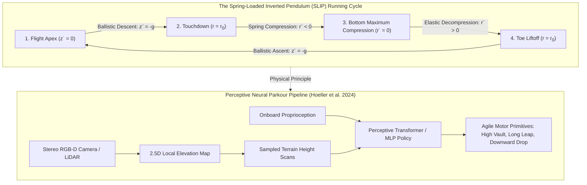
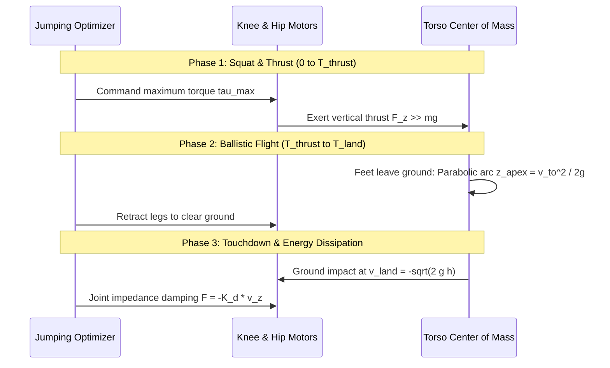
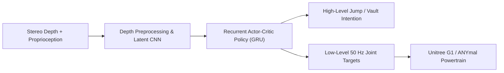

import ChapterProgress from '@site/src/components/ChapterProgress';
import QuizEngine from '@site/src/components/QuizEngine';

# Advanced Locomotion: Running, Jumping, Stairs & Neural Parkour

While steady walking is sufficient for smooth, flat indoor corridors, the true promise of humanoid robots lies in matching human physical agility across rugged outdoor terrain. Humans do not walk everywhere; we sprint across open spaces, leap over gaps, bound up staircases two steps at a time, and vault over obstacles. Achieving these high-energy dynamic behaviors requires transitioning beyond the flat-ground, continuous-contact assumptions of the Linear Inverted Pendulum Model.

When a humanoid runs or jumps, it introduces a completely new dynamical regime: the **ballistic flight phase**, during which both feet leave the ground ($\boldsymbol{\lambda} = \mathbf{0}$) and the Center of Mass follows an unactuated parabolic trajectory governed solely by gravity. In this chapter, we explore the biomechanical foundations of running via the **Spring-Loaded Inverted Pendulum (SLIP)** model, derive optimal jumping impulse profiles, examine perceptive footstep planning on stairs, and investigate recent breakthroughs in **Neural Parkour** that allow robots to leap across high gaps and climb vertical ledges in real time.



---

## 1. The Spring-Loaded Inverted Pendulum (SLIP) Model

While walking is characterized as an inverted pendulum that converts kinetic energy into potential energy during mid-stance (like an egg rolling over), running is fundamentally an **elastic bouncing phenomenon**. During human running, tendons (especially the Achilles tendon) and muscle aponeuroses store mechanical strain energy upon impact and recoil it to propel the body back into the air.

Pioneered by Reinhard Blickhan (1989) and Hartmut Geyer et al. (2006), the **Spring-Loaded Inverted Pendulum (SLIP)** model captures this behavior by representing the robot as a point mass $m$ atop a massless linear spring of rest length $r_0$ and stiffness $k$.

### Stance Phase Dynamics (In Polar Coordinates)

During stance, the foot is anchored at the origin $(0, 0)$. The state of the body is described by leg length $r$ and angle from the vertical $\theta$:

$$
m \ddot{r} = m r \dot{\theta}^2 - k(r - r_0) - m g \cos\theta
$$

$$
m r^2 \ddot{\theta} = -2 m r \dot{r} \dot{\theta} + m g r \sin\theta
$$

Notice the terms in the radial equation:
- $m r \dot{\theta}^2$: Outward centrifugal force.
- $-k(r - r_0)$: Restoring elastic spring force.
- $-m g \cos\theta$: Gravitational component along the leg axis.

In the angular equation, notice that $m r^2 \ddot{\theta} + 2 m r \dot{r} \dot{\theta} = \frac{d}{dt}(m r^2 \dot{\theta})$. Angular momentum about the foot contact is conserved when gravity is negligible, but under gravity, torque is generated by the moment arm $m g r \sin\theta$.

### Flight Phase Dynamics

The stance phase terminates at **liftoff** when the spring returns to its rest length:

$$
r(t_{\text{liftoff}}) = r_0, \quad \dot{r}(t_{\text{liftoff}}) > 0
$$

During the subsequent flight phase, the contact forces vanish. The Center of Mass obeys unactuated ballistic motion:

$$
\ddot{x} = 0 \implies x(t) = x_{\text{to}} + \dot{x}_{\text{to}} (t - t_{\text{to}})
$$

$$
\ddot{z} = -g \implies z(t) = z_{\text{to}} + \dot{z}_{\text{to}} (t - t_{\text{to}}) - \frac{1}{2}g (t - t_{\text{to}})^2
$$

The apex of flight occurs when vertical velocity vanishes ($\dot{z} = 0$):

$$
t_{\text{apex}} = t_{\text{to}} + \frac{\dot{z}_{\text{to}}}{g}, \quad z_{\text{apex}} = z_{\text{to}} + \frac{\dot{z}_{\text{to}}^2}{2g}
$$

During flight, the robot repositions its swing leg to a predetermined attack angle $\theta_{\text{attack}}$ ready for the next touchdown.

---

## 2. Ballistic Jumping Trajectory Optimization

A jump consists of three sequential phases: **Thrust**, **Flight**, and **Landing**:



### 1. Thrust Phase Momentum Synthesis
To clear a vertical gap of height $H_{\text{jump}}$, the required liftoff velocity at the instant of toe separation $t_{\text{to}}$ is:

$$
\dot{z}_{\text{to}} = \sqrt{2 g H_{\text{jump}}}
$$

From linear momentum conservation over the thrust duration $[0, T_{\text{thrust}}]$:

$$
m \dot{z}_{\text{to}} = \int_0^{T_{\text{thrust}}} (f_z(t) - m g) dt
$$

Assuming a trapezoidal contact force profile peaking at $f_{z,\max}$, the minimum thrust stroke distance $\Delta z_{\text{thrust}}$ (depth of squat) is bounded by:

$$
\Delta z_{\text{thrust}} \ge \frac{m \dot{z}_{\text{to}}^2}{2 (f_{z,\max} - m g)} = \frac{m g H_{\text{jump}}}{f_{z,\max} - m g}
$$

### 2. Touchdown Impact Dissipation
At touchdown, the impact velocity is $\dot{z}_{\text{land}} = -\sqrt{2 g H_{\text{jump}}}$. Without active damping, the kinetic energy $E_k = m g H_{\text{jump}}$ would shatter mechanical bearings. The leg joints switch to variable impedance control:

$$
\tau_j = K_{p,\text{soft}} (q_{\text{nominal}} - q_j) - K_{d,\text{high}} \dot{q}_j
$$

dissipating the impact energy across the compliant knee deflection stroke.

---

## 3. Stair Climbing & Elevation Costmaps

Standard flat-ground gait generators fail on stairs because the swing foot collides directly with the vertical riser. Stair traversal requires coupling perception with kinematic reachability:

### Elevation Map Formulation
The onboard depth camera or 3D LiDAR constructs a $2.5\mathrm{D}$ local elevation map grid $h(x, y)$ around the robot:

$$
h(x, y) = \max_i \{ z_i \mid (x_i, y_i) \in \text{cell}(x, y) \}
$$

### Safe Footstep Placement Filter
A footstep target $\mathbf{p}_{\text{step}} = [x_s, y_s]^T$ is classified as feasible for stair contact if:
1. **Flatness Margin**: The local variance of elevation across the foot footprint is within tolerance:
   $$
   \sigma^2_h(\mathbf{p}_{\text{step}}) = \frac{1}{|\mathcal{S}|}\int_{\mathcal{S}} (h(x, y) - \bar{h})^2 dA \le \epsilon_{\text{flat}}
   $$
2. **Edge Distance Clearance**: The center of the foot must be offset from stair riser edges by at least $d_{\text{edge}} \ge 5$ cm to prevent edge slipping.
3. **Height Clearance Trajectory**: The swing foot Cartesian spline $z_{\text{swing}}(t)$ must maintain a positive clearance safety margin $\delta_c \ge 8$ cm above all terrain points beneath its path:
   $$
   z_{\text{swing}}(t) \ge h(x_{\text{swing}}(t), y_{\text{swing}}(t)) + \delta_c
   $$

---

## 4. Neural Parkour for Humanoids

Pioneered by Hoeller et al. (2024) at ETH Zurich and the University of Zurich, **Neural Parkour** enables legged robots to dynamically traverse complex obstacles—such as 0.8-meter vertical drops, 0.6-meter hurdles, and long continuous trenches—at speeds exceeding 2.5 m/s.

### Architecture Overview



Rather than pre-computing offline trajectory splines, a recurrent neural policy trained with PPO directly ingests:
- Proprioceptive history (IMU, joint states).
- A depth image or 2.5D elevation height scan of the upcoming 2 meters.

The policy automatically shifts between walking, bounding, leaping, and wall-bracing behaviors based on visual affordances.

---

## 5. Locomotion Modalities: Comparative Matrix

| Skill | Dynamic Model | Flight Phase ($\boldsymbol{\lambda} = \mathbf{0}$) | Peak Vertical Force ($F_z / Mg$) | Primary Limiting Hardware Factor |
| :--- | :--- | :--- | :--- | :--- |
| **Walking** | 3D-LIPM / SRBD | Never (Continuous contact) | $1.1\text{--}1.3 \times$ | Joint range of motion & kinematic reach |
| **Running** | SLIP Model | Yes ($30\text{--}50\%$ of gait cycle) | $2.5\text{--}3.5 \times$ | Actuator peak velocity & torque bandwidth |
| **Jumping** | Ballistic / Impulse | Yes (Extended duration $> 0.3$s) | $4.0\text{--}6.0 \times$ | Peak instantaneous electrical power & gear shear |
| **Stairs** | Perceptive 3D-LIPM | None (or brief transitions) | $1.2\text{--}1.5 \times$ | Depth camera latency & edge clearance |
| **Parkour** | Perceptive RL (GRU) | Frequent dynamic leaps | $3.0\text{--}5.0 \times$ | Actuator thermal saturation & frame impact durability |

---

## 6. Python Implementation: SLIP Running Simulator

The script below simulates the non-linear hybrid dynamics of a Spring-Loaded Inverted Pendulum running along a limit cycle. It integrates the polar stance equations of motion, triggers touchdown and liftoff events, and projects the ballistic flight parabola.

```python
"""
slip_running_simulation.py
Simulation of a Spring-Loaded Inverted Pendulum (SLIP) running limit cycle.
Demonstrates transitions between compliant stance and unactuated ballistic flight.
"""

import numpy as np
from scipy.integrate import solve_ivp
import matplotlib.pyplot as plt

class SLIPRunner:
    def __init__(self, mass=40.0, r0=1.0, k=8000.0, attack_angle_deg=68.0, g=9.81):
        """
        Parameters:
        mass: Point mass (kg)
        r0: Rest leg spring length (m)
        k: Leg spring stiffness (N/m)
        attack_angle_deg: Leg angle from horizontal at touchdown (degrees)
        """
        self.m = mass
        self.r0 = r0
        self.k = k
        # Convert to angle from vertical (radians)
        self.theta_attack = np.radians(90.0 - attack_angle_deg)
        self.g = g

    def stance_dynamics(self, t, state):
        """State: [r, theta, r_dot, theta_dot]"""
        r, theta, dr, dtheta = state
        
        # Polar equations of motion under gravity and linear spring
        ddr = r * (dtheta**2) - (self.k / self.m) * (r - self.r0) - self.g * np.cos(theta)
        ddtheta = (-2.0 * dr * dtheta + self.g * np.sin(theta)) / r
        
        return [dr, dtheta, ddr, ddtheta]

    def liftoff_event(self, t, state):
        """Liftoff occurs when leg spring extends back to rest length r0 with dr > 0."""
        r, _, dr, _ = state
        return r - self.r0

    def simulate_stride(self, x_apex, z_apex, vx_apex):
        """Simulates one complete SLIP stride: Flight -> Stance -> Flight to next Apex."""
        # 1. Flight down to touchdown
        # Touchdown occurs when z = r0 * cos(theta_attack)
        z_touchdown = self.r0 * np.cos(self.theta_attack)
        if z_apex < z_touchdown:
            raise ValueError("Apex height is below touchdown altitude!")

        # Free-fall time to touchdown
        t_fall = np.sqrt(2.0 * (z_apex - z_touchdown) / self.g)
        vz_touchdown = -self.g * t_fall
        x_touchdown = x_apex + vx_apex * t_fall

        # Foot ground placement coordinate
        foot_x = x_touchdown + self.r0 * np.sin(self.theta_attack)

        # Initial stance state in polar coordinates
        r_init = self.r0
        theta_init = -self.theta_attack  # Leaning backward toward foot

        # Velocity projection into polar coordinates
        # v = [vx, vz]
        dr_init = vx_apex * np.sin(theta_init) + vz_touchdown * np.cos(theta_init)
        dtheta_init = (vx_apex * np.cos(theta_init) - vz_touchdown * np.sin(theta_init)) / self.r0

        # 2. Integrate Stance Phase
        def event(t, state):
            return self.liftoff_event(t, state)
        event.terminal = True
        event.direction = 1.0  # Spring expanding outward

        sol = solve_ivp(
            self.stance_dynamics,
            [0.0, 1.0],
            [r_init, theta_init, dr_init, dtheta_init],
            events=event,
            rtol=1e-8,
            atol=1e-9
        )

        r_lo, theta_lo, dr_lo, dtheta_lo = sol.y[:, -1]

        # Convert liftoff state back to Cartesian velocities
        vx_lo = dr_lo * np.sin(theta_lo) + r_lo * dtheta_lo * np.cos(theta_lo)
        vz_lo = dr_lo * np.cos(theta_lo) - r_lo * dtheta_lo * np.sin(theta_lo)
        x_lo = foot_x - r_lo * np.sin(theta_lo)
        z_lo = r_lo * np.cos(theta_lo)

        # 3. Ballistic ascent to next Apex
        if vz_lo <= 0:
            return None, "Robot failed to launch into flight!"

        t_rise = vz_lo / self.g
        next_z_apex = z_lo + (vz_lo**2) / (2.0 * self.g)
        next_vx_apex = vx_lo
        next_x_apex = x_lo + vx_lo * t_rise

        return {
            "x_apex": next_x_apex,
            "z_apex": next_z_apex,
            "vx_apex": next_vx_apex,
            "stance_duration": sol.t[-1],
            "max_compression": self.r0 - np.min(sol.y[0])
        }, "Success"

if __name__ == "__main__":
    runner = SLIPRunner(mass=40.0, r0=1.0, k=9000.0, attack_angle_deg=70.0)
    
    # Apex initial state
    x0, z0, vx0 = 0.0, 1.15, 2.5
    print(f"Initial Apex State: z={z0:.2f}m, vx={vx0:.2f}m/s")
    
    result, status = runner.simulate_stride(x0, z0, vx0)
    print(f"Simulation Status: {status}")
    if result:
        print(f"Next Apex Height: {result['z_apex']:.3f} m")
        print(f"Next Forward Speed: {result['vx_apex']:.3f} m/s")
        print(f"Max Spring Compression: {result['max_compression']*100:.1f} cm")
        print(f"Stance Contact Duration: {result['stance_duration']:.3f} s")
```

---

## 7. Seminal Literature & Academic References

1. **Blickhan, R. (1989).** *The spring-mass model for running and hopping*. Journal of Biomechanics, 22(11-12), 1217-1227.
   - *Annotation*: The foundational paper that established the Spring-Loaded Inverted Pendulum (SLIP) as the fundamental template for human and animal running.
2. **Geyer, H., Seyfarth, A., & Blickhan, R. (2006).** *Compliant leg behaviour explains basic dynamics of walking and running*. Proceedings of the Royal Society B: Biological Sciences, 273(1603), 2861-2867.
   - *Annotation*: Unified walking and running dynamics under a single spring-mass paradigm, proving that passive elasticity stabilizes periodic gaits.
3. **Hoeller, D., Rudin, N., Sako, D., & Hutter, M. (2024).** *Neural parkour for legged robots*. Science Robotics, 9(88), eadi7566.
   - *Annotation*: Landmark paper demonstrating perceptive reinforcement learning for agile quadrupedal and humanoid parkour over high obstacles and trenches.
4. **Hubicki, C., Jones, A., Ames, A., & Hurst, J. (2016).** *ATRIAS: Design and validation of a biped with spring-mass dynamics*. In IEEE International Conference on Robotics and Automation (ICRA) (pp. 5236-5243).
   - *Annotation*: Physical implementation of a human-scale robot specifically constructed with mechanical fiberglass leaf springs matching SLIP dynamics.

---

## 8. Hands-On Lab Project: SLIP Attack Angle Stability Basin

### Objective
Explore how the touchdown attack angle $\theta_{\text{attack}}$ affects the stability of running. Find the critical angle that produces an exact period-1 limit cycle where $z_{\text{apex}}[k+1] = z_{\text{apex}}[k]$.

### Deliverables & Verification
1. Run `slip_running_simulation.py` with leg stiffness $k = 9000$ N/m and initial forward velocity $v_x = 2.5$ m/s.
2. Sweep the attack angle $\alpha \in [65^\circ, 75^\circ]$ in increments of $0.5^\circ$.
3. Identify the resonant fixed-point angle $\alpha^*$ where apex height remains constant across multiple successive strides.
4. Document the failure modes: pitch-forward tumbling at steep angles vs backward bouncing at shallow angles.

---

<ChapterProgress chapterId="6-8-advanced-locomotion-skills" moduleId="module6" totalChapters={10} />

## Chapter Mastery Check

<QuizEngine
  quizId="quiz-6-8"
  title="Module 6.8 Mastery Check: Advanced Locomotion Skills"
  moduleId="module6"
  passThreshold={70}
  questions={[
    {
      id: "q1",
      question: "What fundamental physical phase distinguishes running and jumping from standard bipedal walking?",
      options: [
        "A double-support phase where both feet are glued to the floor",
        "A ballistic flight phase during which all ground contact reaction forces vanish (lambda = 0) and the Center of Mass follows an unactuated gravitational parabola",
        "A phase where joint motors consume zero electrical current",
        "A phase where the robot's cameras are disabled"
      ],
      correctIndex: 1,
      explanation: "Running and jumping feature a ballistic flight phase where the robot loses ground contact. During flight, external ground reaction forces are zero, and the CoM accelerates downward at -g."
    },
    {
      id: "q2",
      question: "In the Spring-Loaded Inverted Pendulum (SLIP) model, how is mechanical energy stored and recovered during the stance phase?",
      options: [
        "By charging the robot's lithium polymer battery pack through regenerative braking",
        "Through elastic compliance in the leg spring, which compresses under impact during early stance and recoils during late stance to launch the body into flight",
        "By heating up the motor coils",
        "Through aerodynamic lift from cooling fans"
      ],
      correctIndex: 1,
      explanation: "The SLIP template models the leg as a mechanical spring that stores kinetic energy as elastic potential energy during compression, returning it during decompression to propel the robot into the air."
    },
    {
      id: "q3",
      question: "When planning foot placement on staircases using a 2.5D elevation map, why must footsteps be constrained by an edge clearance margin d_edge?",
      options: [
        "To satisfy building architectural codes",
        "To prevent placing the Center of Pressure on the fragile step corner, which causes catastrophic foot rollover and slipping off the step edge",
        "To reduce camera exposure glare",
        "Because stairs can only be detected in the middle"
      ],
      correctIndex: 1,
      explanation: "Placing a foot right on the edge of a step riser risks slippage due to line contact and friction limits. Enforcing an edge distance clearance guarantees planar support within the flat tread."
    }
  ]}
/>
