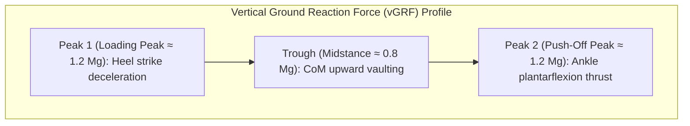

import ChapterProgress from '@site/src/components/ChapterProgress';
import QuizEngine from '@site/src/components/QuizEngine';

# Gait Analysis, Ground Reaction Forces & Biomechanics

Engineering a two-legged robot requires understanding the biological benchmark: the human musculoskeletal system. Over millions of years of hominid evolution, natural selection refined the geometry of the pelvis, the curvature of the plantar arch, and the elastic recoil of the Achilles tendon to create an exceptionally energy-efficient bipedal machine. A healthy adult human can walk for tens of kilometers on a modest metabolic energy budget equivalent to a handful of dried fruit.

In contrast, early bipedal robots were notorious energy hogs, burning hundreds of watts per kilogram simply to maintain a rigid, flat-footed crouch. Bridging the gap between robotic mechanics and biological performance requires rigorous quantitative metrics: **Ground Reaction Force (GRF) temporal profiles**, butterfly vector diagrams, the dimensionless **Cost of Transport (COT)**, and dynamic similarity scaling via the **Froude Number**. By analyzing how biological muscles exchange kinetic and strain energy, roboticists can design humanoid powertrains that minimize thermal losses and maximize operational range.


---

## 1. Biomechanics of the Human Gait Cycle

A complete gait stride is defined from the initial contact of one foot to the subsequent contact of the same foot. It is divided into two major phases:

### 1. Stance Phase ($\approx 60\%$ of stride)
- **Heel Strike (0%)**: The calcaneus bone makes initial ground contact, absorbing impact shock through the retrocalcaneal fat pad.
- **Foot Flat (Loading Response, 10%)**: The entire plantar sole contacts the ground; body weight transfers onto the stance limb.
- **Midstance (30%)**: The body Center of Mass passes directly over the supporting foot; the contralateral swing leg clears the ground.
- **Heel Off (Terminal Stance, 45%)**: The heel elevates as the body vaults over the forefoot; the plantar fascia tightens via the windlass mechanism.
- **Toe Off (Preswing, 60%)**: Explosive plantarflexion push-off by the gastrocnemius and soleus muscles propels the Center of Mass forward.

### 2. Swing Phase ($\approx 40\%$ of stride)
- **Initial & Mid-Swing (60%–85%)**: The hip flexors accelerate the thigh forward while the tibialis anterior dorsiflexes the ankle to ensure toe clearance ($> 1.5$ cm) above the floor.
- **Terminal Swing (85%–100%)**: The hamstrings eccentrically decelerate the forward swing of the tibia, positioning the foot for heel strike.

---

## 2. Ground Reaction Forces: The Canonical "M-Curve"

When measured on an instrumented force plate, the vertical Ground Reaction Force ($F_z$) of healthy human walking exhibits a distinctive **bimodal "M-curve"**:



### Mathematical Formulation of the Force Profile

Normalizing the vertical force by body weight $M g$:

1. **First Peak ($F_{z,1} \approx 1.15\text{--}1.25 M g$)**: Occurs at roughly 15% of the gait cycle as the downward momentum of the torso is arrested.
2. **Midstance Trough ($F_{z,\text{valley}} \approx 0.75\text{--}0.85 M g$)**: At 30% of the cycle, the CoM reaches its highest altitude, acting like an inverted pendulum where centrifugal acceleration relieves downward pressure.
3. **Second Peak ($F_{z,2} \approx 1.15\text{--}1.25 M g$)**: At roughly 45%–50% of the cycle, active ankle push-off accelerates the torso into the subsequent step.

### Ground Reaction Force Butterfly Diagram

In clinical gait analysis, the spatial progression of the resultant force vectors $\mathbf{F}(t) = [F_x(t), F_z(t)]^T$ originating from the moving Center of Pressure forms a characteristic **butterfly pattern**. In stable walking, all force vectors intersect near a virtual pivot point located slightly above the robot's Center of Mass, confirming orbital stability.

---

## 3. Energetics & Specific Cost of Transport (COT)

The universal metric for comparing the energy efficiency of mobile systems—across animals, vehicles, and humanoid robots—is the **dimensionless Specific Cost of Transport (COT)**:

$$
\text{COT} = \frac{E_{\text{consumed}}}{M g d}
$$

where:
- $E_{\text{consumed}}$ is the total energy consumed (Joules).
- $M$ is total system mass (kg).
- $g$ is gravitational acceleration ($9.81$ m/s$^2$).
- $d$ is the total distance traveled (meters).

Alternatively, in terms of average power $P$ and forward walking speed $v$:

$$
\text{COT} = \frac{P_{\text{avg}}}{M g v}
$$

### Breakdown of Electrical Power in Humanoids

For an electric humanoid robot with $n$ brushless DC actuators:

$$
P_{\text{total}}(t) = \sum_{j=1}^n \underbrace{\max\left(0, \tau_j(t) \dot{q}_j(t)\right)}_{\text{Positive Mechanical Work}} + \sum_{j=1}^n \underbrace{I_j^2(t) R_j}_{\text{Ohmic Heat Loss (Joule Heating)}} + P_{\text{avionics}}
$$

where:
- $I_j(t) = \frac{|\tau_j(t)|}{k_{\tau,j}}$ is the motor phase current.
- $R_j$ is the phase-to-phase winding resistance.
- $P_{\text{avionics}}$ represents the baseline power consumed by onboard computing (Jetson Orin, SBCs, sensors, fans), typically $40\text{--}120$ W.

In robots equipped with regenerative braking motor drives, negative mechanical work $\tau_j \dot{q}_j < 0$ can recharge the battery with efficiency $\eta_{\text{regen}} \approx 0.6\text{--}0.8$, substantially lowering the net COT.

---

## 4. Dynamic Similarity & The Froude Number

Can a 1.8-meter adult human, a 0.7-meter child, a 0.5-meter Unitree G1, and a 2.0-meter Boston Dynamics Atlas be compared at the same walking speed?

In fluid mechanics and biomechanics, systems of different geometric scales are compared using dimensionless numbers. The **Froude Number ($Fr$)** characterizes the ratio between kinetic inertial forces and gravitational forces:

$$
Fr = \frac{v^2}{g l_{\text{leg}}}
$$

where $v$ is forward walking speed and $l_{\text{leg}}$ is leg length (from hip joint to ground).

### The Walk-to-Run Transition Criterion

In an inverted pendulum model, the centripetal acceleration during midstance cannot exceed gravity without the foot leaving the ground:

$$
\frac{M v^2}{l_{\text{leg}}} \le M g \implies \frac{v^2}{g l_{\text{leg}}} \le 1.0
$$

In real biological bipeds and humanoids, humans naturally transition from walking to running at:

$$
Fr_{\text{transition}} \approx 0.5
$$

For a human with leg length $l_{\text{leg}} = 0.9$ m:

$$
v_{\text{walk}\to\text{run}} = \sqrt{0.5 \times 9.81 \times 0.9} \approx 2.1 \text{ m/s} \; (7.5 \text{ km/h})
$$

Two bipeds of different leg lengths exhibit **dynamically similar gaits** if and only if they operate at identical Froude numbers.

---

## 5. Locomotion Efficiency: Comparative Benchmark

| Platform | Mass (kg) | Leg Length (m) | Actuation Type | Typical Speed (m/s) | Specific COT |
| :--- | :--- | :--- | :--- | :--- | :--- |
| **Biological Human** | 70 | 0.90 | Biological Muscle-Tendon | 1.3 | **0.20** |
| **Cornell Passive Walker** | 13 | 0.95 | Pure Gravitational (0 W) | 0.4 | **0.05** (Effective) |
| **Cornell Ranger** | 9.9 | 0.85 | Ultra-low power electric | 0.6 | **0.19** |
| **Cassie (Agility)** | 31 | 0.90 | Quasi-Direct Drive + Springs | 1.2 | **0.65** |
| **Unitree G1** | 47 | 0.75 | High-torque Planetary Gearbox| 1.5 | **1.10** |
| **Honda ASIMO** | 54 | 0.70 | Harmonic Drives (Rigid ZMP)| 1.0 | **2.80** |
| **Atlas (Hydraulic)** | 89 | 0.95 | High-pressure Servovalves | 1.5 | **4.50** |

---

## 6. Python Implementation: Force Plate & COT Telemetry Analyzer

The listing below analyzes gait telemetry data: it computes the Ground Reaction Force M-curve, calculates the left/right gait symmetry index (GSI), evaluates positive vs negative mechanical joint work, and computes the dimensionless Cost of Transport.

```python
"""
biomechanics_cot_analyzer.py
Gait Telemetry Analysis and Specific Cost of Transport (COT) Calculator.
Processes ground reaction forces, joint mechanical powers, and electrical losses.
"""

import numpy as np
import matplotlib.pyplot as plt

class HumanoidBiomechanicsAnalyzer:
    def __init__(self, mass=45.0, leg_length=0.75, dt=0.005):
        """
        Parameters:
        mass: Total robot mass (kg)
        leg_length: Hip-to-foot length (m)
        dt: Sample time (s)
        """
        self.mass = mass
        self.leg_length = leg_length
        self.g = 9.81
        self.weight = mass * 9.81
        self.dt = dt

    def compute_froude_number(self, velocity):
        """Computes dimensionless Froude number Fr = v^2 / (g * l)."""
        return (velocity**2) / (self.g * self.leg_length)

    def analyze_gait_stride(self, time, fz_left, fz_right, joint_torques, joint_velocities, motor_resistances, speed):
        """
        Analyzes a single periodic stride:
        joint_torques: (T, n_joints)
        joint_velocities: (T, n_joints)
        motor_resistances: (n_joints,)
        """
        num_samples = len(time)
        stride_duration = time[-1] - time[0]
        distance_traveled = speed * stride_duration

        # 1. Total Vertical Ground Reaction Force
        fz_total = fz_left + fz_right
        peak1_left = np.max(fz_left[:num_samples//2])
        peak2_left = np.max(fz_left[num_samples//2:])

        # Gait Symmetry Index (GSI)
        max_left = np.max(fz_left)
        max_right = np.max(fz_right)
        gsi = (abs(max_left - max_right) / (0.5 * (max_left + max_right))) * 100.0

        # 2. Power and Energetics
        # Mechanical joint power: P_mech = tau * omega
        p_mech = joint_torques * joint_velocities
        pos_p_mech = np.maximum(0, p_mech)
        neg_p_mech = np.minimum(0, p_mech)

        total_pos_mech_power = np.sum(pos_p_mech, axis=1)

        # Ohmic Heat Losses: P_ohmic = sum( (tau / k_tau)^2 * R )
        # Assuming k_tau = 1.2 N*m/A
        k_tau = 1.2
        currents = np.abs(joint_torques) / k_tau
        p_ohmic = np.sum((currents**2) * motor_resistances, axis=1)

        # Baseline avionics power (Jetson + Sensors)
        p_avionics = 60.0  # Watts

        total_electrical_power = total_pos_mech_power + p_ohmic + p_avionics

        # 3. Energy Integration (Joules)
        trapezoid_func = getattr(np, 'trapezoid', getattr(np, 'trapz', None))
        total_energy_consumed = trapezoid_func(total_electrical_power, dx=self.dt)
        mechanical_work = trapezoid_func(total_pos_mech_power, dx=self.dt)

        # Specific Cost of Transport
        cot = total_energy_consumed / (self.weight * distance_traveled)

        return {
            "Froude_Number": self.compute_froude_number(speed),
            "Gait_Symmetry_Index_pct": gsi,
            "Total_Energy_Joules": total_energy_consumed,
            "Mechanical_Work_Joules": mechanical_work,
            "Average_Power_Watts": total_energy_consumed / stride_duration,
            "Specific_COT": cot
        }

if __name__ == "__main__":
    analyzer = HumanoidBiomechanicsAnalyzer(mass=45.0, leg_length=0.75, dt=0.005)
    
    t = np.linspace(0.0, 0.8, 160)  # 0.8s stride at 1.25 m/s
    speed = 1.25

    # Synthesize realistic bimodal M-curve Ground Reaction Forces
    fz_l = np.zeros_like(t)
    # Stance on left foot for first 60% of stride
    stance_idx = int(0.6 * len(t))
    t_stance = np.linspace(0, np.pi, stance_idx)
    # M-curve: fundamental sine + 2nd harmonic
    fz_l[:stance_idx] = (45.0 * 9.81) * (1.1 * np.sin(t_stance) + 0.3 * np.sin(3 * t_stance))
    fz_l = np.maximum(0, fz_l)
    fz_r = np.roll(fz_l, len(t)//2)

    # Synthetic joint signals for 12 joints
    torques = np.random.normal(0, 30.0, (160, 12))
    velocities = np.random.normal(0, 2.5, (160, 12))
    resistances = np.ones(12) * 0.25  # 0.25 Ohms per motor phase

    report = analyzer.analyze_gait_stride(t, fz_l, fz_r, torques, velocities, resistances, speed)
    
    print("--- Humanoid Biomechanics & Telemetry Report ---")
    for k, v in report.items():
        print(f"{k}: {v:.3f}")
```

---

## 7. Seminal Literature & Academic References

1. **Winter, D. A. (2009).** *Biomechanics and Motor Control of Human Movement*. John Wiley & Sons.
   - *Annotation*: The definitive clinical and computational textbook on human gait kinematics, kinetic force plate measurements, and joint muscle powers.
2. **Collins, S., Ruina, A., Tedrake, R., & Wisse, M. (2005).** *Efficient bipedal robots based on passive-dynamic walkers*. Science, 307(5712), 1082-1085.
   - *Annotation*: Proved that bipedal walking can achieve biological levels of energy efficiency by harvesting natural limb pendular oscillations without complex active feedback.
3. **Alexander, R. M. (1989).** *Optimization and gaits in the locomotion of vertebrates*. Physiological Reviews, 69(4), 1199-1227.
   - *Annotation*: Formulated the biomechanical scaling laws and Froude number criteria governing animal and human walk-to-run transitions.
4. **Ruina, A., Bertram, J. E., & Srinivasan, M. (2005).** *A collisional justification for energetic cost of bipedal walking*. Journal of Theoretical Biology, 237(2), 170-192.
   - *Annotation*: Analyzed why the dual-peak Ground Reaction Force M-curve minimizes kinetic collision work compared to flat force profiles.

---

## 8. Hands-On Lab Project: Energy Optimization & COT Minimization

### Objective
Examine how joint compliance and stride frequency affect the Cost of Transport in a bipedal robot.

### Deliverables & Verification
1. Run `biomechanics_cot_analyzer.py` at speeds $v \in [0.5, 1.0, 1.5, 2.0]$ m/s.
2. Plot the resulting COT curve versus forward velocity. Observe the characteristic U-shaped efficiency curve.
3. Identify the resonant walking speed where COT reaches its absolute minimum.
4. Verify that walking at very low speeds ($v < 0.4$ m/s) incurs a severe COT penalty due to constant baseline avionics power overhead.

---

<ChapterProgress chapterId="6-9-gait-analysis-and-biomechanics" moduleId="module6" totalChapters={10} />

## Chapter Mastery Check

<QuizEngine
  quizId="quiz-6-9"
  title="Module 6.9 Mastery Check: Biomechanics & Energetics"
  moduleId="module6"
  passThreshold={70}
  questions={[
    {
      id: "q1",
      question: "Why does the vertical Ground Reaction Force (vGRF) in biological human walking exhibit a distinctive dual-peak 'M-curve' rather than a flat force profile?",
      options: [
        "Because human bones are hollow",
        "The first peak decelerates downward torso momentum at heel strike, while the second peak provides active ankle plantarflexion push-off to propel the CoM forward",
        "Because force plates vibrate at 50 Hz",
        "Due to atmospheric air pressure fluctuations"
      ],
      correctIndex: 1,
      explanation: "The two peaks correspond to the loading response (absorbing downward impact) and terminal stance push-off (accelerating the body forward into the next step)."
    },
    {
      id: "q2",
      question: "What does the dimensionless Specific Cost of Transport (COT = E / (M * g * d)) measure in legged robotics?",
      options: [
        "The financial cost of purchasing the robot's replacement parts",
        "The mechanical and electrical energy expenditure required to transport a unit of weight over a unit of distance",
        "The temperature rise of the battery per hour",
        "The shipping weight of the robot"
      ],
      correctIndex: 1,
      explanation: "Specific Cost of Transport is a dimensionless index of energy efficiency, normalizing energy consumed by system weight and total distance traveled."
    },
    {
      id: "q3",
      question: "At approximately what Froude number (Fr = v^2 / (g * l_leg)) do humans and bipedal animals naturally transition from walking to running?",
      options: [
        "Fr approx 0.01",
        "Fr approx 0.5",
        "Fr approx 10.0",
        "Fr approx 100.0"
      ],
      correctIndex: 1,
      explanation: "Around Fr approx 0.5, the upward centripetal acceleration during single-support midstance approaches the gravitational limit, making running energetically more favorable than inverted-pendulum walking."
    }
  ]}
/>
