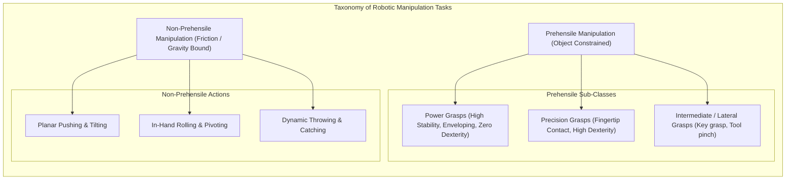
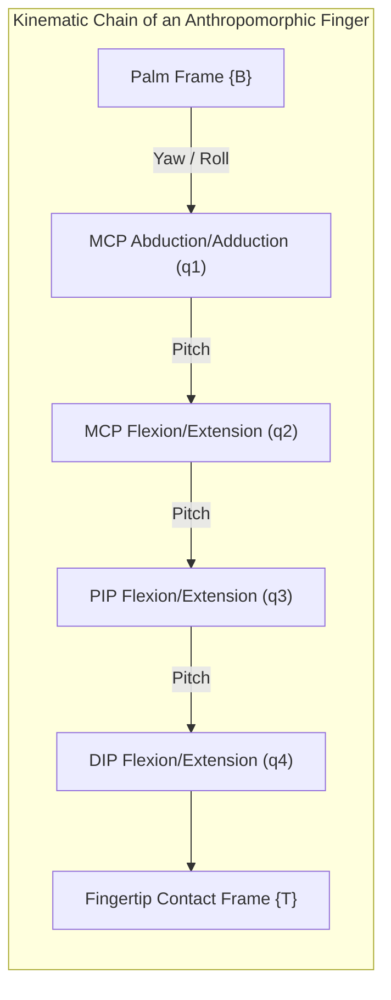
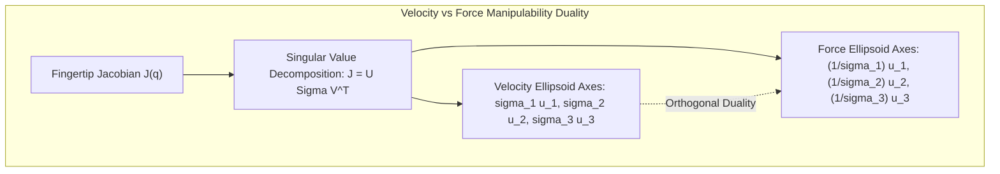

import ChapterProgress from '@site/src/components/ChapterProgress';
import QuizEngine from '@site/src/components/QuizEngine';

# Foundations of Dexterous Manipulation & Hand Kinematics

While industrial automation has perfected high-speed pick-and-place with parallel-jaw grippers, humanoid robots operating in human-centric environments face an entirely different challenge: unstructured versatility. A rigid two-jaw gripper can secure a coffee mug by its rim or clamp a uniform box, but it fails abruptly when tasked with turning a screwdriver, threading a flexible cable through a grommet, or shifting a pencil from a palmar grasp to a writing posture without dropping it. Human dexterity relies on continuous in-hand reorientation, coordinated multi-fingered contact transitions, and active tactile impedance regulation.

Dexterous manipulation represents the pinnacle of robotic embodiment. Moving beyond simple form-locking grasps, dexterity encompasses the deliberate alteration of an object's pose relative to the palm and fingers through controlled rolling, sliding, and finger gaiting. Achieving this capability requires rigorous kinematic modeling of multi-branched articulated mechanisms, differential kinematic transformations, and manipulability analysis across complex contact topologies.



---

## 1. Biomechanics of the Human Hand vs. Anthropomorphic End-Effectors

The human hand is a musculoskeletal masterpiece comprising 27 bones, 34 muscles, and over 100 named ligaments. Biomechanically, it provides 21 articulate degrees of freedom (DoFs) intrinsic to the wrist-distal anatomy (excluding the 6-DoF spatial mobility of the wrist and forearm):

- **Thumb (5 DoFs)**: 2 DoFs at the carpometacarpal (CMC) saddle joint (flexion/extension, abduction/adduction), 2 DoFs at the metacarpophalangeal (MCP) condyloid joint, and 1 DoF at the interphalangeal (IP) hinge joint. The opposability of the human thumb provides the fundamental geometric basis for both power wrap and precision pinch grasps.
- **Index and Middle Fingers (4 DoFs each)**: 2 DoFs at the MCP joint (abduction/adduction, flexion/extension), 1 DoF at the proximal interphalangeal (PIP) joint, and 1 DoF at the distal interphalangeal (DIP) joint.
- **Ring and Little Fingers (4 DoFs each + 1 ulnar cup DoF)**: An additional CMC flexion DoF on the pinky enables palmar arching (the "cupping" motion critical for grasping spherical objects).



Robotic hands span a spectrum between structural simplicity and full anthropomorphic fidelity:
1. **Parallel-Jaw & Underactuated Grippers (1–2 Actuators)**: Exemplified by the Robotiq 2F-85 or Festo adaptive grippers. They exploit mechanical compliance to passively adapt to geometric variations, sacrificing in-hand dexterity for rugged grasping.
2. **Modular 3- to 4-Fingered Research Hands (12–16 DoFs)**: Exemplified by the Allegro Hand (Wonik Robotics) and Barrett Hand. The Allegro features 4 fingers with 4 DoFs each, providing sufficient dexterity for in-hand spherical and cylindrical reorientation while maintaining direct-drive motor reliability.
3. **Fully Anthropomorphic Biomimetic Hands (20–24 DoFs)**: Exemplified by the Shadow Dexterous Hand (20 driven DoFs via 40 tendon-actuated pneumatic or brushless DC muscles) and the DLR-HIT Hand II. These hands replicate the human kinematic footprint and allow direct human-to-robot teleoperation retargeting.

---

## 2. Mathematical Kinematics of Multi-Fingered Systems

Let a robotic hand consist of $k$ distinct fingers branching from a common palm coordinate frame $\{B\}$. Each finger $i \in \{1, \dots, k\}$ possesses $n_i$ revolute joints represented by generalized coordinates $\mathbf{q}_i = [q_{i,1}, q_{i,2}, \dots, q_{i,n_i}]^T \in \mathcal{C}_i \subset \mathbb{R}^{n_i}$.

The total configuration space of the hand is the Cartesian product:

$$
\mathcal{C}_{\text{hand}} = \mathcal{C}_1 \times \mathcal{C}_2 \times \dots \times \mathcal{C}_k \subset \mathbb{R}^{n}, \quad n = \sum_{i=1}^k n_i
$$

### 2.1 Product of Exponentials (PoE) Forward Kinematics

Using the modern Lie-group formulation, the forward kinematics of the $i$-th fingertip relative to the palm frame $\{B\}$ is expressed using the Product of Exponentials (PoE) formula:

$$
\mathbf{T}_{b, i}(\mathbf{q}_i) = e^{[\mathcal{S}_{i,1}] q_{i,1}} e^{[\mathcal{S}_{i,2}] q_{i,2}} \cdots e^{[\mathcal{S}_{i, n_i}] q_{i, n_i}} \mathbf{M}_{i} \in \mathrm{SE}(3)
$$

where:
- $\mathbf{M}_i \in \mathrm{SE}(3)$ denotes the rest configuration of the $i$-th fingertip when $\mathbf{q}_i = \mathbf{0}$.
- $\mathcal{S}_{i,j} = [\boldsymbol{\omega}_{i,j}^T, \mathbf{v}_{i,j}^T]^T \in \mathbb{R}^6$ represents the screw axis of joint $j$ of finger $i$ expressed in frame $\{B\}$.
- $[\mathcal{S}] \in \mathfrak{se}(3)$ is the $4 \times 4$ Lie algebra matrix representation:

$$
[\mathcal{S}] = \begin{bmatrix} [\boldsymbol{\omega}]_\times & \mathbf{v} \\ \mathbf{0}_{1 \times 3} & 0 \end{bmatrix}, \quad [\boldsymbol{\omega}]_\times = \begin{bmatrix} 0 & -\omega_z & \omega_y \\ \omega_z & 0 & -\omega_x \\ -\omega_y & \omega_x & 0 \end{bmatrix}
$$

### 2.2 Differential Kinematics & Finger Jacobians

The linear and angular velocity of the $i$-th fingertip contact point $\mathbf{p}_{tip, i} \in \mathbb{R}^3$ relative to the palm frame is governed by the fingertip geometric Jacobian $\mathbf{J}_i(\mathbf{q}_i) \in \mathbb{R}^{6 \times n_i}$:

$$
\mathbf{V}_i = \begin{bmatrix} \boldsymbol{\omega}_i \\ \dot{\mathbf{p}}_{tip, i} \end{bmatrix} = \mathbf{J}_i(\mathbf{q}_i) \dot{\mathbf{q}}_i
$$

The body Jacobian columns $\mathbf{J}_{b, i}^{(j)}$ are computed recursively:

$$
\mathbf{J}_{b, i}^{(j)}(\mathbf{q}_i) = \mathrm{Ad}^{-1}\left( e^{[\mathcal{S}_{i, j}] q_{i, j}} \cdots e^{[\mathcal{S}_{i, n_i}] q_{i, n_i}} \mathbf{M}_i \right) \mathcal{S}_{i, j}
$$

where $\mathrm{Ad}_{\mathbf{T}}$ is the adjoint transformation matrix for $\mathbf{T} = \begin{bmatrix} \mathbf{R} & \mathbf{p} \\ \mathbf{0} & 1 \end{bmatrix}$:

$$
\mathrm{Ad}_{\mathbf{T}} = \begin{bmatrix} \mathbf{R} & \mathbf{0}_{3 \times 3} \\ [\mathbf{p}]_\times \mathbf{R} & \mathbf{R} \end{bmatrix} \in \mathbb{R}^{6 \times 6}
$$

---

## 3. Dexterous Manipulability & Velocity Transmission Ellipsoids

For contact-rich manipulation tasks, knowing whether a finger can generate arbitrary fingertip velocities or forces is essential. The linear velocity transmission from joint rates $\dot{\mathbf{q}}_i$ to fingertip translational velocity $\mathbf{v}_i \in \mathbb{R}^3$ is isolated through the linear sub-Jacobian $\mathbf{J}_{v, i}(\mathbf{q}_i) \in \mathbb{R}^{3 \times n_i}$:

$$
\mathbf{v}_i = \mathbf{J}_{v, i}(\mathbf{q}_i) \dot{\mathbf{q}}_i
$$

Assuming normalized joint rate constraints $\|\dot{\mathbf{q}}_i\|_2 \le 1$, the reachable fingertip velocity boundary maps to an ellipsoid in $\mathbb{R}^3$:

$$
\mathbf{v}_i^T \left( \mathbf{J}_{v, i} \mathbf{J}_{v, i}^T \right)^{-1} \mathbf{v}_i \le 1
$$

The **Yoshikawa Manipulability Measure** $w(\mathbf{q}_i)$ quantifies distance from kinematic singularity:

$$
w(\mathbf{q}_i) = \sqrt{\det\left( \mathbf{J}_{v, i}(\mathbf{q}_i) \mathbf{J}_{v, i}(\mathbf{q}_i)^T \right)} = \sigma_1 \sigma_2 \sigma_3
$$

where $\sigma_1 \ge \sigma_2 \ge \sigma_3 \ge 0$ are the singular values of $\mathbf{J}_{v, i}$.



When $\sigma_3 \to 0$, the finger approaches a kinematic singularity (such as full extension or collinear joint alignment), losing mobility along the axis of the third singular vector $\mathbf{u}_3$. Conversely, by the principle of virtual work, the fingertip force transmission capability is governed by:

$$
\boldsymbol{\tau}_i = \mathbf{J}_{v, i}^T \mathbf{f}_i \implies \mathbf{f}_i^T \left( \mathbf{J}_{v, i} \mathbf{J}_{v, i}^T \right) \mathbf{f}_i \le 1
$$

This exposes the fundamental **kinematic-static duality**: directions in which the fingertip moves fastest have the lowest force capacity, while directions constrained near singularities can exert high contact forces with minimal motor torque.

---

## 4. Hardware Comparison of Manipulation End-Effectors

| Metric / Attribute | Industrial 2F Gripper | Underactuated Adaptive Hand | Allegro Research Hand | Shadow Dexterous Hand |
| :--- | :--- | :--- | :--- | :--- |
| **Active Degrees of Actuation** | 1 DoA | 1–2 DoA | 16 DoA (4 DoA $\times$ 4 fingers) | 20 DoA (tendon-driven) |
| **Kinematic Degrees of Freedom** | 1 DoF | 4–10 DoF (flexures/springs) | 16 DoF | 24 DoF |
| **Transmission Mechanism** | Lead screw / Spur gear | Five-bar linkage / Tendons | Direct-drive mini brushless | Ag/W Bowden cable tendons |
| **In-Hand Manipulation Capability**| None (rigid clamping) | Passive enveloping wrap only | Full 3D rolling & gaiting | Human-equivalent dexterity |
| **Peak Fingertip Pinch Force** | 200–500 N | 40–80 N | 12 N per finger | 10 N per finger |
| **Primary Failure Mode** | Jamming on misaligned load | Plastic tendon deformation | Gearhead backlash / impact | Tendon fraying / compliance drift |
| **Integrated Tactile Modality** | Binary open/close microswitches| Piezoresistive pads | Optical (DIGIT) or FSR | BioTac multi-modal tactile |

---

## 5. Production Python Implementation: Multi-Finger Kinematics & Manipulability

The listing below provides a clean, fully vectorized Python implementation computing forward kinematics, geometric Jacobians, and Yoshikawa manipulability ellipsoids for an anthropomorphic 4-DoF finger:

```python
"""
Production Python implementation: Multi-Finger Kinematics & Manipulability
Author: Dexterous Manipulation Specialist
Module: 7.1 Foundations of Dexterous Manipulation
"""

import numpy as np
from dataclasses import dataclass
from typing import Tuple, List, Dict


@dataclass
class LinkParameters:
    """Denavit-Hartenberg parameters (modified Craig convention) for finger."""
    alpha: float  # Link twist [rad]
    a: float      # Link length [m]
    d: float      # Link offset [m]
    theta_offset: float = 0.0


class AnthropomorphicFinger:
    """
    Kinematic model of a 4-DoF anthropomorphic finger:
    Joint 1: MCP Abduction/Adduction (yaw)
    Joint 2: MCP Flexion/Extension (pitch)
    Joint 3: PIP Flexion/Extension (pitch)
    Joint 4: DIP Flexion/Extension (pitch)
    """

    def __init__(self, finger_id: str, links: List[LinkParameters]):
        self.finger_id = finger_id
        self.links = links
        self.dof = len(links)
        assert self.dof == 4, "Anthropomorphic finger must have exactly 4 joints."

    def _dh_transform(self, alpha: float, a: float, d: float, theta: float) -> np.ndarray:
        """Computes standard 4x4 homogenous DH transformation matrix."""
        c_th = np.cos(theta)
        s_th = np.sin(theta)
        c_al = np.cos(alpha)
        s_al = np.sin(alpha)

        return np.array([
            [c_th,        -s_th,       0.0,         a],
            [s_th * c_al,  c_th * c_al, -s_al, -d * s_al],
            [s_th * s_al,  c_th * s_al,  c_al,  d * c_al],
            [0.0,          0.0,         0.0,         1.0]
        ], dtype=np.float64)

    def forward_kinematics(self, joint_angles: np.ndarray) -> Tuple[np.ndarray, List[np.ndarray]]:
        """
        Computes forward kinematics returning base-to-tip matrix and intermediate frames.
        
        Args:
            joint_angles: 1D array of 4 joint positions [radians].
            
        Returns:
            T_tip: 4x4 SE(3) pose of fingertip in base frame.
            transforms: List of intermediate homogenous frames {0_T_1, 0_T_2, ...}.
        """
        assert len(joint_angles) == self.dof, f"Expected {self.dof} joint angles."

        t_accum = np.eye(4, dtype=np.float64)
        transforms = [t_accum.copy()]

        for i, link in enumerate(self.links):
            theta = joint_angles[i] + link.theta_offset
            a_i = self._dh_transform(link.alpha, link.a, link.d, theta)
            t_accum = t_accum @ a_i
            transforms.append(t_accum.copy())

        return t_accum, transforms

    def compute_jacobian(self, joint_angles: np.ndarray) -> np.ndarray:
        """
        Computes 6x4 geometric Jacobian J = [J_v; J_omega] in base frame.
        """
        t_tip, transforms = self.forward_kinematics(joint_angles)
        p_tip = t_tip[0:3, 3]

        j_geom = np.zeros((6, self.dof), dtype=np.float64)

        for i in range(self.dof):
            t_i = transforms[i]
            z_i = t_i[0:3, 2]  # Rotation axis of joint i
            p_i = t_i[0:3, 3]  # Origin of joint frame i

            # Linear velocity Jacobian: J_v = z_i x (p_tip - p_i)
            j_geom[0:3, i] = np.cross(z_i, (p_tip - p_i))
            # Angular velocity Jacobian: J_omega = z_i
            j_geom[3:6, i] = z_i

        return j_geom

    def compute_manipulability(self, joint_angles: np.ndarray) -> Dict[str, np.ndarray]:
        """
        Evaluates linear velocity manipulability ellipsoid using SVD.
        """
        j_geom = self.compute_jacobian(joint_angles)
        j_v = j_geom[0:3, :]  # 3x4 translational component

        # Singular Value Decomposition of J_v
        u, singular_values, vt = np.linalg.svd(j_v, full_matrices=False)
        yoshikawa_metric = float(np.prod(singular_values))

        return {
            "jacobian_linear": j_v,
            "yoshikawa_index": yoshikawa_metric,
            "principal_radii": singular_values,
            "principal_axes": u,
            "condition_number": float(singular_values[0] / max(singular_values[-1], 1e-9))
        }


def default_human_finger(name: str = "index") -> AnthropomorphicFinger:
    """Returns standard adult index finger kinematic parameters (meters, rad)."""
    links = [
        LinkParameters(alpha=np.pi / 2, a=0.0,    d=0.0),    # MCP Ab/Ad
        LinkParameters(alpha=0.0,       a=0.045,  d=0.0),    # Proximal phalanx (MCP Flex)
        LinkParameters(alpha=0.0,       a=0.025,  d=0.0),    # Intermediate phalanx (PIP)
        LinkParameters(alpha=0.0,       a=0.020,  d=0.0)     # Distal phalanx (DIP)
    ]
    return AnthropomorphicFinger(finger_id=name, links=links)


if __name__ == "__main__":
    finger = default_human_finger("index_finger")
    
    # Test nominal semi-flexed grasp configuration
    q_nominal = np.array([0.05, np.radians(30), np.radians(45), np.radians(20)])
    t_tip, _ = finger.forward_kinematics(q_nominal)
    manip_data = finger.compute_manipulability(q_nominal)

    print("=== 4-DoF Anthropomorphic Finger Kinematics ===")
    print(f"Fingertip Position (m): x={t_tip[0, 3]:.4f}, y={t_tip[1, 3]:.4f}, z={t_tip[2, 3]:.4f}")
    print(f"Yoshikawa Manipulability Measure w: {manip_data['yoshikawa_index']:.6e}")
    print(f"Ellipsoid Principal Radii (sigma_i): {np.round(manip_data['principal_radii'], 4)}")
    print(f"Jacobian Conditioning: {manip_data['condition_number']:.2f}")
```

---

## 6. Seminal Research Foundations

1. **Cutkosky, M. R. (1989).** *On grasp choice, grasp models, and the design of hands for manufacturing tasks*. IEEE Transactions on Robotics and Automation, 5(3), 269–279.
   - *Annotation*: Established the classic Cutkosky Grasp Taxonomy, categorizing human and robot grasping into hierarchical branches of power vs. precision grips.
2. **Bicchi, A. (2000).** *Hands for dexterous manipulation and robust grasping: a difficult road toward simplicity*. IEEE Transactions on Robotics and Automation, 16(6), 652–662.
   - *Annotation*: Formulated the fundamental trade-off between hand complexity and functional dexterity, advocating for synergic underactuation.
3. **Okamura, A. M., Smaby, N., & Cutkosky, M. R. (2000).** *An overview of dexterous manipulation*. In IEEE International Conference on Robotics and Automation (ICRA), pp. 255–262.
   - *Annotation*: Defined the formal taxonomy of contact state transitions (sliding, rolling, finger-gaiting) essential for autonomous in-hand manipulation.
4. **Bullock, I. M., Zheng, J. Z., De La Rosa, S., Guertler, C., & Dollar, A. M. (2013).** *Grasp frequency and usage in daily life: A vision-based analysis of human hand use*. IEEE Transactions on Haptics, 6(3), 340–350.
   - *Annotation*: Quantified everyday human hand usage patterns, proving that precision pinches and lateral key grasps constitute over 70% of human grasping behavior.

---

## 7. Hands-on Lab Project: Multi-Fingered Workspace & Manipulability Analysis

### Objective
Implement an analytical and numerical simulator for a 3-fingered anthropomorphic hand (Thumb, Index, Middle). Your module must evaluate the 3D reachable workspace of the fingertips and compute the multi-finger coordinated manipulability index across 1,000 sampled grasp configurations.

### Key Deliverables
1. **Workspace Boundary Generator**: Monte Carlo point cloud generator mapping fingertip reaches in palm coordinates.
2. **Multi-Finger Coordinated Jacobian**: Construct the aggregated block-diagonal hand Jacobian:

$$
\mathbf{J}_{\text{hand}}(\mathbf{q}) = \mathrm{diag}\left(\mathbf{J}_1(\mathbf{q}_1), \mathbf{J}_2(\mathbf{q}_2), \mathbf{J}_3(\mathbf{q}_3)\right) \in \mathbb{R}^{18 \times 12}
$$

3. **Singularity Boundary Detector**: Flag any configuration where condition number $\kappa(\mathbf{J}_{v, i}) > 50.0$, indicating proximity to boundary or internal singularities.

### Verification Criteria
- [ ] Forward kinematics verified against analytical trigonometry: error $\lt 10^{-6}$ m.
- [ ] Jacobian verified via central finite differences: $\|\mathbf{J}_{\text{analytical}} - \mathbf{J}_{\text{numerical}}\|_{\infty} \lt 10^{-5}$.
- [ ] Successful detection of the fully extended singular posture where radial velocity capacity collapses to zero.

---

<ChapterProgress chapterId="7-1-introduction-to-dexterous-manipulation" moduleId="module7" totalChapters={8} />

## Chapter Mastery Check

<QuizEngine
  quizId="quiz-7-1"
  title="Module 7.1 Mastery Check: Dexterous Manipulation Foundations"
  moduleId="module7"
  passThreshold={70}
  questions={[
    {
      id: "q1",
      question: "According to Cutkosky's grasp taxonomy, what is the fundamental functional distinction between power grasps and precision grasps?",
      options: [
        "Power grasps rely solely on the thumb while precision grasps use only the four fingers",
        "Power grasps emphasize stability through large contact areas and palm envelopment, while precision grasps prioritize dexterity and sensitivity via fingertip contact",
        "Power grasps operate without tactile feedback, while precision grasps require computer vision",
        "Power grasps are non-prehensile actions while precision grasps are prehensile"
      ],
      correctIndex: 1,
      explanation: "Power grasps maximize stability and contact area by clamping objects against the palm with high passive restraint. Precision grasps isolate contact to the fingertips, freeing internal degrees of freedom to control object motion."
    },
    {
      id: "q2",
      question: "How many intrinsic kinematic degrees of freedom (excluding wrist and forearm mobility) does the biological human hand possess?",
      options: [
        "10 DoFs",
        "16 DoFs",
        "21 DoFs",
        "27 DoFs"
      ],
      correctIndex: 2,
      explanation: "The human hand has 21 articulate degrees of freedom: 5 in the thumb, 4 in each of the index, middle, ring, and little fingers (5 + 4*4 = 21). Wrist flexion/extension and radial/ulnar deviation are extrinsic wrist DoFs."
    },
    {
      id: "q3",
      question: "What physical condition does a Yoshikawa manipulability index w approaching zero signify?",
      options: [
        "The finger is moving at infinite velocity",
        "The finger has entered a kinematic singularity where mobility is lost along at least one Cartesian direction",
        "The actuator motors have overheated",
        "The finger has established perfect force closure"
      ],
      correctIndex: 1,
      explanation: "The Yoshikawa manipulability index equals the product of the singular values of the linear Jacobian. When w -> 0, at least one singular value approaches zero, which indicates a kinematic singularity."
    },
    {
      id: "q4",
      question: "Under the kinematic-static duality of robotic manipulators, what happens to fingertip force capacity along a direction where velocity transmission capacity is near zero?",
      options: [
        "Force capacity along that direction is maximized, allowing high contact forces with minimal joint torques",
        "Force capacity collapses to zero",
        "Fingertip force becomes purely imaginary",
        "The motor current must be doubled to maintain equilibrium"
      ],
      correctIndex: 0,
      explanation: "Because the force ellipsoid axes are inversely proportional to the velocity ellipsoid singular values (1/sigma_i), directions with minimal velocity capacity near singularities possess maximal mechanical advantage for exerting contact forces."
    }
  ]}
/>
