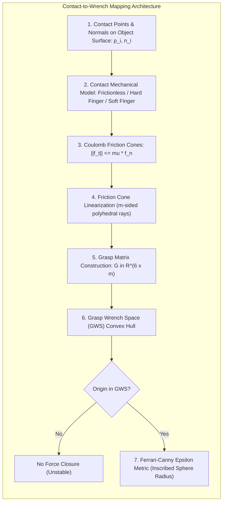
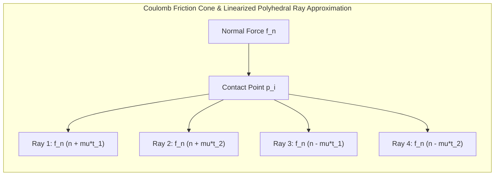
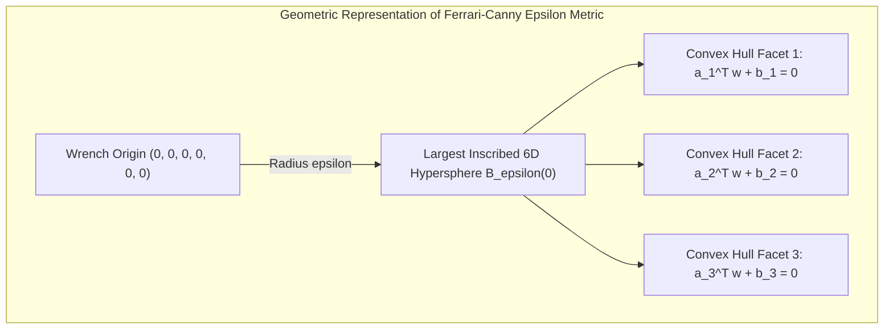

import ChapterProgress from '@site/src/components/ChapterProgress';
import QuizEngine from '@site/src/components/QuizEngine';

# Grasp Theory: Contact Mechanics, Wrench Space & Force Closure

A robot can plan a visually pristine trajectory toward an object, but if the physical contacts it establishes cannot resist gravitational torques, inertial perturbations during arm acceleration, or dynamic assembly forces, the grasp will fail catastrophically. In biological grasping, humans subconsciously position fingertips at geometric antitheses on an object's surface, applying normal forces scaled precisely to friction coefficients and load estimates. 

In robotics, **Grasp Theory** transforms this intuition into mathematical mechanics. It provides the analytical bedrock for evaluating whether a set of contacts can immobilize a rigid body against any disturbance wrench (Force and Form Closure) and formalizes quantitative metrics (such as the Ferrari-Canny $\epsilon$-metric) to select optimal contact locations on complex geometry.



---

## 1. Contact Mechanics & Friction Models

When a robotic fingertip presses against an object at point $\mathbf{p}_i \in \mathbb{R}^3$, the nature of the mechanical restraint depends on the geometry and material properties of the contacting surfaces. We define a local contact frame $\{C_i\}$ at $\mathbf{p}_i$ where the $\hat{\mathbf{z}}_i$ unit vector corresponds to the inward surface normal $\hat{\mathbf{n}}_i$, and $\{\hat{\mathbf{x}}_i, \hat{\mathbf{y}}_i\}$ span the tangent plane.

Robotics classifies contacts into three canonical models:

### 1.1 Point Contact without Friction (Frictionless Contact)
The fingertip can only exert a compressive force along the inward surface normal. No tangential shear forces or moments can be sustained:

$$
\mathbf{f}_{c_i} = f_{n_i} \hat{\mathbf{n}}_i, \quad f_{n_i} \ge 0, \quad m_i = 1
$$

### 1.2 Point Contact with Friction (Hard Finger Contact)
The contact sustains compressive normal force and tangential shear forces governed by Coulomb's law of friction. No frictional moments can be transmitted about the contact normal:

$$
\mathbf{f}_{c_i} = \begin{bmatrix} f_{t_{i,x}} \\ f_{t_{i,y}} \\ f_{n_i} \end{bmatrix}, \quad f_{n_i} \ge 0, \quad \sqrt{f_{t_{i,x}}^2 + f_{t_{i,y}}^2} \le \mu_i f_{n_i}, \quad m_i = 3
$$

where $\mu_i > 0$ is the static coefficient of friction.

### 1.3 Soft Finger Contact
Due to the viscoelastic compliance of rubber or human skin, the contact area deforms into a finite planar patch. In addition to normal and tangential forces, the contact can transmit a torsional friction moment $\tau_{n_i}$ about the normal axis:

$$
\mathbf{f}_{c_i} = \begin{bmatrix} f_{t_{i,x}} \\ f_{t_{i,y}} \\ f_{n_i} \\ \tau_{n_i} \end{bmatrix}, \quad f_{n_i} \ge 0, \quad \sqrt{f_{t_{i,x}}^2 + f_{t_{i,y}}^2} \le \mu_i f_{n_i}, \quad |\tau_{n_i}| \le \gamma_i f_{n_i}, \quad m_i = 4
$$

where $\gamma_i$ represents the torsional friction coefficient (units of meters).



---

## 2. The Grasp Matrix $\mathbf{G}$

Consider an object manipulated by $k$ contacts. Let $\mathbf{p}_i \in \mathbb{R}^3$ be the position of contact $i$ expressed relative to the object's center of mass (CoM) coordinate frame $\{O\}$.

Each contact exerts a local force wrench $\mathbf{f}_{c_i}$. The contact wrench is mapped to the object's body frame through the contact transformation matrix $\mathbf{G}_i \in \mathbb{R}^{6 \times m_i}$:

$$
\mathbf{w}_i = \begin{bmatrix} \mathbf{f}_i \\ \boldsymbol{\tau}_i \end{bmatrix} = \begin{bmatrix} \mathbf{R}_i & \mathbf{0} \\ [\mathbf{p}_i]_\times \mathbf{R}_i & \mathbf{R}_i \end{bmatrix} \mathbf{H}_i \mathbf{f}_{c_i} = \mathbf{G}_i \mathbf{f}_{c_i}
$$

where $\mathbf{R}_i = [\hat{\mathbf{t}}_{i,x}, \hat{\mathbf{t}}_{i,y}, \hat{\mathbf{n}}_i] \in \mathrm{SO}(3)$ aligns the contact frame with the object frame, and $\mathbf{H}_i$ is the contact wrench selection matrix:

$$
\mathbf{H}_i = \begin{cases} 
\begin{bmatrix} 0 & 0 & 1 & 0 & 0 & 0 \end{bmatrix}^T & \text{Frictionless } (m_i = 1) \\
\begin{bmatrix} \mathbf{I}_{3 \times 3} \\ \mathbf{0}_{3 \times 3} \end{bmatrix} & \text{Hard Finger } (m_i = 3) \\
\begin{bmatrix} \mathbf{I}_{3 \times 3} & \mathbf{0}_{3 \times 1} \\ \mathbf{0}_{2 \times 3} & \mathbf{0}_{2 \times 1} \\ \mathbf{0}_{1 \times 3} & 1 \end{bmatrix} & \text{Soft Finger } (m_i = 4)
\end{cases}
$$

The complete **Grasp Matrix** $\mathbf{G}$ aggregates all $k$ contacts:

$$
\mathbf{G} = \begin{bmatrix} \mathbf{G}_1 & \mathbf{G}_2 & \cdots & \mathbf{G}_k \end{bmatrix} \in \mathbb{R}^{6 \times m}, \quad m = \sum_{i=1}^k m_i
$$

The total wrench exerted by the fingertips on the object is:

$$
\mathbf{w}_{\text{grasp}} = \mathbf{G} \mathbf{f}_c
$$

For the object to remain in static equilibrium against an external wrench $\mathbf{w}_{\text{ext}} = [\mathbf{F}_{\text{ext}}^T, \mathbf{M}_{\text{ext}}^T]^T$ (e.g., gravity, inertial forces):

$$
\mathbf{G} \mathbf{f}_c + \mathbf{w}_{\text{ext}} = \mathbf{0} \iff \mathbf{w}_{\text{ext}} = -\mathbf{G} \mathbf{f}_c
$$

---

## 3. Form Closure vs. Force Closure

The conditions under which a grasp can maintain equilibrium against arbitrary disturbances define closure:

### 3.1 Form Closure (Geometric Immobility)
Form closure occurs when the geometric placement of frictionless contacts prevents any infinitesimal virtual displacement of the object in any direction. It relies entirely on unilateral kinematics without requiring friction:

$$
\forall \mathbf{V} \in \mathrm{se}(3) \setminus \{\mathbf{0}\}, \quad \exists i \in \{1, \dots, k\} \text{ such that } \mathbf{G}_i^T \mathbf{V} \lt 0
$$

By Somoff and Lakshminarayana's theorems:
- **Planar (2D)**: Requires a minimum of **4 frictionless contacts**.
- **Spatial (3D)**: Requires a minimum of **7 frictionless contacts**.

### 3.2 Force Closure (Frictional Equilibrium)
Force closure occurs when contacts equipped with friction can exert forces within their respective friction cones $\mathcal{K}_i$ to balance **any** arbitrary external wrench $\mathbf{w}_{\text{ext}} \in \mathbb{R}^6$:

$$
\forall \mathbf{w}_{\text{ext}} \in \mathbb{R}^6, \quad \exists \mathbf{f}_c \in \mathcal{K} \text{ such that } \mathbf{G} \mathbf{f}_c + \mathbf{w}_{\text{ext}} = \mathbf{0}
$$

A grasp achieves force closure if and only if:
1. $\operatorname{rank}(\mathbf{G}) = 6$ (The contacts span all spatial motion directions).
2. There exists a strictly internal force vector $\mathbf{f}_0 \in \operatorname{int}(\mathcal{K})$ in the null-space of $\mathbf{G}$ such that $\mathbf{G} \mathbf{f}_0 = \mathbf{0}$.

Under hard finger friction models, force closure in 3D can be achieved with as few as **3 hard finger contacts** (non-collinear), or **4 hard finger contacts** for generic spatial geometry.

---

## 4. Grasp Wrench Space (GWS) & The Ferrari-Canny $\epsilon$-Metric

To evaluate which grasp is safest, we linearize the quadratic Coulomb friction cone at each contact into an $s$-sided polyhedral cone spanned by unit primitive friction rays $\mathbf{d}_{i, j}$:

$$
\mathbf{d}_{i, j} = \hat{\mathbf{n}}_i + \mu_i \left( \cos\left(\frac{2\pi j}{s}\right) \hat{\mathbf{t}}_{i,x} + \sin\left(\frac{2\pi j}{s}\right) \hat{\mathbf{t}}_{i,y} \right), \quad j = 1, \dots, s
$$

Each unit ray produces an elementary wrench acting on the object:

$$
\mathbf{w}_{i, j} = \begin{bmatrix} \mathbf{d}_{i, j} \\ \mathbf{p}_i \times \mathbf{d}_{i, j} \end{bmatrix} \in \mathbb{R}^6
$$

The **Grasp Wrench Space (GWS)** is the convex hull of all elementary wrenches under a total contact force budget:

$$
\mathcal{W} = \operatorname{ConvexHull}\left( \bigcup_{i=1}^k \bigcup_{j=1}^s \mathbf{w}_{i, j} \right) \subset \mathbb{R}^6
$$

### The Ferrari-Canny Metric ($\epsilon$)
The **Ferrari-Canny $\epsilon$-metric** measures the radius of the largest 6-dimensional sphere centered at the wrench origin that fits entirely inside the Grasp Wrench Space:

$$
\epsilon = \max \{ r \ge 0 \mid \mathcal{B}_r(\mathbf{0}) \subseteq \mathcal{W} \}
$$

- If $\epsilon = 0$, the wrench origin lies on or outside the boundary of $\mathcal{W}$, meaning the grasp lacks force closure and cannot resist disturbances in at least one direction.
- If $\epsilon > 0$, the grasp achieves force closure. The magnitude of $\epsilon$ represents the magnitude of the worst-case external wrench the grasp can resist per unit of contact force applied.



Mathematically, $\epsilon$ is determined by the minimum orthogonal distance from the origin to any supporting hyperplane (facet) of the convex hull:

$$
\epsilon = \min_{m \in \text{Facets}} \frac{-d_m}{\|\mathbf{n}_m\|_2}
$$

where each facet is defined by $\mathbf{n}_m^T \mathbf{w} + d_m \le 0$ with $d_m \lt 0$.

---

## 5. Contact Models & Closure Comparison

| Parameter / Feature | Frictionless Point Contact | Hard Finger Contact | Soft Finger Contact |
| :--- | :--- | :--- | :--- |
| **Contact Degrees of Restraint ($m_i$)** | 1 (pure normal force) | 3 (normal + 2 shear forces) | 4 (normal + 2 shear + normal torque) |
| **Friction Parameters Required** | None | Static friction $\mu$ | Static friction $\mu$, torsional friction $\gamma$ |
| **Minimum Contacts for 3D Form Closure** | 7 contacts | Not applicable (form closure is frictionless) | Not applicable |
| **Minimum Contacts for 3D Force Closure**| Not possible | 3 contacts (non-collinear) | 2 opposing contacts |
| **Grasp Matrix Block Dimensions** | $6 \times 1$ | $6 \times 3$ | $6 \times 4$ |
| **Computation Complexity for GWS** | Trivial (polytope vertices) | Medium ($k \times s$ rays for polyhedral hull) | High ($k \times 2s$ rays including torque signs) |

---

## 6. Production Python Implementation: 3D Grasp Matrix & Ferrari-Canny Metric

The following module implements a complete, mathematically robust grasp quality evaluator. It constructs the grasp matrix, linearizes 3D Coulomb friction cones into polyhedral rays, projects wrenches into $\mathbb{R}^6$, computes the convex hull, and calculates the exact Ferrari-Canny $\epsilon$ metric:

```python
"""
Production Python implementation: 3D Grasp Matrix & Ferrari-Canny Metric
Author: Dexterous Manipulation Specialist
Module: 7.2 Grasp Theory
"""

import numpy as np
from scipy.spatial import ConvexHull, Delaunay
from typing import List, Dict, Tuple


class GraspAnalyzer:
    """
    Evaluates 3D multi-finger grasp equilibrium, Grasp Matrix G,
    Grasp Wrench Space (GWS), and the Ferrari-Canny epsilon quality metric.
    """

    def __init__(self, mu: float = 0.5, friction_cone_facets: int = 8):
        self.mu = mu
        self.num_facets = friction_cone_facets

    def _orthonormal_tangents(self, normal: np.ndarray) -> Tuple[np.ndarray, np.ndarray]:
        """Generates two orthogonal tangent vectors given an inward unit normal."""
        n = normal / np.linalg.norm(normal)
        # Select reference vector not parallel to n
        ref = np.array([1.0, 0.0, 0.0]) if abs(n[0]) < 0.8 else np.array([0.0, 1.0, 0.0])
        t1 = np.cross(n, ref)
        t1 /= np.linalg.norm(t1)
        t2 = np.cross(n, t1)
        t2 /= np.linalg.norm(t2)
        return t1, t2

    def build_grasp_matrix(self, contact_points: np.ndarray, contact_normals: np.ndarray) -> np.ndarray:
        """
        Constructs the spatial Grasp Matrix G for hard finger contacts.
        
        Args:
            contact_points: (k, 3) contact locations relative to object CoM.
            contact_normals: (k, 3) inward-pointing unit surface normals.
            
        Returns:
            G: (6, 3k) Grasp Matrix.
        """
        k = len(contact_points)
        g_blocks = []

        for i in range(k):
            p = contact_points[i]
            n = contact_normals[i] / np.linalg.norm(contact_normals[i])
            t1, t2 = self._orthonormal_tangents(n)
            
            # Contact frame orientation matrix R_c = [t1, t2, n]
            r_c = np.column_stack((t1, t2, n))
            
            # Skew-symmetric cross product matrix [p]_x
            p_skew = np.array([
                [0.0,   -p[2],  p[1]],
                [p[2],   0.0,  -p[0]],
                [-p[1],  p[0],  0.0]
            ])
            
            # Hard finger block: G_i = [ R_c; [p]_x * R_c ] (6x3)
            g_i = np.vstack((r_c, p_skew @ r_c))
            g_blocks.append(g_i)

        return np.hstack(g_blocks)

    def compute_elementary_wrenches(self, contact_points: np.ndarray, contact_normals: np.ndarray) -> np.ndarray:
        """
        Linearizes friction cones into polyhedral rays and computes wrench columns.
        
        Returns:
            wrenches: (N_total_rays, 6) elementary wrench vectors.
        """
        k = len(contact_points)
        wrenches = []

        angles = np.linspace(0, 2 * np.pi, self.num_facets, endpoint=False)

        for i in range(k):
            p = contact_points[i]
            n = contact_normals[i] / np.linalg.norm(contact_normals[i])
            t1, t2 = self._orthonormal_tangents(n)

            for alpha in angles:
                # Friction ray inside Coulomb cone: d = n + mu*(cos(alpha)*t1 + sin(alpha)*t2)
                d = n + self.mu * (np.cos(alpha) * t1 + np.sin(alpha) * t2)
                # Normalize so normal component equals 1.0 (L1 standard per-finger budget)
                d_normalized = d / np.dot(d, n)
                
                # Spatial wrench: w = [force; torque = p x force]
                torque = np.cross(p, d_normalized)
                wrench = np.concatenate((d_normalized, torque))
                wrenches.append(wrench)

        return np.array(wrenches)

    def evaluate_ferrari_canny_epsilon(self, contact_points: np.ndarray, contact_normals: np.ndarray) -> Dict:
        """
        Evaluates the exact Ferrari-Canny epsilon metric via 6D Convex Hull.
        """
        wrenches = self.compute_elementary_wrenches(contact_points, contact_normals)
        origin = np.zeros(6)

        try:
            hull = ConvexHull(wrenches)
            delaunay = Delaunay(wrenches)
            
            # Check if wrench origin is strictly inside the convex hull
            is_force_closure = (delaunay.find_simplex(origin) >= 0)

            if not is_force_closure:
                return {
                    "force_closure": False,
                    "epsilon": 0.0,
                    "hull_facets": len(hull.simplices),
                    "wrenches_count": len(wrenches)
                }

            # Distance from origin to each supporting hyperplane:
            # Equations are given as: a_i^T x + b_i = 0 where b_i <= 0
            distances = []
            for eq in hull.equations:
                normal = eq[:-1]
                offset = eq[-1]
                # Distance from origin = -offset / ||normal||
                dist = -offset / np.linalg.norm(normal)
                distances.append(dist)

            epsilon = float(np.min(distances))

            return {
                "force_closure": True,
                "epsilon": max(0.0, epsilon),
                "min_facet_distance": epsilon,
                "hull_facets": len(hull.simplices),
                "wrenches_count": len(wrenches)
            }

        except Exception as e:
            return {"force_closure": False, "epsilon": 0.0, "error": str(e)}


if __name__ == "__main__":
    analyzer = GraspAnalyzer(mu=0.6, friction_cone_facets=8)

    # Grasp setup: 3 fingers grasping a cylinder (radius 0.04m, height 0.10m)
    # Contact points on circular perimeter
    r = 0.04
    theta = np.array([0.0, 2 * np.pi / 3, 4 * np.pi / 3])
    
    contacts = np.column_stack((r * np.cos(theta), r * np.sin(theta), np.zeros(3)))
    # Inward normals point directly toward origin (center of cylinder)
    normals = -contacts / np.linalg.norm(contacts, axis=1, keepdims=True)

    g_matrix = analyzer.build_grasp_matrix(contacts, normals)
    result = analyzer.evaluate_ferrari_canny_epsilon(contacts, normals)

    print("=== 3D Grasp Quality Analysis ===")
    print(f"Grasp Matrix Rank: {np.linalg.matrix_rank(g_matrix)} / 6")
    print(f"Force Closure Established: {result['force_closure']}")
    print(f"Ferrari-Canny Epsilon Metric: {result['epsilon']:.6f}")
    print(f"Convex Hull Facets Generated: {result['hull_facets']}")
```

---

## 7. Seminal Research Foundations

1. **Salisbury, J. K., & Roth, B. (1983).** *Kinematic and force analysis of articulated mechanical hands*. ASME Journal of Mechanisms, Transmissions, and Automation in Design, 105(1), 35–41.
   - *Annotation*: Derived the foundational Grasp Matrix $\mathbf{G}$, establishing the mathematical transformation between fingertip contact forces and rigid object wrenches.
2. **Ferrari, C., & Canny, J. (1992).** *Planning optimal grasps*. In IEEE International Conference on Robotics and Automation (ICRA), pp. 2290–2295.
   - *Annotation*: Introduced the Ferrari-Canny $\epsilon$-metric and largest inscribed hypersphere concept to quantify multi-finger grasp robustness.
3. **Bicchi, A., & Kumar, V. (2000).** *Robotic grasping and contact: a review*. In IEEE International Conference on Robotics and Automation (ICRA), pp. 348–353.
   - *Annotation*: Comprehensive formulation of contact mechanics, form closure, and force closure taxonomy for multi-limbed robotic systems.
4. **Roa, M. A., & Suárez, R. (2015).** *Grasp quality measures: review and performance*. Autonomous Robots, 38(1), 65–88.
   - *Annotation*: Exhaustive survey and mathematical classification of geometric, force, and wrench space grasp quality metrics.

---

## 8. Hands-on Lab Project: Multi-Fingered Grasp Quality Optimization

### Objective
Develop an automated grasp synthesizer that determines the optimal 3-finger contact configuration on a 3D box ($0.1\text{ m} \times 0.1\text{ m} \times 0.2\text{ m}$) subjected to combined gravitational loading and high-speed robotic arm acceleration ($a = 5\text{ m/s}^2$).

### Key Deliverables
1. **Antipodal Sampling Pipeline**: Implement a ray-casting sampler generating candidate contact pairs with opposing surface normals ($\hat{\mathbf{n}}_1 \cdot \hat{\mathbf{n}}_2 \approx -1$).
2. **Grasp Matrix Engine**: Construct the $6 \times 9$ Grasp Matrix $\mathbf{G}$ for each sampled triplet.
3. **Ferrari-Canny Optimization Loop**: Maximize $\epsilon$ across 500 sampled configurations:

$$
\mathbf{p}^* = \arg\max_{\mathbf{p}_1, \mathbf{p}_2, \mathbf{p}_3} \epsilon(\mathbf{p}_1, \mathbf{p}_2, \mathbf{p}_3)
$$

### Verification Criteria
- [ ] Grasp Matrix condition number $\kappa(\mathbf{G}) \lt 15.0$ for the optimal grasp.
- [ ] Validated force closure: Wrench origin confirmed strictly inside the 6D convex hull.
- [ ] Quantitative quality: Optimal configuration achieves $\epsilon \ge 0.08$ under friction coefficient $\mu = 0.5$.

---

<ChapterProgress chapterId="7-2-grasp-theory" moduleId="module7" totalChapters={8} />

## Chapter Mastery Check

<QuizEngine
  quizId="quiz-7-2"
  title="Module 7.2 Mastery Check: Grasp Theory & Contact Mechanics"
  moduleId="module7"
  passThreshold={70}
  questions={[
    {
      id: "q1",
      question: "What is the key theoretical difference between Form Closure and Force Closure?",
      options: [
        "Form closure prevents virtual displacements purely through frictionless contact geometry, while force closure balances arbitrary disturbance wrenches using contact forces inside friction cones",
        "Form closure is used only for deformable objects, while force closure is for rigid objects",
        "Form closure requires at least 12 contacts, while force closure requires only 1 contact",
        "Form closure ignores gravity while force closure ignores inertia"
      ],
      correctIndex: 0,
      explanation: "Form closure is a purely kinematic condition where frictionless unilateral constraints immobilize the object against any virtual displacement. Force closure relies on friction to counteract any disturbance wrench."
    },
    {
      id: "q2",
      question: "What is the theoretical minimum number of frictionless point contacts required to establish spatial (3D) Form Closure on a general rigid body?",
      options: [
        "3 contacts",
        "4 contacts",
        "6 contacts",
        "7 contacts"
      ],
      correctIndex: 3,
      explanation: "By Somoff's and Lakshminarayana's theorems, completely constraining 6 spatial degrees of freedom with unilateral frictionless contacts requires at least 6 + 1 = 7 contacts."
    },
    {
      id: "q3",
      question: "In the Ferrari-Canny grasp quality formulation, what does an epsilon metric of exactly 0.0 indicate?",
      options: [
        "The grasp is capable of resisting infinite external wrench loads",
        "The wrench origin lies on or outside the Grasp Wrench Space convex hull, meaning the grasp does not possess force closure",
        "All contact points have zero friction coefficient",
        "The object has zero mass"
      ],
      correctIndex: 1,
      explanation: "The Ferrari-Canny epsilon metric is the radius of the largest inscribed 6D sphere centered at the wrench origin. If epsilon = 0, the origin is on the boundary or outside the convex hull, indicating that disturbances in at least one direction cannot be resisted."
    },
    {
      id: "q4",
      question: "How does a Soft Finger contact model differ from a Hard Finger contact model in its mathematical description?",
      options: [
        "A soft finger provides 4 degrees of restraint (normal force, 2 tangential forces, and a torsional friction moment about the contact normal), whereas a hard finger provides only 3 (forces only)",
        "A soft finger cannot sustain normal forces",
        "A soft finger eliminates Coulomb friction",
        "A soft finger only acts in 2D space"
      ],
      correctIndex: 0,
      explanation: "Because compliant fingertips deform into an area contact patch, a soft finger contact transmits a friction torque tau_n about the contact normal axis in addition to normal and tangential forces (m = 4 vs m = 3)."
    }
  ]}
/>
