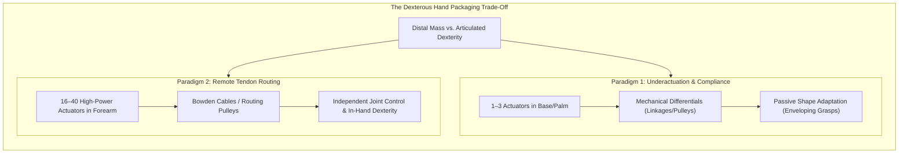
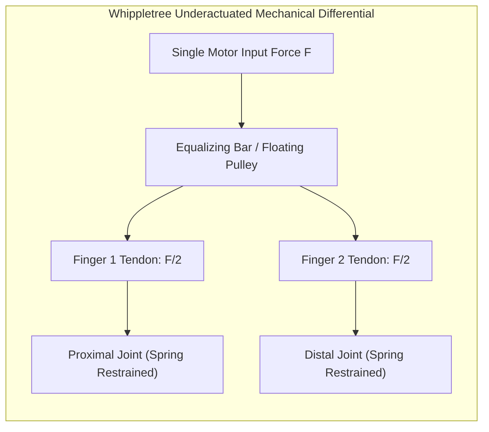
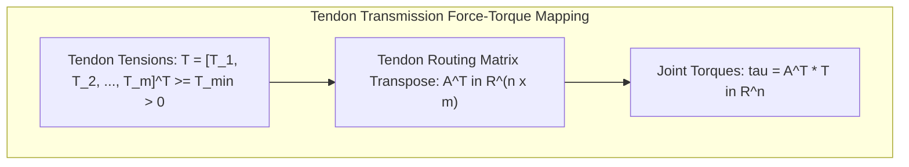
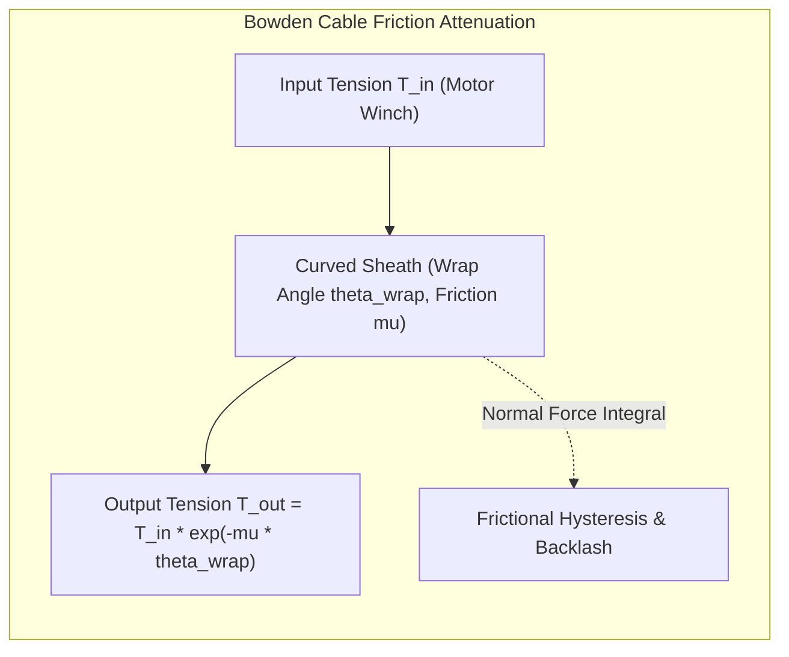
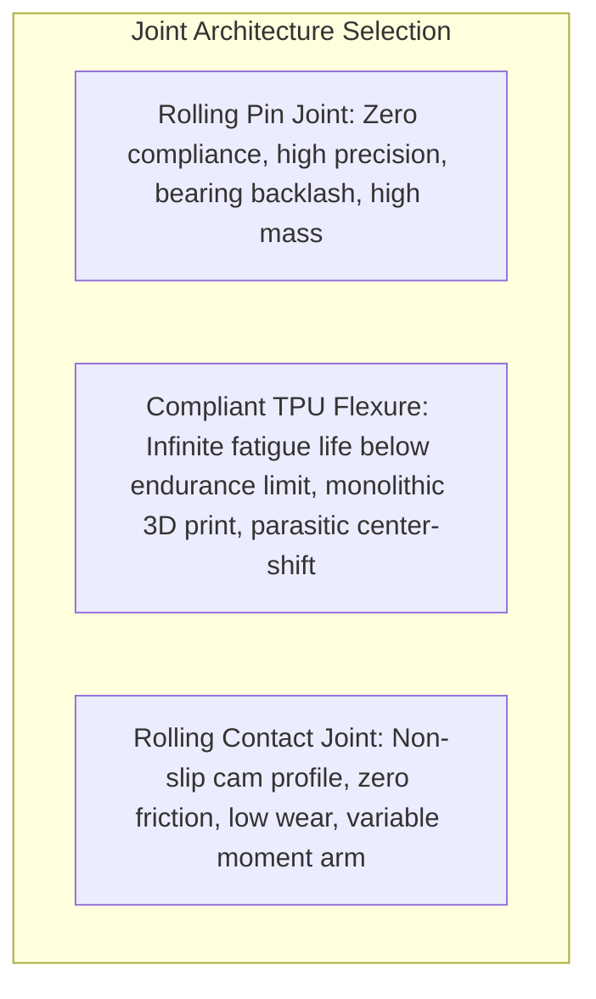

import ChapterProgress from '@site/src/components/ChapterProgress';
import QuizEngine from '@site/src/components/QuizEngine';

# Robotic Hand Design: Underactuation, Tendons & Actuator Sizing

Designing a robotic hand presents one of the most challenging packaging problems in electromechanical engineering. An adult human hand packs 21 kinematic degrees of freedom into a volume of approximately 300 cubic centimeters, weighing barely 400 grams, while exerting pinch forces up to 100 N and peak power grasps exceeding 400 N. Placing electric motors, gearheads, encoders, and motor controllers directly inside individual finger phalanges rapidly creates excessive distal mass, high rotational inertia, and bulky finger links that collide prematurely during grasping.

To resolve this bottleneck, roboticists leverage two contrasting paradigms: **synergic underactuation** (using passive compliance and mechanical differentials to allow a few motors to adapt to arbitrary shapes) and **remotely routed tendon transmissions** (housing high-power motors in the forearm while routing tension through high-strength micro-cables). This chapter details the mechanical principles, transmission matrices, Capstan friction models, and actuator sizing laws that govern modern dexterous hands.



---

## 1. Underactuated Hands vs. Fully Articulated Anthropomorphic Hands

Robotic end-effectors fall into two primary architectural philosophies based on the ratio of active actuators ($m$) to kinematic degrees of freedom ($n$):

### 1.1 Underactuated Systems ($m \lt n$)
In an underactuated hand, a single actuator drives multiple joints through a mechanical differential (such as a whippletree mechanism or floating pulley network) combined with passive return springs. 

- **Robotiq 2F-85 / 3-Finger**: Uses articulated planar four-bar linkages. When the proximal link encounters an obstacle, the motor continues driving the linkage, causing the distal link to curl inward automatically around the object.
- **SDM Hand (Dollar & Howe)**: Utilizes polymeric flexure joints (urethane elastomers) with an embedded tendon spool. The entire hand adapts passively without sensors, absorbing mechanical shocks during high-velocity impacts.

### 1.2 Fully Articulated Systems ($m \ge n$)
In fully articulated hands, each kinematic degree of freedom is independently commanded, enabling precise trajectory tracking and in-hand dexterity.

- **Shadow Dexterous Hand**: 20 active DoFs actuated by 40 antagonistic tendon lines routed to a forearm bank of 40 Maxon DC micromotors or McKibben pneumatic artificial muscles.
- **DLR-HIT Hand II**: Packs 15 brushless DC motors directly into the finger bases and palm using customized high-reduction harmonic gears and integrated torque sensors.
- **Wonik Allegro Hand**: Direct-drive micro-brushless motors with spur gears embedded in each finger base, balancing dexterity with minimal mechanical backlash.



---

## 2. Mathematical Kinematics of Tendon Routing

Unlike rigid gear transmissions, tendons can only pull ($T_j \ge 0$). Generating bidirectional joint torques requires either an **antagonistic configuration** ($2n$ tendons for $n$ joints, replicating biological flexor-extensor pairs) or an **$n+1$ configuration** (a shared antagonizing extensor tendon balancing $n$ flexor tendons).

Let $\mathbf{q} \in \mathbb{R}^n$ represent joint angles and $\mathbf{l} \in \mathbb{R}^m$ represent tendon excursion lengths. The differential relationship between joint motion and tendon displacement is defined by the **Tendon Routing Matrix** $\mathbf{A}(\mathbf{q}) \in \mathbb{R}^{m \times n}$:

$$
\Delta \mathbf{l} = \mathbf{A}(\mathbf{q}) \Delta \mathbf{q}
$$

By the principle of virtual work, the relationship between tendon tensions $\mathbf{T} \in \mathbb{R}^m$ and resulting joint torques $\boldsymbol{\tau} \in \mathbb{R}^n$ is:

$$
\boldsymbol{\tau} = \mathbf{A}(\mathbf{q})^T \mathbf{T}
$$

where each entry $A_{j, i} = \frac{\partial l_j}{\partial q_i}$ corresponds to the effective pulley moment arm of tendon $j$ around joint $i$:
- $A_{j, i} > 0$ for flexor tendons (increasing joint angle $q_i$ pulls tendon length).
- $A_{j, i} \lt 0$ for extensor tendons.
- $A_{j, i} = 0$ if tendon $j$ does not cross joint $i$.



### Tension Feasibility & Minimum Pretension
Because tendons slack when $T_j \le 0$, every valid joint torque command $\boldsymbol{\tau}_{\text{des}}$ must be mapped to positive tensions bounded by minimum pretension $T_{\min} > 0$ (to avoid derailment from pulleys) and maximum tensile yield limit $T_{\max}$:

$$
\min_{\mathbf{T}} \frac{1}{2} \|\mathbf{T}\|_2^2 \quad \text{s.t.} \quad \mathbf{A}^T \mathbf{T} = \boldsymbol{\tau}_{\text{des}}, \quad T_{\min} \le T_j \le T_{\max} \quad \forall j \in \{1, \dots, m\}
$$

---

## 3. Capstan Friction in Bowden Cable Transmissions

When tendons are routed through curved synthetic Bowden cable sheaths (such as PTFE-lined stainless steel conduits), friction accumulates exponentially along the cable routing curve.

The transmission of tension from the motor winch ($T_{\text{in}}$) to the finger joint ($T_{\text{out}}$) is governed by the **Capstan Equation**:

$$
T_{\text{out}} = T_{\text{in}} e^{-\mu \theta_{\text{wrap}}}
$$

where:
- $\mu$ is the Coulomb friction coefficient between the cable (e.g., braided Dyneema or stranded stainless steel) and the inner sheath conduit ($\mu \approx 0.10\text{--}0.25$).
- $\theta_{\text{wrap}} = \int_0^L |\kappa(s)| ds$ is the total cumulative angle of bend (curvature integral) in radians along the routing trajectory.



During bidirectional motion, the Capstan effect produces significant mechanical hysteresis:
- **Pulling phase ($\dot{l} > 0$)**: $T_{\text{finger}} = T_{\text{motor}} e^{-\mu \theta_{\text{wrap}}}$ (motor must pull harder to overcome sheath drag).
- **Relaxing phase ($\dot{l} \lt 0$)**: $T_{\text{finger}} = T_{\text{motor}} e^{+\mu \theta_{\text{wrap}}}$ (residual tension in the finger cannot be quickly relieved by the motor).

To maintain closed-loop joint torque accuracy, robotic hands must place miniature strain gauge load cells or semiconductor force sensors directly at the tendon terminations in the fingertips, bypassing Bowden sheath friction within the feedback loop.

---

## 4. Flexure Joints vs. Rolling-Contact Pin Joints

In miniaturized robotic fingers, traditional pin joints with rolling bearings suffer from particulate contamination, high part counts, and mechanical backlash. Modern fingers increasingly adopt **compliant flexure joints**:

$$
\theta_{\text{deflect}} = \frac{M L}{E I} = \frac{12 M L}{E b h^3}
$$

where $E$ is Young's modulus, $I = \frac{b h^3}{12}$ is the area moment of inertia of a cross-section of width $b$ and thickness $h$, and $L$ is the flexure length.



---

## 5. Actuation Architecture Comparison

| Actuation Technology | Energy Density | Backdrivability | Frequency Response | Control Modality | Typical Robotic Hands |
| :--- | :--- | :--- | :--- | :--- | :--- |
| **Brushless DC + Harmonic Drive** | High ($> 150\text{ W/kg}$) | Moderate (cogging torque) | 50–100 Hz | Current / Torque FOC | DLR-HIT II, Wonik Allegro |
| **Tendon-Routed Bowden Motors** | Ultra-High at hand | Low (Capstan friction) | 20–40 Hz | Winch Position + Tension | Shadow Hand, NASA Robonaut 2 |
| **Pneumatic Artificial Muscles (PAM)**| Extremely High ($> 1\text{ kW/kg}$) | High (inherent air spring) | 5–15 Hz (choked flow) | Pressure / Mass Flow | Shadow Pneumatic Hand |
| **Compliant Underactuated TPU Links** | Passive (zero motor) | High (elastic spring back)| $> 200\text{ Hz}$ | Open-loop geometric wrap | SDM Hand, Robotiq 2F-85 |

---

## 6. Production Python Implementation: Tendon Tension Optimization & Capstan Modeling

The listing below implements a tendon transmission solver. It formulates and solves the quadratic program for distributing positive tendon tensions to achieve a desired multi-axis joint torque vector while compensating for exponential Capstan sheath losses:

```python
"""
Production Python implementation: Tendon Routing & Capstan Tension Optimizer
Author: Dexterous Manipulation Specialist
Module: 7.3 Robotic Hand Design
"""

import numpy as np
from scipy.optimize import minimize
from typing import Dict, List, Tuple


class TendonTransmissionModel:
    """
    Models tendon-driven kinematic transmission with antagonistic cables
    and Bowden sheath Capstan friction attenuation.
    """

    def __init__(
        self,
        routing_matrix: np.ndarray,
        sheath_wrap_angles: np.ndarray,
        friction_coeff: float = 0.15,
        min_tension: float = 2.0,   # Minimum pretension [N]
        max_tension: float = 80.0   # Maximum cable load [N]
    ):
        """
        Args:
            routing_matrix: A matrix of size (m_tendons, n_joints).
            sheath_wrap_angles: 1D array of length m_tendons containing cumulative bend [rad].
            friction_coeff: Coulomb friction mu for Bowden cable.
            min_tension: Anti-derailment pretension limit.
            max_tension: Structural yield tensile threshold.
        """
        self.A = routing_matrix  # Shape: (m, n)
        self.m, self.n = routing_matrix.shape
        self.wrap_angles = sheath_wrap_angles
        self.mu = friction_coeff
        self.t_min = min_tension
        self.t_max = max_tension

        # Capstan attenuation factor: T_out / T_in = exp(-mu * theta)
        self.capstan_forward = np.exp(-self.mu * self.wrap_angles)

    def capstan_loss_factor(self) -> np.ndarray:
        """Returns per-tendon tension transmission efficiency."""
        return self.capstan_forward

    def solve_tendon_tensions(self, target_joint_torques: np.ndarray) -> Dict:
        """
        Solves for optimal tendon tensions T >= t_min minimizing quadratic cable stress:
            min 0.5 * ||T||^2 + lambda * ||T - T_nominal||^2
            subject to A^T * T = tau_des,  t_min <= T <= t_max
            
        Args:
            target_joint_torques: (n,) desired joint torque vector [Nm].
            
        Returns:
            Dictionary containing solved finger tensions, motor winch commands, and residuals.
        """
        assert len(target_joint_torques) == self.n, f"Expected {self.n} joint torques."

        # Objective function: minimize sum of squared tensions to reduce internal joint wear
        def objective(t: np.ndarray) -> float:
            return 0.5 * float(np.sum(t ** 2))

        def objective_grad(t: np.ndarray) -> np.ndarray:
            return t

        # Linear equality constraint: A^T * T = tau_des
        constraints = [{
            'type': 'eq',
            'fun': lambda t: self.A.T @ t - target_joint_torques,
            'jac': lambda t: self.A.T
        }]

        # Bound constraints: t_min <= T_j <= t_max
        bounds = [(self.t_min, self.t_max) for _ in range(self.m)]

        # Initial guess: midpoint pretension
        t0 = np.full(self.m, (self.t_min + self.t_max) / 4.0)

        res = minimize(
            objective,
            t0,
            jac=objective_grad,
            constraints=constraints,
            bounds=bounds,
            method='SLSQP',
            options={'ftol': 1e-8, 'disp': False}
        )

        if not res.success:
            return {
                "success": False,
                "message": res.message,
                "finger_tensions": None,
                "motor_tensions": None
            }

        t_finger = res.x
        # Motor must exert higher tension to overcome Capstan friction along the Bowden cable
        t_motor = t_finger / self.capstan_forward

        torque_achieved = self.A.T @ t_finger
        residual_error = float(np.linalg.norm(torque_achieved - target_joint_torques))

        return {
            "success": True,
            "finger_tensions": t_finger,
            "motor_tensions": t_motor,
            "torque_achieved": torque_achieved,
            "residual_error_nm": residual_error,
            "max_cable_load_n": float(np.max(t_finger))
        }


def make_3dof_finger_transmission() -> TendonTransmissionModel:
    """
    Constructs a 3-DoF finger driven by 4 antagonistic tendons (n+1 configuration):
    - Tendon 1: Dedicated MCP flexor
    - Tendon 2: Dedicated PIP flexor
    - Tendon 3: Dedicated DIP flexor
    - Tendon 4: Shared antagonistic extensor spanning MCP, PIP, and DIP
    """
    # Moment arm radius r = 0.008 m (8 mm pulley)
    r = 0.008
    A = np.array([
        [ r,  0.0,  0.0],   # T1: MCP flexor
        [0.0,   r,  0.0],   # T2: PIP flexor
        [0.0, 0.0,    r],   # T3: DIP flexor
        [-r,  -r,   -r]    # T4: Shared extensor
    ])

    # Cumulative routing wrap angles (radians) through wrist and finger conduits
    sheath_bends = np.array([
        np.radians(60),   # Tendon 1 bend
        np.radians(90),   # Tendon 2 bend
        np.radians(120),  # Tendon 3 bend
        np.radians(90)    # Tendon 4 bend
    ])

    return TendonTransmissionModel(
        routing_matrix=A,
        sheath_wrap_angles=sheath_bends,
        friction_coeff=0.18,
        min_tension=3.0,
        max_tension=100.0
    )


if __name__ == "__main__":
    transmission = make_3dof_finger_transmission()

    # Commanded joint torques: [tau_MCP, tau_PIP, tau_DIP] in Nm
    tau_target = np.array([0.25, 0.15, -0.05])

    sol = transmission.solve_tendon_tensions(tau_target)

    print("=== Tendon Transmission Optimization Results ===")
    print(f"Optimization Status: {sol['success']}")
    if sol['success']:
        print(f"Target Joint Torques (Nm):  {tau_target}")
        print(f"Achieved Torques (Nm):      {np.round(sol['torque_achieved'], 4)}")
        print(f"Torque Tracking Error (Nm): {sol['residual_error_nm']:.6e}")
        print(f"Finger Cable Tensions (N):  {np.round(sol['finger_tensions'], 2)}")
        print(f"Motor Winch Tensions (N):   {np.round(sol['motor_tensions'], 2)}")
        print(f"Transmission Efficiency:    {np.round(transmission.capstan_loss_factor() * 100, 1)}%")
```

---

## 7. Seminal Research Foundations

1. **Dollar, A. M., & Howe, R. D. (2010).** *The highly adaptive SDM hand: Design and performance evaluation*. The International Journal of Robotics Research, 29(5), 585–597.
   - *Annotation*: Documented the Shape Deposition Manufacturing (SDM) compliant hand, proving that polymeric flexure joints and passive underactuation enable robust grasping across extreme positional uncertainty.
2. **Grebenstein, M., et al. (2011).** *The DLR hand arm system*. In IEEE International Conference on Robotics and Automation (ICRA), pp. 3175–3182.
   - *Annotation*: Detailed the variable stiffness, tendon-driven anthropomorphic DLR hand-arm system capable of absorbing explosive impacts during human tool manipulation.
3. **Butterfass, J., Fischer, M., Grebenstein, M., Bürger, U., & Hirzinger, G. (2001).** *Design and experiences with DLR Hand II*. In IEEE/RSJ International Conference on Intelligent Robots and Systems (IROS), pp. 105–110.
   - *Annotation*: Pioneered the integration of miniature brushless DC actuators, harmonic drives, and digital signal processors directly inside the palm and finger digits.
4. **Catalano, M. G., et al. (2014).** *Adaptive synergies for the design of the Pisa/IIT SoftHand*. The International Journal of Robotics Research, 33(5), 768–781.
   - *Annotation*: Implemented biological postural synergies through a single tendon routed across rolling-contact joints, producing human-like power and precision grasps.

---

## 8. Hands-on Lab Project: Tendon Transmission & Capstan Compensation

### Objective
Design and simulate an antagonistic tendon drive for a 2-DoF robotic finger (MCP pitch and PIP pitch) driven by 3 Bowden cables ($n+1$ configuration). Implement feedforward Capstan friction compensation to deliver precise joint torques during high-frequency oscillatory trajectories.

### Key Deliverables
1. **Kinematic Routing Model**: Specify the $3 \times 2$ routing matrix $\mathbf{A}$ with $r_{\text{MCP}} = 10\text{ mm}$ and $r_{\text{PIP}} = 7\text{ mm}$.
2. **Capstan Friction Observer**: Compute state-dependent transmission loss:

$$
T_{\text{motor}, j} = T_{\text{finger}, j} \cdot \exp\left(\mu \int |\kappa(s)| ds\right)
$$

3. **Dynamic Tension Profiler**: Execute a 5 Hz sinusoidal torque tracking trajectory:

$$
\boldsymbol{\tau}_{\text{des}}(t) = \begin{bmatrix} 0.3 \sin(10\pi t) \\ 0.2 \cos(10\pi t) \end{bmatrix}\text{ Nm}
$$

### Verification Criteria
- [ ] Tensions strictly satisfy $T_j(t) \ge 3.0\text{ N}$ throughout all trajectory phases.
- [ ] Closed-loop joint torque error satisfies $\|\boldsymbol{\tau}_{\text{des}} - \boldsymbol{\tau}_{\text{actual}}\|_{\infty} \lt 10^{-3}\text{ Nm}$.
- [ ] Successful compensation of Capstan attenuation: motor winches output up to 35% higher tension than fingertip loads to overcome sheath drag.

---

<ChapterProgress chapterId="7-3-robotic-hand-design" moduleId="module7" totalChapters={8} />

## Chapter Mastery Check

<QuizEngine
  quizId="quiz-7-3"
  title="Module 7.3 Mastery Check: Robotic Hand Design & Tendon Actuation"
  moduleId="module7"
  passThreshold={70}
  questions={[
    {
      id: "q1",
      question: "What is the primary mechanical motivation for utilizing remote tendon routing (Bowden cables) in high-DoF robotic hands rather than embedding motors directly inside the fingers?",
      options: [
        "To reduce distal finger mass and rotational inertia, preventing excessive wrist loading and allowing compact finger geometries",
        "Because electric motors cannot rotate clockwise when placed inside fingers",
        "To eliminate all mechanical friction from the transmission",
        "To avoid needing motor controllers or encoders"
      ],
      correctIndex: 0,
      explanation: "Placing motors directly inside finger phalanges adds heavy distal mass and bulky volume, which increases wrist inertia and causes premature inter-finger collisions during grasping. Remote tendon routing moves heavy actuators into the forearm or palm."
    },
    {
      id: "q2",
      question: "In tendon kinematics, how are tendon tensions T related to the resulting joint torques tau through the routing matrix A?",
      options: [
        "tau = A * T",
        "tau = A^T * T",
        "tau = inv(A) * T",
        "tau = A * T * A^T"
      ],
      correctIndex: 1,
      explanation: "By the principle of virtual work, if tendon excursion is dl = A * dq, then the work equality tau^T * dq = T^T * dl = T^T * A * dq implies tau = A^T * T."
    },
    {
      id: "q3",
      question: "What does the Capstan equation T_out = T_in * exp(-mu * theta_wrap) describe in a Bowden cable transmission?",
      options: [
        "The linear thermal expansion of the cable under high current",
        "The exponential decay of tension transmission along a curved conduit due to accumulated Coulomb friction",
        "The magnetic flux leakage in the electric motor",
        "The electrical resistance of the strain gauge"
      ],
      correctIndex: 1,
      explanation: "The Capstan equation models friction along curved surfaces. In a Bowden cable, friction accumulates exponentially as a function of the coefficient of friction mu and the cumulative wrap angle theta_wrap."
    },
    {
      id: "q4",
      question: "Why must an antagonistic tendon-driven finger maintain a strictly positive minimum pretension T_min > 0 at all times?",
      options: [
        "To prevent tendons from going slack, de-spooling, or derailing from routing pulleys",
        "To keep the motors from overheating",
        "To reduce the electrical resistance of the cable",
        "To increase the speed of sound in the finger"
      ],
      correctIndex: 0,
      explanation: "Tendons are unilateral tensile elements that cannot push. If tension drops to zero, the cable slacks, risking derailment from pulleys, introducing mechanical backlash, and causing severe impact shocks upon re-engagement."
    }
  ]}
/>
