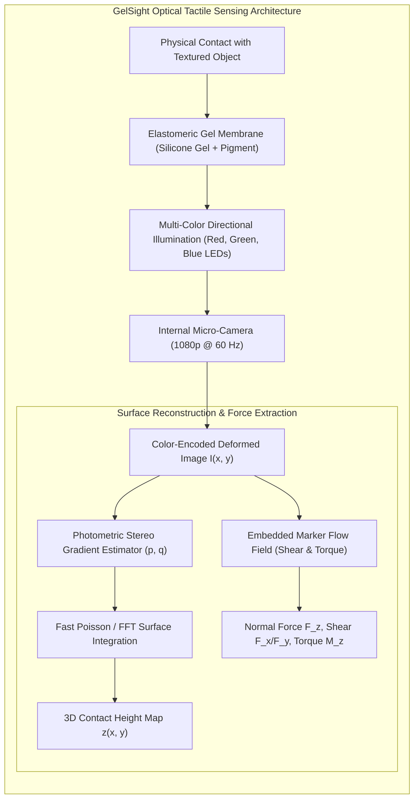
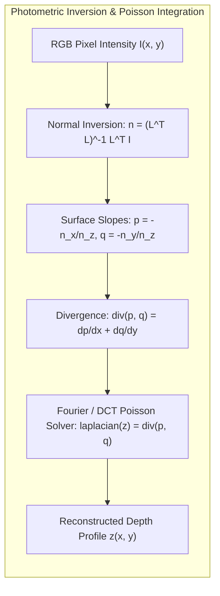
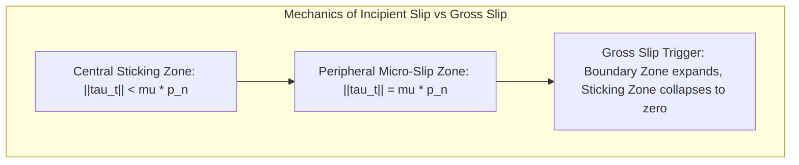

import ChapterProgress from '@site/src/components/ChapterProgress';
import QuizEngine from '@site/src/components/QuizEngine';

# Optical & Piezoresistive Tactile Sensing: GelSight to High-Density Skins

Vision provides robots with global semantic understanding and gross spatial awareness, but at the exact moment of physical interaction, vision suffers from catastrophic blind spots. When a robot reaches to grasp an apple or insert an Allen wrench into a bolt, its own fingers and palm occlude the line of sight. Furthermore, cameras cannot directly observe contact force distributions, friction coefficients, local compliance, micro-textures, or the onset of frictional slip.

Tactile sensing bridges this perceptual gap. Just as human skin utilizes specialized mechanoreceptors (Merkel discs for static pressure, Meissner corpuscles for low-frequency slip, Ruffini endings for skin stretch, and Pacinian corpuscles for high-frequency vibration), robotic hands must sense contact pressure, shear strain, and high-frequency vibrations. Modern optical tactile sensors, such as **GelSight** and **DIGIT**, transform the contact surface into an ultra-high-resolution vision problem, capturing micron-scale contact geometries and multi-axis force vectors at camera framerates.



---

## 1. Transduction Physics: From Resistive Skins to Optical Elastomers

Robotic tactile instruments rely on several distinct physical transduction mechanisms:

### 1.1 Piezoresistive Tactile Arrays
Piezoresistive sensors utilize conductive polymers or carbon-nanotube-doped silicone elastomers whose bulk electrical resistance drops under mechanical compression:

$$
R(p) = R_0 p^{-\gamma}
$$

Arranged in an $N \times M$ cross-grid matrix of row and column electrodes, they provide thin, flexible electronic skins conformable to curved fingers. However, they suffer from significant viscoelastic hysteresis, long settling times, and thermal drift.

### 1.2 Capacitive Sensor Skins
Capacitive sensors measure the capacitance change of an elastic dielectric layer sandwiched between conductive plates:

$$
C = \frac{\varepsilon_0 \varepsilon_r A}{d - \delta z}
$$

They exhibit superior dynamic range and lower hysteresis than piezoresistive films, but require active electromagnetic interference (EMI) shielding when routed alongside high-current motor cables.

### 1.3 Optical Tactile Sensors (GelSight, DIGIT, TacTip)
Optical tactile sensors decouple the contact interface from electrical wiring by imaging an elastomeric membrane from within. 

- **Structure**: A clear acrylic structural window is topped with a layer of transparent silicone gel. The external contact face of the gel is coated with an opaque, semi-specular reflective paint (e.g., aluminum micro-flake or titanium dioxide powder).
- **Illumination**: Multiple directional LED light sources with distinct spectral colors (e.g., Red from positive $x$, Green from positive $y$, Blue from negative $x/y$) illuminate the interior of the gel.
- **Transduction**: Pressing an object into the gel deforms the reflective membrane. Because the light sources hit the local surface facets at different angles, the reflected RGB values directly encode the local surface gradients ($p = \partial z / \partial x$, $q = \partial z / \partial y$).

---

## 2. Mathematical Formulation of Photometric Stereo Reconstruction

Let the deformed gel surface be defined by the height profile $z(x, y)$ in the camera coordinate frame. The inward-pointing unit surface normal $\hat{\mathbf{n}}(x, y)$ is:

$$
\hat{\mathbf{n}}(x, y) = \frac{1}{\sqrt{p(x, y)^2 + q(x, y)^2 + 1}} \begin{bmatrix} -p(x, y) \\ -q(x, y) \\ 1 \end{bmatrix}
$$

where $p(x, y) = \frac{\partial z}{\partial x}$ and $q(x, y) = \frac{\partial z}{\partial y}$.

### 2.1 Optical Irradiance Model
Assuming a Lambertian-like reflective gel coating illuminated by $K$ directional light sources with known lighting directions $\mathbf{l}_k \in \mathbb{R}^3$ and intensities $\rho_k$, the observed image intensity $I_k(x, y)$ at source $k$ is governed by:

$$
I_k(x, y) = \rho_k (\mathbf{l}_k \cdot \hat{\mathbf{n}}(x, y)) = \rho_k \frac{-p l_{k, x} - q l_{k, y} + l_{k, z}}{\sqrt{p^2 + q^2 + 1}}
$$

Stacking $K \ge 3$ calibrated light measurements into matrix form:

$$
\mathbf{I}(x, y) = \begin{bmatrix} I_1(x, y) \\ I_2(x, y) \\ \vdots \\ I_K(x, y) \end{bmatrix} = \mathbf{L} \hat{\mathbf{n}}(x, y), \quad \mathbf{L} = \begin{bmatrix} \rho_1 \mathbf{l}_1^T \\ \rho_2 \mathbf{l}_2^T \\ \vdots \\ \rho_K \mathbf{l}_K^T \end{bmatrix} \in \mathbb{R}^{K \times 3}
$$

The surface normal vector is solved at every pixel via regularized pseudo-inverse:

$$
\tilde{\mathbf{n}}(x, y) = (\mathbf{L}^T \mathbf{L})^{-1} \mathbf{L}^T \mathbf{I}(x, y) = \begin{bmatrix} n_x \\ n_y \\ n_z \end{bmatrix}
$$

From $\tilde{\mathbf{n}}(x, y)$, the directional surface slopes are recovered:

$$
p(x, y) = -\frac{n_x(x, y)}{n_z(x, y)}, \quad q(x, y) = -\frac{n_y(x, y)}{n_z(x, y)}
$$



### 2.2 2D Poisson Surface Integration via Spectral Decomposition
To recover the continuous height profile $z(x, y)$ from gradient fields $p(x, y)$ and $q(x, y)$, we minimize the least-squares integration objective:

$$
\min_{z} \iint \left( \left(\frac{\partial z}{\partial x} - p\right)^2 + \left(\frac{\partial z}{\partial y} - q\right)^2 \right) dx dy
$$

The Euler-Lagrange optimality condition yields the standard **Poisson equation**:

$$
\nabla^2 z(x, y) = \frac{\partial^2 z}{\partial x^2} + \frac{\partial^2 z}{\partial y^2} = \frac{\partial p}{\partial x} + \frac{\partial q}{\partial y} = \operatorname{div}(p, q)
$$

Under homogeneous Neumann boundary conditions ($\nabla z \cdot \hat{\mathbf{n}}_{\partial \Omega} = 0$), the Poisson equation is solved in $O(N M \log(NM))$ time using the 2D Discrete Cosine Transform (DCT-II):

$$
Z(u, v) = \frac{\mathcal{DCT}\left\{ \frac{\partial p}{\partial x} + \frac{\partial q}{\partial y} \right\}(u, v)}{-4 \left( \sin^2\left(\frac{\pi u}{2 N}\right) + \sin^2\left(\frac{\pi v}{2 M}\right) \right)}, \quad (u, v) \ne (0, 0)
$$

Taking the inverse 2D DCT yields the micron-precision surface height map $z(x, y)$.

---

## 3. Contact Force, Shear Traction & Incipient Slip Detection

### 3.1 Normal & Shear Force Extraction via Marker Tracking
Modern GelSight membranes embed a regular grid of opaque black elastomer markers beneath the reflective coating. By tracking the $(u, v)$ displacement vectors of these markers via Lucas-Kanade optical flow:
- **Normal displacement ($\Delta z$)**: Reflected by gel compression and marker dilation.
- **Shear displacement field ($\Delta \mathbf{u}_m, \Delta \mathbf{v}_m$)**: Encodes surface tangential traction $\boldsymbol{\tau}_t(x, y)$.

Integrating shear traction across the contact area $\Omega$ yields total spatial contact forces:

$$
\mathbf{F}_t = \iint_\Omega \mathbf{C}_{\text{shear}} \begin{bmatrix} \Delta u(x, y) \\ \Delta v(x, y) \end{bmatrix} dx dy, \quad F_n = \iint_\Omega K_{\text{gel}} z(x, y) dx dy
$$



### 3.2 Dynamic Slip Criterion
By Mindlin's classic contact mechanics, as tangential load increases on a curved contact patch, slip does not happen instantaneously across the entire surface. Instead, **incipient slip** begins at the outer periphery where contact pressure is lowest, progressing inward while the center remains stuck:

$$
\|\mathbf{f}_{\text{shear}}(x, y)\| = \mu p_{\text{contact}}(x, y) \quad \text{at periphery}
$$

Gross slip occurs when the central sticking area shrinks to zero, satisfying Coulomb's global limit:

$$
\|\mathbf{F}_{\text{shear}}\| \ge \mu F_{\text{normal}}
$$

Simultaneously, high-frequency micro-vibrations ($50\text{--}500\text{ Hz}$) ripple through the gel as asperities snap across surface textures. Robotic controllers detect incipient slip by monitoring:
1. The convergence of the central marker velocity field.
2. A high-frequency spectral power burst in the shear derivative signal:

$$
S_{\text{slip}} = \int_{50\text{ Hz}}^{500\text{ Hz}} \left| \mathcal{F}\left\{ \frac{d}{dt} \mathbf{F}_{\text{shear}}(t) \right\} \right|^2 d\omega > \Gamma_{\text{threshold}}
$$

Upon slip detection, the impedance controller instantaneously commands an incremental normal grasp force $\Delta F_n > 0$ to prevent object loss.

---

## 4. Hardware Comparison of Tactile Sensing Technologies

| Characteristic | Piezoresistive Matrix | Capacitive Array | Optical GelSight / DIGIT | Multi-modal BioTac |
| :--- | :--- | :--- | :--- | :--- |
| **Spatial Resolution** | 1–3 mm | 2–5 mm | **20–50 $\mu\text{m}$** (Camera-limited) | ~5 mm (19 electrodes) |
| **Sensing Modalities** | Normal pressure only | Normal pressure, proximity | 3D Topography, Shear, Torque | Pressure, Micro-vibration, Thermal |
| **Sampling Bandwidth** | 50–200 Hz | 50–100 Hz | 30–120 Hz (Camera FPS) | **2200 Hz** (Hydro-acoustic) |
| **Durability & Wear** | Moderate (delamination) | High | Low (silicone skin wears/tears) | High (replaceable liquid skin) |
| **Packaging Thickness** | **$\lt 0.5\text{ mm}$ (Ultra-thin)** | 1–2 mm | 15–30 mm (Requires optical path) | 10–15 mm |
| **Integration Complexity** | Simple ADC multiplexing | Specialized capacitance ICs | High (Camera USB/MIPI + LEDs) | SPI Bus + Hydro-acoustic ADC |

---

## 5. Production Python Implementation: Photometric Stereo & Fast Poisson Integration

The listing below implements a complete GelSight tactile processing pipeline. It loads a 3-channel photometric image, solves for unit surface normals using calibrated light sources, and reconstructs the 3D surface depth profile via fast 2D Spectral Poisson Integration:

```python
"""
Production Python implementation: GelSight Photometric Stereo & Poisson Reconstruction
Author: Dexterous Manipulation Specialist
Module: 7.4 Tactile Sensing
"""

import numpy as np
from scipy.fftpack import dct, idct
from typing import Tuple, Dict


class GelSightDepthReconstructor:
    """
    Reconstructs 3D contact topography from multi-color photometric tactile images.
    Uses calibrated lighting directions and fast DCT-based Poisson integration.
    """

    def __init__(self, height: int, width: int, light_sources: np.ndarray):
        """
        Args:
            height: Image pixel height (N).
            width: Image pixel width (M).
            light_sources: (K, 3) matrix of calibrated lighting vectors [l_x, l_y, l_z].
        """
        self.H = height
        self.W = width
        self.L = light_sources
        self.K = len(light_sources)

        # Precompute pseudo-inverse of light matrix: (L^T * L)^-1 * L^T
        self.L_pinv = np.linalg.pinv(self.L)

        # Precompute eigenvalue denominators for 2D Poisson DCT solver
        u = np.arange(self.H)[:, None]
        v = np.arange(self.W)[None, :]
        
        denom = 2 * (np.cos(np.pi * u / self.H) - 1) + 2 * (np.cos(np.pi * v / self.W) - 1)
        denom[0, 0] = 1.0  # Avoid division by zero at DC frequency
        self.poisson_denom = denom

    def estimate_surface_normals(self, rgb_image: np.ndarray) -> Tuple[np.ndarray, np.ndarray]:
        """
        Estimates surface gradients p = dz/dx and q = dz/dy from image channels.
        
        Args:
            rgb_image: (H, W, 3) normalized float image in range [0, 1].
            
        Returns:
            p: (H, W) gradient in x direction.
            q: (H, W) gradient in y direction.
        """
        # Reshape image to (3, H*W) for vectorized matrix multiplication
        i_vec = rgb_image.reshape(-1, 3).T  # Shape: (3, H*W)

        # Solve for normal vector field: n_tilde = L_pinv * I
        n_tilde = self.L_pinv @ i_vec  # Shape: (3, H*W)

        # Reshape back to (3, H, W)
        n_tilde = n_tilde.reshape(3, self.H, self.W)
        nx = n_tilde[0]
        ny = n_tilde[1]
        nz = n_tilde[2]

        # Prevent division by zero near surface horizons
        nz_safe = np.where(np.abs(nz) < 1e-4, 1e-4 * np.sign(nz), nz)

        # Surface slopes: p = -nx / nz, q = -ny / nz
        p = -nx / nz_safe
        q = -ny / nz_safe

        # Clamp extreme gradients caused by optical noise
        p = np.clip(p, -5.0, 5.0)
        q = np.clip(q, -5.0, 5.0)

        return p, q

    def _dct2(self, x: np.ndarray) -> np.ndarray:
        """2D Discrete Cosine Transform (type 2)."""
        return dct(dct(x.T, norm='ortho').T, norm='ortho')

    def _idct2(self, x: np.ndarray) -> np.ndarray:
        """2D Inverse Discrete Cosine Transform (type 2)."""
        return idct(idct(x.T, norm='ortho').T, norm='ortho')

    def reconstruct_depth(self, p: np.ndarray, q: np.ndarray) -> np.ndarray:
        """
        Solves Poisson equation div(p, q) = laplacian(z) using Spectral DCT-II.
        
        Args:
            p: (H, W) horizontal gradient field.
            q: (H, W) vertical gradient field.
            
        Returns:
            z: (H, W) reconstructed contact height profile [arbitrary scale / mm].
        """
        # Central difference approximation of divergence: div = dp/dx + dq/dy
        dp_dx = np.zeros_like(p)
        dq_dy = np.zeros_like(q)

        dp_dx[:, 1:-1] = (p[:, 2:] - p[:, :-2]) / 2.0
        dq_dy[1:-1, :] = (q[2:, :] - q[:-2, :]) / 2.0

        divergence = dp_dx + dq_dy

        # Transform divergence to frequency domain via 2D DCT
        div_dct = self._dct2(divergence)

        # Solve in frequency domain
        z_dct = div_dct / self.poisson_denom
        z_dct[0, 0] = 0.0  # Set DC baseline component to zero

        # Invert back to spatial domain
        z = self._idct2(z_dct)

        # Offset baseline so non-contact regions sit at zero height
        z = z - np.percentile(z, 5)
        return np.maximum(0.0, z)

    def process_frame(self, rgb_image: np.ndarray) -> Dict[str, np.ndarray]:
        """Full pipeline execution returning gradients, height map, and contact mask."""
        p, q = self.estimate_surface_normals(rgb_image)
        depth = self.reconstruct_depth(p, q)
        contact_mask = depth > 0.05 * np.max(depth)

        return {
            "p_gradient": p,
            "q_gradient": q,
            "depth_map": depth,
            "contact_mask": contact_mask,
            "max_indentation": float(np.max(depth))
        }


if __name__ == "__main__":
    H, W = 120, 160

    # Calibrated directional light matrix for Red (left), Green (right), Blue (top)
    lights = np.array([
        [-0.8,  0.0,  0.6],   # Red LED: from left (-x)
        [ 0.8,  0.0,  0.6],   # Green LED: from right (+x)
        [ 0.0, -0.8,  0.6]    # Blue LED: from bottom (-y)
    ], dtype=np.float64)

    reconstructor = GelSightDepthReconstructor(height=H, width=W, light_sources=lights)

    # Generate synthetic contact: spherical indentation (ball bearing pressing into gel)
    y_coords, x_coords = np.mgrid[:H, :W]
    cx, cy, radius = W // 2, H // 2, 25
    dist_sq = (x_coords - cx) ** 2 + (y_coords - cy) ** 2
    
    # Ground truth spherical dome height profile
    z_true = np.where(dist_sq < radius ** 2, np.sqrt(radius ** 2 - dist_sq), 0.0)

    # Compute analytical normals
    nx_true = -(x_coords - cx) / radius * (dist_sq < radius ** 2)
    ny_true = -(y_coords - cy) / radius * (dist_sq < radius ** 2)
    nz_true = np.sqrt(np.maximum(0.01, 1.0 - nx_true**2 - ny_true**2))
    
    normals_true = np.stack([nx_true, ny_true, nz_true], axis=-1)

    # Simulate RGB camera image via Lambertian dot product: I_k = L_k . n
    synthetic_rgb = np.zeros((H, W, 3), dtype=np.float64)
    for k in range(3):
        synthetic_rgb[:, :, k] = np.maximum(0.0, np.dot(normals_true, lights[k]))

    # Execute reconstructor
    output = reconstructor.process_frame(synthetic_rgb)

    print("=== GelSight Photometric Tactile Reconstruction ===")
    print(f"Sensor Resolution: {W}x{H} pixels")
    print(f"Ground Truth Peak Indentation:  {np.max(z_true):.2f}")
    print(f"Reconstructed Peak Indentation: {output['max_indentation']:.2f}")
    print(f"Contact Patch Pixel Count:      {np.sum(output['contact_mask'])} px")
```

---

## 6. Seminal Research Foundations

1. **Johnson, M. K., & Adelson, E. H. (2009).** *Retrographic sensing for the measurement of surface texture and shape*. In IEEE Conference on Computer Vision and Pattern Recognition (CVPR), pp. 1070–1077.
   - *Annotation*: Introduced the foundational GelSight elastomer sensor and photometric stereo depth reconstruction for micro-scale topography measurement.
2. **Yuan, W., Dong, S., & Adelson, E. H. (2017).** *GelSight: High-resolution robot tactile system for measuring slip and texture*. Sensors, 17(12), 2762.
   - *Annotation*: Extended GelSight to autonomous robotic fingertips, introducing marker tracking for shear traction and real-time incipient slip detection.
3. **Lambeta, M., et al. (2020).** *DIGIT: A novel design for a low-cost, compact, high-resolution tactile sensor with application to out-of-the-box robot learning*. IEEE Robotics and Automation Letters, 5(3), 3838–3845.
   - *Annotation*: Open-sourced the compact DIGIT sensor form-factor, enabling mass deployment of optical tactile sensing on multi-fingered robot hands.
4. **Wettels, N., Santos, V. J., Johansson, R. S., & Loeb, G. E. (2008).** *Biomimetic tactile sensor array*. Advanced Robotics, 22(8), 829–849.
   - *Annotation*: Developed the SynTouch BioTac sensor, replicating human fingertip biology with an impedance electrode array, fluid chamber, and hydro-acoustic pressure transducer.

---

## 7. Hands-on Lab Project: GelSight Depth Reconstruction & Slip Reflex Controller

### Objective
Implement an online tactile processing pipeline for an optical tactile sensor. Your algorithm must reconstruct 3D contact geometry from RGB camera frames, track internal elastomer marker fields to estimate shear forces, and trigger an autonomous grip-tightening reflex within 20 milliseconds of detecting incipient slip.

### Key Deliverables
1. **Photometric Calibration Engine**: Compute the $3 \times 3$ light transformation matrix $\mathbf{L}$ from calibration sphere images.
2. **Fast Poisson Integrator**: Solve $\nabla^2 z = \operatorname{div}(p, q)$ via 2D DCT in $\lt 10\text{ ms}$ per frame on CPU.
3. **Incipient Slip Reflex State Machine**:
   - Monitor the ratio $\frac{\|\mathbf{F}_{\text{shear}}\|}{F_{\text{normal}}}$.
   - Detect high-frequency vibration surges above $100\text{ Hz}$.
   - Emit an emergency grip effort increment $\Delta F_n = 5.0\text{ N}$ before gross slip exceeds $2\text{ mm}$.

### Verification Criteria
- [ ] Surface reconstruction accuracy: Depth profile RMSE $\lt 0.1\text{ mm}$ against ground-truth calibration spheres.
- [ ] Processing throughput $\ge 60\text{ FPS}$ on $640 \times 480$ video stream.
- [ ] Successful slip reflex: Zero dropped objects across 20 randomized shear disturbance trials.

---

<ChapterProgress chapterId="7-4-tactile-sensing" moduleId="module7" totalChapters={8} />

## Chapter Mastery Check

<QuizEngine
  quizId="quiz-7-4"
  title="Module 7.4 Mastery Check: Optical & Piezoresistive Tactile Sensing"
  moduleId="module7"
  passThreshold={70}
  questions={[
    {
      id: "q1",
      question: "In a GelSight optical tactile sensor, what is the fundamental purpose of the directional multi-color (RGB) LED illumination?",
      options: [
        "To illuminate the external workspace so external cameras can see the object",
        "To encode local surface gradients (slopes p and q) into reflected RGB color values through photometric stereo",
        "To heat the silicone gel so it becomes softer",
        "To disinfect the fingertip between grasps"
      ],
      correctIndex: 1,
      explanation: "By illuminating the semi-specular gel membrane from distinct spatial directions with different color wavelengths, the reflected color at each pixel uniquely encodes the local surface normal via photometric stereo."
    },
    {
      id: "q2",
      question: "Why is 2D Poisson surface integration necessary in GelSight depth processing rather than directly measuring height?",
      options: [
        "Photometric stereo only yields surface gradients (p = dz/dx, q = dz/dy), which must be integrated across the 2D image plane to recover the continuous height profile z(x, y)",
        "The camera lens distorts the image into polar coordinates",
        "Poisson integration is required to compute motor temperatures",
        "The gel membrane operates only in the frequency domain"
      ],
      correctIndex: 0,
      explanation: "Photometric stereo calculates surface normals and directional slopes. Reconstructing the true scalar depth map z(x,y) requires solving the 2D Poisson partial differential equation laplacian(z) = div(p, q)."
    },
    {
      id: "q3",
      question: "According to Mindlin's contact mechanics, how does incipient slip manifest before gross object slippage occurs?",
      options: [
        "The object immediately drops with zero warning",
        "Micro-slip initiates at the low-pressure boundary periphery of the contact patch while the high-pressure center remains stuck",
        "The normal contact force instantly doubles",
        "The coefficient of friction increases to infinity"
      ],
      correctIndex: 1,
      explanation: "Under tangential loading, shear stress reaches the Coulomb threshold first at the outer edges of the contact patch where normal pressure is lowest. This creates a ring of incipient micro-slip before the central sticking zone collapses."
    },
    {
      id: "q4",
      question: "What is the primary physical trade-off of optical tactile sensors (GelSight/DIGIT) compared to thin piezoresistive skins?",
      options: [
        "Optical tactile sensors provide sub-millimeter spatial resolution but require significant physical volume (15-30 mm depth) to accommodate camera focal distance",
        "Optical sensors cannot detect any contact",
        "Piezoresistive skins have higher spatial resolution than optical sensors",
        "Optical sensors cannot be used with computers"
      ],
      correctIndex: 0,
      explanation: "Optical tactile sensors achieve camera-level micron resolution, but they require a rigid housing with sufficient internal depth for the camera optics and LED light paths, making them bulkier than ultra-thin flexible piezoresistive skins."
    }
  ]}
/>
