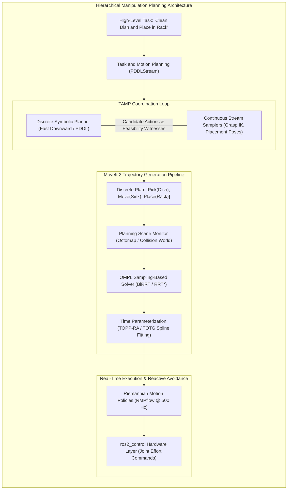
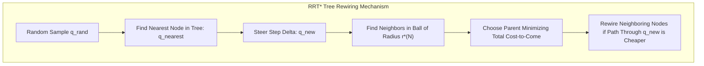
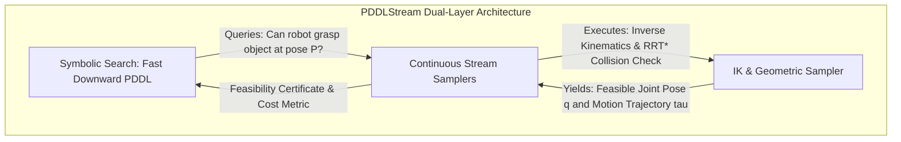

import ChapterProgress from '@site/src/components/ChapterProgress';
import QuizEngine from '@site/src/components/QuizEngine';

# Motion Planning for Manipulation: MoveIt 2, TAMP & RMPs

Moving a multi-jointed robotic manipulator through an obstacle-strewn environment is deceptively complex. While human beings effortlessly reach into a crowded refrigerator to grab a milk carton without knocking over jars, a 7-DoF robotic arm must navigate a high-dimensional configuration space where Euclidean obstacles transform into non-convex, disconnected manifolds. The problem escalates exponentially during contact-rich tasks: opening a microwave, unscrewing a bottle cap, or coordinating two robotic arms to lift an awkward tray.

To conquer these challenges, modern manipulation divides motion synthesis across three distinct abstraction tiers:
1. **Sampling-Based Geometric Planning** (e.g., RRT*, BiRRT within MoveIt 2) to find collision-free paths in high-dimensional spaces.
2. **Task and Motion Planning (TAMP)** (e.g., PDDLStream) to interleave discrete symbolic reasoning (e.g., deciding which container to unstack first) with continuous trajectory feasibility.
3. **Riemannian Motion Policies (RMPs)** to generate real-time reactive acceleration fields capable of evading dynamic obstacles at 1000 Hz.



---

## 1. Configuration Space Topology & Collision Geometry

The state of an $n$-DoF manipulator is uniquely specified by its generalized joint coordinates $\mathbf{q} \in \mathcal{C} \subset \mathbb{R}^n$, where the configuration space $\mathcal{C}$ is typically a torus or Euclidean manifold bounded by mechanical joint limits:

$$
\mathcal{C} = [q_{1, \min}, q_{1, \max}] \times [q_{2, \min}, q_{2, \max}] \times \cdots \times [q_{n, \min}, q_{n, \max}]
$$

Let $\mathcal{W} \subset \mathbb{R}^3$ denote the 3D operational workspace. The physical robot body occupies a volume $\mathcal{A}(\mathbf{q}) \subset \mathcal{W}$, while static and dynamic obstacles occupy $\mathcal{O} \subset \mathcal{W}$.

The configuration space is partitioned into obstacle and free regions:

$$
\mathcal{C}_{\text{obs}} = \{ \mathbf{q} \in \mathcal{C} \mid \mathcal{A}(\mathbf{q}) \cap \mathcal{O} \ne \emptyset \}, \quad \mathcal{C}_{\text{free}} = \mathcal{C} \setminus \mathcal{C}_{\text{obs}}
$$

Because the forward kinematics mapping $\mathbf{x} = \mathbf{f}_{\text{FK}}(\mathbf{q})$ is highly non-linear, simple convex polyhedra in workspace $\mathcal{W}$ map to intricate, highly non-convex surfaces with holes and narrow passages in $\mathcal{C}$-space. Consequently, explicitly computing the analytical boundary $\partial \mathcal{C}_{\text{obs}}$ is computationally intractable for $n \ge 4$. Modern planners instead treat $\mathcal{C}_{\text{free}}$ as a black box queried via fast collision detection routines (such as the Gilbert-Johnson-Keerthi (GJK) algorithm and Flexible Collision Library (FCL)).

---

## 2. Asymptotically Optimal Sampling: The Mathematics of RRT*

Rapidly-exploring Random Trees (RRT) explore high-dimensional spaces by incrementally growing a tree towards random samples. While standard RRT terminates at the first feasible path found, **RRT*** guarantees **asymptotic optimality**: the path cost converges almost surely to the theoretical optimum as the number of samples $N \to \infty$.



### 2.1 The Critical Rewiring Radius
To guarantee asymptotic convergence while maintaining a sparse graph, the search radius $r^*(N)$ for finding neighboring nodes $\mathcal{X}_{\text{near}}$ must scale with sample count $N$:

$$
r^*(N) = \gamma_{\text{RRT}^*} \left( \frac{\log N}{N} \right)^{1/d}
$$

where $d$ is the dimensionality of $\mathcal{C}$-space ($d = n$), and $\gamma_{\text{RRT}^*}$ is a constant strictly exceeding a geometric threshold:

$$
\gamma_{\text{RRT}^*} > 2 \left( 1 + \frac{1}{d} \right)^{1/d} \left( \frac{\mu(\mathcal{C}_{\text{free}})}{\zeta_d} \right)^{1/d}
$$

where $\mu(\mathcal{C}_{\text{free}})$ is the Lebesgue measure of free space, and $\zeta_d$ is the volume of the unit sphere in $\mathbb{R}^d$.

### 2.2 Cost-to-Come & Local Rewiring
For every new candidate node $\mathbf{q}_{\text{new}}$, RRT* evaluates all neighbors $\mathbf{q} \in \mathcal{X}_{\text{near}}$ to find the parent that minimizes total accumulated path cost:

$$
\mathbf{q}_{\text{min}} = \arg\min_{\mathbf{q} \in \mathcal{X}_{\text{near}}} \left\{ \text{Cost}(\mathbf{q}) + c(\text{Line}(\mathbf{q}, \mathbf{q}_{\text{new}})) \mid \text{CollisionFree}(\mathbf{q}, \mathbf{q}_{\text{new}}) \right\}
$$

After inserting $\mathbf{q}_{\text{new}}$ with parent $\mathbf{q}_{\text{min}}$, RRT* rewires the local tree: for each $\mathbf{q}_{\text{near}} \in \mathcal{X}_{\text{near}}$, if routing the path through $\mathbf{q}_{\text{new}}$ yields a lower cost than its existing parent:

$$
\text{Cost}(\mathbf{q}_{\text{new}}) + c(\text{Line}(\mathbf{q}_{\text{new}}, \mathbf{q}_{\text{near}})) \lt \text{Cost}(\mathbf{q}_{\text{near}})
$$

the edge is rewired to establish $\mathbf{q}_{\text{new}}$ as the new parent.

---

## 3. MoveIt 2 Architecture & Real-Time Trajectory Generation

In ROS 2 humanoid and manipulator stacks, **MoveIt 2** serves as the primary motion planning and execution container.

```mermaid
graph LR
    subgraph MoveIt2Internals["MoveIt 2 Core Node Architecture"]
        PSM["PlanningSceneMonitor"] -->|Monitors| TF["tf2 & /joint_states"]
        PSM -->|Maintains| Scene["Planning Scene (World Model + Robot URDF)"]
        UserNode["User C++ Node / Action Client"] -->|Sends MotionPlanRequest| Pipeline["Planning Pipeline (OMPL / CHOMP / Pilz)"]
        Scene --> Pipeline
        Pipeline -->|Raw C-Space Waypoints| TOPPRA["Time-Optimal Path Parameterization (TOPP-RA)"]
        TOPPRA -->|Trajectory with v(t) & a(t)| Execution["TrajectoryExecutionManager"]
        Execution -->|FollowJointTrajectory Action| Controller["ros2_control Joint Trajectory Controller"]
    end
```

Key MoveIt 2 components include:
1. **PlanningSceneMonitor**: Subscribes to `/tf`, `/joint_states`, and point clouds/depth images to construct an internal octree (`octomap`) collision representation.
2. **OMPL Plugin**: Provides state allocators and constraint samplers (e.g., maintaining an end-effector upright constraint during liquid transport via manifold projection).
3. **Time-Optimal Path Parameterization (TOPP-RA)**: Transforms purely geometric $\mathcal{C}$-space waypoints $\mathbf{q}(s)$ into time-stamped trajectories $\mathbf{q}(t)$ maximizing speed while strictly respecting joint velocity limits $\dot{\mathbf{q}}_{\max}$ and torque bounds $\boldsymbol{\tau}_{\max}$.

---

## 4. Task and Motion Planning (TAMP) with PDDLStream

Standard geometric planners fail when a task requires sequential discrete actions that alter kinematic reachability: for instance, unstacking box A to pick box B, or opening a drawer before retrieving a tool. **Task and Motion Planning (TAMP)** unifies discrete symbolic logic with continuous geometric constraints.



**PDDLStream** extends the classical Planning Domain Definition Language (PDDL) by introducing **Streams**: procedural generative procedures that map continuous inputs to continuous outputs satisfying geometric predicates:

$$
\text{Stream } f_{\text{sample-ik}}: (\text{Object}, \text{Pose } p, \text{Grasp } g) \to (\text{JointPose } q, \text{Trajectory } \tau)
$$

The symbolic planner optimistically plans assuming all stream calls will succeed. When candidate symbolic sequences are generated, PDDLStream calls the underlying continuous samplers (IK, collision checks, trajectory planners) to instantiate actual motion trajectories. If a stream fails (e.g., reaching into the drawer causes an elbow collision with the table), the predicate is marked infeasible, and the symbolic engine backtracks to find an alternative action sequence.

---

## 5. Reactive Control: Riemannian Motion Policies (RMPs)

While sampling-based planners generate global trajectories, they are too computationally heavy to react to sudden obstacle movements in real-time ($> 100\text{ Hz}$). **Riemannian Motion Policies (RMPs)** model motion as second-order differential equations embedded in curved Riemannian manifolds.

An RMP is a pair:

$$
(\mathbf{M}(\mathbf{x}, \dot{\mathbf{x}}), \mathbf{f}(\mathbf{x}, \dot{\mathbf{x}}))
$$

where $\mathbf{M} \in \mathbb{R}^{m \times m}$ is a symmetric positive-definite Riemannian metric representing directional inertia/importance, and $\mathbf{f} \in \mathbb{R}^m$ is a generalized force field generating acceleration $\ddot{\mathbf{x}} = \mathbf{M}^{-1} \mathbf{f}$.

### The Pullback Operator
Let $\mathbf{x} = \phi(\mathbf{q})$ be a smooth forward kinematic map from joint space to a task space (e.g., end-effector position or an elbow collision bubble), with Jacobian $\mathbf{J} = \frac{\partial \phi}{\partial \mathbf{q}}$. An RMP defined in task space is **pulled back** into joint space via:

$$
\mathbf{M}_{\mathbf{q}} = \mathbf{J}^T \mathbf{M}_{\mathbf{x}} \mathbf{J}, \quad \mathbf{f}_{\mathbf{q}} = \mathbf{J}^T \left( \mathbf{f}_{\mathbf{x}} - \mathbf{M}_{\mathbf{x}} \dot{\mathbf{J}} \dot{\mathbf{q}} \right)
$$

Multiple independent policies (target attraction, joint limit avoidance, collision repulsion) are combined across the robot by simply summing their pulled-back components:

$$
\mathbf{M}_{\text{total}} = \sum_{k} \mathbf{M}_{\mathbf{q}, k}, \quad \mathbf{f}_{\text{total}} = \sum_{k} \mathbf{f}_{\mathbf{q}, k} \implies \ddot{\mathbf{q}}_{\text{cmd}} = \mathbf{M}_{\text{total}}^{-1} \mathbf{f}_{\text{total}}
$$

This allows smooth, mathematically certified collision evasion at 1000 Hz without matrix inversion bottlenecks.

---

## 6. Comparison of Motion Planning Paradigms

| Feature / Metric | Sampling-Based (OMPL RRT*) | Optimization (TrajOpt / CHOMP) | TAMP (PDDLStream) | Reactive RMPs (RMPflow) |
| :--- | :--- | :--- | :--- | :--- |
| **Completeness Guarantee** | Probabilistically complete | Local minimum prone | Probabilistically complete | Local behavior only |
| **Optimality Guarantee** | Asymptotically optimal ($N \to \infty$)| Locally optimal | Asymptotically optimal | Sub-optimal |
| **Cycle Frequency** | 1–10 Hz (Global re-plan) | 10–30 Hz | 0.1–1.0 Hz (Symbolic search) | **500–1000 Hz (Real-time)** |
| **Handling of Discrete State**| None (Continuous $\mathcal{C}$-space only)| None | **Native (Unstacking, doors)** | None |
| **Collision Representation** | Mesh-to-mesh (GJK/FCL) | Signed Distance Fields (SDF) | Mixed (Semantic + GJK) | Distance gradients $\nabla d$ |

---

## 7. Production C++ MoveIt 2 Motion Planning Client

The listing below illustrates an industrial-grade MoveIt 2 C++ client node. It sets up a planning scene, adds an obstacle box dynamically, specifies an upright orientation constraint, solves a collision-free motion plan via OMPL, and executes the trajectory:

```cpp
/**
 * Production C++20 MoveIt 2 Planning Client Node
 * Author: Dexterous Manipulation Specialist
 * Module: 7.5 Motion Planning for Manipulation
 */

#include <memory>
#include <rclcpp/rclcpp.hpp>
#include <geometry_msgs/msg/pose_stamped.hpp>
#include <moveit/move_group_interface/move_group_interface.h>
#include <moveit/planning_scene_interface/planning_scene_interface.h>
#include <moveit_msgs/msg/collision_object.h>
#include <shape_msgs/msg/solid_primitive.h>

class ArmManipulationPlanner : public rclcpp::Node
{
public:
  ArmManipulationPlanner() : Node("arm_manipulation_planner")
  {
    RCLCPP_INFO(this->get_logger(), "Initializing Arm Manipulation Planner Node...");
  }

  void execute_pick_plan()
  {
    // Initialize MoveGroup for the 7-DoF manipulator arm
    static const std::string PLANNING_GROUP = "arm_manipulator";
    moveit::planning_interface::MoveGroupInterface move_group(shared_from_this(), PLANNING_GROUP);
    moveit::planning_interface::PlanningSceneInterface planning_scene_interface;

    // Configure planning tolerances and solvers
    move_group.setPlanningTime(5.0);
    move_group.setNumPlanningAttempts(10);
    move_group.setMaxVelocityScalingFactor(0.4);
    move_group.setMaxAccelerationScalingFactor(0.3);
    move_group.setPlannerId("RRTConnectkConfigDefault");

    // 1. Insert collision obstacle into the Planning Scene
    moveit_msgs::msg::CollisionObject obstacle;
    obstacle.header.frame_id = move_group.getPlanningFrame();
    obstacle.id = "table_barrier";

    shape_msgs::msg::SolidPrimitive primitive;
    primitive.type = primitive.BOX;
    primitive.dimensions = {0.20, 0.40, 0.30};  // 20cm x 40cm x 30cm box

    geometry_msgs::msg::Pose box_pose;
    box_pose.orientation.w = 1.0;
    box_pose.position.x = 0.45;
    box_pose.position.y = 0.00;
    box_pose.position.z = 0.15;

    obstacle.primitives.push_back(primitive);
    obstacle.primitive_poses.push_back(box_pose);
    obstacle.operation = obstacle.ADD;

    planning_scene_interface.applyCollisionObject(obstacle);
    RCLCPP_INFO(this->get_logger(), "Collision obstacle 'table_barrier' published to planning scene.");

    // 2. Specify target end-effector pose
    geometry_msgs::msg::PoseStamped target_pose;
    target_pose.header.frame_id = move_group.getPlanningFrame();
    target_pose.pose.position.x = 0.55;
    target_pose.pose.position.y = 0.25;
    target_pose.pose.position.z = 0.40;
    target_pose.pose.orientation.x = 0.7071;
    target_pose.pose.orientation.y = 0.0;
    target_pose.pose.orientation.z = 0.7071;
    target_pose.pose.orientation.w = 0.0;

    move_group.setPoseTarget(target_pose);

    // 3. Formulate path orientation constraint (keep tool upright)
    moveit_msgs::msg::OrientationConstraint ocm;
    ocm.link_name = move_group.getEndEffectorLink();
    ocm.header.frame_id = move_group.getPlanningFrame();
    ocm.orientation = target_pose.pose.orientation;
    ocm.absolute_x_axis_tolerance = 0.2;
    ocm.absolute_y_axis_tolerance = 0.2;
    ocm.absolute_z_axis_tolerance = 3.14;  // Allow free rotation around tool z
    ocm.weight = 1.0;

    moveit_msgs::msg::Constraints path_constraints;
    path_constraints.orientation_constraints.push_back(ocm);
    move_group.setPathConstraints(path_constraints);

    // 4. Plan motion
    moveit::planning_interface::MoveGroupInterface::Plan plan;
    bool success = (move_group.plan(plan) == moveit::core::MoveItErrorCode::SUCCESS);

    if (success)
    {
      RCLCPP_INFO(this->get_logger(), "Motion plan computed successfully! Executing trajectory...");
      move_group.execute(plan);
    }
    else
    {
      RCLCPP_ERROR(this->get_logger(), "Motion planning failed to find a collision-free path.");
    }

    // Clean up path constraints
    move_group.clearPathConstraints();
  }
};

int main(int argc, char** argv)
{
  rclcpp::init(argc, argv);
  auto node = std::make_shared<ArmManipulationPlanner>();
  
  // In production, execute in multi-threaded executor
  node->execute_pick_plan();
  
  rclcpp::shutdown();
  return 0;
}
```

---

## 8. Seminal Research Foundations

1. **Karaman, S., & Frazzoli, E. (2011).** *Sampling-based algorithms for optimal motion planning*. The International Journal of Robotics Research, 30(7), 846–894.
   - *Annotation*: Proved that standard RRT is sub-optimal with probability 1 and derived the RRT* and PRM* algorithms with asymptotic optimality guarantees.
2. **Garrett, C. R., Chitnis, R., Holladay, R., Kim, B., Silver, T., Kaelbling, L. P., & Lozano-Pérez, T. (2020).** *Integrated task and motion planning*. Annual Review of Control, Robotics, and Autonomous Systems, 4, 265–293.
   - *Annotation*: Definitive foundation of TAMP algorithms, analyzing stream samplers and PDDLStream completeness.
3. **Ratliff, N., Issac, J., Kappler, D., Birchfield, S., & Fox, D. (2018).** *Riemannian Motion Policies*. arXiv preprint arXiv:1801.02854.
   - *Annotation*: Introduced RMPflow, formulating robotic motion and collision avoidance as differential geometry pullbacks on Riemannian manifolds.
4. **Chitta, S., Sucan, I., & Cousins, S. (2012).** *Moveit! [ROS news]*. IEEE Robotics & Automation Magazine, 19(1), 18–19.
   - *Annotation*: Documented the canonical MoveIt manipulation system architecture combining kinematic pipelines, collision scenes, and OMPL.

---

## 9. Hands-on Lab Project: Constrained Collision-Free Dual-Arm Pick-and-Place

### Objective
Configure a MoveIt 2 / OMPL motion planner for a dual-arm humanoid manipulator. The robot must pick a container filled with fluid, plan a collision-free trajectory over an obstacle partition without tilting the container more than $10^\circ$, and transfer it to the opposite arm's workspace.

### Key Deliverables
1. **Octomap Collision Pipeline**: Ingest a simulated 3D depth point cloud and generate collision octree voxels.
2. **Constrained State Space Sampler**: Implement an OMPL manifold projection sampler enforcing:

$$
\left| \hat{\mathbf{z}}_{\text{container}}(\mathbf{q}) \cdot \hat{\mathbf{z}}_{\text{world}} - 1.0 \right| \le 1 - \cos(10^\circ)
$$

3. **Trajectory Smoother**: Apply TOPP-RA to ensure joint velocity and acceleration bounds are strictly observed.

### Verification Criteria
- [ ] Collision avoidance: 0 collisions detected across 50 planning trials in complex obstacle scenes.
- [ ] Constraint satisfaction: Container tilt angle never exceeds $10.0^\circ$ at any point along the trajectory.
- [ ] Planning latency: Average planning time $\lt 1.5\text{ seconds}$ on 7-DoF arm using RRT-Connect.

---

<ChapterProgress chapterId="7-5-motion-planning-for-manipulation" moduleId="module7" totalChapters={8} />

## Chapter Mastery Check

<QuizEngine
  quizId="quiz-7-5"
  title="Module 7.5 Mastery Check: Motion Planning for Manipulation"
  moduleId="module7"
  passThreshold={70}
  questions={[
    {
      id: "q1",
      question: "Why does the standard RRT algorithm fail to guarantee optimal path generation even as the number of samples approaches infinity?",
      options: [
        "Because once an edge is added to the RRT tree, it is permanently locked and never rewired, locking in suboptimal connections formed during early iterations",
        "Because RRT uses floating-point arithmetic which loses numerical precision",
        "Because RRT cannot detect collisions in 3D",
        "Because OMPL does not support RRT"
      ],
      correctIndex: 0,
      explanation: "Standard RRT only grows outward and never modifies existing tree connections. Once an inefficient path branch is formed early in the search, it persists indefinitely. RRT* solves this by rewiring neighboring nodes within radius r*(N) to minimize cost-to-come."
    },
    {
      id: "q2",
      question: "In the PDDLStream framework for Task and Motion Planning (TAMP), what is the function of a 'Stream'?",
      options: [
        "To stream video frames over an RTSP network",
        "A procedural generator that maps continuous inputs to outputs (e.g. IK solutions, collision-free trajectories) to verify and ground discrete symbolic actions",
        "To clear the ROS 2 log file buffer",
        "To serialize URDF files into JSON"
      ],
      correctIndex: 1,
      explanation: "A Stream is a declarative bridge connecting symbolic planners to continuous geometric algorithms. It takes symbolic parameters (like an object pose and grasp) and procedurally samples valid continuous values (like joint poses and collision-free trajectories)."
    },
    {
      id: "q3",
      question: "In Riemannian Motion Policies (RMPs), how are independent task-space acceleration policies combined into a unified joint command?",
      options: [
        "By averaging their joint angles randomly",
        "By pulling back task-space metrics M and forces f through kinematic Jacobians into joint space and summing them: M_total = sum(J_k^T M_k J_k)",
        "By selecting only the highest-priority policy and ignoring all others",
        "By converting all policies to text prompts for an LLM"
      ],
      correctIndex: 1,
      explanation: "RMPs exploit differential geometry: each policy's metric M and force f are pulled back to joint space via the Jacobian J and metric congruence (J^T M J). Because RMPs are additive in configuration space, total acceleration is computed via M_total^-1 * f_total."
    },
    {
      id: "q4",
      question: "What role does Time-Optimal Path Parameterization (such as TOPP-RA) perform in the MoveIt 2 pipeline?",
      options: [
        "It generates 3D mesh models from camera point clouds",
        "It parameterizes a purely geometric path q(s) into a time-stamped trajectory q(t) that maximizes execution speed while strictly respecting actuator velocity and torque limits",
        "It compiles C++ code into machine code",
        "It resets the robot's hardware encoders"
      ],
      correctIndex: 1,
      explanation: "Geometric planners like RRT* only output ordered waypoints without timing information. TOPP-RA calculates optimal time stamps, velocities, and accelerations along the path that respect physical robot velocity and acceleration limits."
    }
  ]}
/>
