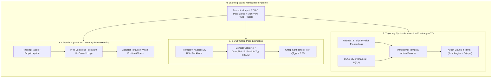
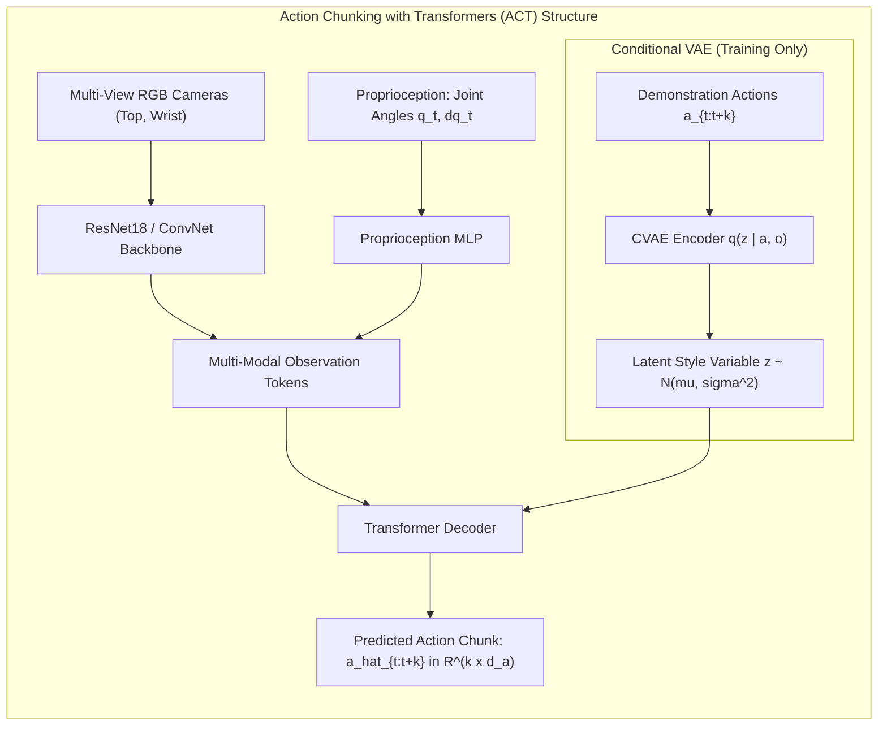
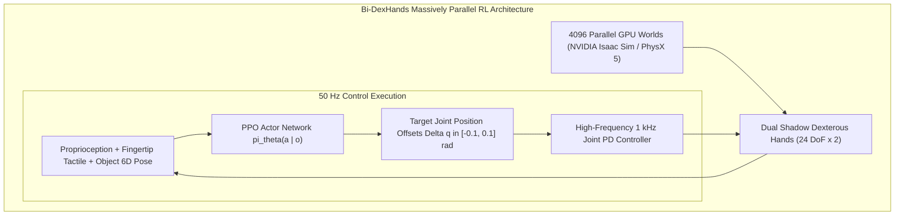

import ChapterProgress from '@site/src/components/ChapterProgress';
import QuizEngine from '@site/src/components/QuizEngine';

# Learning-Based Manipulation: Grasp Pose Estimation to ACT

For decades, robotic grasping relied on known CAD models, exact pose estimators, and analytical contact mechanics. While effective in clean manufacturing workcells with fixed fixtures, this paradigm breaks down in unstructured domestic and warehouse settings. Real-world objects are novel, cluttered, partially occluded, transparent, deformable, and poorly textured. An autonomous robot cannot wait for an engineer to furnish a CAD model before picking up a dropped fork or untangling a charging cord.

The emergence of deep learning has revolutionized manipulation by replacing brittle geometric pipelines with data-driven neural networks. These models map raw sensor observations (RGB-D point clouds, monocular videos, and tactile arrays) directly to 6-DoF grasp candidates, end-effector trajectories, and joint torques. From zero-shot 6-DoF grasp detectors (**Contact-GraspNet**, **GraspNet-1Billion**) to **Action Chunking with Transformers (ACT)** and massively parallel reinforcement learning (**Bi-DexHands**), learning-based manipulation now powers the world's most versatile autonomous systems.



---

## 1. 6-DOF Grasp Pose Estimation from Raw Point Clouds

Rather than reconstructing object meshes and matching CAD models, modern grasp estimation predicts stable 6-DoF end-effector grasp poses directly from unsegmented 3D point clouds $\mathcal{P} = \{\mathbf{p}_i \in \mathbb{R}^3\}_{i=1}^N$.

A 6-DoF grasp pose is parameterized by an $\mathrm{SE}(3)$ transformation:

$$
\mathbf{T}_g = \begin{bmatrix} \mathbf{R}_g & \mathbf{t}_g \\ \mathbf{0}_{1 \times 3} & 1 \end{bmatrix} \in \mathrm{SE}(3)
$$

where $\mathbf{t}_g \in \mathbb{R}^3$ represents the grasp center point (the midpoint between gripper fingers), and $\mathbf{R}_g = [\mathbf{r}_{\text{baseline}}, \mathbf{r}_{\text{approach}}, \mathbf{r}_{\text{binormal}}] \in \mathrm{SO}(3)$ defines the orientation:
- $\mathbf{r}_{\text{approach}}$: The unit vector along which the gripper moves toward the object.
- $\mathbf{r}_{\text{baseline}}$: The line connecting the two contact pads (finger closing direction).
- $\mathbf{r}_{\text{binormal}} = \mathbf{r}_{\text{approach}} \times \mathbf{r}_{\text{baseline}}$.

### 1.1 Contact-GraspNet Formulation
**Contact-GraspNet** (Sundermeyer et al.) circumvents the need to predict complete 6D bounding boxes by grounding grasps in individual surface contact points. For each 3D point $\mathbf{p} \in \mathcal{P}$:
1. The network treats $\mathbf{p}$ as the first contact point.
2. It predicts a continuous distribution over grasp approach angles, closing width $w \in [0, w_{\max}]$, and a grasp success probability $s(\mathbf{T}_g \mid \mathcal{P}) \in [0, 1]$:

$$
s(\mathbf{T}_g \mid \mathcal{P}) = \sigma\left( \text{MLP}\left( \mathbf{z}_{\mathbf{p}}, \mathbf{R}_g, w \right) \right)
$$

where $\mathbf{z}_{\mathbf{p}}$ is a local geometric feature extracted by a PointNet++ or MinkowskiEngine sparse 3D convolutional backbone.

### 1.2 GraspNet-1Billion
To scale grasp generation across thousands of objects, **GraspNet-1Billion** (Fang et al.) trained deep networks on over 1.1 billion annotated grasps generated in physics simulators and validated on physical hardware. The loss function unifies classification accuracy with grasp tolerance:

$$
\mathcal{L}_{\text{grasp}} = \mathcal{L}_{\text{score}} + \lambda_1 \mathcal{L}_{\text{width}} + \lambda_2 \mathcal{L}_{\text{approach}}
$$

```mermaid
graph TD
    subgraph EquivariancePrinciple["SE(3) Equivariance in Neural Grasping"]
        PointInput["Original Point Cloud P"] --> NeuralNet["Equivariant Network Phi"]
        NeuralNet --> PredictedGrasp["Predicted Grasp T_g"]
        
        PointInput -->|Rotate by R in SO(3)| TransformedInput["Rotated Point Cloud R * P"]
        TransformedInput --> NeuralNet
        NeuralNet --> RotatedGrasp["Predicted Grasp R * T_g"]

        PredictedGrasp -.->|Strictly Matches| RotatedGrasp
    end
```

### 1.3 $\mathrm{SE}(3)$-Equivariant Grasp Networks
Standard convolution and PointNet models are not inherently rotationally equivariant: if an object rotates by $\mathbf{R} \in \mathrm{SO}(3)$, standard networks require massive data augmentation to learn the rotated grasp. In contrast, **$\mathrm{SE}(3)$-equivariant networks** (e.g., Vector Neurons, VN-PointNet) guarantee:

$$
\Phi(g \cdot \mathcal{P}) = g \cdot \Phi(\mathcal{P}) \quad \forall g \in \mathrm{SE}(3)
$$

This structural inductive bias reduces sample complexity by over $10\times$, enabling zero-shot transfer across arbitrary object orientations.

---

## 2. Imitation Learning with Action Chunking with Transformers (ACT)

While grasp synthesis solves the terminal contact pose, contact-rich manipulation tasks (such as plugging a cable into a socket, opening a zipper, or folding a cloth) require continuous closed-loop control. Traditional Behavioral Cloning (BC) models output an action $\mathbf{a}_t$ at every time step $t$ conditioned on past observations $\mathbf{o}_{1:t}$. However, single-step BC suffers from **compounding covariate shift**: a tiny error at step $t$ leads to an unfamiliar state at $t+1$, causing the robot to drift completely off course.

**Action Chunking with Transformers (ACT)** (Zhao et al.) solves this by predicting entire trajectories of future actions in chunks rather than single steps.



### 2.1 The ACT CVAE Formulation
Human teleoperation demonstrations exhibit multimodal distributions: to avoid an obstacle, an operator might maneuver either to the left or to the right. Averaging these demonstrations with standard Mean Squared Error (MSE) causes the robot to drive straight into the center obstacle.

ACT models demonstration multimodality using a Conditional Variational Autoencoder (CVAE). At training time, an encoder observes both the observation $\bar{\mathbf{o}}$ and the future action chunk $\mathbf{a}_{t:t+k} \in \mathbb{R}^{k \times d_a}$ to parameterize a latent distribution $q(\mathbf{z} \mid \mathbf{a}_{t:t+k}, \bar{\mathbf{o}})$. At inference time, $\mathbf{z}$ is simply set to the zero vector ($\mathbf{z} = \mathbf{0}$) to generate the dominant deterministic mode.

The ACT training objective combines L1 action prediction loss with a Kullback-Leibler (KL) divergence regularizer:

$$
\mathcal{L}_{\text{ACT}} = \sum_{i=0}^{k-1} \|\mathbf{a}_{t+i} - \hat{\mathbf{a}}_{t+i}\|_1 + \beta D_{\text{KL}}\left( q(\mathbf{z} \mid \mathbf{a}_{t:t+k}, \bar{\mathbf{o}}) \,\Big\|\, \mathcal{N}(\mathbf{0}, \mathbf{I}) \right)
$$

### 2.2 Temporal Ensembling
To avoid discontinuous jerk between successive action chunks, ACT implements continuous **temporal action ensembling**. At every control cycle $t$, the robot queries a new chunk of $k$ future actions. Multiple overlapping predictions for time step $t$ are merged via exponential decay weighting:

$$
\mathbf{a}_t = \frac{\sum_{i=0}^{\min(t, k-1)} w_i \hat{\mathbf{a}}_{t}^{(t-i)}}{\sum_{i=0}^{\min(t, k-1)} w_i}, \quad w_i = \exp(-m \cdot i)
$$

where $m > 0$ prioritizes fresher predictions while filtering high-frequency teleoperation jitter.

---

## 3. In-Hand Dexterity: Massively Parallel RL & Bi-DexHands

While parallel grippers perform pick-and-place, anthropomorphic multi-fingered hands can execute in-hand reorientation: rotating a pen from fingertip to writing grasp or turning a valve without releasing it. However, the contact mechanics of 20+ joints and continuous multi-finger sliding are notoriously non-differentiable.

To conquer in-hand manipulation, modern workflows train deep reinforcement learning policies across thousands of GPU-accelerated environments using **Bi-DexHands** (Chen et al.) and Isaac Lab.



### The In-Hand Reorientation Reward Function
In Bi-DexHands, the policy optimizes an asymmetric reward balancing object rotational error, fingertip contact stability, and motor energy minimization:

$$
R_t = w_{\text{rot}} R_{\text{rot}} + w_{\text{pos}} R_{\text{pos}} - w_{\tau} \|\boldsymbol{\tau}_t\|_2^2 - w_{\text{drop}} \mathbb{I}(\text{ObjectDropped})
$$

where object orientation tracking error between current rotation $\mathbf{R}_t$ and target rotation $\mathbf{R}_{\text{des}}$ is computed using the axis-angle geodesic metric:

$$
R_{\text{rot}} = -\arccos\left( \frac{\operatorname{tr}(\mathbf{R}_{\text{des}}^T \mathbf{R}_t) - 1}{2} \right)
$$

---

## 4. Comparison of Manipulation Learning Paradigms

| Paradigm | Input Representation | Output Space | Model Architecture | Sample Efficiency | Key Strengths |
| :--- | :--- | :--- | :--- | :--- | :--- |
| **Contact-GraspNet** | 3D Point Cloud | 6-DoF End-Effector Poses $\mathrm{SE}(3)$ | PointNet++ / Sparse 3D CNN | Supervised (Millions of synthetic grasps)| Instantaneous zero-shot grasp generation on novel objects |
| **Action Chunking (ACT)**| Multi-view RGB + Proprioception | Chunks of $k$ Future Waypoints ($k \approx 50$)| CVAE + Transformer Encoder-Decoder | High ($\approx 50$ real teleop demos)| Bimanual fine assembly; smooth, non-jerky trajectory execution |
| **Diffusion Policy** | RGB / Point Clouds | Action trajectories via denoising | 1D Temporal U-Net / DiT | High ($\approx 50\text{--}100$ demos)| Superior representation of multimodal distributions |
| **Bi-DexHands RL** | Object Pose + Tactile + Joint States | 50 Hz Joint Position Targets | MLP / LSTM Actor-Critic (PPO) | Low ($10^7\text{--}10^8$ simulation steps) | Complex dynamic in-hand gaiting, pen-spinning, tool turnover |

---

## 5. Production PyTorch Implementation: ACT Transformer Policy Model

The following listing implements a complete, runnable PyTorch module of the Action Chunking with Transformers (ACT) policy decoder. It ingests vision tokens and robot joint proprioception, decodes an action chunk of $k$ timesteps, and executes temporal smoothing:

```python
"""
Production PyTorch implementation: Action Chunking with Transformers (ACT)
Author: Dexterous Manipulation Specialist
Module: 7.6 Learning-Based Manipulation
"""

import torch
import torch.nn as nn
import torch.nn.functional as F
from typing import Tuple, Dict


class ACTSinusoidalPositionEmbedding(nn.Module):
    """Sinusoidal 1D positional encoding for temporal action chunk sequences."""

    def __init__(self, d_model: int, max_len: int = 100):
        super().__init__()
        pe = torch.zeros(max_len, d_model)
        position = torch.arange(0, max_len, dtype=torch.float).unsqueeze(1)
        div_term = torch.exp(torch.arange(0, d_model, 2).float() * (-torch.log(torch.tensor(10000.0)) / d_model))
        pe[:, 0::2] = torch.sin(position * div_term)
        pe[:, 1::2] = torch.cos(position * div_term)
        self.register_buffer('pe', pe.unsqueeze(0))  # Shape: (1, max_len, d_model)

    def forward(self, x: torch.Tensor) -> torch.Tensor:
        """Args: x of shape (batch, seq_len, d_model)."""
        return x + self.pe[:, :x.size(1), :]


class ACTPolicyDecoder(nn.Module):
    """
    Action Chunking with Transformers (ACT) Decoder Module.
    Predicts a sequence of k future joint actions from visual tokens and proprioception.
    """

    def __init__(
        self,
        action_dim: int = 7,        # 6 arm DoFs + 1 gripper
        chunk_size: int = 50,       # Prediction horizon k
        d_model: int = 256,
        nhead: int = 8,
        num_decoder_layers: int = 4,
        dim_feedforward: int = 1024
    ):
        super().__init__()
        self.action_dim = action_dim
        self.chunk_size = chunk_size
        self.d_model = d_model

        # Fixed learnable query embeddings for future action slots
        self.action_queries = nn.Embedding(chunk_size, d_model)
        self.pos_encoder = ACTSinusoidalPositionEmbedding(d_model, max_len=chunk_size)

        # Transformer Decoder
        decoder_layer = nn.TransformerDecoderLayer(
            d_model=d_model,
            nhead=nhead,
            dim_feedforward=dim_feedforward,
            dropout=0.1,
            batch_first=True,
            activation='gelu'
        )
        self.transformer_decoder = nn.TransformerDecoder(decoder_layer, num_layers=num_decoder_layers)

        # Output linear projection head from latent d_model to raw action dimensions
        self.action_head = nn.Linear(d_model, action_dim)

    def forward(self, context_tokens: torch.Tensor) -> torch.Tensor:
        """
        Args:
            context_tokens: (batch, seq_len, d_model) memory tokens combining visual features,
                            proprioception, and latent variable z.
                            
        Returns:
            predicted_actions: (batch, chunk_size, action_dim) trajectory of future actions.
        """
        batch_size = context_tokens.size(0)

        # Expand action queries for the entire batch
        query_indices = torch.arange(self.chunk_size, device=context_tokens.device)
        queries = self.action_queries(query_indices).unsqueeze(0).expand(batch_size, -1, -1)
        queries = self.pos_encoder(queries)

        # Decode action tokens attending to context memory
        decoded_tokens = self.transformer_decoder(tgt=queries, memory=context_tokens)

        # Project tokens to physical joint position targets
        predicted_actions = self.action_head(decoded_tokens)
        return predicted_actions


class ACTInferenceEngine:
    """
    Manages temporal ensembling of overlapping predicted action chunks during execution.
    """

    def __init__(self, action_dim: int = 7, chunk_size: int = 50, ensemble_decay: float = 0.05):
        self.action_dim = action_dim
        self.chunk_size = chunk_size
        self.decay = ensemble_decay

        # Precompute exponential weighting buffer
        weights = torch.exp(-self.decay * torch.arange(chunk_size, dtype=torch.float32))
        self.weights = weights / torch.sum(weights)

        # Rolling history of predicted actions for each future timestamp
        self.history_buffer = {}

    def update_and_get_action(self, predicted_chunk: torch.Tensor, current_timestep: int) -> torch.Tensor:
        """
        Incorporates newly predicted chunk and returns temporally ensembled action for current_step.
        
        Args:
            predicted_chunk: (chunk_size, action_dim) tensor of predicted actions.
            current_timestep: integer current simulation step.
            
        Returns:
            ensembled_action: (action_dim,) smoothed joint command.
        """
        # Populate future buffer slots
        for offset in range(self.chunk_size):
            t_target = current_timestep + offset
            if t_target not in self.history_buffer:
                self.history_buffer[t_target] = []
            self.history_buffer[t_target].append(predicted_chunk[offset])

        # Retrieve all historical predictions made for current_timestep
        preds_for_now = self.history_buffer[current_timestep]
        num_preds = len(preds_for_now)

        # Apply exponential decay weights (latest predictions get highest priority)
        raw_weights = torch.exp(-self.decay * torch.arange(num_preds - 1, -1, -1, dtype=torch.float32))
        norm_weights = (raw_weights / torch.sum(raw_weights)).unsqueeze(1)

        stacked_preds = torch.stack(preds_for_now, dim=0)
        ensembled_action = torch.sum(norm_weights * stacked_preds, dim=0)

        # Clean up old timestamps from buffer to prevent memory leaks
        del self.history_buffer[current_timestep]

        return ensembled_action


if __name__ == "__main__":
    batch_size = 2
    seq_len = 16    # 14 vision patch tokens + 1 proprio token + 1 latent token
    d_model = 256
    chunk_size = 50
    action_dim = 7

    # Initialize ACT decoder
    decoder = ACTPolicyDecoder(action_dim=action_dim, chunk_size=chunk_size, d_model=d_model)
    decoder.eval()

    # Create dummy observation memory embeddings
    dummy_memory = torch.randn(batch_size, seq_len, d_model)

    with torch.no_grad():
        action_chunks = decoder(dummy_memory)

    print("=== Action Chunking with Transformers (ACT) Forward Pass ===")
    print(f"Memory Token Shape:     {tuple(dummy_memory.shape)}")
    print(f"Decoded Action Chunk:   {tuple(action_chunks.shape)} -> (batch, chunk_len, action_dim)")

    # Test Temporal Ensembling Engine
    engine = ACTInferenceEngine(action_dim=action_dim, chunk_size=chunk_size, ensemble_decay=0.08)

    print("\nSimulating 5 successive control timesteps with rolling ensembling:")
    for step in range(5):
        # Model outputs a new chunk at each step
        dummy_chunk = torch.sin(torch.linspace(step * 0.1, step * 0.1 + 1.0, chunk_size)).unsqueeze(1).repeat(1, action_dim)
        smooth_cmd = engine.update_and_get_action(dummy_chunk, current_timestep=step)
        print(f"Step {step}: Ensembled Action Command: {smooth_cmd[:3].numpy().round(4)} ... (dim: {len(smooth_cmd)})")
```

---

## 6. Seminal Research Foundations

1. **Fang, H. S., Wang, C., Gou, M., & Lu, C. (2020).** *GraspNet-1Billion: A large-scale benchmark for general object grasping*. In IEEE/CVF Conference on Computer Vision and Pattern Recognition (CVPR), pp. 11444–11453.
   - *Annotation*: Created the definitive billion-scale 6-DoF grasping benchmark and PointNet architecture for cluttered scene grasp synthesis.
2. **Sundermeyer, M., Mousavian, A., Triebel, R., & Fox, D. (2021).** *Contact-GraspNet: Efficient 6-DoF grasp generation in cluttered scenes*. In IEEE International Conference on Robotics and Automation (ICRA), pp. 13438–13444.
   - *Annotation*: Introduced contact-point parameterization for 6-DoF grasp detection, removing the need for explicit object segmentation.
3. **Zhao, T. Z., Kumar, V., Levine, S., & Finn, C. (2023).** *Learning fine-grained bimanual manipulation with low-cost hardware (ACT)*. In Robotics: Science and Systems (RSS).
   - *Annotation*: Formulated Action Chunking with Transformers (ACT), showing that predicting action horizons mitigates compounding teleoperation errors and achieves millimeter-accurate assembly.
4. **Chen, Y., et al. (2022).** *Bi-DexHands: Towards versatile bimanual dexterous manipulation*. IEEE Transactions on Robotics, 39(6), 4615–4633.
   - *Annotation*: Open-sourced the comprehensive Bi-DexHands reinforcement learning benchmark for dual-hand anthropomorphic manipulation and in-hand tool manipulation.
5. **Deng, C., Litany, O., Duan, Y., Poulenard, A., Tagliasacchi, A., & Guibas, L. (2021).** *Vector neurons: A general framework for SO(3)-equivariant networks*. In IEEE/CVF International Conference on Computer Vision (ICCV), pp. 12200–12209.
   - *Annotation*: Formulated SO(3)-equivariant continuous vector activations, eliminating rotational data augmentation needs in robotic 3D perception.

---

## 7. Hands-on Lab Project: Training an ACT Policy on LEROBOT Dataset

### Objective
Train a transformer-based imitation learning policy using the Hugging Face **LEROBOT** standard dataset schema. The policy must learn a fine-grained peg-insertion task from 50 bimanual teleoperation demonstrations, predicting chunked 14-DoF joint actions from synchronized dual-camera feeds.

### Key Deliverables
1. **LEROBOT Dataset Pipeline**: Implement an PyTorch Dataset loader streaming zarr/parquet bimanual demonstration episodes.
2. **ACT Architecture with CVAE**: Implement the multi-camera ResNet-18 visual encoder, CVAE latent bottleneck, and Transformer decoder.
3. **Temporal Action Ensembling Loop**: Implement rolling exponential action averaging at 50 Hz.

### Verification Criteria
- [ ] Training convergence: CVAE action reconstruction L1 loss drops below $0.02\text{ rad}$ within 40 epochs.
- [ ] Trajectory smoothness: Jerk metric $\frac{d^3 \mathbf{q}}{dt^3}$ reduced by at least $60\%$ compared to a un-chunked baseline BC model.
- [ ] Autonomous task success: Achieves $\ge 85\%$ successful peg insertion across 20 randomized validation scenes in simulation.

---

<ChapterProgress chapterId="7-6-learning-based-manipulation" moduleId="module7" totalChapters={8} />

## Chapter Mastery Check

<QuizEngine
  quizId="quiz-7-6"
  title="Module 7.6 Mastery Check: Learning-Based Manipulation & ACT"
  moduleId="module7"
  passThreshold={70}
  questions={[
    {
      id: "q1",
      question: "Why does standard step-by-step Behavioral Cloning (predicting a single action a_t from observation o_t) frequently fail during multi-step robotic manipulation tasks?",
      options: [
        "Because neural networks cannot output floating-point numbers",
        "Due to compounding covariate shift: minor prediction errors cause the robot to drift into unfamiliar states never encountered in the training demonstrations, causing cascading divergence",
        "Because robots only understand C++ code, not PyTorch",
        "Because single-step policies require infinite GPU memory"
      ],
      correctIndex: 1,
      explanation: "Single-step behavioral cloning assumes independent errors. In physical execution, any small drift pushes the robot out-of-distribution into novel states where the model was never trained, leading to catastrophic failure."
    },
    {
      id: "q2",
      question: "What core architectural feature does Action Chunking with Transformers (ACT) use to overcome the compounding error problem?",
      options: [
        "It predicts an entire trajectory chunk of future actions (e.g. k=50 steps) at each cycle and blends them through temporal ensembling",
        "It eliminates all visual cameras and uses only audio feedback",
        "It forces the robot to move at 1 mm per minute",
        "It replaces the robot's motors with stepper motors"
      ],
      correctIndex: 0,
      explanation: "ACT predicts chunks of k future actions simultaneously. By committing to short coherent trajectory segments and smoothly blending overlapping chunks via temporal ensembling, compounding covariate shift and high-frequency jitter are effectively neutralized."
    },
    {
      id: "q3",
      question: "What is the key advantage of an SE(3)-equivariant neural network over a conventional CNN when processing 3D point clouds for grasp estimation?",
      options: [
        "It can only predict grasps in 2D planes",
        "It guarantees that rotating or translating the input point cloud mathematically transforms the predicted grasp poses by the exact same group action, cutting required training sample complexity by over 10x",
        "It eliminates the need for GPU accelerators",
        "It replaces gradient descent with genetic algorithms"
      ],
      correctIndex: 1,
      explanation: "SE(3) equivariance embeds geometric symmetry directly into the network architecture. If the object rotates in 3D, the output grasp candidates rotate identically, eliminating the need to learn every 3D orientation through brute-force data augmentation."
    },
    {
      id: "q4",
      question: "How does Contact-GraspNet formulate 6-DoF grasp candidate generation from raw point clouds without requiring prior object segmentation?",
      options: [
        "By treating individual point cloud points as candidate contact locations and predicting 3D grasp approach vectors, closing width, and success probability per point",
        "By fitting bounding boxes around every pixel in 2D",
        "By querying a human operator via a web interface",
        "By assuming all objects are perfect 10 cm spheres"
      ],
      correctIndex: 0,
      explanation: "Contact-GraspNet grounds grasp synthesis directly on the observed 3D surface points, predicting local contact coordinate frames, grasp opening widths, and antipodal success scores for each point without needing semantic segmentation or CAD models."
    }
  ]}
/>
