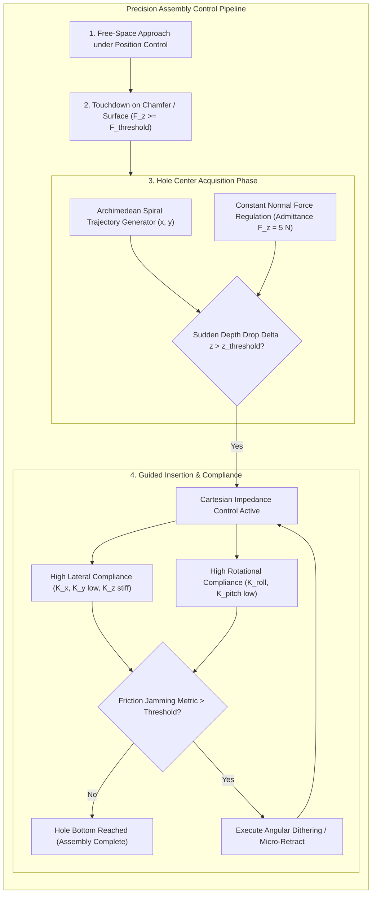
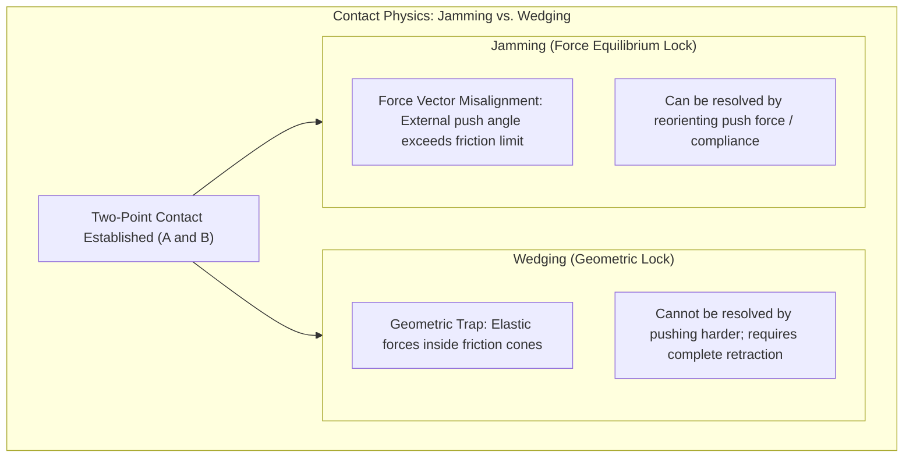
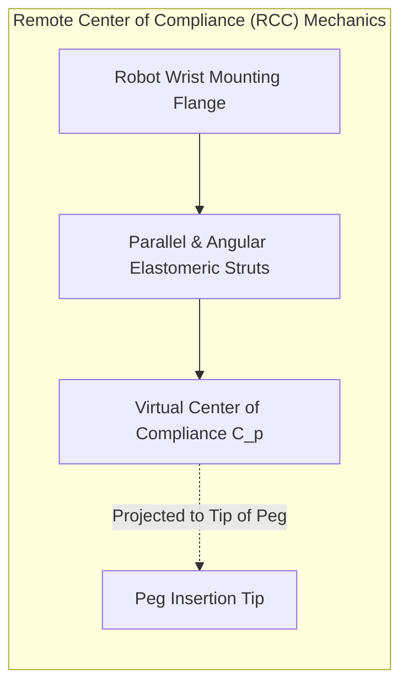
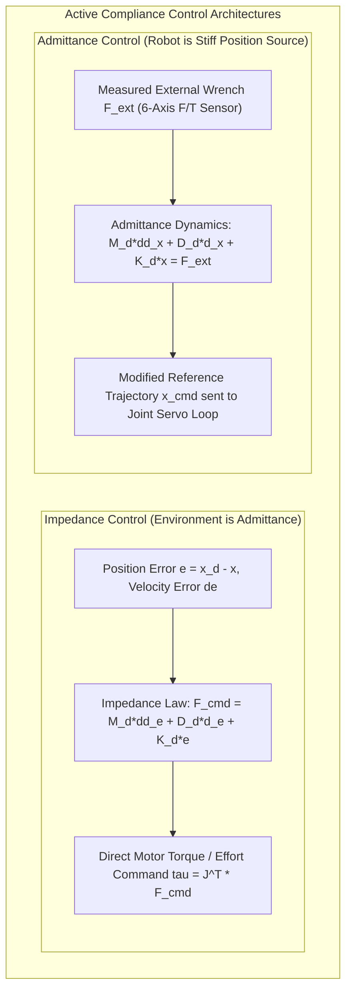
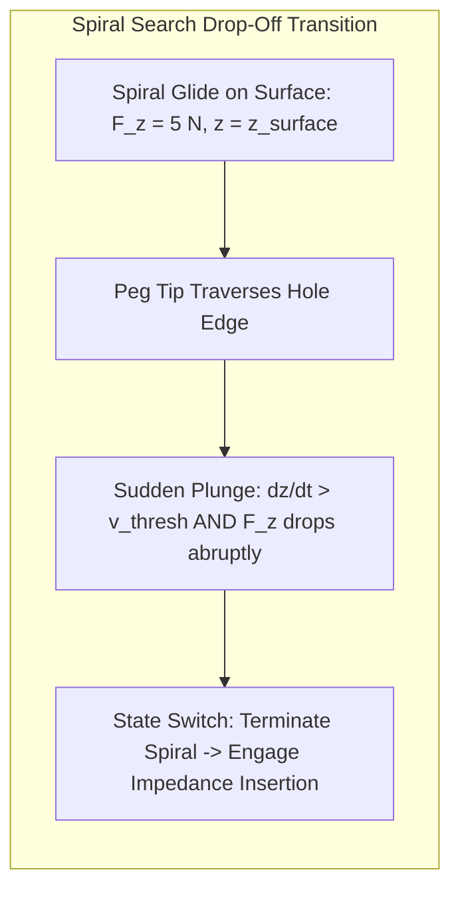
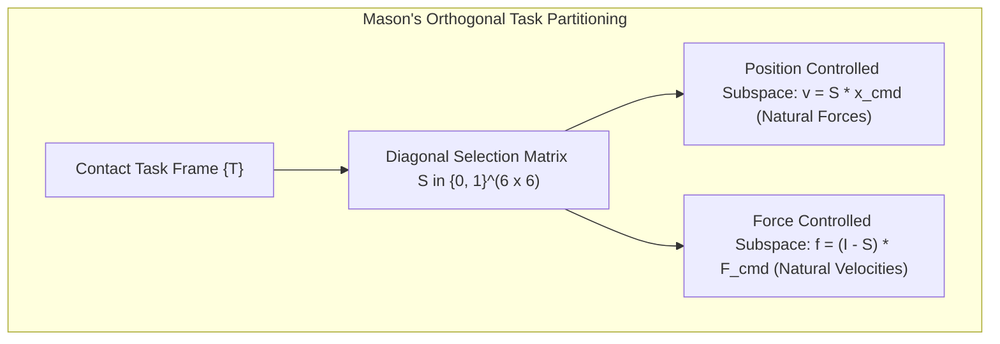

import ChapterProgress from '@site/src/components/ChapterProgress';
import QuizEngine from '@site/src/components/QuizEngine';

# Contact-Rich Assembly: Peg-in-Hole, Spiral Search & Compliance

In free-space motion, robotic position control reigns supreme: kinematic errors of a few tenths of a millimeter have zero consequence as long as the end-effector avoids collisions. However, the moment a robot engages in physical assembly—mating a high-precision metal peg into a cylindrical bore, snapping a battery into a latch, or threading a fastener—pure position control becomes catastrophic. Because metal and hard plastics exhibit near-infinite contact stiffness ($K \approx 10^7\text{ N/m}$), a position error of merely $50\ \mu\text{m}$ generates hundreds of Newtons of reactive force, triggering mechanical jamming, surface gouging, or motor drive overload faults.

Contact-rich manipulation demands that robots govern **dynamic relationships between force and motion** rather than position alone. This chapter covers the mechanics of industrial assembly, the physics of jamming versus wedging, passive Remote Center of Compliance (RCC) mechanics, Cartesian impedance and admittance control, Archimedean spiral contact search, and Mason's hybrid position/force formulation.



---

## 1. Contact Mechanics of Peg-in-Hole: Jamming vs. Wedging

The canonical peg-in-hole assembly problem models a rigid cylindrical peg of diameter $2r$ and clearance $c = R_{\text{hole}} - r$ inserting into a hole of radius $R_{\text{hole}}$ under friction coefficient $\mu$.

When the peg enters the bore with angular misalignment $\theta$ and lateral misalignment $\epsilon_0$, it establishes two-point line contact along opposing lips:



In his seminal treatise, Whitney (1982) proved that assembly failure falls into two fundamentally distinct physical failure modes:

### 1.1 Wedging (Geometric Force Lock)
Wedging is a **purely geometric lock condition**. It occurs when the elastic deformation of the peg and hole walls forces opposing contact reaction vectors to fall entirely within each other's friction cones. 

Once wedging occurs, the peg is mechanically locked: **pushing harder only increases the internal normal forces, potentially causing permanent plastic deformation**. The mathematical condition for wedging during two-point contact is:

$$
\theta_{\text{wedge}} \le \frac{c}{\mu d}
$$

where $d$ is the insertion depth, $c$ is the radial clearance, and $\mu$ is the Coulomb friction coefficient. Wedging occurs almost exclusively at extremely shallow insertion depths ($d \approx 0$).

### 1.2 Jamming (Force Imbalance Lock)
Jamming is a **static force balance condition**. Unlike wedging, jamming is not locked by internal elasticity; rather, the external applied insertion wrench $\mathbf{w}_{\text{ext}} = [F_x, F_z, M_y]^T$ has an incorrect ratio of moment to insertion force, causing the friction forces at contacts A and B to completely oppose the insertion direction.

Jamming occurs when the moment-to-force ratio exceeds a critical threshold governed by contact geometry:

$$
\frac{M_y}{F_z \cdot r} \ge \frac{\mu(1 + \mu)\frac{d}{2r} + \mu}{\mu - \frac{d}{2r}}
$$

Unlike wedging, **jamming can always be resolved without full retraction** by actively compliance-steering the contact wrench to reduce the tilting moment $M_y$ or applying lateral dithering.

---

## 2. Passive Compliance: The Remote Center of Compliance (RCC)

Before high-frequency digital force-torque sensors existed, mechanical engineers solved high-speed assembly using passive elastomeric kinematics.



The **Remote Center of Compliance (RCC)** device utilizes a spatial arrangement of elastic shear pads and angled links to project the mechanical center of compliance out into free space, directly at the tip of the peg:
- **Lateral Force Decoupling**: A pure lateral contact force $F_x$ applied at the compliance center produces **only lateral translation $\Delta x$**, with zero induced rotational tilt ($\Delta \theta_y = 0$).
- **Moment Decoupling**: A pure moment $M_y$ applied at the compliance center produces **only rotational tilt $\Delta \theta_y$**, with zero lateral translation.

By projecting the compliance center to the peg tip, contact forces generated as the peg slides along the hole chamfer guide the peg directly into the bore without tilting, passively preventing the angular misalignment that triggers jamming.

---

## 3. Active Contact Control: Impedance vs. Admittance

When interacting with stiff environments, robots replace rigid position control with active dynamic compliance.



### 3.1 Cartesian Impedance Control (Hogan 1985)
Impedance control models the robot as a programmable mechanical mass-spring-damper system. The controller takes position and velocity errors as inputs and outputs Cartesian forces:

$$
\mathbf{F}_{\text{cmd}} = \mathbf{M}_d (\ddot{\mathbf{x}}_d - \ddot{\mathbf{x}}) + \mathbf{D}_d (\dot{\mathbf{x}}_d - \dot{\mathbf{x}}) + \mathbf{K}_d (\mathbf{x}_d - \mathbf{x})
$$

The Cartesian command force is transformed into joint torques via the manipulator Jacobian transpose:

$$
\boldsymbol{\tau}_{\text{cmd}} = \mathbf{J}(\mathbf{q})^T \mathbf{F}_{\text{cmd}} + \mathbf{C}(\mathbf{q}, \dot{\mathbf{q}})\dot{\mathbf{q}} + \mathbf{g}(\mathbf{q})
$$

### 3.2 Cartesian Admittance Control
Because industrial manipulators often feature high-ratio gearboxes that lack torque backdrivability, direct effort control is infeasible. Admittance control inverts the mapping: a 6-axis Force/Torque sensor at the wrist measures external interaction wrench $\mathbf{F}_{\text{ext}}$, and an admittance filter computes instantaneous position modifications $\Delta \mathbf{x}$:

$$
\mathbf{M}_d \Delta \ddot{\mathbf{x}} + \mathbf{D}_d \Delta \dot{\mathbf{x}} + \mathbf{K}_d \Delta \mathbf{x} = \mathbf{F}_{\text{ext}}
$$

The modified position $\mathbf{x}_{\text{cmd}} = \mathbf{x}_d + \Delta \mathbf{x}$ is streamed to standard industrial position servos.

---

## 4. Archimedean Spiral Search & Hole Center Acquisition

When positional uncertainty exceeds the chamfer radius ($|\Delta p| > r_{\text{chamfer}}$), the robot cannot immediately enter the bore. It must perform a **blind surface search** to locate the hole without applying destructive forces.

The optimal planar search pattern is the **Archimedean Spiral**, which guarantees uniform search density across the uncertainty disc:

$$
r(\theta) = r_0 + \frac{p_{\text{pitch}}}{2\pi} \theta
$$

Parameterizing the trajectory in Cartesian coordinates with constant search velocity $v_{\text{scan}}$:

$$
\theta(t) = \sqrt{\frac{4\pi v_{\text{scan}} t}{p_{\text{pitch}}}}, \quad \begin{cases} x(t) = r(\theta(t)) \cos(\theta(t)) \\ y(t) = r(\theta(t)) \sin(\theta(t)) \end{cases}
$$



During the spiral search:
1. The admittance controller maintains a light normal bias force ($F_z = 3\text{--}5\text{ N}$) to keep continuous contact with the mating surface.
2. The controller continuously monitors the insertion depth $z(t)$ and vertical force $F_z(t)$.
3. When the peg crosses the lip of the hole, the peg tip drops into the bore ($\Delta z > 0.5\text{ mm}$), causing an instantaneous drop in $F_z$. This sensory event triggers the immediate termination of the spiral search and switches the controller into insertion mode.

---

## 5. Mason's Hybrid Position/Force Control

In complex assembly operations (e.g., sliding along a surface while maintaining contact force, or turning a threaded nut), motion degrees of freedom cannot be treated identically. **Mason's Hybrid Control** (Mason 1981, Raibert & Craig 1981) partitions task space into orthogonal position-controlled and force-controlled subspaces based on physical contact geometry.



Let $\mathbf{S} = \operatorname{diag}(s_1, \dots, s_6)$ be a diagonal selection matrix where $s_i \in \{0, 1\}$:
- $s_i = 1$: Direction $i$ is unconstrained by the environment (Artificial Position Command).
- $s_i = 0$: Direction $i$ is constrained by rigid contact (Artificial Force Command).

The commanded Cartesian wrench and velocity vectors are synthesized through orthogonal projection:

$$
\mathbf{v}_{\text{cmd}} = \mathbf{S} \left( \dot{\mathbf{x}}_d + \mathbf{K}_v (\mathbf{x}_d - \mathbf{x}) \right), \quad \mathbf{F}_{\text{cmd}} = (\mathbf{I} - \mathbf{S}) \left( \mathbf{F}_d + \mathbf{K}_f (\mathbf{F}_d - \mathbf{F}_{\text{ext}}) \right)
$$

---

## 6. Assembly Control Strategy Comparison

| Strategy | Hardware Requirements | Bandwidth | Tolerance Capability | Resistance to Jamming |
| :--- | :--- | :--- | :--- | :--- |
| **Passive RCC Wrist** | Purely mechanical passive spring | Infinite (Instantaneous passive) | $\pm 1\text{ mm}$ lateral, $\pm 2^\circ$ angular | High (Tip compliance eliminates moments) |
| **Cartesian Impedance** | Direct-drive or torque-sensing joints | 50–200 Hz | $\pm 0.5\text{ mm}$ | High (Programmable virtual stiffness) |
| **Cartesian Admittance**| Standard robot + 6-axis F/T sensor | 20–50 Hz (Inner position loop)| $\pm 0.2\text{ mm}$ | Moderate (Prone to lag-induced jamming) |
| **Hybrid Position/Force**| 6-axis F/T sensor + Fast bus | 50–100 Hz | High for planar slide/insertion | High along unconstrained axes |
| **Reinforcement Learning**| Camera + F/T or Joint Torques | 50 Hz policy | Superhuman for deformable parts | Learned through simulation randomization |

---

## 7. Production Python Implementation: Spiral Search & Admittance Insertion Controller

The listing below implements an assembly controller. It executes an Archimedean spiral search on a surface while maintaining constant normal force, detects the hole lip drop-off event, and transitions into compliant Cartesian admittance insertion with real-time jamming monitoring:

```python
"""
Production Python implementation: Spiral Search & Admittance Assembly Controller
Author: Dexterous Manipulation Specialist
Module: 7.7 Assembly and Contact-Rich Tasks
"""

import numpy as np
from enum import Enum
from typing import Dict, Tuple


class AssemblyState(Enum):
    SURFACE_APPROACH = 1
    SPIRAL_SEARCH = 2
    COMPLIANT_INSERTION = 3
    ASSEMBLY_COMPLETE = 4
    JAMMED_FAULT = 5


class PegInHoleAssemblyController:
    """
    Precision Peg-in-Hole Assembly Controller combining:
    - Archimedean spiral surface exploration
    - Contact force regulation (Admittance control)
    - Anti-jamming moment-to-force monitoring
    """

    def __init__(
        self,
        peg_radius: float = 0.010,     # 10 mm peg radius
        hole_depth: float = 0.040,     # 40 mm hole depth
        search_pitch: float = 0.002,   # 2 mm spiral radial expansion per rev
        normal_search_force: float = 5.0,  # Constant 5 N push force during search
        dt: float = 0.005              # 200 Hz control loop
    ):
        self.r_peg = peg_radius
        self.depth_target = hole_depth
        self.pitch = search_pitch
        self.f_search_target = normal_search_force
        self.dt = dt

        self.state = AssemblyState.SURFACE_APPROACH
        self.time_in_state = 0.0

        # Admittance control gains: M*ddx + D*dx + K*x = F_ext
        self.admittance_k_xy = 400.0   # Soft lateral stiffness [N/m]
        self.admittance_d_xy = 50.0    # Lateral damping [Ns/m]
        self.admittance_k_z = 800.0    # Insertion axis stiffness [N/m]
        self.admittance_d_z = 80.0     # Insertion damping [Ns/m]

        # Spiral search parameters
        self.spiral_theta = 0.0
        self.spiral_center = np.zeros(2)

        # Baseline surface z position
        self.surface_z = 0.0

    def update(
        self,
        current_pose: np.ndarray,      # [x, y, z] end-effector position (m)
        measured_wrench: np.ndarray    # [Fx, Fy, Fz, Mx, My, Mz] contact wrench (N, Nm)
    ) -> Tuple[np.ndarray, AssemblyState, Dict]:
        """
        Executes one control cycle at 200 Hz.
        
        Args:
            current_pose: Current 3D position of the peg tip.
            measured_wrench: 6-axis force/torque sensor feedback in tool frame.
            
        Returns:
            cmd_velocity: [vx, vy, vz] Cartesian velocity vector sent to robot servos.
            state: Current assembly state.
            telemetry: Diagnostic dictionary.
        """
        fx, fy, fz = measured_wrench[0], measured_wrench[1], measured_wrench[2]
        mx, my, mz = measured_wrench[3], measured_wrench[4], measured_wrench[5]

        cmd_vel = np.zeros(3)
        self.time_in_state += self.dt

        # -------------------------------------------------------------
        # STATE 1: SURFACE APPROACH (Move downward until contact)
        # -------------------------------------------------------------
        if self.state == AssemblyState.SURFACE_APPROACH:
            cmd_vel[2] = -0.01  # Descend at 10 mm/s
            if fz >= 2.0:       # Contact detected (2 N threshold)
                self.surface_z = current_pose[2]
                self.spiral_center = current_pose[:2].copy()
                self.state = AssemblyState.SPIRAL_SEARCH
                self.time_in_state = 0.0

        # -------------------------------------------------------------
        # STATE 2: ARCHIMEDEAN SPIRAL SEARCH (Locate hole center)
        # -------------------------------------------------------------
        elif self.state == AssemblyState.SPIRAL_SEARCH:
            # Maintain constant normal force: vz = -K_admit * (F_target - F_measured)
            force_error_z = self.f_search_target - fz
            cmd_vel[2] = 0.001 * force_error_z

            # Update spiral radius and angle
            omega = 1.5  # Angular search velocity [rad/s]
            self.spiral_theta += omega * self.dt
            r = (self.pitch / (2.0 * np.pi)) * self.spiral_theta

            target_x = self.spiral_center[0] + r * np.cos(self.spiral_theta)
            target_y = self.spiral_center[1] + r * np.sin(self.spiral_theta)

            # Proportional velocity feed toward spiral coordinate
            cmd_vel[0] = 3.0 * (target_x - current_pose[0])
            cmd_vel[1] = 3.0 * (target_y - current_pose[1])

            # Drop-off detection: peg tip plunges into hole lip
            vertical_drop = self.surface_z - current_pose[2]
            if vertical_drop > 0.0015:  # 1.5 mm drop detected
                self.state = AssemblyState.COMPLIANT_INSERTION
                self.time_in_state = 0.0

        # -------------------------------------------------------------
        # STATE 3: COMPLIANT ADMITTANCE INSERTION
        # -------------------------------------------------------------
        elif self.state == AssemblyState.COMPLIANT_INSERTION:
            # Constant downward insertion velocity
            cmd_vel[2] = -0.008  # 8 mm/s insertion speed

            # Lateral admittance compliance: relieve contact forces in x and y
            # dx/dt = - F_ext / D
            cmd_vel[0] = - (fx / self.admittance_d_xy)
            cmd_vel[1] = - (fy / self.admittance_d_xy)

            # Jamming detection: evaluate Whitney jamming metric (moment-to-force ratio)
            total_moment = np.hypot(mx, my)
            if fz > 10.0:
                jamming_ratio = total_moment / (fz * self.r_peg)
                if jamming_ratio > 1.8:
                    self.state = AssemblyState.JAMMED_FAULT

            # Check if target depth achieved
            current_insertion_depth = self.surface_z - current_pose[2]
            if current_insertion_depth >= self.depth_target:
                self.state = AssemblyState.ASSEMBLY_COMPLETE
                cmd_vel = np.zeros(3)

        # -------------------------------------------------------------
        # STATE 4 & 5: TERMINAL STATES
        # -------------------------------------------------------------
        elif self.state in (AssemblyState.ASSEMBLY_COMPLETE, AssemblyState.JAMMED_FAULT):
            cmd_vel = np.zeros(3)

        telemetry = {
            "insertion_depth_mm": (self.surface_z - current_pose[2]) * 1000.0,
            "normal_force_n": fz,
            "lateral_force_n": np.hypot(fx, fy),
            "tilting_moment_nm": np.hypot(mx, my)
        }

        return cmd_vel, self.state, telemetry


if __name__ == "__main__":
    controller = PegInHoleAssemblyController()

    # Simulate 5-step control sequence
    sim_pos = np.array([0.0, 0.0, 0.05])
    sim_wrench = np.array([0.0, 0.0, 0.0, 0.0, 0.0, 0.0])

    print("=== Peg-in-Hole Assembly Controller Simulation ===")
    for step in range(6):
        # Inject synthetic contact forces as robot descends
        if step == 2:
            sim_wrench[2] = 5.2  # Touchdown
        if step == 4:
            sim_pos[2] -= 0.002  # Peg tip drops into hole

        cmd_v, state, data = controller.update(sim_pos, sim_wrench)
        sim_pos += cmd_v * controller.dt

        print(f"Step {step:02d} | State: {state.name:<20} | Pos Z: {sim_pos[2]:.4f}m | F_z: {data['normal_force_n']:.1f}N")
```

---

## 8. Seminal Research Foundations

1. **Whitney, D. E. (1982).** *Quasi-static assembly of compliantly supported rigid parts*. ASME Journal of Dynamic Systems, Measurement, and Control, 104(1), 65–77.
   - *Annotation*: Derived the analytical mechanics of peg-in-hole assembly, defining the geometric boundary between jamming and wedging.
2. **Hogan, N. (1985).** *Impedance control: An approach to manipulation: Part I—Theory*. ASME Journal of Dynamic Systems, Measurement, and Control, 107(1), 1–7.
   - *Annotation*: Foundational formulation of mechanical impedance control, establishing that robots interacting with stiff physical environments must regulate dynamic impedance rather than position.
3. **Mason, M. T. (1981).** *Compliance and force control for computer controlled manipulators*. IEEE Transactions on Systems, Man, and Cybernetics, 11(6), 418–432.
   - *Annotation*: Formulated the theory of natural and artificial constraints, introducing the hybrid position/force control architecture.
4. **Raibert, M. H., & Craig, J. J. (1981).** *Hybrid position/force control of manipulators*. ASME Journal of Dynamic Systems, Measurement, and Control, 103(2), 126–133.
   - *Annotation*: Implemented the first real-time multi-axis hybrid controller utilizing spatial selection matrices to partition position and force loops.

---

## 9. Hands-on Lab Project: Tight-Tolerance Peg-in-Hole Assembly Controller

### Objective
Develop a closed-loop Cartesian admittance controller for a 7-DoF manipulator inserting a steel peg (diameter $20\text{ mm}$, clearance $25\ \mu\text{m}$) into a blind hole under positional uncertainty ($\pm 4\text{ mm}$ lateral offset, $\pm 1.5^\circ$ angular tilt).

### Key Deliverables
1. **Archimedean Search Module**: Execute a 200 Hz Archimedean spiral search with pitch $p = 1.5\text{ mm}$, maintaining $F_z = 4.0 \pm 0.5\text{ N}$.
2. **Hole Drop Detector**: Detect hole engagement when depth increases by $> 1.0\text{ mm}$ within a $20\text{ ms}$ window.
3. **Active Admittance Insertion Loop**: Implement Cartesian compliance:

$$
\Delta \dot{\mathbf{x}} = -\mathbf{K}_a \mathbf{F}_{\text{ext}}
$$

guaranteeing that insertion forces satisfy $F_z \le 25\text{ N}$ throughout the $40\text{ mm}$ insertion depth.

### Verification Criteria
- [ ] Jamming immunity: Zero wedging or jamming events across 30 randomized offset trials.
- [ ] Surface safety: Peak contact force never exceeds $30.0\text{ N}$ on the mating plate.
- [ ] Assembly success rate $\ge 95\%$ with average insertion time $\lt 8.0\text{ seconds}$.

---

<ChapterProgress chapterId="7-7-assembly-and-contact-rich-tasks" moduleId="module7" totalChapters={8} />

## Chapter Mastery Check

<QuizEngine
  quizId="quiz-7-7"
  title="Module 7.7 Mastery Check: Contact-Rich Assembly & Impedance Control"
  moduleId="module7"
  passThreshold={70}
  questions={[
    {
      id: "q1",
      question: "In Whitney's contact mechanics formulation, what is the critical physical difference between Wedging and Jamming during peg-in-hole assembly?",
      options: [
        "Wedging is a geometric lock where elastic deformation traps contact vectors inside friction cones (pushing harder will not free it), whereas jamming is a force imbalance that can be resolved by altering the push wrench or adding compliance",
        "Wedging only happens with square pegs, while jamming only happens with round pegs",
        "Wedging occurs only at the very bottom of the hole, while jamming occurs in free air",
        "Jamming breaks the robot's motors, while wedging produces zero force"
      ],
      correctIndex: 0,
      explanation: "Wedging is a geometric lock where opposing reaction forces become mutually self-sustaining inside friction cones; pushing harder simply stresses the material. Jamming is a solvable force-balance condition caused by an excessive moment-to-force ratio."
    },
    {
      id: "q2",
      question: "What mechanical advantage does a Remote Center of Compliance (RCC) wrist mechanism provide during precision insertion tasks?",
      options: [
        "It projects the compliance center directly to the tip of the peg, decoupling lateral contact forces from induced tilting moments",
        "It increases the maximum payload of the robot arm tenfold",
        "It measures electrical currents in the motor",
        "It uses suction cups to hold the peg"
      ],
      correctIndex: 0,
      explanation: "By placing the virtual center of compliance at the tip of the peg, a lateral force at the tip causes pure lateral translation without introducing a tilting moment, passively guiding the peg into the hole without jamming."
    },
    {
      id: "q3",
      question: "Why is pure position control strictly dangerous when manipulating rigid objects in stiff contact environments?",
      options: [
        "Because position controllers cannot execute circular paths",
        "Because rigid materials have near-infinite stiffness (K ~ 10^7 N/m), meaning even a microscopic positioning error (e.g. 50 microns) generates hundreds of Newtons of reactive force, damaging hardware",
        "Because position control disables the robot's joint encoders",
        "Because position control requires Internet connectivity"
      ],
      correctIndex: 1,
      explanation: "In stiff environments, force equals stiffness times position displacement (F = K * dx). When K is very large, tiny position errors generate enormous forces that will trip safety stops, strip gears, or damage workpieces."
    },
    {
      id: "q4",
      question: "In Mason's Hybrid Position/Force Control, how are task constraints partitioned using the diagonal selection matrix S?",
      options: [
        "By setting S = 0 for all joints simultaneously",
        "By assigning position control to unconstrained environmental directions (S_ii = 1) and force control to rigidly constrained contact directions (S_ii = 0)",
        "By randomly toggling joints between position and force mode at 1 kHz",
        "By multiplying motor voltages by joint angles"
      ],
      correctIndex: 1,
      explanation: "Mason's natural and artificial constraint theory proves that along any given task direction, a robot can command position OR force, but not both. The selection matrix S assigns position control along natural force directions and force control along natural velocity directions."
    }
  ]}
/>
