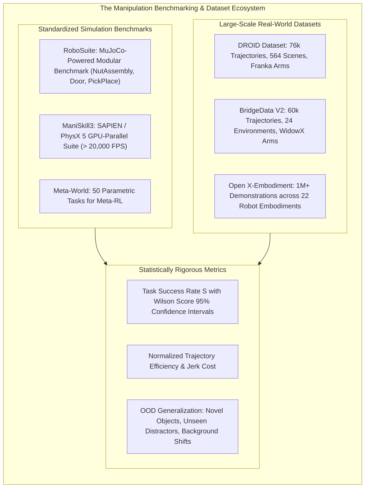
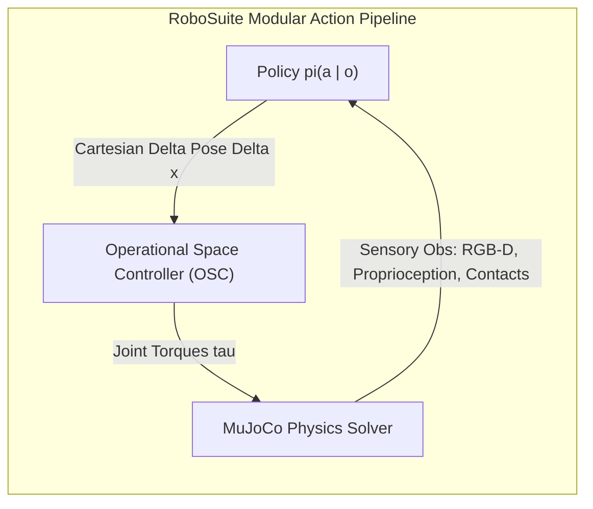
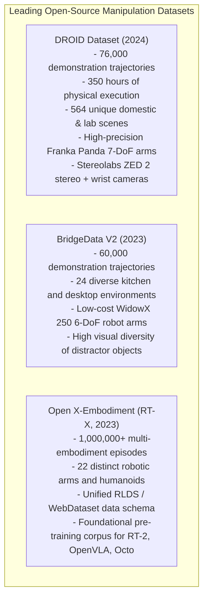
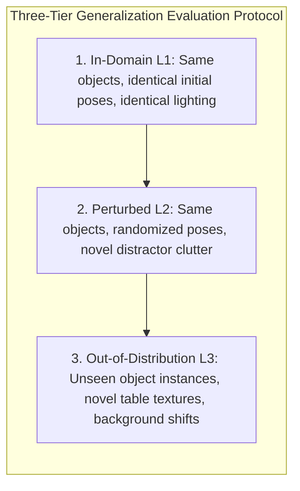

import ChapterProgress from '@site/src/components/ChapterProgress';
import QuizEngine from '@site/src/components/QuizEngine';

# Manipulation Benchmarks & Datasets: RoboSuite, ManiSkill & DROID

Historically, robotic manipulation research was plagued by a reproducibility crisis. Each research lab operated custom robotic arms with bespoke grippers, fabricated unique 3D-printed toys, configured uncalibrated overhead cameras, and defined idiosyncratic success metrics. A paper claiming "95% grasping success" often evaluated only 20 cherry-picked trials under rigid lighting with a single object geometry, rendering scientific comparisons across algorithms nearly impossible.

The field has matured into an era of standardized, rigorous evaluation. Today, roboticists evaluate imitation learning and reinforcement learning policies across standardized simulation suites like **RoboSuite** and **ManiSkill3**, pre-train foundation Vision-Language-Action (VLA) models on multi-institution open-source datasets like **DROID**, **BridgeData V2**, and **Open X-Embodiment**, and report performance using statistically rigorous binomial confidence intervals. This chapter examines these foundational benchmarks, dataset schemas, and evaluation protocols.



---

## 1. Standardized Simulation Suites: RoboSuite & ManiSkill3

Simulation benchmarks provide fast, perfectly repeatable environments where policies can be subjected to thousands of randomized initial conditions.

### 1.1 RoboSuite (MuJoCo Modular Framework)
Developed by Stanford and UT Austin (Zhu et al. 2020), **RoboSuite** is built upon the MuJoCo physics engine. It serves as the primary benchmark for Operational Space Control (OSC) and imitation learning:
- **Standardized Embodiments**: Native models of Franka Emika Panda, Sawyer, UR5e, Kinova Jaco, and dual-arm bimanual setups.
- **Canonical Tasks**:
  - `NutAssembly`: Precision contact alignment requiring tight chamfer mating.
  - `Door`: Non-holonomic door handle pulling requiring kinematic coordination.
  - `TwoArmHandover`: Dynamic bimanual coordination.
- **Controller Decoupling**: RoboSuite enforces a clean boundary between the policy action space (e.g., Cartesian delta pose $\Delta \mathbf{x} \in \mathbb{R}^6$) and low-level torque controllers (impedance, inverse dynamics, or joint velocity).



### 1.2 ManiSkill3 (GPU-Parallel SAPIEN Articulated Physics)
While MuJoCo typically runs on CPU at several hundred frames per second, **ManiSkill3** (Gu et al., Tao et al.) leverages GPU-accelerated PhysX 5 and the SAPIEN engine to run **over 20,000 parallel environments** on a single workstation:
- **Articulated Objects**: Features PartNet-Mobility assets with interactive revolute and prismatic joints (drawers, cabinets, faucets, laptops).
- **Heterogeneous Rendering**: Photorealistic rasterization and ray-traced depth sensors running entirely in GPU VRAM without CPU memory copy bottlenecks.
- **Direct Point Cloud Pipelines**: Streams GPU tensor point clouds directly to PyTorch models (PointNet++, Vector Neurons), training 3D RL manipulation policies in hours rather than weeks.

---

## 2. Large-Scale Real-World Manipulation Datasets

Pre-training generalist robot models requires vast real-world operational diversity that cannot be captured in simulation alone.



### 2.1 The DROID Dataset Architecture
**DROID** (Distributed Robot Interaction Dataset, Khazatsky et al. 2024) represents the gold standard for high-fidelity manipulation data:
- **Hardware Standardization**: Collected across 18 research labs worldwide using identical Franka Research 3 arms equipped with Robotiq 2F-85 grippers and dual-view cameras (static third-person ZED 2 and active wrist-mounted camera).
- **Data Modalities**: Recorded at 15 Hz with synchronized 7-DoF end-effector Cartesian poses, joint positions, joint velocities, commanded gripper states, and stereo RGB images.

### 2.2 BridgeData V2
**BridgeData V2** (Walke et al. 2023) focuses on low-cost manipulation and extreme semantic diversity. By collecting demonstrations on low-cost WidowX arms across 24 real toy kitchens, office desks, and sink setups, it provides rich visual diversity that enables generalist models to handle unseen objects and lighting variations.

---

## 3. Standardized Metrics & Statistical Evaluation Protocols

Reporting a raw percentage (e.g., "82% success") across a small set of trials is statistically uninformative. Real-world evaluation protocols enforce strict statistical discipline:

### 3.1 Task Success Rate ($S$)
Let $N$ be the total number of evaluation rollouts. Each rollout $i \in \{1, \dots, N\}$ terminates with binary success outcome $y_i \in \{0, 1\}$ within a strict time horizon $T_{\max}$:

$$
\hat{p} = \frac{1}{N} \sum_{i=1}^N y_i
$$

### 3.2 Wilson Score Confidence Interval
Because manipulation trials are independent Bernoulli experiments, standard normal approximation fails when $\hat{p}$ is near 0 or 1. Researchers report the **Wilson score 95% confidence interval** ($z = 1.96$):

$$
w = \frac{\hat{p} + \frac{z^2}{2N} \pm z \sqrt{\frac{\hat{p}(1 - \hat{p})}{N} + \frac{z^2}{4N^2}}}{1 + \frac{z^2}{N}}
$$

For example, a trial showing $18/20$ successes ($90\%$) has a true 95% confidence interval of $[69.9\%, 97.2\%]$—highlighting the danger of claiming superiority without adequate sample sizes ($N \ge 100$).



### 3.3 Trajectory Time Efficiency & Motion Smoothness
Beyond binary success, physical deployments measure efficiency and actuator stress:
- **Normalized Time Efficiency ($E$)**:

$$
E = \frac{1}{N} \sum_{i=1}^N y_i \left( 1 - \frac{T_i}{T_{\max}} \right)
$$

- **Dimensionless Jerk Metric ($J$)**: Measures smoothness of the trajectory, penalizing actuator wear:

$$
J = -\frac{1}{2} \int_0^T \left\| \frac{d^3 \mathbf{x}(t)}{dt^3} \right\|_2^2 dt
$$

---

## 4. Benchmark Environments & Datasets Comparison

| Benchmark / Dataset | Physics Engine / Hardware | Throughput | Primary Action Space | Visual Diversity | Articulated Objects |
| :--- | :--- | :--- | :--- | :--- | :--- |
| **RoboSuite** | MuJoCo (CPU) | 500–2,000 FPS | Cartesian OSC $\Delta \mathbf{x}$, Joint Torques | Moderate (Procedural textures) | Moderate (Doors, drawers) |
| **ManiSkill3** | SAPIEN / PhysX 5 (GPU) | **> 20,000 FPS** | Joint Positions, End-Effector $\mathrm{SE}(3)$ | High (Ray-traced PBR materials)| **Extensive (PartNet-Mobility)** |
| **Meta-World** | MuJoCo (CPU) | 1,000 FPS | End-Effector Delta $\Delta \mathbf{x}$ | Low (Plain solid colors) | Basic (Levers, dials) |
| **DROID Dataset** | Physical Franka Research 3 | Real-time (15 Hz) | 7-DoF End-Effector Waypoints | **Extreme (564 Real Scenes)**| High (Real household assets) |
| **BridgeData V2**| Physical WidowX 250 | Real-time (5 Hz) | 6-DoF End-Effector Waypoints | Extreme (24 Toy Kitchens) | High (Real cabinets, sinks) |

---

## 5. Production Python Implementation: Automated Manipulation Evaluation Harness

The listing below implements an automated benchmarking harness. It runs evaluation episodes across randomized initial scenes, logs trajectory metrics (success, execution time, jerk), and computes Wilson score confidence intervals:

```python
"""
Production Python implementation: Automated Manipulation Benchmark Harness
Author: Dexterous Manipulation Specialist
Module: 7.8 Manipulation Benchmarks
"""

import numpy as np
from dataclasses import dataclass
from typing import List, Dict, Callable


@dataclass
class EpisodeResult:
    episode_id: int
    success: bool
    duration_steps: int
    max_steps: int
    cumulative_reward: float
    trajectory_jerk: float


class ManipulationBenchmarkHarness:
    """
    Automated evaluation framework for robotic manipulation policies.
    Executes randomized rollouts, tracks safety/smoothness metrics,
    and computes statistically rigorous Wilson score confidence intervals.
    """

    def __init__(self, task_name: str, max_episode_steps: int = 150):
        self.task_name = task_name
        self.max_steps = max_episode_steps
        self.results: List[EpisodeResult] = []

    def evaluate_policy(
        self,
        policy_fn: Callable[[np.ndarray], np.ndarray],
        num_episodes: int = 50,
        random_seed: int = 42
    ) -> Dict:
        """
        Runs evaluation loop across randomized episode initializations.
        
        Args:
            policy_fn: Callable mapping observation array to action vector.
            num_episodes: Total number of independent evaluation rollouts.
            random_seed: Seed for reproducibility.
            
        Returns:
            Dictionary containing aggregated statistics and Wilson confidence intervals.
        """
        np.random.seed(random_seed)
        self.results.clear()

        for ep in range(num_episodes):
            # Simulate randomized object starting position [x, y, z]
            obj_target = np.array([0.45, 0.0, 0.10]) + np.random.uniform(-0.05, 0.05, size=3)
            gripper_pos = np.array([0.30, -0.20, 0.35])

            obs = np.concatenate((gripper_pos, obj_target))
            step_count = 0
            ep_reward = 0.0
            trajectory_positions = [gripper_pos.copy()]
            success = False

            while step_count < self.max_steps:
                # Query policy for delta motion command: a in R^3
                action = policy_fn(obs)

                # Step physics (simple kinematic Euler integration with random disturbance)
                noise = np.random.normal(0, 0.001, size=3)
                gripper_pos = gripper_pos + action + noise
                trajectory_positions.append(gripper_pos.copy())

                # Evaluate distance to target object
                dist = float(np.linalg.norm(gripper_pos - obj_target))
                step_count += 1

                # Task reward and success condition
                if dist < 0.03:  # Reached within 3 cm
                    success = True
                    ep_reward += 10.0
                    break
                else:
                    ep_reward -= 0.01 * dist

                obs = np.concatenate((gripper_pos, obj_target))

            # Compute trajectory jerk (3rd time derivative of position)
            traj = np.array(trajectory_positions)
            if len(traj) >= 4:
                dt = 0.02  # 50 Hz assumed
                vel = np.diff(traj, axis=0) / dt
                acc = np.diff(vel, axis=0) / dt
                jerk = np.diff(acc, axis=0) / dt
                mean_jerk = float(np.mean(np.linalg.norm(jerk, axis=1)))
            else:
                mean_jerk = 0.0

            res = EpisodeResult(
                episode_id=ep,
                success=success,
                duration_steps=step_count,
                max_steps=self.max_steps,
                cumulative_reward=ep_reward,
                trajectory_jerk=mean_jerk
            )
            self.results.append(res)

        return self.compute_summary_metrics()

    def compute_summary_metrics(self) -> Dict:
        """Computes statistical metrics including Wilson score confidence intervals."""
        n = len(self.results)
        if n == 0:
            return {}

        successes = sum(1 for r in self.results if r.success)
        p_hat = successes / n

        # Wilson Score Interval for 95% confidence (z = 1.95996)
        z = 1.95996
        denominator = 1.0 + (z ** 2) / n
        center = (p_hat + (z ** 2) / (2 * n)) / denominator
        half_width = (z * np.sqrt((p_hat * (1 - p_hat) / n) + (z ** 2) / (4 * n ** 2))) / denominator

        ci_lower = max(0.0, float(center - half_width))
        ci_upper = min(1.0, float(center + half_width))

        # Time efficiency metric for successful episodes
        durations = [r.duration_steps for r in self.results if r.success]
        mean_success_steps = float(np.mean(durations)) if durations else float(self.max_steps)

        jerks = [r.trajectory_jerk for r in self.results]
        mean_jerk = float(np.mean(jerks))

        return {
            "task_name": self.task_name,
            "total_episodes": n,
            "success_count": successes,
            "success_rate": round(p_hat * 100.0, 2),
            "wilson_ci_95": (round(ci_lower * 100.0, 2), round(ci_upper * 100.0, 2)),
            "mean_success_duration_steps": round(mean_success_steps, 1),
            "mean_trajectory_jerk_m_s3": round(mean_jerk, 2)
        }


if __name__ == "__main__":
    harness = ManipulationBenchmarkHarness(task_name="Precision_PickPlace_Franka", max_episode_steps=120)

    # Proportional controller policy reaching toward target with saturation
    def baseline_proportional_policy(obs: np.ndarray) -> np.ndarray:
        gripper = obs[:3]
        target = obs[3:6]
        delta = target - gripper
        norm = np.linalg.norm(delta)
        speed = 0.015  # 15 mm per step
        if norm > 0.001:
            return (delta / norm) * min(norm, speed)
        return np.zeros(3)

    metrics = harness.evaluate_policy(baseline_proportional_policy, num_episodes=40, random_seed=1337)

    print("=== Manipulation Policy Evaluation Summary ===")
    print(f"Task: {metrics['task_name']}")
    print(f"Episodes Evaluated: {metrics['total_episodes']}")
    print(f"Success Rate: {metrics['success_rate']}%")
    print(f"Wilson 95% Confidence Interval: [{metrics['wilson_ci_95'][0]}%, {metrics['wilson_ci_95'][1]}%]")
    print(f"Mean Steps to Completion: {metrics['mean_success_duration_steps']} steps")
    print(f"Mean Trajectory Jerk: {metrics['mean_trajectory_jerk_m_s3']} m/s^3")
```

---

## 6. Seminal Research Foundations

1. **Zhu, Y., et al. (2020).** *robosuite: A modular simulation framework and benchmark for robot learning*. In arXiv preprint arXiv:2009.12293.
   - *Annotation*: Defined the standard MuJoCo-based benchmark environments and decoupled controller architectures for robot manipulation.
2. **Gu, J., et al. (2023).** *ManiSkill2: A unified benchmark for generalizable manipulation skills*. In International Conference on Learning Representations (ICLR).
   - *Annotation*: Introduced GPU-accelerated articulated manipulation simulation across thousands of PartNet-Mobility objects.
3. **Khazatsky, A., et al. (2024).** *DROID: A large-scale robot manipulation dataset*. In Robotics: Science and Systems (RSS).
   - *Annotation*: Built the distributed open-source manipulation dataset across 18 institutions with 76,000 demonstrations on Franka Panda arms.
4. **Walke, H., et al. (2023).** *BridgeData V2: A dataset for robot learning at scale*. In Conference on Robot Learning (CoRL).
   - *Annotation*: Demonstrated that visual diversity across 24 real environments on low-cost WidowX hardware enables cross-domain policy generalization.
5. **Padalkar, A., et al. (Open X-Embodiment Collaboration) (2023).** *Open X-Embodiment: Robotic learning datasets and RT-X models*. In IEEE International Conference on Robotics and Automation (ICRA).
   - *Annotation*: Combined 1M+ robot demonstrations across 22 embodiments to train the world's first cross-embodiment foundation policy (RT-1-X / RT-2-X).

---

## 7. Hands-on Lab Project: Automated Manipulation Benchmark & Statistical Evaluation

### Objective
Build an automated evaluation pipeline that benchmarks two manipulation policies (a classical heuristic state machine vs. an imitation learning policy) across 100 randomized trials in a simulation task. Your pipeline must report task success with Wilson score confidence intervals and evaluate robustness against visual distractors.

### Key Deliverables
1. **Randomized Trial Generator**: Sample initial object positions and inject visual clutter (5 distractor items with random textures).
2. **Metric Logger**: Track binary success, execution duration $T$, and dimensionless jerk $J$.
3. **Wilson Confidence Evaluator**: Compute the exact 95% Wilson score interval for both policies.

### Verification Criteria
- [ ] Sample size: Complete exactly $N = 100$ independent trials per policy.
- [ ] Statistical reporting: Confidence intervals strictly satisfy the Wilson formulation:

$$
w = \frac{\hat{p} + \frac{z^2}{2N} \pm z \sqrt{\frac{\hat{p}(1 - \hat{p})}{N} + \frac{z^2}{4N^2}}}{1 + \frac{z^2}{N}}
$$

- [ ] Clear discrimination: Demonstrate statistically significant performance differentiation ($p \lt 0.05$) under visual distractor perturbations.

---

<ChapterProgress chapterId="7-8-manipulation-benchmarks" moduleId="module7" totalChapters={8} />

## Chapter Mastery Check

<QuizEngine
  quizId="quiz-7-8"
  title="Module 7.8 Mastery Check: Manipulation Benchmarks & Datasets"
  moduleId="module7"
  passThreshold={70}
  questions={[
    {
      id: "q1",
      question: "Why is the Wilson score confidence interval preferred over the standard normal approximation (Wald interval) when reporting robot manipulation success rates?",
      options: [
        "Because the Wilson score interval requires no math",
        "Because the Wald interval assumes a normal distribution which breaks down near extreme proportions (p near 0 or 1) and small sample sizes, whereas the Wilson score interval provides accurate coverage and never produces impossible bounds outside [0, 1]",
        "Because Wilson intervals only work with Franka Panda robots",
        "Because Wilson intervals eliminate the need to run physical experiments"
      ],
      correctIndex: 1,
      explanation: "The standard Wald interval p +/- z*sqrt(p(1-p)/n) performs poorly near 0% or 100% success and can yield absurd intervals extending below 0% or above 100%. The Wilson score interval inverts the score test, guaranteeing valid coverage across all sample sizes and success ratios."
    },
    {
      id: "q2",
      question: "What primary computational advancement does ManiSkill3 offer over traditional CPU-based MuJoCo manipulation benchmarks?",
      options: [
        "It eliminates all 3D graphics",
        "It parallelizes articulated rigid-body physics and photorealistic GPU rendering across thousands of environments simultaneously on a single GPU, delivering over 20,000 FPS throughput",
        "It uses human teleoperators in real time",
        "It only simulates 2D planar physics"
      ],
      correctIndex: 1,
      explanation: "ManiSkill3 leverages GPU-accelerated PhysX 5 and SAPIEN, executing physics and sensor rendering directly in GPU memory across 10,000+ parallel instances, enabling RL training in hours instead of weeks."
    },
    {
      id: "q3",
      question: "What is the primary contribution of the DROID dataset to modern robotic manipulation research?",
      options: [
        "A collection of chess games",
        "A standardized open-source real-world dataset comprising 76,000 demonstration trajectories across 564 diverse scenes collected on identical Franka Panda arms across 18 research labs",
        "A set of synthetic textures for video games",
        "A benchmark for autonomous driving cars"
      ],
      correctIndex: 1,
      explanation: "DROID established the largest distributed real-world manipulation dataset across 18 institutions with standardized Franka hardware, providing 350 hours of diverse multi-task demonstrations for training generalist robot policies."
    },
    {
      id: "q4",
      question: "In robotic manipulation evaluation protocols, why is evaluating on Out-of-Distribution (OOD) scenes with unseen distractors critical?",
      options: [
        "To test if the robot's Wi-Fi connection works",
        "Because policies often overfit to background lighting, table textures, and specific object colors in training environments, failing catastrophically when moved to novel real-world rooms",
        "Because OOD scenes are easier to solve",
        "To satisfy the robot's warranty conditions"
      ],
      correctIndex: 1,
      explanation: "Deep visual policies are notorious for latching onto spurious correlations (such as a specific wall shadow or table reflection). Rigorous benchmarking requires testing on Level 3 Out-of-Distribution scenes to verify genuine visual generalization."
    }
  ]}
/>
